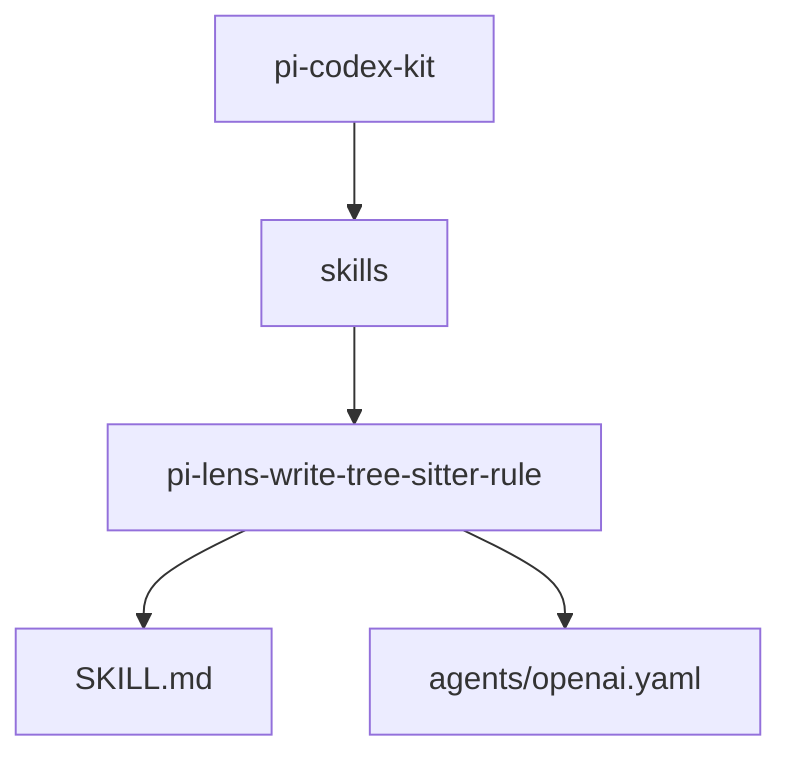
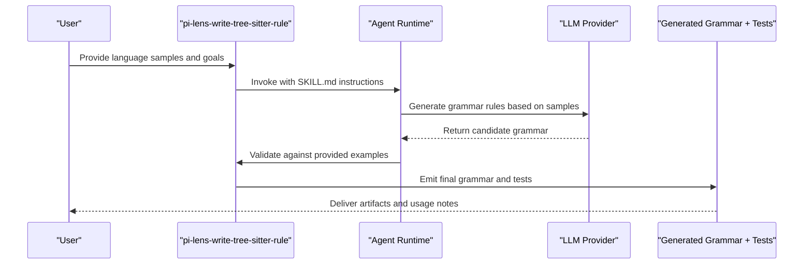
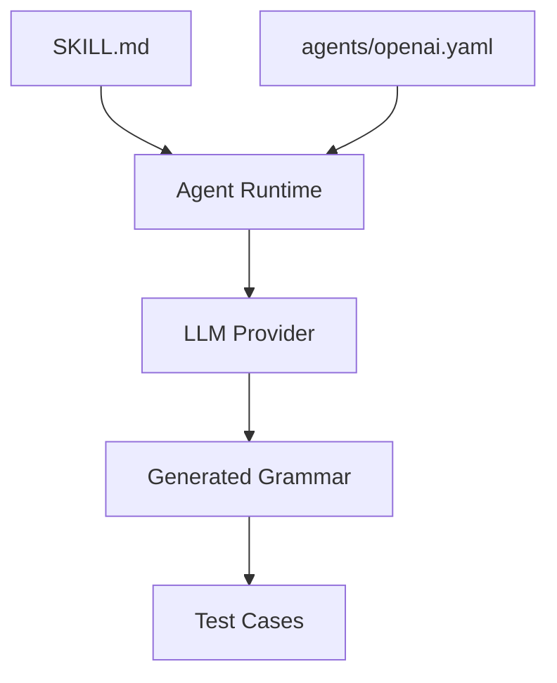

# Tree-sitter Rule Generation

<cite>
**Referenced Files in This Document**
- [SKILL.md](file://skills/pi-lens-write-tree-sitter-rule/SKILL.md)
- [openai.yaml](file://skills/pi-lens-write-tree-sitter-rule/agents/openai.yaml)
</cite>

## Table of Contents
1. [Introduction](#introduction)
2. [Project Structure](#project-structure)
3. [Core Components](#core-components)
4. [Architecture Overview](#architecture-overview)
5. [Detailed Component Analysis](#detailed-component-analysis)
6. [Dependency Analysis](#dependency-analysis)
7. [Performance Considerations](#performance-considerations)
8. [Troubleshooting Guide](#troubleshooting-guide)
9. [Conclusion](#conclusion)
10. [Appendices](#appendices)

## Introduction
This document explains the pi-lens-write-tree-sitter-rule skill, which generates tree-sitter parser rules for custom languages or extensions to existing grammars. It covers tree-sitter concepts, grammar syntax, rule structure, and practical workflows for creating and testing parsers. It also includes guidance on advanced topics such as context-aware parsing, error recovery, and performance optimization for large codebases.

## Project Structure
The skill is implemented under skills/pi-lens-write-tree-sitter-rule with two primary files:
- SKILL.md: The skill definition and instructions used by the agent runtime
- agents/openai.yaml: Agent configuration for model invocation and behavior

**Diagram sources**
- [SKILL.md](file://skills/pi-lens-write-tree-sitter-rule/SKILL.md)
- [openai.yaml](file://skills/pi-lens-write-tree-sitter-rule/agents/openai.yaml)

**Section sources**
- [SKILL.md](file://skills/pi-lens-write-tree-sitter-rule/SKILL.md)
- [openai.yaml](file://skills/pi-lens-write-tree-sitter-rule/agents/openai.yaml)

## Core Components
- Skill Definition (SKILL.md): Describes how the agent should generate tree-sitter rules, including inputs, outputs, and workflow steps.
- Agent Configuration (agents/openai.yaml): Specifies model parameters and constraints that influence rule generation quality and behavior.

Key responsibilities:
- Accept language samples and desired parse targets
- Produce a complete grammar fragment or full grammar file
- Provide test cases and validation strategies
- Offer debugging guidance for common parsing issues

**Section sources**
- [SKILL.md](file://skills/pi-lens-write-tree-sitter-rule/SKILL.md)
- [openai.yaml](file://skills/pi-lens-write-tree-sitter-rule/agents/openai.yaml)

## Architecture Overview
At a high level, the skill orchestrates an LLM-based agent to transform user-provided language samples into a tree-sitter grammar. The agent uses the skill instructions and model configuration to produce deterministic, testable outputs.

[No sources needed since this diagram shows conceptual workflow, not actual code structure]

## Detailed Component Analysis

### Skill Definition (SKILL.md)
Purpose:
- Defines the end-to-end process for generating tree-sitter rules
- Specifies input requirements (language samples, target constructs)
- Outlines output format (grammar fragment or full grammar)
- Includes guidance for testing and iteration

Operational flow:
- Collect representative code samples
- Identify key syntactic constructs and patterns
- Generate corresponding tree-sitter rules
- Provide minimal test cases to validate correctness
- Suggest iterative refinements based on failures

Best practices:
- Use diverse samples covering edge cases
- Keep generated rules focused and modular
- Include comments explaining non-obvious rules
- Maintain consistency with existing grammar style when extending

**Section sources**
- [SKILL.md](file://skills/pi-lens-write-tree-sitter-rule/SKILL.md)

### Agent Configuration (agents/openai.yaml)
Purpose:
- Configures model behavior for rule generation
- Controls temperature, max tokens, and other parameters
- Ensures consistent output formatting and determinism

Configuration considerations:
- Lower temperature for more stable rule generation
- Adequate token limits to accommodate complex grammars
- Structured prompts embedded via SKILL.md to guide output

**Section sources**
- [openai.yaml](file://skills/pi-lens-write-tree-sitter-rule/agents/openai.yaml)

### Conceptual Overview: Tree-sitter Concepts and Grammar Syntax
Tree-sitter represents source code as a concrete syntax tree (CST). A grammar defines how tokens and non-terminals combine to form valid programs. Key concepts include:
- Tokens: Lexical units recognized by the lexer
- Non-terminals: Syntactic categories defined by production rules
- Precedence and associativity: Resolve ambiguities in expressions
- External scanners: Integrate custom lexers for complex tokenization
- Error recovery: Allow partial parses to continue after errors

Grammar structure:
- Top-level declarations for precedence and external functions
- Production rules mapping non-terminals to sequences of tokens/non-terminals
- Auxiliary rules for repetition, choice, and optional elements
- Comments and metadata for maintainability

Testing strategy:
- Provide positive examples that must parse successfully
- Provide negative examples that must fail or recover gracefully
- Use incremental refinement to improve coverage

Debugging approach:
- Isolate failing constructs with minimal reproductions
- Inspect parse trees to verify expected structure
- Adjust precedence and associativity to resolve conflicts
- Refine external scanner logic if token boundaries are incorrect

Advanced topics:
- Context-aware parsing: Use auxiliary methods and dynamic precedence to disambiguate based on surrounding context
- Error recovery: Configure error nodes and skip strategies to keep parsing robust
- Performance optimization: Minimize backtracking, prefer left-factoring, and avoid ambiguous rules

[No sources needed since this section doesn't analyze specific files]

## Dependency Analysis
The skill depends on:
- SKILL.md for procedural instructions
- agents/openai.yaml for model configuration
- External tree-sitter tooling for compilation and testing (outside this repository)

**Diagram sources**
- [SKILL.md](file://skills/pi-lens-write-tree-sitter-rule/SKILL.md)
- [openai.yaml](file://skills/pi-lens-write-tree-sitter-rule/agents/openai.yaml)

**Section sources**
- [SKILL.md](file://skills/pi-lens-write-tree-sitter-rule/SKILL.md)
- [openai.yaml](file://skills/pi-lens-write-tree-sitter-rule/agents/openai.yaml)

## Performance Considerations
- Prefer unambiguous rules to reduce backtracking
- Left-factor common prefixes to minimize lookahead
- Use external scanners only when necessary; they can impact speed
- Organize grammar modules to enable incremental builds
- Cache parsed results for repeated analysis tasks
- Profile large codebases to identify hotspots and refine rules accordingly

[No sources needed since this section provides general guidance]

## Troubleshooting Guide
Common issues and remedies:
- Parse conflicts: Adjust precedence and associativity; split ambiguous productions
- Incorrect token boundaries: Review external scanner logic and character classes
- Missing constructs: Add targeted rules and expand sample coverage
- Slow parsing: Simplify rules, remove unnecessary alternations, and avoid deep nesting
- Error recovery problems: Tune error node placement and skip strategies

Validation checklist:
- All positive examples parse without errors
- Negative examples either fail predictably or recover as intended
- Generated AST matches expected structure for critical constructs
- Performance meets thresholds for target codebase size

**Section sources**
- [SKILL.md](file://skills/pi-lens-write-tree-sitter-rule/SKILL.md)

## Conclusion
The pi-lens-write-tree-sitter-rule skill streamlines the creation of tree-sitter grammars by leveraging structured prompts and model configuration. By following the outlined workflows, testing strategies, and best practices, you can build accurate, maintainable parsers for new languages or extend existing ones effectively.

[No sources needed since this section summarizes without analyzing specific files]

## Appendices

### Quick Start Checklist
- Gather representative code samples
- Define target constructs and expected AST shape
- Run the skill to generate initial grammar
- Validate with positive and negative examples
- Iterate on rules and tests until stable
- Optimize for performance and readability

[No sources needed since this section doesn't analyze specific files]