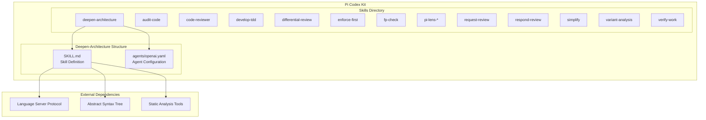
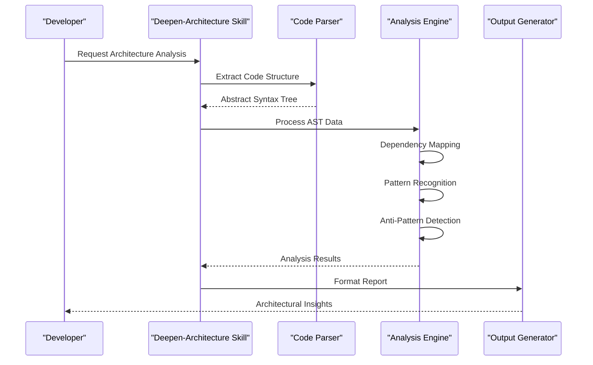
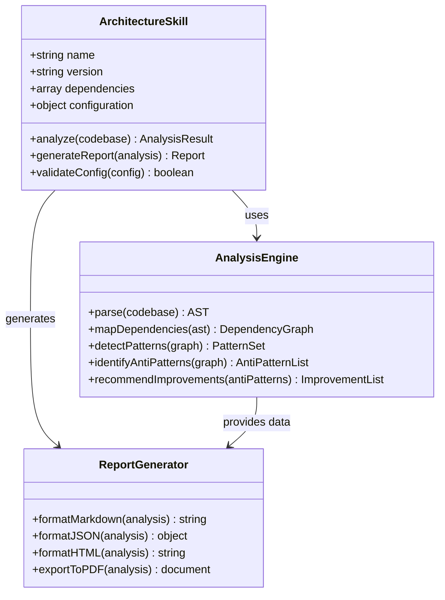
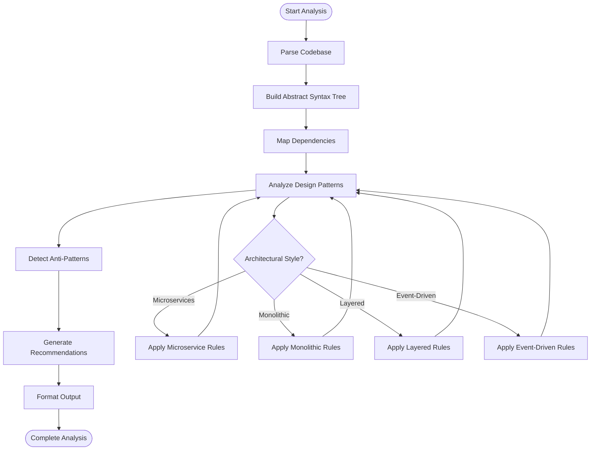
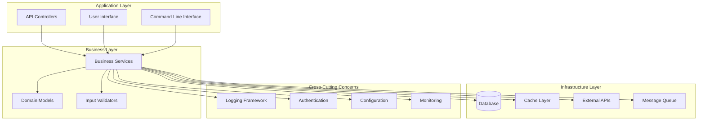

# Architecture Analysis Skills

<cite>
**Referenced Files in This Document**
- [SKILL.md](file://skills/deepen-architecture/SKILL.md)
- [openai.yaml](file://skills/deepen-architecture/agents/openai.yaml)
- [README.md](file://skills/README.md)
</cite>

## Table of Contents
1. [Introduction](#introduction)
2. [Project Structure](#project-structure)
3. [Core Components](#core-components)
4. [Architecture Overview](#architecture-overview)
5. [Detailed Component Analysis](#detailed-component-analysis)
6. [Dependency Analysis](#dependency-analysis)
7. [Performance Considerations](#performance-considerations)
8. [Troubleshooting Guide](#troubleshooting-guide)
9. [Conclusion](#conclusion)

## Introduction

The Pi Codex Kit provides advanced architecture analysis capabilities through its deepen-architecture skill, designed to deliver comprehensive architectural insights, dependency analysis, and design pattern recommendations for software projects. This skill enables developers and architects to understand their codebase structure, identify architectural anti-patterns, and receive actionable improvement suggestions tailored to different architectural styles and project requirements.

## Project Structure

The architecture analysis functionality is organized within the skills directory structure, following a modular approach that separates concerns between skill definitions, agent configurations, and execution logic.

**Diagram sources**
- [SKILL.md](file://skills/deepen-architecture/SKILL.md)
- [openai.yaml](file://skills/deepen-architecture/agents/openai.yaml)

**Section sources**
- [SKILL.md](file://skills/deepen-architecture/SKILL.md)
- [openai.yaml](file://skills/deepen-architecture/agents/openai.yaml)

## Core Components

The deepen-architecture skill comprises several key components that work together to provide comprehensive architectural analysis:

### Skill Definition Layer
The primary skill definition contains the core instructions, analysis methodologies, and output specifications that guide the architectural analysis process.

### Agent Configuration
The OpenAI agent configuration defines the specific parameters, system prompts, and behavioral constraints for the architecture analysis engine.

### Analysis Engine
The underlying analysis engine processes codebase information through multiple stages including parsing, dependency mapping, pattern recognition, and recommendation generation.

### Output Formatter
A dedicated component handles the transformation of analysis results into structured reports suitable for different consumption contexts.

**Section sources**
- [SKILL.md](file://skills/deepen-architecture/SKILL.md)
- [openai.yaml](file://skills/deepen-architecture/agents/openai.yaml)

## Architecture Overview

The architecture analysis system follows a multi-stage processing pipeline that transforms raw codebase information into actionable architectural insights.

**Diagram sources**
- [SKILL.md](file://skills/deepen-architecture/SKILL.md)
- [openai.yaml](file://skills/deepen-architecture/agents/openai.yaml)

## Detailed Component Analysis

### Deepen-Architecture Skill Implementation

The deepen-architecture skill serves as the central orchestrator for architectural analysis tasks. It coordinates multiple analysis phases and manages the flow of information between different components.

#### Skill Configuration Structure

**Diagram sources**
- [SKILL.md](file://skills/deepen-architecture/SKILL.md)
- [openai.yaml](file://skills/deepen-architecture/agents/openai.yaml)

#### Analysis Pipeline Flow

**Diagram sources**
- [SKILL.md](file://skills/deepen-architecture/SKILL.md)

### Agent Configuration Analysis

The OpenAI agent configuration defines the behavioral parameters and system context for the architecture analysis engine.

#### Agent Parameters

| Parameter | Type | Description | Default Value |
|-----------|------|-------------|---------------|
| model | string | AI model identifier for analysis | gpt-4 |
| temperature | number | Creativity level for recommendations | 0.7 |
| max_tokens | integer | Maximum response length | 4000 |
| system_prompt | string | System-level instructions | Architecture analysis guidelines |
| top_p | number | Nucleus sampling parameter | 0.9 |
| frequency_penalty | number | Repetition penalty factor | 0.0 |

#### Context Management

The agent maintains contextual awareness of the analyzed codebase, preserving relationships between components and maintaining consistency across analysis sessions.

**Section sources**
- [openai.yaml](file://skills/deepen-architecture/agents/openai.yaml)

### Codebase Structure Analysis

The skill employs sophisticated techniques to analyze codebase organization and structure:

#### Structural Metrics Collection

- **Module Cohesion**: Measures how closely related the responsibilities of a module are
- **Coupling Analysis**: Evaluates inter-module dependencies and integration complexity
- **Hierarchy Depth**: Assesses the depth of inheritance and composition relationships
- **Naming Consistency**: Validates adherence to established naming conventions
- **File Organization**: Analyzes logical grouping and separation of concerns

#### Dependency Graph Construction

The system builds comprehensive dependency graphs that capture both explicit imports and implicit relationships, enabling visualization of architectural boundaries and potential circular dependencies.

**Section sources**
- [SKILL.md](file://skills/deepen-architecture/SKILL.md)

### Architectural Anti-Pattern Detection

The analysis engine identifies common architectural anti-patterns that can compromise maintainability, scalability, and performance:

#### Common Anti-Patterns Detected

1. **God Classes**: Overly large classes with too many responsibilities
2. **Feature Envy**: Methods that show more interest in other classes' data than their own
3. **Shotgun Surgery**: Small changes requiring modifications in many places
4. **Data Clumps**: Groups of data that appear together repeatedly
5. **Primitive Obsession**: Overuse of primitive types instead of small objects
6. **Refused Bequest**: Subclasses that don't use inherited methods
7. **Middle Man**: Excessive indirection through wrapper classes
8. **Inappropriate Intimacy**: Classes accessing private members of other classes

#### Detection Methodology

The detection system uses static analysis combined with semantic understanding to identify these patterns with high accuracy while minimizing false positives.

**Section sources**
- [SKILL.md](file://skills/deepen-architecture/SKILL.md)

### Design Pattern Recommendations

Based on the analysis results, the system provides targeted recommendations for implementing appropriate design patterns:

#### Recommended Patterns by Context

| Context | Recommended Patterns | Purpose |
|---------|---------------------|---------|
| High Coupling | Strategy, Observer, Mediator | Reduce direct dependencies |
| Complex Object Creation | Factory, Builder, Abstract Factory | Simplify instantiation logic |
| State Management | State, Command, Memento | Handle complex state transitions |
| Service Communication | Facade, Adapter, Proxy | Standardize interface interactions |
| Data Access | Repository, Unit of Work, DAO | Abstract data source details |

#### Implementation Guidance

Each recommendation includes detailed implementation guidance, migration strategies, and potential trade-offs to consider during adoption.

**Section sources**
- [SKILL.md](file://skills/deepen-architecture/SKILL.md)

## Dependency Analysis

The architecture analysis capability provides comprehensive dependency management and visualization features:

### Dependency Visualization

**Diagram sources**
- [SKILL.md](file://skills/deepen-architecture/SKILL.md)

### Circular Dependency Detection

The system automatically detects circular dependencies that can lead to tight coupling and maintenance challenges:

#### Detection Algorithm

1. **Graph Construction**: Build directed graph from import statements
2. **Cycle Detection**: Apply Tarjan's algorithm for strongly connected components
3. **Impact Assessment**: Evaluate severity based on dependency depth and scope
4. **Resolution Suggestions**: Provide concrete refactoring recommendations

#### Severity Classification

| Severity | Description | Action Required |
|----------|-------------|-----------------|
| Critical | Direct circular dependency between major modules | Immediate refactoring required |
| High | Multiple layers of indirect circular dependencies | Refactor within current sprint |
| Medium | Minor circular dependencies in utility layers | Plan for next maintenance cycle |
| Low | Acceptable circular dependencies in well-isolated components | Monitor and document |

**Section sources**
- [SKILL.md](file://skills/deepen-architecture/SKILL.md)

## Performance Considerations

### Analysis Optimization Strategies

The architecture analysis system implements several optimization strategies to ensure efficient processing of large codebases:

#### Incremental Analysis

- **Change Detection**: Only re-analyze modified files and their affected dependencies
- **Caching Mechanism**: Store analysis results for unchanged code segments
- **Parallel Processing**: Distribute analysis tasks across multiple processors
- **Lazy Loading**: Load detailed analysis only when needed

#### Memory Management

- **Streaming Processing**: Process large files without loading entire contents into memory
- **Garbage Collection**: Aggressive cleanup of temporary analysis artifacts
- **Memory Pooling**: Reuse analysis objects to reduce allocation overhead

### Scalability Characteristics

The system scales effectively with codebase size through:

- **Horizontal Scaling**: Support for distributed analysis across multiple nodes
- **Progressive Enhancement**: Basic analysis available immediately, detailed analysis completes asynchronously
- **Resource Throttling**: Configurable limits to prevent resource exhaustion

## Troubleshooting Guide

### Common Issues and Resolutions

#### Analysis Timeout Errors

**Symptoms**: Analysis requests timing out before completion
**Causes**: 
- Extremely large codebases exceeding default timeout settings
- Insufficient system resources allocated to analysis engine
- Network connectivity issues with external analysis services

**Resolutions**:
- Increase timeout configuration values
- Allocate additional system resources
- Enable incremental analysis mode
- Configure analysis exclusions for non-critical directories

#### Memory Exhaustion

**Symptoms**: Analysis engine crashes due to insufficient memory
**Causes**:
- Very large single-file analysis
- Memory leaks in custom analysis plugins
- Concurrent analysis of multiple large codebases

**Resolutions**:
- Configure memory limits appropriately
- Enable streaming analysis for large files
- Implement analysis queuing for concurrent requests
- Use memory profiling to identify optimization opportunities

#### Inaccurate Dependency Detection

**Symptoms**: Missing or incorrect dependency relationships identified
**Causes**:
- Dynamic imports not properly parsed
- Conditional imports based on runtime configuration
- Custom import resolution mechanisms

**Resolutions**:
- Configure custom import resolvers
- Add manual dependency mappings for dynamic cases
- Update parser configurations for language-specific features
- Validate results against known dependency structures

### Debugging Techniques

#### Analysis Logging

Enable detailed logging to understand analysis progression and identify bottlenecks:

- **Verbose Mode**: Comprehensive step-by-step analysis logging
- **Performance Metrics**: Timing and resource usage statistics
- **Dependency Tracing**: Complete dependency resolution paths
- **Error Context**: Detailed error information with stack traces

#### Validation Tools

Built-in validation utilities help verify analysis accuracy:

- **Dependency Verification**: Cross-check detected dependencies against actual imports
- **Pattern Validation**: Verify anti-pattern detections with manual inspection
- **Report Consistency**: Ensure generated reports accurately reflect analysis findings

**Section sources**
- [SKILL.md](file://skills/deepen-architecture/SKILL.md)

## Conclusion

The Pi Codex Kit's deepen-architecture skill provides a comprehensive solution for architectural analysis, offering deep insights into codebase structure, dependency relationships, and design quality. Through its sophisticated analysis engine, the system identifies architectural anti-patterns, recommends appropriate design patterns, and generates actionable improvement suggestions tailored to specific architectural styles.

The modular architecture ensures extensibility and maintainability, while the configurable nature allows adaptation to diverse project requirements and organizational standards. Integration with development planning processes enables continuous architectural governance and proactive technical debt management.

Key benefits include improved code maintainability, reduced technical debt, enhanced team collaboration through shared architectural understanding, and data-driven decision making for architectural evolution. The system's emphasis on actionable insights rather than mere problem identification makes it an invaluable tool for teams committed to architectural excellence and continuous improvement.