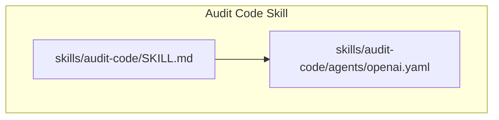
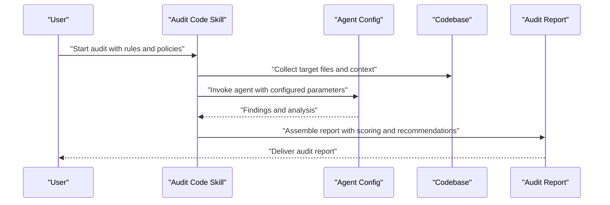
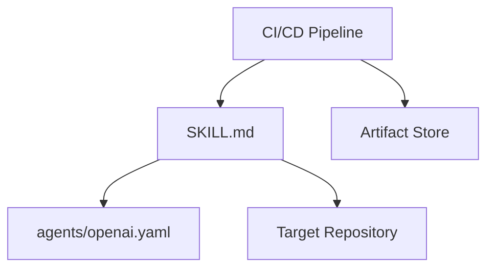

# Audit Code Skill

<cite>
**Referenced Files in This Document**
- [SKILL.md](file://skills/audit-code/SKILL.md)
- [openai.yaml](file://skills/audit-code/agents/openai.yaml)
</cite>

## Table of Contents
1. [Introduction](#introduction)
2. [Project Structure](#project-structure)
3. [Core Components](#core-components)
4. [Architecture Overview](#architecture-overview)
5. [Detailed Component Analysis](#detailed-component-analysis)
6. [Dependency Analysis](#dependency-analysis)
7. [Performance Considerations](#performance-considerations)
8. [Troubleshooting Guide](#troubleshooting-guide)
9. [Conclusion](#conclusion)
10. [Appendices](#appendices)

## Introduction
This document provides comprehensive guidance for the audit-code skill, which focuses on compliance checking and security auditing across codebases. It explains how to configure compliance rules, define security policies, establish audit criteria, interpret audit reports, compute compliance scores, and integrate with regulatory requirements. It also includes examples of common audit scenarios, policy definitions, and remediation recommendations.

The audit-code skill is designed to be extensible and tool-agnostic, enabling teams to tailor checks to their organization’s standards and external regulations while maintaining consistent reporting and scoring.

## Project Structure
The audit-code skill is organized as a self-contained module under the skills directory. It contains:
- A primary skill definition that describes capabilities, inputs, outputs, and usage patterns.
- An agent configuration file that defines runtime parameters for the AI agent used during audits.

**Diagram sources**
- [SKILL.md](file://skills/audit-code/SKILL.md)
- [openai.yaml](file://skills/audit-code/agents/openai.yaml)

**Section sources**
- [SKILL.md](file://skills/audit-code/SKILL.md)
- [openai.yaml](file://skills/audit-code/agents/openai.yaml)

## Core Components
- Skill Definition (SKILL.md): Describes the purpose, scope, inputs, outputs, and workflow of the audit process. It outlines how to configure compliance rules, security policies, and audit criteria, and how to produce standardized audit reports.
- Agent Configuration (openai.yaml): Defines the model and execution settings used by the audit agent, including parameters such as temperature, max tokens, and any system prompts or constraints relevant to compliance and security checks.

Key responsibilities:
- Define rule categories (e.g., data protection, access control, cryptography).
- Specify severity levels and scoring weights.
- Provide templates for audit reports and findings.
- Configure agent behavior to ensure deterministic and auditable results.

**Section sources**
- [SKILL.md](file://skills/audit-code/SKILL.md)
- [openai.yaml](file://skills/audit-code/agents/openai.yaml)

## Architecture Overview
The audit-code skill orchestrates an agent-driven audit workflow. The typical flow involves:
- Ingesting repository context and selected files or directories.
- Applying configured compliance rules and security policies.
- Generating findings with severity, evidence, and references.
- Producing a structured audit report with compliance scoring and remediation guidance.

[No sources needed since this diagram shows conceptual workflow, not actual code structure]

## Detailed Component Analysis

### Compliance Rules Configuration
Compliance rules are defined within the skill’s configuration and referenced by the agent during analysis. Typical rule attributes include:
- Rule identifier and description
- Applicable languages or frameworks
- Severity level (e.g., critical, high, medium, low)
- Evidence requirements (code snippets, logs, configs)
- Regulatory mapping (e.g., GDPR, HIPAA, PCI-DSS)
- Remediation guidance and references

Configuration steps:
- Create or update the rule set in the skill’s configuration area.
- Assign weights per severity to influence compliance scoring.
- Link rules to specific regulatory requirements for traceability.
- Validate rule syntax and coverage before running audits.

Example scenario:
- Data encryption at rest: enforce AES-256 usage and key management practices; map to PCI-DSS requirement.

Remediation recommendation example:
- Replace deprecated cryptographic libraries with vetted alternatives; add unit tests for crypto paths.

**Section sources**
- [SKILL.md](file://skills/audit-code/SKILL.md)

### Security Policies Definition
Security policies complement compliance rules by codifying organizational security posture. They may cover:
- Authentication and authorization standards
- Secrets management and rotation
- Input validation and output encoding
- Logging and monitoring requirements
- Dependency vulnerability thresholds

Policy attributes:
- Scope (repo-wide, feature-specific)
- Enforcement mode (warn vs. block)
- Exceptions and approvals workflow
- Review cadence and ownership

Example scenario:
- Enforce least privilege for service accounts and restrict secret exposure via environment variables.

Remediation recommendation example:
- Integrate secrets scanning into CI; rotate compromised credentials immediately.

**Section sources**
- [SKILL.md](file://skills/audit-code/SKILL.md)

### Audit Criteria and Scoring
Audit criteria define what constitutes pass/fail conditions and how findings impact overall compliance. Scoring typically aggregates:
- Number and severity of findings
- Risk exposure based on asset criticality
- Mitigation status and time-to-fix metrics
- Policy exceptions and risk acceptance records

Scoring approach:
- Weighted sum of severity counts
- Deductions for unresolved critical issues
- Adjustments for documented mitigations and compensating controls

Example scoring formula concept:
- Score = Base - Σ(SeverityWeight × FindingCount) + MitigationAdjustment

**Section sources**
- [SKILL.md](file://skills/audit-code/SKILL.md)

### Audit Report Format
A standardized audit report should include:
- Executive summary with compliance score and risk posture
- Findings table with ID, title, severity, location, evidence, and references
- Regulatory mapping section linking findings to requirements
- Remediation plan with owners, deadlines, and verification steps
- Appendices with raw logs, diffs, and tool outputs

Report generation steps:
- Collect findings from the agent analysis
- Normalize entries into the report schema
- Compute compliance score using configured weights
- Attach evidence artifacts and references

**Section sources**
- [SKILL.md](file://skills/audit-code/SKILL.md)

### Integration with Regulatory Requirements
To align with external regulations:
- Map each rule to one or more regulatory clauses
- Maintain a registry of mappings and versioning
- Generate traceability matrices in the report
- Support periodic reviews and updates when regulations change

Common regulations:
- GDPR: data minimization, consent, retention
- HIPAA: PHI protection, access controls, audit trails
- PCI-DSS: encryption, secure development, vulnerability management

**Section sources**
- [SKILL.md](file://skills/audit-code/SKILL.md)

### Agent Configuration and Behavior
The agent configuration influences how the audit runs:
- Model selection and parameters (temperature, max tokens)
- System prompt constraints to focus on compliance and security
- Output formatting preferences for consistent reports
- Retry and timeout policies for robustness

Best practices:
- Use deterministic settings for reproducible audits
- Constrain prompts to avoid hallucinated findings
- Log agent interactions for auditability

**Section sources**
- [openai.yaml](file://skills/audit-code/agents/openai.yaml)

## Dependency Analysis
The audit-code skill depends on:
- The skill definition for rule sets, policies, and report schemas
- The agent configuration for runtime behavior
- External repositories or codebases under audit
- Optional integrations for CI/CD pipelines and artifact storage

[No sources needed since this diagram shows conceptual relationships, not actual code structure]

**Section sources**
- [SKILL.md](file://skills/audit-code/SKILL.md)
- [openai.yaml](file://skills/audit-code/agents/openai.yaml)

## Performance Considerations
- Limit scope to relevant files and directories to reduce analysis time.
- Cache rule evaluations where possible to avoid redundant work.
- Parallelize independent checks across modules or services.
- Tune agent parameters to balance accuracy and throughput.
- Streamline report assembly by predefining templates and sections.

[No sources needed since this section provides general guidance]

## Troubleshooting Guide
Common issues and resolutions:
- Missing rule definitions: Ensure all referenced rules exist and are valid.
- Inconsistent findings: Verify agent configuration and prompt constraints.
- Slow audits: Narrow input scope and enable caching strategies.
- Non-deterministic outputs: Fix randomness parameters and standardize prompts.
- Reporting errors: Validate report schema and required fields.

Operational tips:
- Enable detailed logging for agent calls and rule matches.
- Maintain versioned rule sets and track changes over time.
- Use dry-run modes to validate configurations without full audits.

**Section sources**
- [SKILL.md](file://skills/audit-code/SKILL.md)
- [openai.yaml](file://skills/audit-code/agents/openai.yaml)

## Conclusion
The audit-code skill provides a structured approach to compliance checking and security auditing. By defining clear rules, policies, and criteria, teams can generate actionable reports, compute meaningful compliance scores, and maintain alignment with regulatory requirements. Proper configuration of the agent ensures reliable and reproducible outcomes, while performance and troubleshooting practices keep audits efficient and maintainable.

[No sources needed since this section summarizes without analyzing specific files]

## Appendices

### Example Policy Definitions
- Authentication policy: Require multi-factor authentication for privileged accounts.
- Secrets policy: Prohibit hardcoded secrets; mandate vault integration.
- Encryption policy: Enforce TLS 1.2+ and approved cipher suites.
- Logging policy: Capture audit trails for sensitive operations.

### Common Audit Scenarios
- API endpoint review for injection vulnerabilities and proper input validation.
- Database access patterns for least privilege and query parameterization.
- Dependency scanning for known vulnerabilities and outdated packages.
- Configuration drift detection against baseline security settings.

### Remediation Recommendations
- Refactor insecure code paths and add automated tests.
- Update dependencies to patched versions and lockfile management.
- Implement compensating controls where immediate fixes are not feasible.
- Document risk acceptances with expiration and review dates.

[No sources needed since this section provides general guidance]