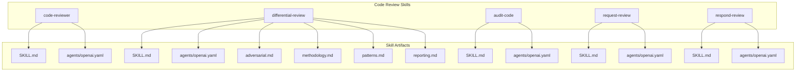
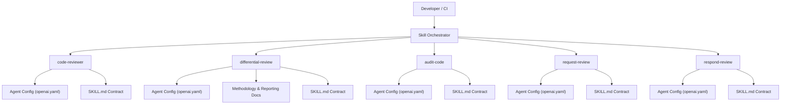
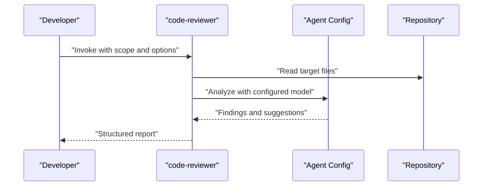
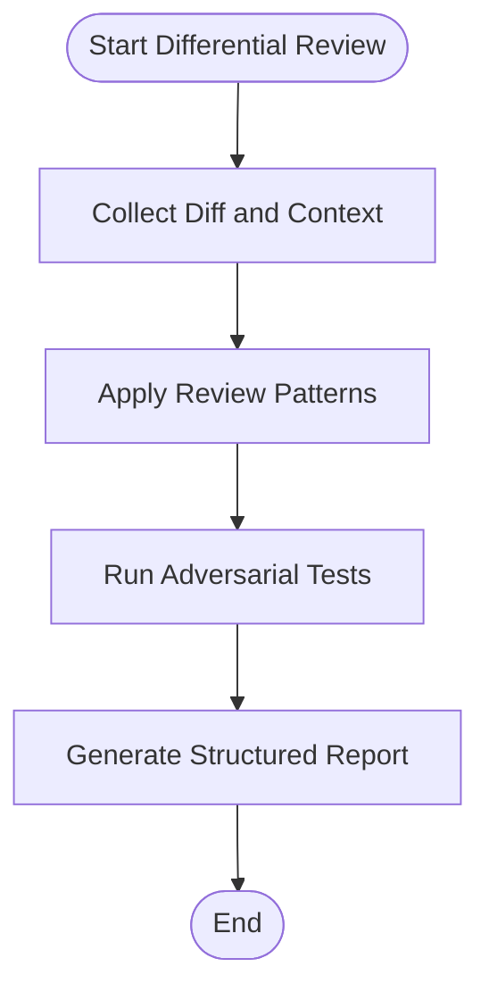
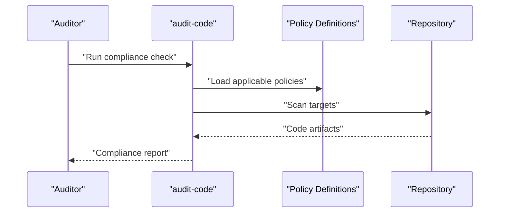
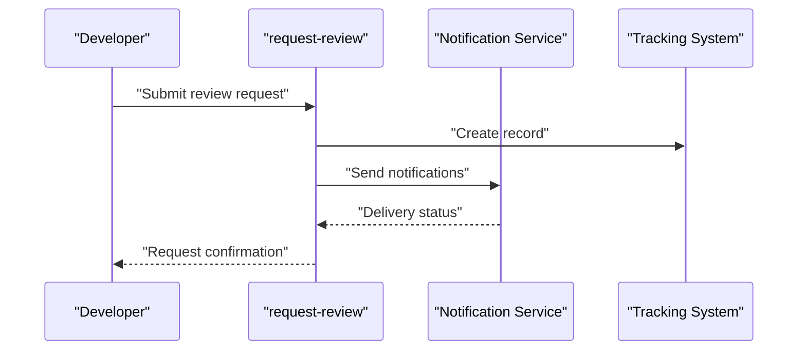
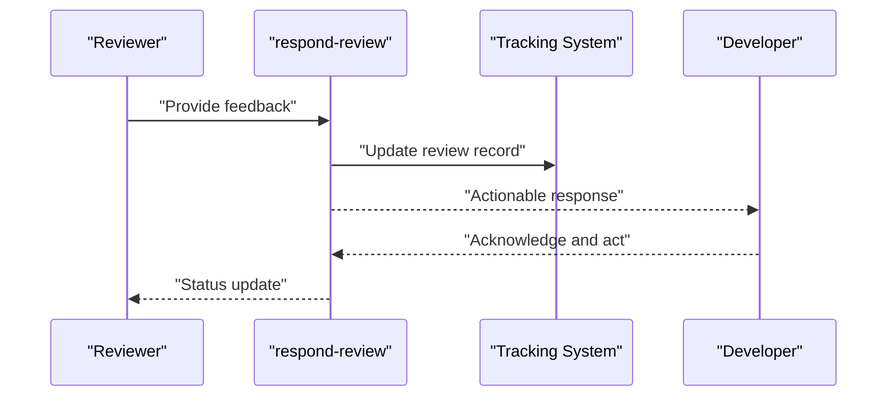
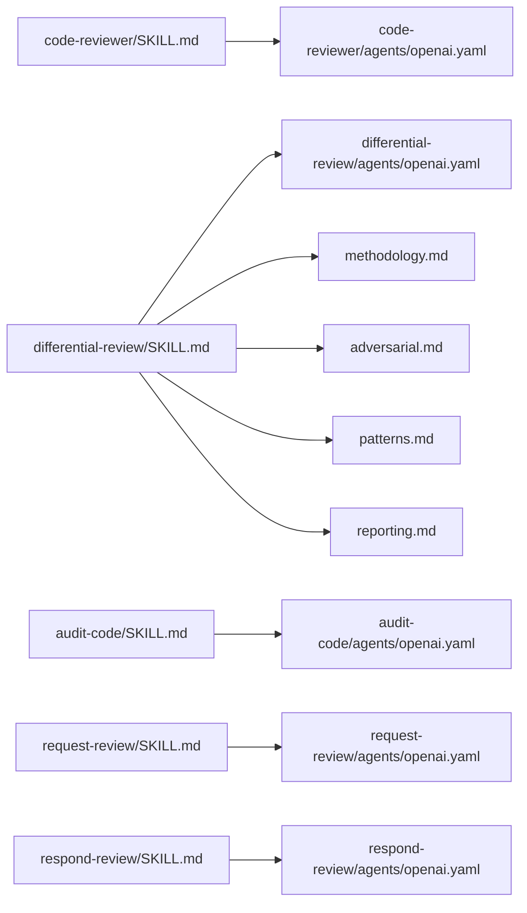

# Code Review Skills

<cite>
**Referenced Files in This Document**
- [skills/README.md](file://skills/README.md)
- [skills/code-reviewer/SKILL.md](file://skills/code-reviewer/SKILL.md)
- [skills/code-reviewer/agents/openai.yaml](file://skills/code-reviewer/agents/openai.yaml)
- [skills/differential-review/SKILL.md](file://skills/differential-review/SKILL.md)
- [skills/differential-review/adversarial.md](file://skills/differential-review/adversarial.md)
- [skills/differential-review/methodology.md](file://skills/differential-review/methodology.md)
- [skills/differential-review/patterns.md](file://skills/differential-review/patterns.md)
- [skills/differential-review/reporting.md](file://skills/differential-review/reporting.md)
- [skills/differential-review/agents/openai.yaml](file://skills/differential-review/agents/openai.yaml)
- [skills/audit-code/SKILL.md](file://skills/audit-code/SKILL.md)
- [skills/audit-code/agents/openai.yaml](file://skills/audit-code/agents/openai.yaml)
- [skills/request-review/SKILL.md](file://skills/request-review/SKILL.md)
- [skills/request-review/agents/openai.yaml](file://skills/request-review/agents/openai.yaml)
- [skills/respond-review/SKILL.md](file://skills/respond-review/SKILL.md)
- [skills/respond-review/agents/openai.yaml](file://skills/respond-review/agents/openai.yaml)
</cite>

## Table of Contents
1. [Introduction](#introduction)
2. [Project Structure](#project-structure)
3. [Core Components](#core-components)
4. [Architecture Overview](#architecture-overview)
5. [Detailed Component Analysis](#detailed-component-analysis)
6. [Dependency Analysis](#dependency-analysis)
7. [Performance Considerations](#performance-considerations)
8. [Troubleshooting Guide](#troubleshooting-guide)
9. [Conclusion](#conclusion)

## Introduction
This document provides comprehensive documentation for the code review skills in the Pi Codex Kit. It covers automated code analysis, quality assurance, and review workflow automation across four primary skills:
- code-reviewer: general-purpose code analysis and feedback generation
- differential-review: change-focused reviews with adversarial testing and structured reporting
- audit-code: compliance-oriented checks and policy enforcement
- request-review and respond-review: collaborative review orchestration and response handling

The goal is to help developers configure inputs, understand outputs, and integrate these skills into CI/CD and local development workflows effectively.

## Project Structure
The code review capabilities are organized as discrete skills under the skills directory. Each skill includes a SKILL.md describing its purpose, configuration, inputs, outputs, and usage patterns, plus an agents/openai.yaml file that configures the underlying agent behavior. The differential-review skill additionally includes methodological references (adversarial.md, methodology.md, patterns.md, reporting.md).

**Diagram sources**
- [skills/README.md](file://skills/README.md)
- [skills/code-reviewer/SKILL.md](file://skills/code-reviewer/SKILL.md)
- [skills/code-reviewer/agents/openai.yaml](file://skills/code-reviewer/agents/openai.yaml)
- [skills/differential-review/SKILL.md](file://skills/differential-review/SKILL.md)
- [skills/differential-review/adversarial.md](file://skills/differential-review/adversarial.md)
- [skills/differential-review/methodology.md](file://skills/differential-review/methodology.md)
- [skills/differential-review/patterns.md](file://skills/differential-review/patterns.md)
- [skills/differential-review/reporting.md](file://skills/differential-review/reporting.md)
- [skills/differential-review/agents/openai.yaml](file://skills/differential-review/agents/openai.yaml)
- [skills/audit-code/SKILL.md](file://skills/audit-code/SKILL.md)
- [skills/audit-code/agents/openai.yaml](file://skills/audit-code/agents/openai.yaml)
- [skills/request-review/SKILL.md](file://skills/request-review/SKILL.md)
- [skills/request-review/agents/openai.yaml](file://skills/request-review/agents/openai.yaml)
- [skills/respond-review/SKILL.md](file://skills/respond-review/SKILL.md)
- [skills/respond-review/agents/openai.yaml](file://skills/respond-review/agents/openai.yaml)

**Section sources**
- [skills/README.md](file://skills/README.md)

## Core Components
This section summarizes each skill’s role, typical inputs, outputs, and integration points. For exact configuration keys and examples, refer to the referenced files.

- code-reviewer
  - Purpose: General code analysis and actionable feedback generation across repositories or specific paths.
  - Typical inputs: Target code paths, scope filters, language hints, and optional policy constraints.
  - Outputs: Structured findings, severity levels, suggested fixes, and links to relevant rules or references.
  - Integration: Local dev hooks, PR pre-checks, nightly scans.

- differential-review
  - Purpose: Change-focused reviews emphasizing diffs, risk assessment, and adversarial testing strategies.
  - Typical inputs: Diff ranges, changed files, baseline context, and adversarial test scenarios.
  - Outputs: Change-centric reports, risk scores, targeted recommendations, and adversarial test results.
  - Integration: PR gate checks, change impact dashboards, regression prevention pipelines.

- audit-code
  - Purpose: Compliance and policy enforcement checks against organizational standards and regulatory requirements.
  - Typical inputs: Policy definitions, compliance frameworks, target scopes, and exception lists.
  - Outputs: Compliance status, violations, remediation steps, and audit-ready artifacts.
  - Integration: Compliance gates, periodic audits, governance dashboards.

- request-review
  - Purpose: Orchestrate review requests by assembling context, summarizing changes, and notifying reviewers.
  - Typical inputs: Change metadata, reviewer assignments, required criteria, and communication channels.
  - Outputs: Review requests, summaries, and tracking identifiers.
  - Integration: Collaboration platforms, ticketing systems, notification services.

- respond-review
  - Purpose: Process incoming review feedback, generate responses, and update artifacts accordingly.
  - Typical inputs: Review comments, decisions, and required actions.
  - Outputs: Responses, action items, and updated review records.
  - Integration: Collaboration platforms, issue trackers, continuous feedback loops.

**Section sources**
- [skills/code-reviewer/SKILL.md](file://skills/code-reviewer/SKILL.md)
- [skills/differential-review/SKILL.md](file://skills/differential-review/SKILL.md)
- [skills/audit-code/SKILL.md](file://skills/audit-code/SKILL.md)
- [skills/request-review/SKILL.md](file://skills/request-review/SKILL.md)
- [skills/respond-review/SKILL.md](file://skills/respond-review/SKILL.md)

## Architecture Overview
The code review skills follow a consistent pattern:
- A SKILL.md defines the user-facing contract (inputs, outputs, configuration, usage).
- An agents/openai.yaml configures the underlying model behavior and tooling.
- Optional reference documents provide deeper methodology and reporting guidance.

**Diagram sources**
- [skills/code-reviewer/SKILL.md](file://skills/code-reviewer/SKILL.md)
- [skills/code-reviewer/agents/openai.yaml](file://skills/code-reviewer/agents/openai.yaml)
- [skills/differential-review/SKILL.md](file://skills/differential-review/SKILL.md)
- [skills/differential-review/adversarial.md](file://skills/differential-review/adversarial.md)
- [skills/differential-review/methodology.md](file://skills/differential-review/methodology.md)
- [skills/differential-review/patterns.md](file://skills/differential-review/patterns.md)
- [skills/differential-review/reporting.md](file://skills/differential-review/reporting.md)
- [skills/differential-review/agents/openai.yaml](file://skills/differential-review/agents/openai.yaml)
- [skills/audit-code/SKILL.md](file://skills/audit-code/SKILL.md)
- [skills/audit-code/agents/openai.yaml](file://skills/audit-code/agents/openai.yaml)
- [skills/request-review/SKILL.md](file://skills/request-review/SKILL.md)
- [skills/request-review/agents/openai.yaml](file://skills/request-review/agents/openai.yaml)
- [skills/respond-review/SKILL.md](file://skills/respond-review/SKILL.md)
- [skills/respond-review/agents/openai.yaml](file://skills/respond-review/agents/openai.yaml)

## Detailed Component Analysis

### code-reviewer Skill
- Purpose: Provide broad-spectrum code analysis and feedback.
- Configuration: See agents/openai.yaml for model parameters and tool bindings.
- Inputs: Target directories/files, language hints, rule sets, and thresholds.
- Outputs: Findings with severity, location, description, and fix suggestions.
- Usage: Run on-demand or integrated into pre-commit and CI stages.

**Diagram sources**
- [skills/code-reviewer/SKILL.md](file://skills/code-reviewer/SKILL.md)
- [skills/code-reviewer/agents/openai.yaml](file://skills/code-reviewer/agents/openai.yaml)

**Section sources**
- [skills/code-reviewer/SKILL.md](file://skills/code-reviewer/SKILL.md)
- [skills/code-reviewer/agents/openai.yaml](file://skills/code-reviewer/agents/openai.yaml)

### differential-review Skill
- Purpose: Focus reviews on changes, incorporate adversarial testing, and produce structured reports.
- Methodology: Refer to methodology.md for process guidance; adversarial.md for threat modeling and stress-testing strategies; patterns.md for common review patterns; reporting.md for output formats.
- Configuration: See agents/openai.yaml for model and tool settings tailored to diff analysis.
- Inputs: Diffs, changed files, baseline context, adversarial scenarios.
- Outputs: Change-centric findings, risk assessments, adversarial test outcomes, and actionable recommendations.

**Diagram sources**
- [skills/differential-review/SKILL.md](file://skills/differential-review/SKILL.md)
- [skills/differential-review/methodology.md](file://skills/differential-review/methodology.md)
- [skills/differential-review/adversarial.md](file://skills/differential-review/adversarial.md)
- [skills/differential-review/patterns.md](file://skills/differential-review/patterns.md)
- [skills/differential-review/reporting.md](file://skills/differential-review/reporting.md)
- [skills/differential-review/agents/openai.yaml](file://skills/differential-review/agents/openai.yaml)

**Section sources**
- [skills/differential-review/SKILL.md](file://skills/differential-review/SKILL.md)
- [skills/differential-review/methodology.md](file://skills/differential-review/methodology.md)
- [skills/differential-review/adversarial.md](file://skills/differential-review/adversarial.md)
- [skills/differential-review/patterns.md](file://skills/differential-review/patterns.md)
- [skills/differential-review/reporting.md](file://skills/differential-review/reporting.md)
- [skills/differential-review/agents/openai.yaml](file://skills/differential-review/agents/openai.yaml)

### audit-code Skill
- Purpose: Enforce compliance policies and generate audit artifacts.
- Configuration: See agents/openai.yaml for compliance-specific model tuning and tool integrations.
- Inputs: Policy definitions, compliance frameworks, target scopes, exceptions.
- Outputs: Compliance status, violations, remediation steps, and audit-ready reports.

**Diagram sources**
- [skills/audit-code/SKILL.md](file://skills/audit-code/SKILL.md)
- [skills/audit-code/agents/openai.yaml](file://skills/audit-code/agents/openai.yaml)

**Section sources**
- [skills/audit-code/SKILL.md](file://skills/audit-code/SKILL.md)
- [skills/audit-code/agents/openai.yaml](file://skills/audit-code/agents/openai.yaml)

### request-review Skill
- Purpose: Create and distribute review requests with summarized context and assigned reviewers.
- Configuration: See agents/openai.yaml for communication and summarization settings.
- Inputs: Change metadata, reviewer list, required criteria, notification channels.
- Outputs: Review requests, summaries, and tracking IDs.

**Diagram sources**
- [skills/request-review/SKILL.md](file://skills/request-review/SKILL.md)
- [skills/request-review/agents/openai.yaml](file://skills/request-review/agents/openai.yaml)

**Section sources**
- [skills/request-review/SKILL.md](file://skills/request-review/SKILL.md)
- [skills/request-review/agents/openai.yaml](file://skills/request-review/agents/openai.yaml)

### respond-review Skill
- Purpose: Process review feedback, generate responses, and update artifacts.
- Configuration: See agents/openai.yaml for response generation and formatting options.
- Inputs: Review comments, decisions, required actions.
- Outputs: Responses, action items, and updated review records.

**Diagram sources**
- [skills/respond-review/SKILL.md](file://skills/respond-review/SKILL.md)
- [skills/respond-review/agents/openai.yaml](file://skills/respond-review/agents/openai.yaml)

**Section sources**
- [skills/respond-review/SKILL.md](file://skills/respond-review/SKILL.md)
- [skills/respond-review/agents/openai.yaml](file://skills/respond-review/agents/openai.yaml)

## Dependency Analysis
Each skill depends on:
- Its SKILL.md contract for input/output specifications and configuration keys.
- Its agents/openai.yaml for model and tool behavior.
- Additional references for differential-review (methodology, adversarial testing, patterns, reporting).

**Diagram sources**
- [skills/code-reviewer/SKILL.md](file://skills/code-reviewer/SKILL.md)
- [skills/code-reviewer/agents/openai.yaml](file://skills/code-reviewer/agents/openai.yaml)
- [skills/differential-review/SKILL.md](file://skills/differential-review/SKILL.md)
- [skills/differential-review/methodology.md](file://skills/differential-review/methodology.md)
- [skills/differential-review/adversarial.md](file://skills/differential-review/adversarial.md)
- [skills/differential-review/patterns.md](file://skills/differential-review/patterns.md)
- [skills/differential-review/reporting.md](file://skills/differential-review/reporting.md)
- [skills/differential-review/agents/openai.yaml](file://skills/differential-review/agents/openai.yaml)
- [skills/audit-code/SKILL.md](file://skills/audit-code/SKILL.md)
- [skills/audit-code/agents/openai.yaml](file://skills/audit-code/agents/openai.yaml)
- [skills/request-review/SKILL.md](file://skills/request-review/SKILL.md)
- [skills/request-review/agents/openai.yaml](file://skills/request-review/agents/openai.yaml)
- [skills/respond-review/SKILL.md](file://skills/respond-review/SKILL.md)
- [skills/respond-review/agents/openai.yaml](file://skills/respond-review/agents/openai.yaml)

**Section sources**
- [skills/code-reviewer/SKILL.md](file://skills/code-reviewer/SKILL.md)
- [skills/differential-review/SKILL.md](file://skills/differential-review/SKILL.md)
- [skills/audit-code/SKILL.md](file://skills/audit-code/SKILL.md)
- [skills/request-review/SKILL.md](file://skills/request-review/SKILL.md)
- [skills/respond-review/SKILL.md](file://skills/respond-review/SKILL.md)

## Performance Considerations
- Scope targeting: Narrow file paths and language filters to reduce analysis overhead.
- Incremental reviews: Prefer differential-review for large repositories to focus on changed files.
- Caching and reuse: Reuse generated summaries and artifacts where supported by your platform.
- Threshold tuning: Adjust severity thresholds to balance signal-to-noise ratio.
- Parallelization: Where possible, run multiple skills concurrently for independent tasks (e.g., audit vs. differential review).

[No sources needed since this section provides general guidance]

## Troubleshooting Guide
- Missing configuration: Ensure agents/openai.yaml is present and correctly set for the intended skill.
- Input validation: Verify that SKILL.md-defined inputs (paths, diffs, policies) match expected formats.
- Output parsing: Confirm downstream tools can consume the reported structures defined in each SKILL.md.
- Adversarial tests: For differential-review, validate scenario definitions and environment readiness before execution.
- Compliance drift: Periodically refresh policy definitions and re-run audit-code to maintain accuracy.

**Section sources**
- [skills/code-reviewer/SKILL.md](file://skills/code-reviewer/SKILL.md)
- [skills/differential-review/SKILL.md](file://skills/differential-review/SKILL.md)
- [skills/audit-code/SKILL.md](file://skills/audit-code/SKILL.md)
- [skills/request-review/SKILL.md](file://skills/request-review/SKILL.md)
- [skills/respond-review/SKILL.md](file://skills/respond-review/SKILL.md)

## Conclusion
The Pi Codex Kit’s code review skills provide a cohesive toolkit for automated analysis, change-focused reviews, compliance auditing, and collaborative workflows. By leveraging the SKILL.md contracts and agent configurations, teams can tailor reviews to their needs, integrate them into CI/CD, and produce actionable, auditable outputs. Use differential-review for high-risk changes, audit-code for governance, and request-review/respond-review to streamline collaboration.

[No sources needed since this section summarizes without analyzing specific files]