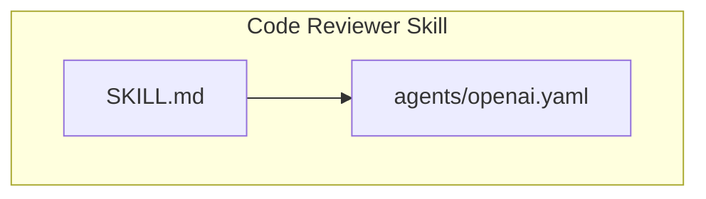
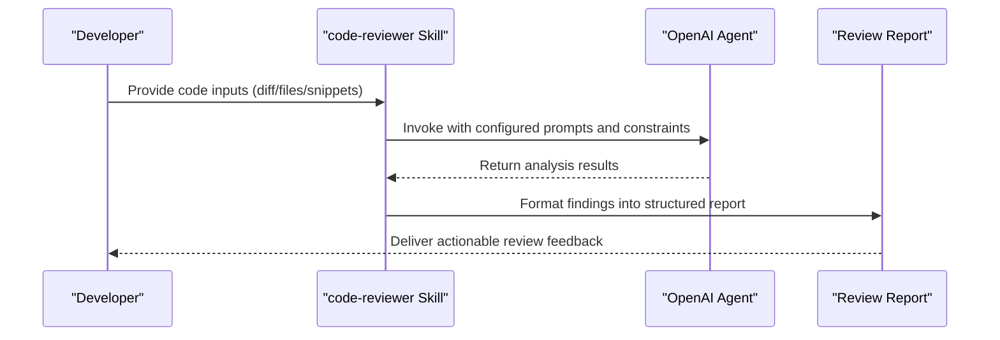
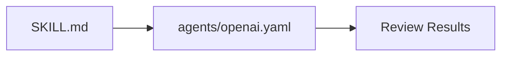

# Code Reviewer Skill

<cite>
**Referenced Files in This Document**
- [SKILL.md](file://skills/code-reviewer/SKILL.md)
- [openai.yaml](file://skills/code-reviewer/agents/openai.yaml)
</cite>

## Table of Contents
1. [Introduction](#introduction)
2. [Project Structure](#project-structure)
3. [Core Components](#core-components)
4. [Architecture Overview](#architecture-overview)
5. [Detailed Component Analysis](#detailed-component-analysis)
6. [Dependency Analysis](#dependency-analysis)
7. [Performance Considerations](#performance-considerations)
8. [Troubleshooting Guide](#troubleshooting-guide)
9. [Conclusion](#conclusion)
10. [Appendices](#appendices)

## Introduction
This document explains the code-reviewer skill, an automated code analysis tool designed to assess general code quality. It covers how to configure and use the skill, input formats it accepts, analysis capabilities, output reports, and configuration options defined in the OpenAI agent YAML file. Practical examples for common review scenarios, integration with development workflows, and customization options for different coding standards are also provided.

## Project Structure
The code-reviewer skill is organized under the skills directory with a consistent layout:
- A descriptive SKILL.md that defines purpose, inputs, outputs, and usage patterns.
- An agents/openai.yaml file that configures the underlying agent behavior and parameters.

**Diagram sources**
- [SKILL.md](file://skills/code-reviewer/SKILL.md)
- [openai.yaml](file://skills/code-reviewer/agents/openai.yaml)

**Section sources**
- [SKILL.md](file://skills/code-reviewer/SKILL.md)
- [openai.yaml](file://skills/code-reviewer/agents/openai.yaml)

## Core Components
- Skill Definition (SKILL.md): Describes the skill’s purpose, supported inputs, expected outputs, and recommended usage patterns.
- Agent Configuration (agents/openai.yaml): Defines model selection, system instructions, temperature, max tokens, and other runtime settings used by the agent during reviews.

Key responsibilities:
- Define what kinds of code changes or files can be reviewed.
- Specify the structure and content of review reports.
- Configure agent behavior to align with project-specific standards.

**Section sources**
- [SKILL.md](file://skills/code-reviewer/SKILL.md)
- [openai.yaml](file://skills/code-reviewer/agents/openai.yaml)

## Architecture Overview
At a high level, the code-reviewer skill orchestrates an AI-powered agent to analyze code artifacts and produce structured feedback. The flow typically involves:
- Preparing inputs (diffs, files, or snippets).
- Invoking the configured agent with appropriate context and constraints.
- Generating a review report with findings, severity levels, and remediation guidance.

[No sources needed since this diagram shows conceptual workflow, not actual code structure]

## Detailed Component Analysis

### Input Formats
The skill supports multiple input formats commonly encountered in code reviews:
- Unified diffs or patch files for change-focused reviews.
- Individual source files or directories for broader assessments.
- Inline code snippets for targeted checks.

Guidelines:
- Prefer providing minimal, relevant context to improve accuracy and reduce token usage.
- Include language identifiers when possible to help tailor analysis.
- For large repositories, scope inputs to changed files or specific modules.

**Section sources**
- [SKILL.md](file://skills/code-reviewer/SKILL.md)

### Analysis Capabilities
The skill performs general code quality assessment across several dimensions:
- Readability and maintainability (naming, structure, complexity).
- Potential defects and error-prone patterns.
- Security-sensitive constructs and anti-patterns.
- Performance concerns and resource usage risks.
- Adherence to style and conventions (configurable via agent settings).

Recommendations:
- Combine diff-based reviews with static analysis tools for comprehensive coverage.
- Use focused inputs to increase precision and reduce noise.

**Section sources**
- [SKILL.md](file://skills/code-reviewer/SKILL.md)

### Output Reports
Expected outputs include structured feedback suitable for human consumption and automation:
- Findings categorized by severity (e.g., critical, major, minor, informational).
- Contextual references to affected lines or sections.
- Actionable remediation steps and rationale.
- Optional summary and prioritized action list.

Formatting tips:
- Keep reports concise and scannable.
- Use consistent categories and severity labels.
- Link findings to concrete code locations where possible.

**Section sources**
- [SKILL.md](file://skills/code-reviewer/SKILL.md)

### Configuration Options (OpenAI Agent YAML)
The agents/openai.yaml file controls how the agent behaves during reviews. Typical configuration areas include:
- Model selection and versioning.
- System instructions defining review focus and tone.
- Temperature and randomness controls for deterministic vs. creative outputs.
- Max tokens to constrain response length.
- Custom prompt templates or constraints aligned with project standards.

Customization strategies:
- Adjust temperature lower for more deterministic, repeatable reviews.
- Increase max tokens for extensive projects or deep analyses.
- Tailor system instructions to emphasize security, performance, or readability based on team priorities.
- Add explicit rules or checklists to enforce coding standards.

**Section sources**
- [openai.yaml](file://skills/code-reviewer/agents/openai.yaml)

### Practical Examples

#### Example 1: Diff-Based Review
- Inputs: Provide a unified diff of changed files.
- Focus: Identify regressions, potential bugs, and style violations introduced by the change.
- Output: A prioritized list of issues with line references and suggested fixes.

#### Example 2: File-Level Review
- Inputs: Submit one or more source files.
- Focus: Assess overall readability, complexity, and adherence to conventions.
- Output: A structured report highlighting key areas for improvement.

#### Example 3: Snippet Review
- Inputs: Paste a small code snippet for targeted inspection.
- Focus: Validate correctness, edge cases, and best practices.
- Output: Concise feedback with direct remediation advice.

**Section sources**
- [SKILL.md](file://skills/code-reviewer/SKILL.md)

### Integration With Development Workflows
Common integration points:
- Pull Request Automation: Trigger the skill on PR creation or updates to provide instant feedback.
- CI Pipeline: Run reviews as part of continuous integration to gate merges based on severity thresholds.
- IDE Hooks: Integrate locally to surface suggestions before committing.
- Issue Triage: Use generated reports to prioritize work items and track recurring issues.

Best practices:
- Limit scope to changed files to reduce cost and latency.
- Cache or reuse context where applicable.
- Standardize report formats for downstream processing.

[No sources needed since this section provides general guidance]

### Customization for Coding Standards
To align with project-specific requirements:
- Update system instructions to reflect preferred libraries, naming conventions, and architectural guidelines.
- Add explicit do/don’t lists for common pitfalls.
- Tune severity definitions to match team risk tolerance.
- Incorporate domain-specific checks (e.g., API design, data validation, logging standards).

**Section sources**
- [openai.yaml](file://skills/code-reviewer/agents/openai.yaml)

## Dependency Analysis
The code-reviewer skill depends on:
- The SKILL.md definition for behavior and expectations.
- The agents/openai.yaml configuration for runtime parameters.

**Diagram sources**
- [SKILL.md](file://skills/code-reviewer/SKILL.md)
- [openai.yaml](file://skills/code-reviewer/agents/openai.yaml)

**Section sources**
- [SKILL.md](file://skills/code-reviewer/SKILL.md)
- [openai.yaml](file://skills/code-reviewer/agents/openai.yaml)

## Performance Considerations
- Scope inputs tightly to reduce token usage and improve turnaround time.
- Lower temperature for deterministic outputs in automated pipelines.
- Set appropriate max tokens to avoid truncated reports.
- Batch related changes to minimize repeated context setup.
- Use incremental reviews for large diffs by splitting into logical units.

[No sources needed since this section provides general guidance]

## Troubleshooting Guide
Common issues and resolutions:
- Incomplete or noisy reports: Narrow input scope and refine system instructions to focus on relevant areas.
- Excessive verbosity: Reduce max tokens and adjust temperature for more concise outputs.
- Misaligned standards: Update system instructions and add explicit rules to enforce project conventions.
- High latency or cost: Limit context size, prefer diffs over full files, and cache reusable prompts.

**Section sources**
- [SKILL.md](file://skills/code-reviewer/SKILL.md)
- [openai.yaml](file://skills/code-reviewer/agents/openai.yaml)

## Conclusion
The code-reviewer skill offers a flexible, configurable approach to automated code quality assessment. By combining well-scoped inputs, tailored agent configuration, and structured reporting, teams can integrate reliable, actionable reviews into their development workflows. Customize system instructions and agent parameters to match your coding standards and project needs for consistent, high-quality outcomes.

[No sources needed since this section summarizes without analyzing specific files]

## Appendices

### Quick Start Checklist
- Prepare minimal, relevant code inputs (diffs, files, or snippets).
- Review agents/openai.yaml to ensure model, temperature, and max tokens fit your use case.
- Run a sample review and validate output format and severity alignment.
- Integrate into PR automation or CI pipeline with clear gating criteria.

[No sources needed since this section provides general guidance]