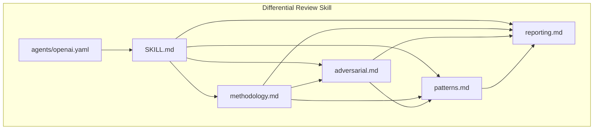
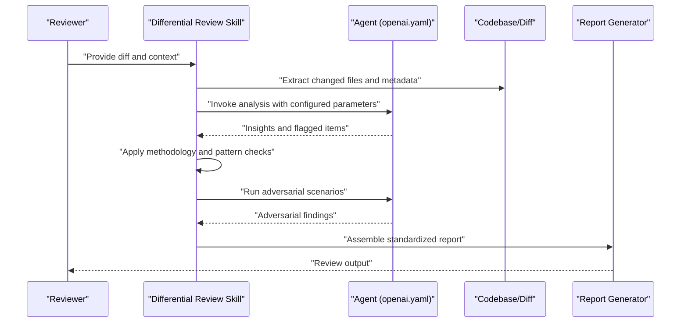
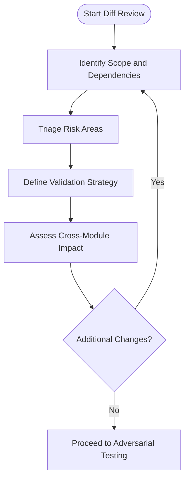
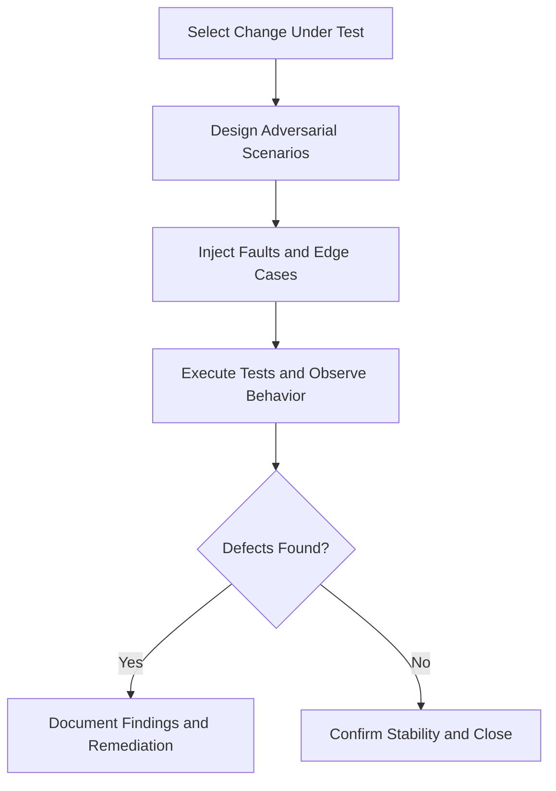
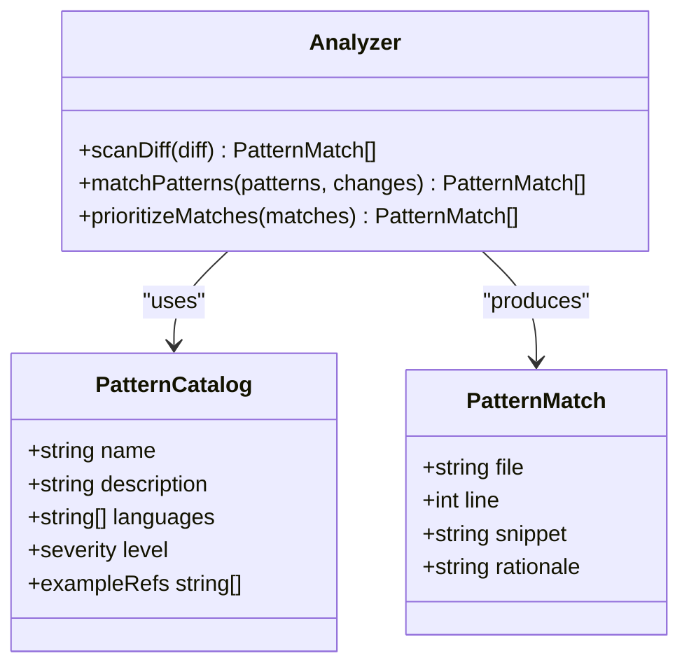
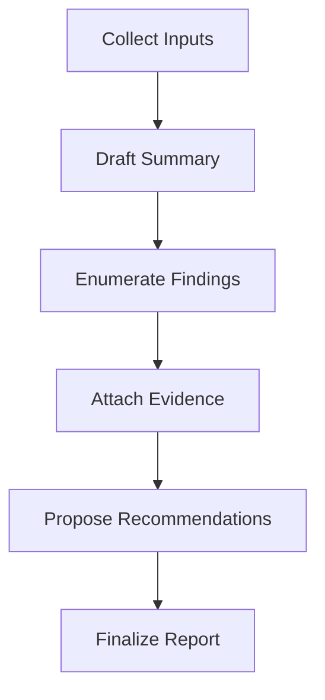
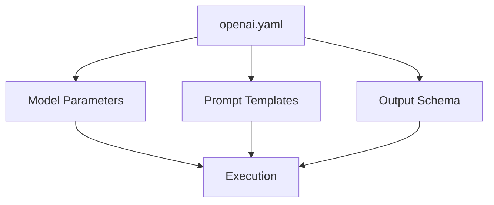
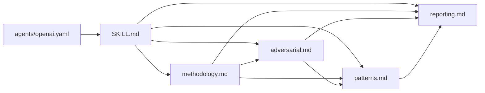

# Differential Review Skill

<cite>
**Referenced Files in This Document**
- [SKILL.md](file://skills/differential-review/SKILL.md)
- [methodology.md](file://skills/differential-review/methodology.md)
- [adversarial.md](file://skills/differential-review/adversarial.md)
- [patterns.md](file://skills/differential-review/patterns.md)
- [reporting.md](file://skills/differential-review/reporting.md)
- [openai.yaml](file://skills/differential-review/agents/openai.yaml)
</cite>

## Table of Contents
1. [Introduction](#introduction)
2. [Project Structure](#project-structure)
3. [Core Components](#core-components)
4. [Architecture Overview](#architecture-overview)
5. [Detailed Component Analysis](#detailed-component-analysis)
6. [Dependency Analysis](#dependency-analysis)
7. [Performance Considerations](#performance-considerations)
8. [Troubleshooting Guide](#troubleshooting-guide)
9. [Conclusion](#conclusion)
10. [Appendices](#appendices)

## Introduction
The differential-review skill focuses on change-focused code reviews with adversarial testing capabilities. It provides a structured methodology for analyzing diffs, identifying risky changes, and applying adversarial strategies to uncover latent defects. The skill also defines pattern recognition techniques and standardized reporting formats to ensure consistent, actionable review outcomes.

## Project Structure
The skill is organized as a self-contained module under the skills directory:
- SKILL.md: High-level overview, usage, and integration notes
- methodology.md: Step-by-step process for diff analysis and review workflow
- adversarial.md: Adversarial testing strategies and scenario design
- patterns.md: Pattern catalog and guidance for recognizing risky or anti-pattern changes
- reporting.md: Output templates and structure for review reports
- agents/openai.yaml: Agent configuration for model invocation and behavior tuning

**Diagram sources**
- [SKILL.md](file://skills/differential-review/SKILL.md)
- [methodology.md](file://skills/differential-review/methodology.md)
- [adversarial.md](file://skills/differential-review/adversarial.md)
- [patterns.md](file://skills/differential-review/patterns.md)
- [reporting.md](file://skills/differential-review/reporting.md)
- [openai.yaml](file://skills/differential-review/agents/openai.yaml)

**Section sources**
- [SKILL.md](file://skills/differential-review/SKILL.md)
- [methodology.md](file://skills/differential-review/methodology.md)
- [adversarial.md](file://skills/differential-review/adversarial.md)
- [patterns.md](file://skills/differential-review/patterns.md)
- [reporting.md](file://skills/differential-review/reporting.md)
- [openai.yaml](file://skills/differential-review/agents/openai.yaml)

## Core Components
- Change Analysis Methodology: Defines how to scope diffs, prioritize risk areas, and validate impact across modules.
- Adversarial Testing Strategies: Provides techniques to stress-test changes by simulating edge cases, failure modes, and misuse scenarios.
- Pattern Recognition Catalog: Enumerates common risky patterns and anti-patterns that often emerge in diffs.
- Reporting Format: Standardizes outputs for clarity, traceability, and actionability.
- Agent Configuration: Controls model parameters and behavior for automated assistance during review.

**Section sources**
- [SKILL.md](file://skills/differential-review/SKILL.md)
- [methodology.md](file://skills/differential-review/methodology.md)
- [adversarial.md](file://skills/differential-review/adversarial.md)
- [patterns.md](file://skills/differential-review/patterns.md)
- [reporting.md](file://skills/differential-review/reporting.md)
- [openai.yaml](file://skills/differential-review/agents/openai.yaml)

## Architecture Overview
The skill orchestrates a pipeline from diff ingestion through adversarial evaluation to report generation. The agent configuration tunes the model’s behavior to align with the skill’s standards.

**Diagram sources**
- [SKILL.md](file://skills/differential-review/SKILL.md)
- [methodology.md](file://skills/differential-review/methodology.md)
- [adversarial.md](file://skills/differential-review/adversarial.md)
- [patterns.md](file://skills/differential-review/patterns.md)
- [reporting.md](file://skills/differential-review/reporting.md)
- [openai.yaml](file://skills/differential-review/agents/openai.yaml)

## Detailed Component Analysis

### Change Analysis Methodology
This component outlines the stepwise approach to reviewing diffs:
- Scope identification: Determine affected components and dependencies.
- Risk triage: Prioritize high-impact changes based on complexity and exposure.
- Validation strategy: Define tests, assertions, and verification steps.
- Impact assessment: Evaluate cross-module effects and regression risks.

**Diagram sources**
- [methodology.md](file://skills/differential-review/methodology.md)

**Section sources**
- [methodology.md](file://skills/differential-review/methodology.md)

### Adversarial Testing Strategies
Adversarial testing aims to break assumptions embedded in changes by constructing targeted scenarios:
- Edge-case injection: Stress inputs at boundaries and limits.
- Failure-mode simulation: Introduce faults, timeouts, and inconsistent states.
- Misuse modeling: Exercise APIs and interfaces with invalid or unexpected usage.
- Regression probing: Revisit previously fixed issues to ensure stability.

**Diagram sources**
- [adversarial.md](file://skills/differential-review/adversarial.md)

**Section sources**
- [adversarial.md](file://skills/differential-review/adversarial.md)

### Pattern Recognition Techniques
Pattern recognition accelerates detection of risky changes by matching known anti-patterns and problematic structures:
- Common pitfalls: Identify recurring mistakes in logic, error handling, and concurrency.
- Structural red flags: Detect overly complex conditionals, hidden side effects, and tight coupling.
- Security-sensitive patterns: Flag unsafe operations, privilege escalations, and data exposure.
- Custom patterns: Encourage team-specific definitions aligned with domain constraints.

**Diagram sources**
- [patterns.md](file://skills/differential-review/patterns.md)

**Section sources**
- [patterns.md](file://skills/differential-review/patterns.md)

### Reporting Formats
Standardized reporting ensures consistency and actionability:
- Summary: High-level overview of changes and overall risk posture.
- Findings: Structured entries with severity, location, and rationale.
- Recommendations: Concrete remediation steps and references.
- Evidence: Links to diffs, logs, and test results supporting each finding.

**Diagram sources**
- [reporting.md](file://skills/differential-review/reporting.md)

**Section sources**
- [reporting.md](file://skills/differential-review/reporting.md)

### Agent Configuration
The agent configuration controls model invocation and behavior alignment with the skill’s standards:
- Model selection and parameters: Tune temperature, max tokens, and other runtime settings.
- Prompt scaffolding: Embed methodology, adversarial prompts, and pattern instructions.
- Output constraints: Enforce structured responses compatible with the reporting format.

**Diagram sources**
- [openai.yaml](file://skills/differential-review/agents/openai.yaml)
- [SKILL.md](file://skills/differential-review/SKILL.md)

**Section sources**
- [openai.yaml](file://skills/differential-review/agents/openai.yaml)
- [SKILL.md](file://skills/differential-review/SKILL.md)

## Dependency Analysis
The skill’s internal dependencies are cohesive and focused:
- SKILL.md orchestrates usage and ties together methodology, adversarial testing, patterns, and reporting.
- Methodology drives the flow into adversarial testing and pattern checks.
- Patterns inform both analysis and reporting.
- Reporting consolidates insights from all components.
- Agent configuration influences execution behavior across the pipeline.

**Diagram sources**
- [SKILL.md](file://skills/differential-review/SKILL.md)
- [methodology.md](file://skills/differential-review/methodology.md)
- [adversarial.md](file://skills/differential-review/adversarial.md)
- [patterns.md](file://skills/differential-review/patterns.md)
- [reporting.md](file://skills/differential-review/reporting.md)
- [openai.yaml](file://skills/differential-review/agents/openai.yaml)

**Section sources**
- [SKILL.md](file://skills/differential-review/SKILL.md)
- [methodology.md](file://skills/differential-review/methodology.md)
- [adversarial.md](file://skills/differential-review/adversarial.md)
- [patterns.md](file://skills/differential-review/patterns.md)
- [reporting.md](file://skills/differential-review/reporting.md)
- [openai.yaml](file://skills/differential-review/agents/openai.yaml)

## Performance Considerations
- Scope diffs precisely to reduce noise and improve focus.
- Pre-filter low-risk changes using heuristics before invoking adversarial testing.
- Cache pattern matches where possible to avoid redundant scans.
- Batch adversarial scenarios to minimize overhead while maintaining coverage.
- Use agent configuration to balance depth and speed according to review urgency.

[No sources needed since this section provides general guidance]

## Troubleshooting Guide
- If reports lack actionable details, verify that evidence attachments and rationale fields are populated per the reporting format.
- If adversarial scenarios produce false positives, refine scenario constraints and add negative examples to the pattern catalog.
- If agent outputs drift from expected structure, adjust prompt scaffolding and output constraints in the agent configuration.
- If analysis misses critical areas, expand scope identification and dependency mapping in the methodology.

**Section sources**
- [reporting.md](file://skills/differential-review/reporting.md)
- [adversarial.md](file://skills/differential-review/adversarial.md)
- [patterns.md](file://skills/differential-review/patterns.md)
- [methodology.md](file://skills/differential-review/methodology.md)
- [openai.yaml](file://skills/differential-review/agents/openai.yaml)

## Conclusion
The differential-review skill provides a comprehensive framework for change-focused code reviews. By combining rigorous methodology, adversarial testing, robust pattern recognition, and standardized reporting, it enables teams to detect and mitigate risks early. With configurable agent behavior, the skill adapts to varying project needs while maintaining consistent quality and traceability.

[No sources needed since this section summarizes without analyzing specific files]

## Appendices

### Workflow Integration Checklist
- Prepare diffs and related context (tests, logs, prior issues).
- Configure agent parameters for desired depth and speed.
- Execute methodology steps and run adversarial scenarios.
- Apply pattern checks and document findings.
- Generate and distribute standardized reports.

**Section sources**
- [SKILL.md](file://skills/differential-review/SKILL.md)
- [methodology.md](file://skills/differential-review/methodology.md)
- [adversarial.md](file://skills/differential-review/adversarial.md)
- [patterns.md](file://skills/differential-review/patterns.md)
- [reporting.md](file://skills/differential-review/reporting.md)
- [openai.yaml](file://skills/differential-review/agents/openai.yaml)