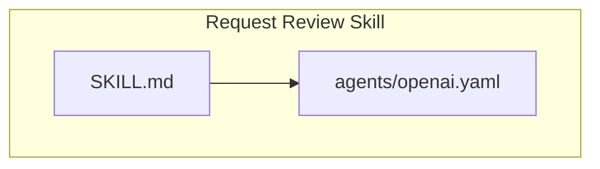
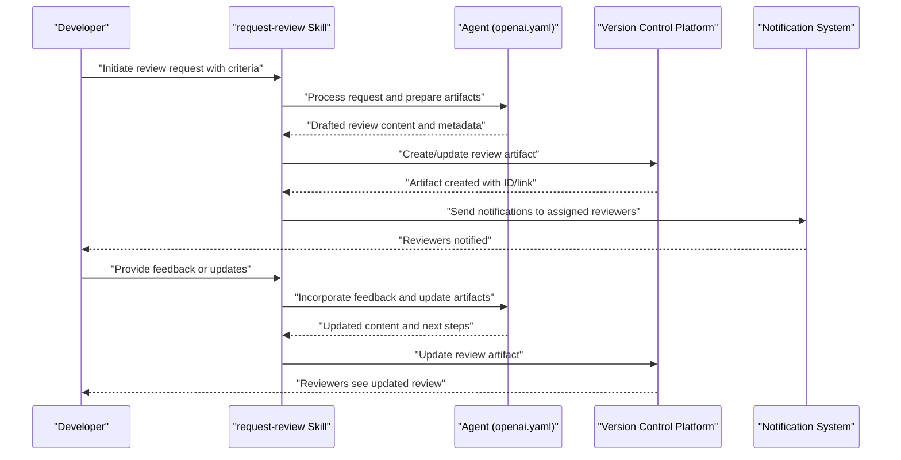
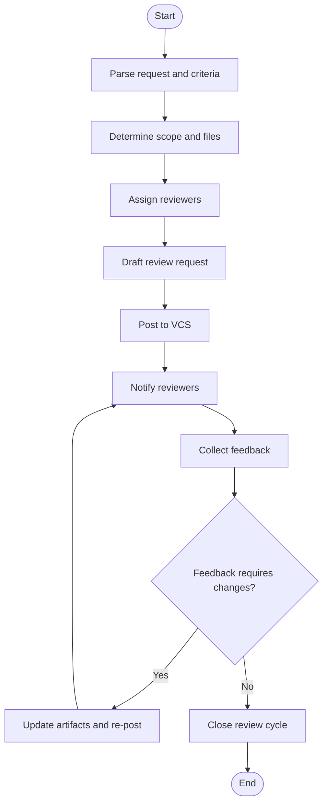
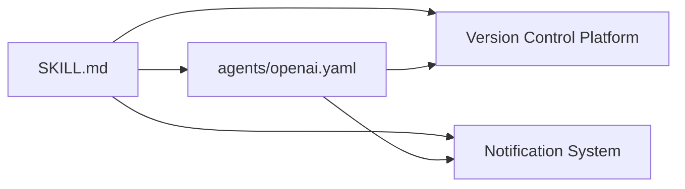

# Request Review Skill

<cite>
**Referenced Files in This Document**
- [SKILL.md](file://skills/request-review/SKILL.md)
- [openai.yaml](file://skills/request-review/agents/openai.yaml)
</cite>

## Table of Contents
1. [Introduction](#introduction)
2. [Project Structure](#project-structure)
3. [Core Components](#core-components)
4. [Architecture Overview](#architecture-overview)
5. [Detailed Component Analysis](#detailed-component-analysis)
6. [Dependency Analysis](#dependency-analysis)
7. [Performance Considerations](#performance-considerations)
8. [Troubleshooting Guide](#troubleshooting-guide)
9. [Conclusion](#conclusion)

## Introduction
This document describes the request-review skill that automates collaborative code review workflows. It explains how to initiate review requests, specify review criteria, manage reviewer assignments, and handle review feedback. It also covers workflow automation patterns, notification systems, and integration with version control platforms for streamlined review processes.

## Project Structure
The request-review skill is implemented as a self-contained module under the skills directory. It includes:
- A skill definition file describing capabilities, inputs, outputs, and usage guidance.
- An agent configuration file defining model parameters and behavior settings.

**Diagram sources**
- [SKILL.md](file://skills/request-review/SKILL.md)
- [openai.yaml](file://skills/request-review/agents/openai.yaml)

**Section sources**
- [SKILL.md](file://skills/request-review/SKILL.md)
- [openai.yaml](file://skills/request-review/agents/openai.yaml)

## Core Components
- Skill Definition (SKILL.md): Describes the purpose, triggers, inputs, outputs, and operational guidelines for initiating and managing review requests.
- Agent Configuration (agents/openai.yaml): Configures the underlying model and runtime behavior used by the skill’s automated actions.

Key responsibilities:
- Initiating review requests based on user prompts or hooks.
- Specifying review criteria such as scope, focus areas, and quality gates.
- Managing reviewer assignments and routing notifications.
- Handling review feedback loops and status updates.

**Section sources**
- [SKILL.md](file://skills/request-review/SKILL.md)
- [openai.yaml](file://skills/request-review/agents/openai.yaml)

## Architecture Overview
At a high level, the skill orchestrates a review workflow across users, the agent, and external systems (e.g., version control). The flow typically involves:
- User provides context and intent to start a review.
- The skill interprets the request, extracts criteria, and prepares artifacts.
- The agent executes tasks such as summarizing changes, drafting review requests, and notifying reviewers.
- External integrations create or update review artifacts (e.g., pull requests or review threads).
- Feedback is collected and summarized back to the requester.

[No diagram sources since this diagram shows conceptual workflow, not actual code structure]

## Detailed Component Analysis

### Skill Definition: SKILL.md
Purpose:
- Defines the request-review capability, including when to use it, required inputs, expected outputs, and recommended practices.
- Provides instructions for specifying review criteria, selecting reviewers, and handling feedback.

Operational highlights:
- Inputs: change identifiers, scope boundaries, focus areas, reviewer preferences, and any constraints.
- Outputs: structured review request, assignment list, and follow-up actions.
- Guidance: best practices for clear criteria, concise context, and actionable feedback.

Usage patterns:
- One-off reviews triggered by developer prompts.
- Automated reviews triggered by repository events via hooks or CI.
- Iterative reviews where feedback is incorporated into subsequent cycles.

**Section sources**
- [SKILL.md](file://skills/request-review/SKILL.md)

### Agent Configuration: agents/openai.yaml
Purpose:
- Configures the model and runtime behavior used by the skill’s automated tasks.
- Controls parameters such as temperature, max tokens, and system instructions that influence tone, verbosity, and adherence to guidelines.

Configuration aspects:
- Model selection and versioning.
- Generation parameters affecting output stability and detail level.
- System-level directives aligning agent behavior with skill goals.

Integration notes:
- The agent consumes structured inputs from the skill and produces outputs consumed by downstream components (e.g., VCS APIs, notification services).
- Changes to agent configuration can impact latency, cost, and output quality; adjust parameters according to team needs.

**Section sources**
- [openai.yaml](file://skills/request-review/agents/openai.yaml)

### Workflow Automation Patterns
Common patterns supported by the skill:
- Trigger-based initiation: Start reviews automatically on push, PR creation, or milestone changes.
- Criteria-driven scoping: Use explicit filters (files, modules, tags) to narrow review scope.
- Role-based assignments: Route reviewers by expertise, ownership, or availability.
- Feedback incorporation: Update review artifacts iteratively based on comments and approvals.
- Status tracking: Maintain consistent state across review lifecycle stages.

[No diagram sources since this diagram shows conceptual workflow, not actual code structure]

### Notification Systems
Typical notification channels:
- In-platform messages (e.g., issue or PR comments).
- Email digests for reviewers and stakeholders.
- Chat integrations for real-time alerts.

Recommendations:
- Include direct links to review artifacts and relevant diffs.
- Provide summary of requested actions and deadlines.
- Avoid notification fatigue by batching updates and respecting reviewer preferences.

[No section sources since this section provides general guidance]

### Version Control Integration
Integration points:
- Create or update review artifacts (pull requests, merge requests, or review threads).
- Attach contextual summaries and checklists generated by the skill.
- Sync status and labels to reflect review progress.

Best practices:
- Use stable identifiers (branch names, commit SHAs) to anchor reviews.
- Keep descriptions concise and actionable.
- Ensure permissions allow the skill to post and update artifacts.

[No section sources since this section provides general guidance]

## Dependency Analysis
The request-review skill depends on:
- The skill definition for behavioral contracts and user-facing guidance.
- The agent configuration for model behavior and generation parameters.
- External systems for posting and updating review artifacts and sending notifications.

**Diagram sources**
- [SKILL.md](file://skills/request-review/SKILL.md)
- [openai.yaml](file://skills/request-review/agents/openai.yaml)

**Section sources**
- [SKILL.md](file://skills/request-review/SKILL.md)
- [openai.yaml](file://skills/request-review/agents/openai.yaml)

## Performance Considerations
- Batch operations: Group multiple review updates to reduce API calls.
- Caching: Reuse computed summaries and metadata where appropriate.
- Parameter tuning: Adjust agent parameters to balance speed and detail.
- Rate limiting: Respect platform quotas and implement retries with backoff.

[No section sources since this section provides general guidance]

## Troubleshooting Guide
Common issues and resolutions:
- Missing context: Ensure the request includes change identifiers, scope, and reviewer preferences.
- Permission errors: Verify the skill has write access to the target repository and notification channels.
- Excessive noise: Refine criteria and notification preferences to avoid overwhelming reviewers.
- Stale artifacts: Refresh references to commits and branches before posting updates.

[No section sources since this section provides general guidance]

## Conclusion
The request-review skill streamlines collaborative code reviews by standardizing initiation, scoping, assignment, and feedback handling. With configurable agent behavior and robust integration patterns, teams can automate routine tasks while preserving human judgment at critical decision points. Adopting the recommended practices ensures efficient, scalable, and maintainable review workflows.