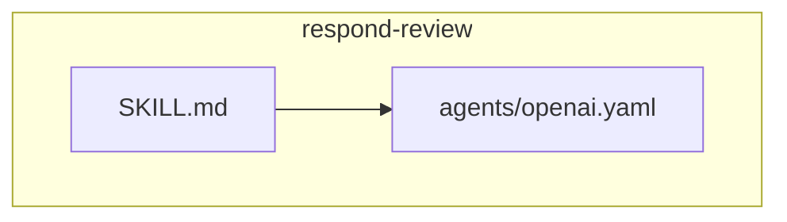
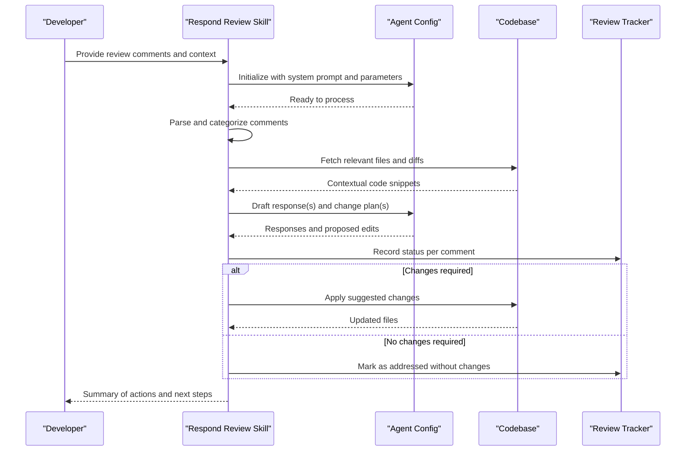
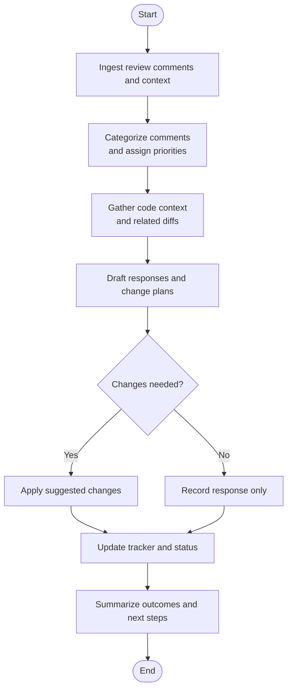
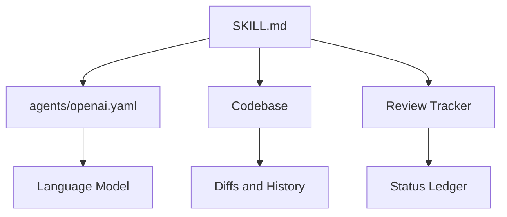

# Respond Review Skill

<cite>
**Referenced Files in This Document**
- [SKILL.md](file://skills/respond-review/SKILL.md)
- [openai.yaml](file://skills/respond-review/agents/openai.yaml)
</cite>

## Table of Contents
1. [Introduction](#introduction)
2. [Project Structure](#project-structure)
3. [Core Components](#core-components)
4. [Architecture Overview](#architecture-overview)
5. [Detailed Component Analysis](#detailed-component-analysis)
6. [Dependency Analysis](#dependency-analysis)
7. [Performance Considerations](#performance-considerations)
8. [Troubleshooting Guide](#troubleshooting-guide)
9. [Conclusion](#conclusion)

## Introduction
The respond-review skill helps developers address review feedback and complete code reviews efficiently. It guides you to analyze review comments, generate thoughtful responses, implement suggested changes, and track the completion status of each item. The skill emphasizes maintaining review context, handling different types of feedback consistently, and ensuring thorough coverage so that no comment is missed or left unresolved.

## Project Structure
The respond-review skill is organized as a focused module under skills with two primary artifacts:
- A human-readable skill definition describing goals, workflow, and expectations
- An agent configuration for model behavior and tooling integration

**Diagram sources**
- [SKILL.md](file://skills/respond-review/SKILL.md)
- [openai.yaml](file://skills/respond-review/agents/openai.yaml)

**Section sources**
- [SKILL.md](file://skills/respond-review/SKILL.md)
- [openai.yaml](file://skills/respond-review/agents/openai.yaml)

## Core Components
- Skill Definition (SKILL.md): Describes the purpose, scope, and step-by-step workflow for responding to review feedback. It outlines how to parse comments, categorize them, propose actions, and maintain a clear audit trail.
- Agent Configuration (agents/openai.yaml): Encapsulates model parameters, system prompts, and any tool integrations used by the skill during execution.

Key responsibilities:
- Analyze review comments for clarity, intent, and actionability
- Generate concise, contextualized responses aligned with reviewer expectations
- Implement or propose concrete changes where appropriate
- Track status per comment and overall review progress
- Preserve context across iterations to avoid losing thread continuity

**Section sources**
- [SKILL.md](file://skills/respond-review/SKILL.md)
- [openai.yaml](file://skills/respond-review/agents/openai.yaml)

## Architecture Overview
At a high level, the skill orchestrates a repeatable loop: ingest review input, analyze and categorize comments, draft responses and change plans, apply changes if needed, update tracking, and summarize outcomes. The agent configuration drives the language model’s behavior within this loop.

**Diagram sources**
- [SKILL.md](file://skills/respond-review/SKILL.md)
- [openai.yaml](file://skills/respond-review/agents/openai.yaml)

## Detailed Component Analysis

### Workflow and Processing Logic
The skill follows a structured flow to ensure completeness and consistency:
- Ingest and normalize review inputs
- Identify comment type and priority
- Gather necessary code context
- Draft responses and change proposals
- Apply changes when appropriate
- Update tracking records
- Produce a summary and identify remaining work

[No sources needed since this diagram shows conceptual workflow, not actual code structure]

### Handling Different Types of Feedback
The skill supports multiple feedback categories and tailors its approach accordingly:
- Clarification requests: Ask targeted questions and provide references to code or docs
- Suggestions: Evaluate feasibility, propose alternatives, and document trade-offs
- Issues and bugs: Reproduce, validate, and propose fixes with tests if applicable
- Style and formatting: Apply consistent rules and explain deviations
- Architectural concerns: Discuss implications and propose incremental improvements

Guidance:
- Maintain neutrality and focus on facts
- Reference specific lines or files when possible
- Keep responses concise and actionable
- Avoid overcommitting; propose experiments when uncertain

[No sources needed since this section provides general guidance]

### Maintaining Review Context
To preserve continuity across sessions:
- Capture baseline information such as PR/diff identifiers, branch names, and timestamps
- Store prior decisions and rationales alongside comments
- Link responses to exact locations in the codebase
- Re-summarize key points at the start of each iteration

[No sources needed since this section provides general guidance]

### Tracking Review Completion Status
Use a simple per-comment ledger to record:
- Comment ID or reference
- Category and priority
- Response summary
- Action taken (no change, change applied, follow-up required)
- Current status (open, addressed, deferred)
- Owner and due date (if applicable)

This enables quick scanning of what remains and ensures nothing slips through the cracks.

[No sources needed since this section provides general guidance]

### Agent Configuration and Behavior
The agent configuration defines:
- Model selection and parameters
- System instructions guiding tone, structure, and safety
- Tool usage patterns for reading diffs, applying changes, and updating trackers
- Constraints to prevent hallucination and enforce evidence-based responses

Best practices:
- Keep prompts focused on the current review set
- Enforce citation of file paths and line ranges
- Require explicit status updates after each action

**Section sources**
- [openai.yaml](file://skills/respond-review/agents/openai.yaml)

## Dependency Analysis
The respond-review skill depends on:
- The skill definition for process and policy
- The agent configuration for runtime behavior
- The codebase for context retrieval and change application
- A lightweight tracker for status management

**Diagram sources**
- [SKILL.md](file://skills/respond-review/SKILL.md)
- [openai.yaml](file://skills/respond-review/agents/openai.yaml)

**Section sources**
- [SKILL.md](file://skills/respond-review/SKILL.md)
- [openai.yaml](file://skills/respond-review/agents/openai.yaml)

## Performance Considerations
- Batch similar comments to reduce redundant context gathering
- Cache frequently referenced diffs and summaries
- Limit token usage by focusing on minimal viable context
- Prefer incremental changes and small commits to keep reviews digestible
- Use deterministic settings when reproducibility matters

[No sources needed since this section provides general guidance]

## Troubleshooting Guide
Common issues and resolutions:
- Missing context: Ensure diff identifiers and file paths are included with comments
- Ambiguous feedback: Request clarification before acting; document assumptions
- Over-scoped changes: Split into smaller, focused changes tied to specific comments
- Lost thread continuity: Re-inject summary and prior decisions at the start of each session
- Status drift: Reconcile tracker entries with actual repository state regularly

[No sources needed since this section provides general guidance]

## Conclusion
The respond-review skill provides a repeatable, transparent process for addressing review feedback. By analyzing comments systematically, generating precise responses, implementing changes judiciously, and tracking status rigorously, teams can accelerate review cycles while preserving quality and context.