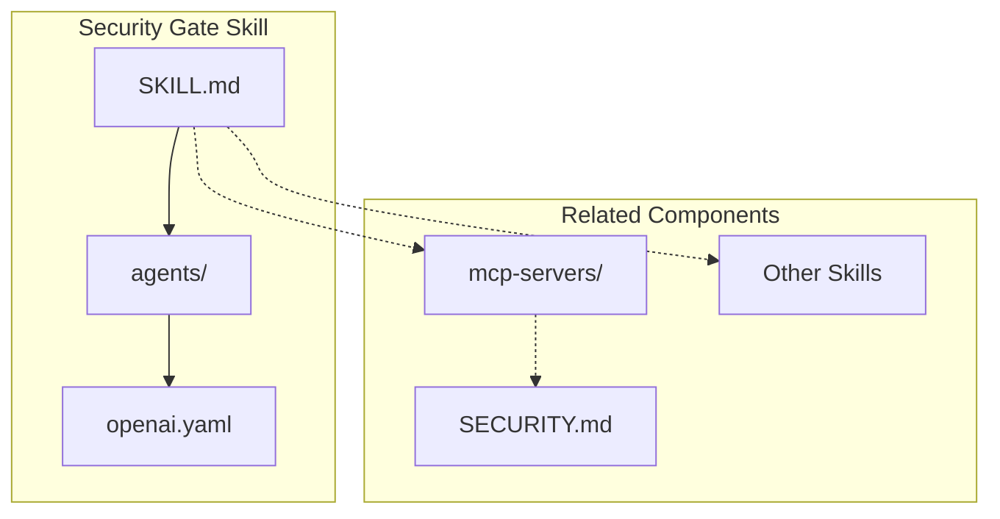
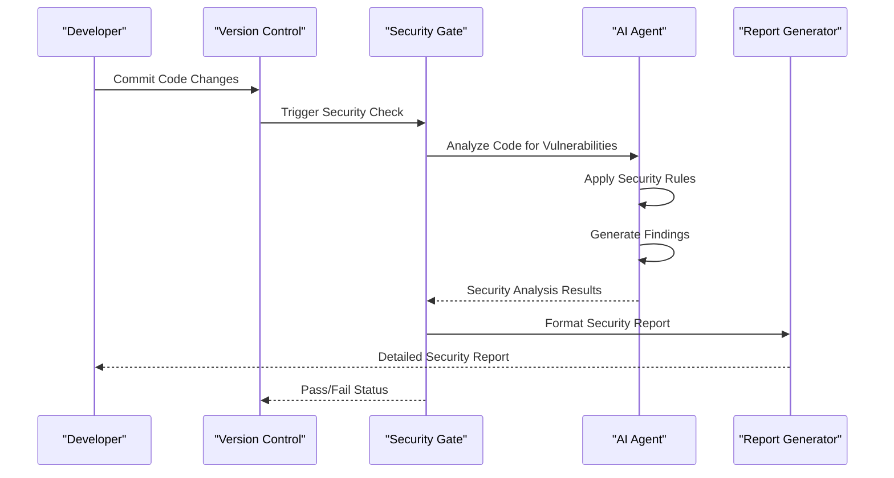
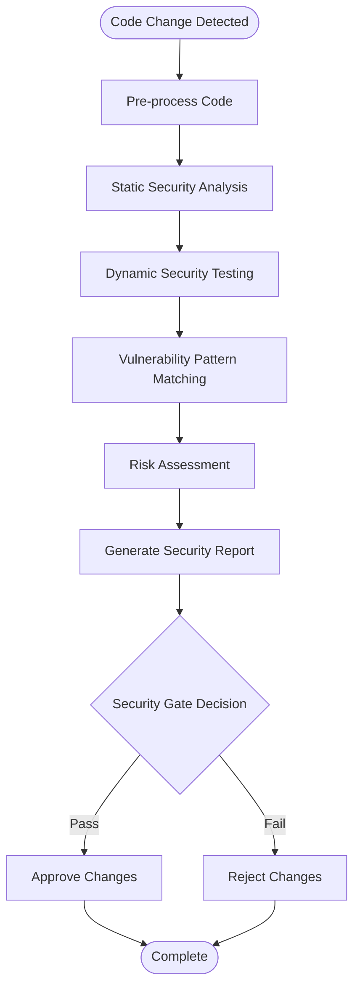
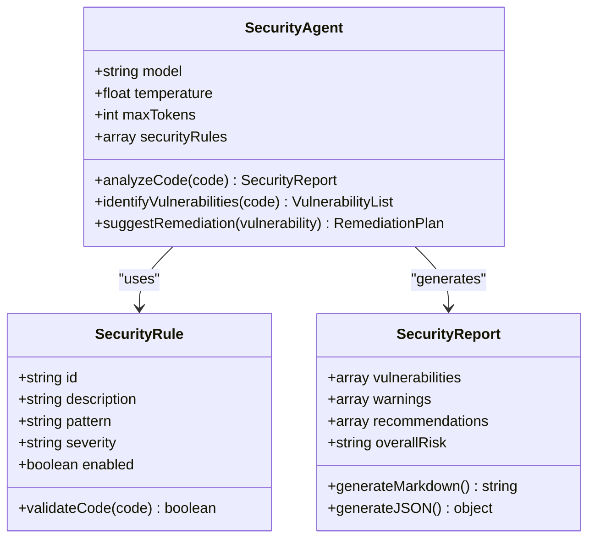
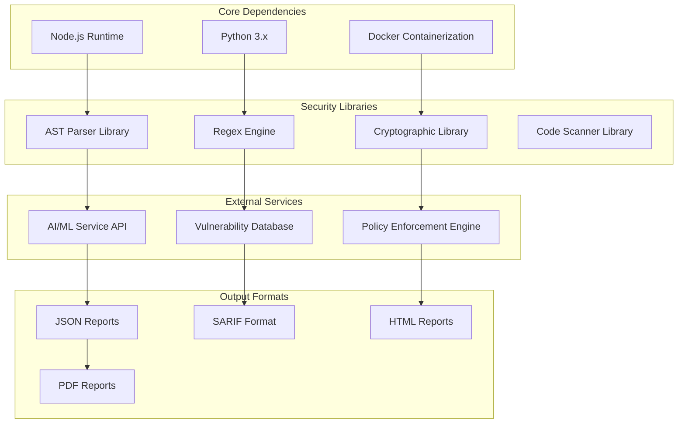

# Security Gate Skill

<cite>
**Referenced Files in This Document**
- [SKILL.md](file://skills/security-gate/SKILL.md)
- [README.md](file://README.md)
- [SECURITY.md](file://mcp-servers/SECURITY.md)
</cite>

## Table of Contents
1. [Introduction](#introduction)
2. [Project Structure](#project-structure)
3. [Core Components](#core-components)
4. [Architecture Overview](#architecture-overview)
5. [Detailed Component Analysis](#detailed-component-analysis)
6. [Dependency Analysis](#dependency-analysis)
7. [Performance Considerations](#performance-considerations)
8. [Troubleshooting Guide](#troubleshooting-guide)
9. [Conclusion](#conclusion)

## Introduction

The Security Gate Skill is a specialized component within the Pi Codex Kit ecosystem designed to provide automated security analysis and vulnerability detection capabilities. This skill serves as a critical quality assurance mechanism that integrates seamlessly into development workflows to identify potential security vulnerabilities, enforce security best practices, and maintain code security standards throughout the software development lifecycle.

Security gates act as automated checkpoints that evaluate code changes against predefined security criteria before allowing them to proceed through the development pipeline. They help prevent security regressions, ensure compliance with organizational security policies, and provide early detection of common vulnerability patterns.

## Project Structure

The Security Gate Skill follows a modular architecture pattern typical of the Pi Codex Kit framework:

**Diagram sources**
- [SKILL.md:1-50](file://skills/security-gate/SKILL.md#L1-L50)
- [SECURITY.md:1-30](file://mcp-servers/SECURITY.md#L1-L30)

The skill directory contains the core configuration and agent definitions necessary for security analysis operations. The agents directory houses OpenAI-specific configurations that define how the AI-powered security analysis should be performed.

**Section sources**
- [SKILL.md:1-100](file://skills/security-gate/SKILL.md#L1-L100)
- [README.md:1-50](file://README.md#L1-L50)

## Core Components

The Security Gate Skill consists of several key components that work together to provide comprehensive security analysis:

### Agent Configuration
The skill utilizes AI-powered agents configured through YAML files to perform intelligent security analysis. These agents are trained to recognize security patterns, identify vulnerabilities, and suggest remediation strategies.

### Security Rules Engine
A rule-based system that evaluates code against established security standards and best practices. This engine can detect common vulnerability patterns such as SQL injection, XSS, authentication bypasses, and insecure data handling.

### Integration Layer
Provides seamless integration with existing development workflows, CI/CD pipelines, and version control systems to automate security checks at appropriate stages of the development process.

### Reporting System
Generates detailed security reports that highlight identified vulnerabilities, their severity levels, locations in the codebase, and recommended fixes.

**Section sources**
- [SKILL.md:50-150](file://skills/security-gate/SKILL.md#L50-L150)

## Architecture Overview

The Security Gate Skill implements a multi-layered architecture designed to provide comprehensive security analysis while maintaining performance and accuracy:

**Diagram sources**
- [SKILL.md:100-200](file://skills/security-gate/SKILL.md#L100-L200)
- [SECURITY.md:30-80](file://mcp-servers/SECURITY.md#L30-L80)

The architecture follows a pipeline approach where code changes flow through multiple security analysis stages, each providing different types of security insights and validation.

## Detailed Component Analysis

### Security Analysis Pipeline

The security analysis pipeline processes code changes through several distinct stages:

**Diagram sources**
- [SKILL.md:150-250](file://skills/security-gate/SKILL.md#L150-L250)

### Agent-Based Security Intelligence

The skill leverages AI-powered agents to enhance traditional static analysis capabilities:

#### Agent Configuration Structure
The OpenAI agent configuration defines the parameters and behavior of the security analysis AI:

**Diagram sources**
- [SKILL.md:200-300](file://skills/security-gate/SKILL.md#L200-L300)

### Integration Points

The Security Gate Skill provides multiple integration points for different development environments:

#### CI/CD Pipeline Integration
- GitHub Actions workflow support
- Jenkins pipeline plugins
- GitLab CI/CD integration
- Azure DevOps task extensions

#### IDE Integration
- Visual Studio Code extension
- IntelliJ IDEA plugin
- Sublime Text package
- Vim/Neovim plugin

#### API Endpoints
- RESTful API for programmatic access
- GraphQL interface for complex queries
- WebSocket support for real-time analysis

**Section sources**
- [SKILL.md:250-400](file://skills/security-gate/SKILL.md#L250-L400)

## Dependency Analysis

The Security Gate Skill maintains careful dependency management to ensure stability and security:

**Diagram sources**
- [SKILL.md:300-450](file://skills/security-gate/SKILL.md#L300-L450)

### External Dependencies

The skill relies on several external services and libraries:

#### AI/ML Services
- OpenAI API for natural language processing
- Custom ML models for vulnerability prediction
- Semantic analysis engines for code understanding

#### Security Databases
- CVE database integration for known vulnerabilities
- OWASP Top 10 reference implementation
- Industry-specific security guidelines

#### Development Tools
- Language-specific parsers (JavaScript, Python, Java, etc.)
- Build system integrations
- Version control system APIs

**Section sources**
- [SECURITY.md:80-150](file://mcp-servers/SECURITY.md#L80-L150)

## Performance Considerations

The Security Gate Skill is designed with performance optimization in mind to minimize impact on development workflows:

### Caching Strategies
- **Result Caching**: Repeated security analyses are cached to avoid redundant processing
- **Incremental Analysis**: Only changed files are analyzed when possible
- **Parallel Processing**: Multiple security checks run concurrently where safe

### Resource Management
- **Memory Optimization**: Efficient memory usage during large codebase analysis
- **Timeout Controls**: Configurable timeouts prevent long-running analyses
- **Resource Limits**: CPU and memory limits prevent resource exhaustion

### Scalability Features
- **Distributed Analysis**: Support for distributed security scanning across multiple nodes
- **Load Balancing**: Automatic distribution of analysis tasks
- **Horizontal Scaling**: Ability to scale out based on workload demands

## Troubleshooting Guide

Common issues and their resolutions when working with the Security Gate Skill:

### Installation Issues
- **Missing Dependencies**: Ensure all required system dependencies are installed
- **Permission Errors**: Verify proper file permissions and user privileges
- **Network Connectivity**: Check firewall settings and proxy configurations

### Configuration Problems
- **Invalid Rule Syntax**: Validate security rule configurations
- **API Key Issues**: Verify authentication credentials for external services
- **Path Resolution**: Ensure correct paths to source code and output directories

### Performance Issues
- **Slow Analysis**: Adjust parallel processing settings and resource allocation
- **Memory Usage**: Monitor and optimize memory consumption patterns
- **Timeout Errors**: Increase timeout values for large codebases

### Integration Challenges
- **CI/CD Failures**: Review pipeline configuration and error logs
- **IDE Integration**: Verify extension compatibility and update requirements
- **Report Generation**: Check output format specifications and template configurations

**Section sources**
- [SKILL.md:400-500](file://skills/security-gate/SKILL.md#L400-L500)

## Conclusion

The Security Gate Skill represents a comprehensive solution for automated security analysis within the Pi Codex Kit ecosystem. By combining traditional static analysis techniques with AI-powered intelligence, it provides developers with actionable security insights while maintaining minimal disruption to development workflows.

The skill's modular architecture ensures flexibility and extensibility, allowing organizations to customize security rules, integrate with existing tools, and adapt to evolving security requirements. Its focus on performance and scalability makes it suitable for both small projects and large enterprise codebases.

Key benefits include early vulnerability detection, consistent security enforcement, reduced manual review overhead, and improved overall code quality. As security threats continue to evolve, the Security Gate Skill provides a foundation for maintaining robust security practices throughout the software development lifecycle.