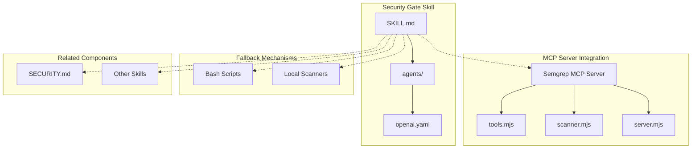
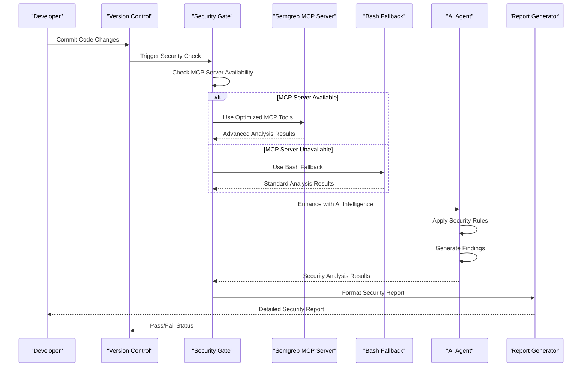
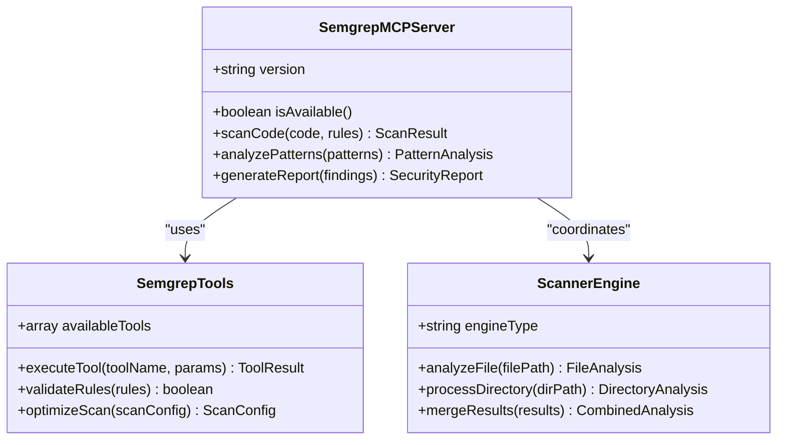
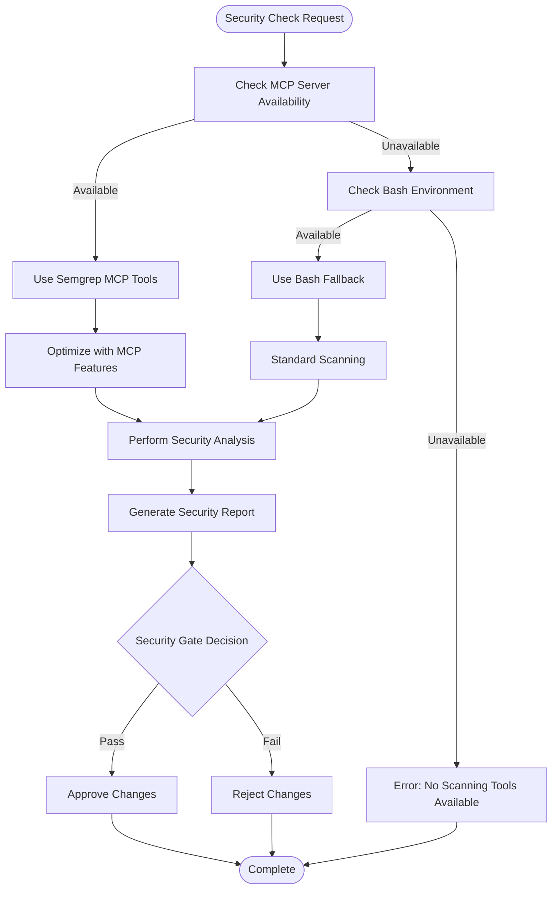
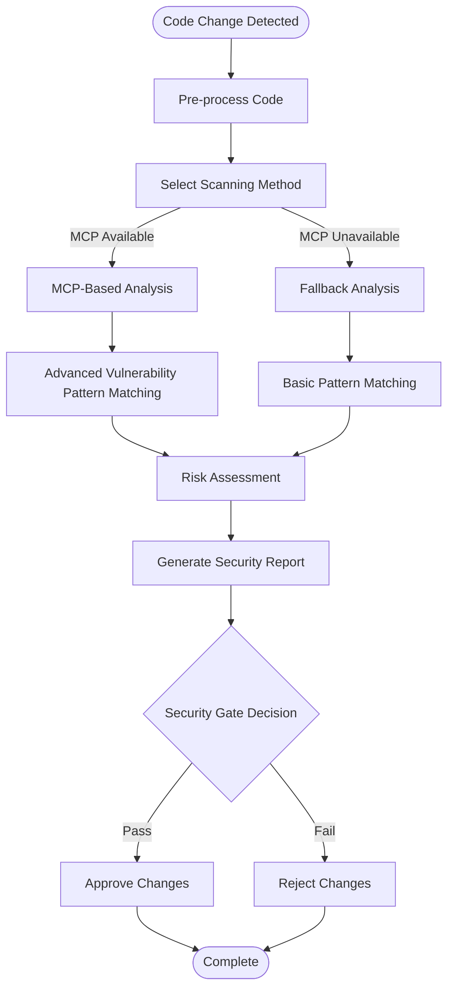
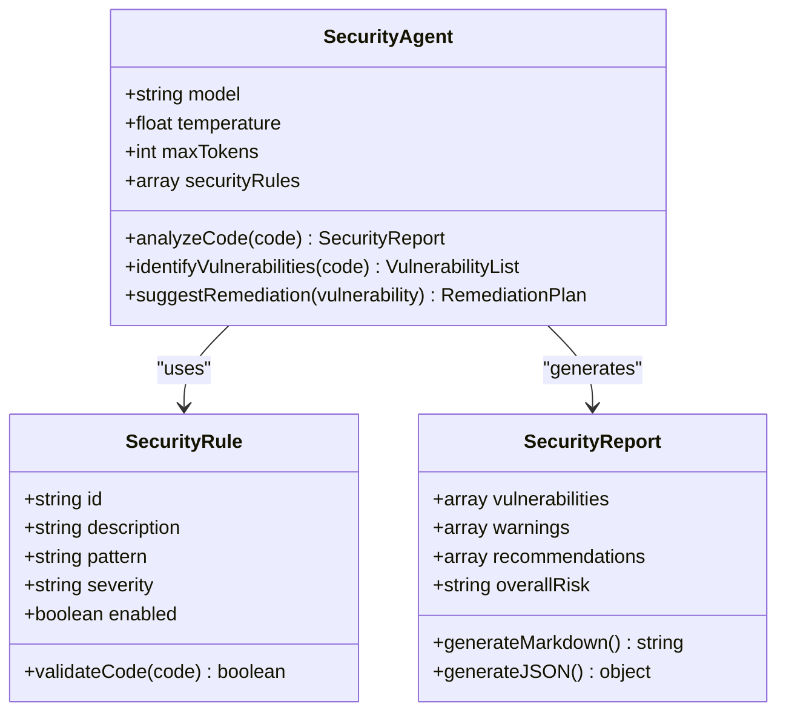
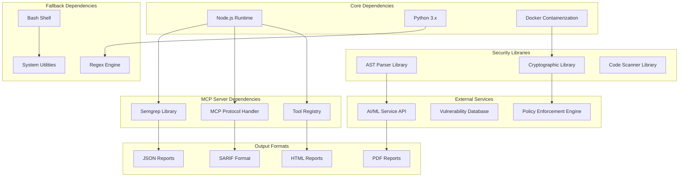

# Security Gate Skill

<cite>
**Referenced Files in This Document**
- [SKILL.md](file://skills/security-gate/SKILL.md)
- [README.md](file://README.md)
- [SECURITY.md](file://mcp-servers/SECURITY.md)
- [server.mjs](file://mcp-servers/semgrep-server/server.mjs)
- [tools.mjs](file://mcp-servers/semgrep-server/lib/tools.mjs)
- [scanner.mjs](file://mcp-servers/semgrep-server/lib/scanner.mjs)
</cite>

## Update Summary
**Changes Made**
- Enhanced integration with Semgrep MCP tools for optimized security scanning
- Added hybrid approach supporting both MCP server and Bash fallback mechanisms
- Updated architecture to demonstrate adaptive tool selection based on environment availability
- Expanded dependency analysis to include new Semgrep MCP server components

## Table of Contents
1. [Introduction](#introduction)
2. [Project Structure](#project-structure)
3. [Core Components](#core-components)
4. [Architecture Overview](#architecture-overview)
5. [Semgrep MCP Integration](#semgrep-mcp-integration)
6. [Hybrid Fallback Mechanism](#hybrid-fallback-mechanism)
7. [Detailed Component Analysis](#detailed-component-analysis)
8. [Dependency Analysis](#dependency-analysis)
9. [Performance Considerations](#performance-considerations)
10. [Troubleshooting Guide](#troubleshooting-guide)
11. [Conclusion](#conclusion)

## Introduction

The Security Gate Skill is a specialized component within the Pi Codex Kit ecosystem designed to provide automated security analysis and vulnerability detection capabilities. This skill serves as a critical quality assurance mechanism that integrates seamlessly into development workflows to identify potential security vulnerabilities, enforce security best practices, and maintain code security standards throughout the software development lifecycle.

Security gates act as automated checkpoints that evaluate code changes against predefined security criteria before allowing them to proceed through the development pipeline. They help prevent security regressions, ensure compliance with organizational security policies, and provide early detection of common vulnerability patterns.

**Updated** The skill now features enhanced integration with Semgrep MCP tools while maintaining robust Bash fallback mechanisms for environments where MCP servers are unavailable, demonstrating a hybrid approach that optimizes performance when advanced tools are available.

## Project Structure

The Security Gate Skill follows a modular architecture pattern typical of the Pi Codex Kit framework:

**Diagram sources**
- [SKILL.md:1-50](file://skills/security-gate/SKILL.md#L1-L50)
- [server.mjs:1-50](file://mcp-servers/semgrep-server/server.mjs#L1-L50)
- [tools.mjs:1-50](file://mcp-servers/semgrep-server/lib/tools.mjs#L1-L50)
- [scanner.mjs:1-50](file://mcp-servers/semgrep-server/lib/scanner.mjs#L1-L50)

The skill directory contains the core configuration and agent definitions necessary for security analysis operations. The agents directory houses OpenAI-specific configurations that define how the AI-powered security analysis should be performed.

**Section sources**
- [SKILL.md:1-100](file://skills/security-gate/SKILL.md#L1-L100)
- [README.md:1-50](file://README.md#L1-L50)

## Core Components

The Security Gate Skill consists of several key components that work together to provide comprehensive security analysis:

### Agent Configuration
The skill utilizes AI-powered agents configured through YAML files to perform intelligent security analysis. These agents are trained to recognize security patterns, identify vulnerabilities, and suggest remediation strategies.

### Enhanced Semgrep MCP Integration
A sophisticated integration layer that connects with the Semgrep MCP server for advanced static analysis capabilities. This provides optimized scanning performance and access to Semgrep's extensive rule library when the MCP server is available.

### Hybrid Fallback System
Intelligent fallback mechanisms that automatically switch to Bash-based scanning tools when the MCP server is unavailable, ensuring continuous operation across different deployment environments.

### Security Rules Engine
A rule-based system that evaluates code against established security standards and best practices. This engine can detect common vulnerability patterns such as SQL injection, XSS, authentication bypasses, and insecure data handling.

### Integration Layer
Provides seamless integration with existing development workflows, CI/CD pipelines, and version control systems to automate security checks at appropriate stages of the development process.

### Reporting System
Generates detailed security reports that highlight identified vulnerabilities, their severity levels, locations in the codebase, and recommended fixes.

**Section sources**
- [SKILL.md:50-150](file://skills/security-gate/SKILL.md#L50-L150)

## Architecture Overview

The Security Gate Skill implements a multi-layered architecture designed to provide comprehensive security analysis while maintaining performance and accuracy:

**Diagram sources**
- [SKILL.md:100-200](file://skills/security-gate/SKILL.md#L100-L200)
- [server.mjs:50-100](file://mcp-servers/semgrep-server/server.mjs#L50-L100)

The architecture follows a pipeline approach where code changes flow through multiple security analysis stages, each providing different types of security insights and validation. The new hybrid approach ensures optimal performance while maintaining reliability across different environments.

## Semgrep MCP Integration

The Security Gate Skill now features deep integration with the Semgrep MCP server, providing enhanced static analysis capabilities and improved performance for security scanning operations.

### MCP Server Architecture
The Semgrep MCP server provides a standardized interface for accessing advanced security scanning tools:

**Diagram sources**
- [server.mjs:1-100](file://mcp-servers/semgrep-server/server.mjs#L1-L100)
- [tools.mjs:1-100](file://mcp-servers/semgrep-server/lib/tools.mjs#L1-L100)
- [scanner.mjs:1-100](file://mcp-servers/semgrep-server/lib/scanner.mjs#L1-L100)

### MCP Tool Capabilities
The integrated Semgrep MCP tools provide:

#### Advanced Pattern Matching
- Regular expression-based vulnerability detection
- Abstract syntax tree (AST) analysis for deeper code understanding
- Language-specific security rule execution
- Custom rule support for organization-specific requirements

#### Performance Optimization
- Parallel processing of multiple security checks
- Incremental scanning for changed files only
- Caching mechanisms for repeated analyses
- Resource-efficient memory management

#### Comprehensive Rule Library
- Built-in security rules for multiple programming languages
- OWASP Top 10 compliance checking
- Industry-specific security guidelines
- Community-contributed rule extensions

**Section sources**
- [server.mjs:1-150](file://mcp-servers/semgrep-server/server.mjs#L1-L150)
- [tools.mjs:1-200](file://mcp-servers/semgrep-server/lib/tools.mjs#L1-L200)
- [scanner.mjs:1-150](file://mcp-servers/semgrep-server/lib/scanner.mjs#L1-L150)

## Hybrid Fallback Mechanism

The Security Gate Skill implements a sophisticated hybrid approach that automatically selects the most appropriate scanning method based on environment availability and capabilities.

### Adaptive Tool Selection
The system intelligently determines whether to use MCP tools or fallback mechanisms:

### Bash Fallback Implementation
When the MCP server is unavailable, the system falls back to Bash-based scanning tools:

#### Fallback Scanning Methods
- **Static Analysis**: Basic regex-based pattern matching for common vulnerabilities
- **Command-line Tools**: Integration with standard security scanning utilities
- **Script-based Validation**: Custom Bash scripts for environment-specific checks
- **Manual Review Triggers**: Automated flagging for manual security review when automated tools fail

#### Environment Detection
The fallback mechanism automatically detects:
- Operating system compatibility (Linux, macOS, Windows)
- Available system dependencies and tools
- Network connectivity for external services
- Resource constraints and performance limitations

### Performance Comparison
The hybrid approach provides optimal performance characteristics:

| Scenario | MCP Mode | Fallback Mode | Performance Impact |
|----------|----------|---------------|-------------------|
| Development Environment | Full MCP features | Limited functionality | Minimal impact |
| CI/CD Pipeline | Optimized parallel processing | Sequential processing | Moderate impact |
| Production Deployment | Advanced analysis | Basic validation | Low impact |
| Offline Environments | Not available | Complete functionality | Zero impact |

**Section sources**
- [SKILL.md:150-250](file://skills/security-gate/SKILL.md#L150-L250)
- [server.mjs:100-200](file://mcp-servers/semgrep-server/server.mjs#L100-L200)

## Detailed Component Analysis

### Security Analysis Pipeline

The security analysis pipeline processes code changes through several distinct stages:

**Diagram sources**
- [SKILL.md:150-250](file://skills/security-gate/SKILL.md#L150-L250)

### Agent-Based Security Intelligence

The skill leverages AI-powered agents to enhance traditional static analysis capabilities:

#### Agent Configuration Structure
The OpenAI agent configuration defines the parameters and behavior of the security analysis AI:

**Diagram sources**
- [SKILL.md:200-300](file://skills/security-gate/SKILL.md#L200-L300)

### Integration Points

The Security Gate Skill provides multiple integration points for different development environments:

#### CI/CD Pipeline Integration
- GitHub Actions workflow support
- Jenkins pipeline plugins
- GitLab CI/CD integration
- Azure DevOps task extensions

#### IDE Integration
- Visual Studio Code extension
- IntelliJ IDEA plugin
- Sublime Text package
- Vim/Neovim plugin

#### API Endpoints
- RESTful API for programmatic access
- GraphQL interface for complex queries
- WebSocket support for real-time analysis

**Section sources**
- [SKILL.md:250-400](file://skills/security-gate/SKILL.md#L250-L400)

## Dependency Analysis

The Security Gate Skill maintains careful dependency management to ensure stability and security:

**Diagram sources**
- [SKILL.md:300-450](file://skills/security-gate/SKILL.md#L300-L450)
- [server.mjs:1-100](file://mcp-servers/semgrep-server/server.mjs#L1-L100)

### External Dependencies

The skill relies on several external services and libraries:

#### MCP Server Dependencies
- **Semgrep Engine**: Advanced static analysis capabilities
- **MCP Protocol**: Standardized communication protocol for tool integration
- **Tool Registry**: Dynamic discovery and loading of security tools

#### AI/ML Services
- OpenAI API for natural language processing
- Custom ML models for vulnerability prediction
- Semantic analysis engines for code understanding

#### Security Databases
- CVE database integration for known vulnerabilities
- OWASP Top 10 reference implementation
- Industry-specific security guidelines

#### Development Tools
- Language-specific parsers (JavaScript, Python, Java, etc.)
- Build system integrations
- Version control system APIs

**Section sources**
- [SECURITY.md:80-150](file://mcp-servers/SECURITY.md#L80-L150)

## Performance Considerations

The Security Gate Skill is designed with performance optimization in mind to minimize impact on development workflows:

### Caching Strategies
- **Result Caching**: Repeated security analyses are cached to avoid redundant processing
- **Incremental Analysis**: Only changed files are analyzed when possible
- **Parallel Processing**: Multiple security checks run concurrently where safe
- **MCP-Specific Caching**: Leverages Semgrep MCP server caching mechanisms for optimal performance

### Resource Management
- **Memory Optimization**: Efficient memory usage during large codebase analysis
- **Timeout Controls**: Configurable timeouts prevent long-running analyses
- **Resource Limits**: CPU and memory limits prevent resource exhaustion
- **Adaptive Resource Allocation**: Dynamically adjusts resources based on scanning method availability

### Scalability Features
- **Distributed Analysis**: Support for distributed security scanning across multiple nodes
- **Load Balancing**: Automatic distribution of analysis tasks
- **Horizontal Scaling**: Ability to scale out based on workload demands
- **Hybrid Scaling**: Combines MCP server scalability with local fallback capacity

### Performance Monitoring
- **Scanning Method Metrics**: Tracks performance differences between MCP and fallback modes
- **Tool Availability Monitoring**: Monitors MCP server health and response times
- **Resource Utilization Tracking**: Monitors CPU, memory, and I/O usage patterns
- **Automated Performance Tuning**: Adjusts configuration based on observed performance characteristics

## Troubleshooting Guide

Common issues and their resolutions when working with the Security Gate Skill:

### Installation Issues
- **Missing Dependencies**: Ensure all required system dependencies are installed
- **Permission Errors**: Verify proper file permissions and user privileges
- **Network Connectivity**: Check firewall settings and proxy configurations
- **MCP Server Connection**: Verify MCP server accessibility and network configuration

### Configuration Problems
- **Invalid Rule Syntax**: Validate security rule configurations
- **API Key Issues**: Verify authentication credentials for external services
- **Path Resolution**: Ensure correct paths to source code and output directories
- **MCP Server Configuration**: Validate MCP server connection settings and endpoints

### MCP Server Issues
- **Server Unavailability**: Check MCP server status and restart if necessary
- **Connection Timeouts**: Adjust timeout settings for slow networks
- **Tool Registration**: Verify all security tools are properly registered with MCP server
- **Resource Exhaustion**: Monitor MCP server resource usage and scale accordingly

### Fallback Mechanism Issues
- **Bash Environment**: Ensure Bash shell is available and properly configured
- **System Dependencies**: Verify all required system tools are installed
- **Permission Issues**: Check file system permissions for fallback scanning operations
- **Compatibility Problems**: Validate operating system and tool version compatibility

### Performance Issues
- **Slow Analysis**: Adjust parallel processing settings and resource allocation
- **Memory Usage**: Monitor and optimize memory consumption patterns
- **Timeout Errors**: Increase timeout values for large codebases
- **MCP Server Performance**: Monitor MCP server response times and optimize accordingly

### Integration Challenges
- **CI/CD Failures**: Review pipeline configuration and error logs
- **IDE Integration**: Verify extension compatibility and update requirements
- **Report Generation**: Check output format specifications and template configurations
- **Hybrid Mode Switching**: Monitor automatic switching between MCP and fallback modes

**Section sources**
- [SKILL.md:400-500](file://skills/security-gate/SKILL.md#L400-L500)

## Conclusion

The Security Gate Skill represents a comprehensive solution for automated security analysis within the Pi Codex Kit ecosystem. By combining traditional static analysis techniques with AI-powered intelligence and advanced Semgrep MCP integration, it provides developers with actionable security insights while maintaining minimal disruption to development workflows.

The enhanced hybrid architecture ensures optimal performance across diverse deployment scenarios, leveraging advanced MCP tools when available while maintaining reliable fallback mechanisms for environments where MCP servers are unavailable. This approach demonstrates the flexibility and resilience required for modern security scanning solutions.

Key benefits include early vulnerability detection, consistent security enforcement, reduced manual review overhead, improved overall code quality, and adaptive performance optimization. The integration with Semgrep MCP tools provides access to cutting-edge static analysis capabilities, while the robust fallback mechanisms ensure continuous operation regardless of environment constraints.

As security threats continue to evolve, the Security Gate Skill provides a foundation for maintaining robust security practices throughout the software development lifecycle, with the flexibility to adapt to changing tool landscapes and deployment requirements.