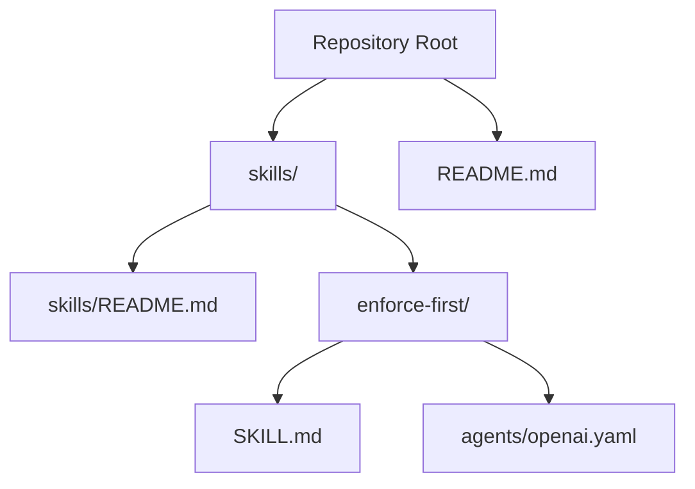
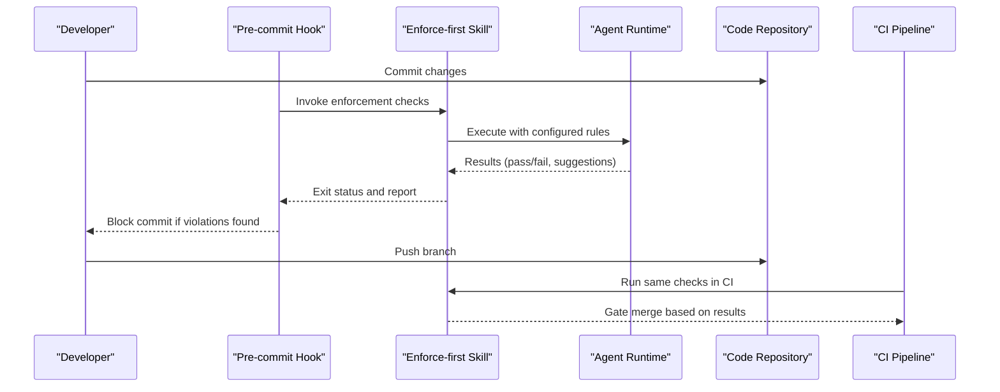
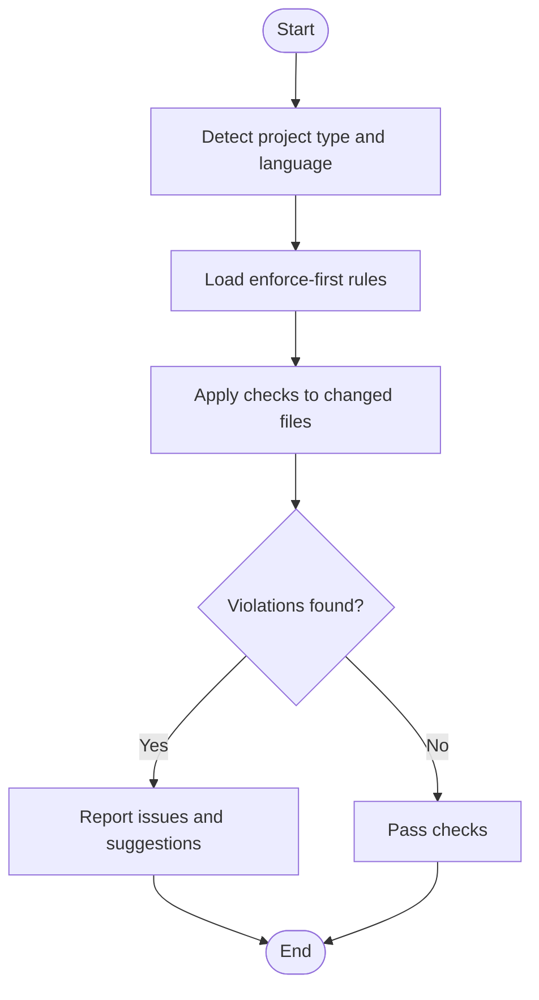
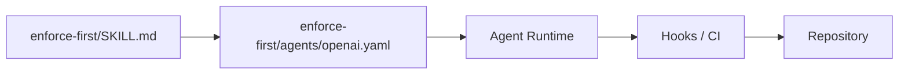

# Development Workflow Skills

<cite>
**Referenced Files in This Document**
- [README.md](file://README.md)
- [skills/README.md](file://skills/README.md)
- [skills/enforce-first/SKILL.md](file://skills/enforce-first/SKILL.md)
- [skills/enforce-first/agents/openai.yaml](file://skills/enforce-first/agents/openai.yaml)
</cite>

## Table of Contents
1. [Introduction](#introduction)
2. [Project Structure](#project-structure)
3. [Core Components](#core-components)
4. [Architecture Overview](#architecture-overview)
5. [Detailed Component Analysis](#detailed-component-analysis)
6. [Dependency Analysis](#dependency-analysis)
7. [Performance Considerations](#performance-considerations)
8. [Troubleshooting Guide](#troubleshooting-guide)
9. [Conclusion](#conclusion)
10. [Appendices](#appendices)

## Introduction
This document explains the development workflow automation skills in the Pi Codex Kit, with a focus on the enforce-first skill. The enforce-first skill helps teams maintain first principles by enforcing architectural decisions and coding standards during development. It integrates into common workflows such as pre-commit checks, pull request reviews, and CI gates to ensure code adheres to agreed-upon patterns and constraints.

The documentation covers:
- How the enforce-first skill fits into development workflows
- Configuration options for different project types
- Customization strategies for team-specific requirements
- Integration points with tools like hooks and CI systems

## Project Structure
The repository organizes reusable capabilities as “skills.” Each skill includes:
- A SKILL.md describing purpose, usage, and configuration
- An agents directory containing provider-specific agent definitions (for example, openai.yaml)

**Diagram sources**
- [README.md](file://README.md)
- [skills/README.md](file://skills/README.md)
- [skills/enforce-first/SKILL.md](file://skills/enforce-first/SKILL.md)
- [skills/enforce-first/agents/openai.yaml](file://skills/enforce-first/agents/openai.yaml)

**Section sources**
- [README.md](file://README.md)
- [skills/README.md](file://skills/README.md)

## Core Components
- Enforce-first skill: Provides guidance and agent configuration to enforce architectural decisions and coding standards consistently across the codebase.
- Agent definition: Provider-specific configuration that defines how the skill is executed by an AI agent runtime.

Key responsibilities:
- Define enforcement rules and principles
- Provide configuration for different project types
- Offer customization hooks for team-specific policies
- Integrate with development tooling via hooks or CI

**Section sources**
- [skills/enforce-first/SKILL.md](file://skills/enforce-first/SKILL.md)
- [skills/enforce-first/agents/openai.yaml](file://skills/enforce-first/agents/openai.yaml)

## Architecture Overview
The enforce-first skill operates within a typical developer workflow:
- Developer writes code locally
- Pre-commit hook triggers the skill to validate changes against enforced standards
- Pull request review uses the skill to ensure consistency before merging
- CI pipeline enforces the same checks to gate merges

[No sources needed since this diagram shows conceptual workflow, not actual code structure]

## Detailed Component Analysis

### Enforce-first Skill
Purpose:
- Maintain first-principles adherence by enforcing architecture and coding standards
- Provide consistent feedback early in the development process
- Support customization for team-specific policies and project types

Configuration and integration:
- The skill’s behavior is defined in its SKILL.md
- Execution details are provided by the agent configuration in agents/openai.yaml
- Teams can tailor rules and thresholds per project type (for example, web app vs library)

Customization strategies:
- Adjust rule sets to match team conventions
- Add project-type specific overrides
- Extend with additional checks via hooks or CI steps

Integration points:
- Local development via hooks
- Remote validation via CI pipelines
- Optional integration with PR review processes

**Section sources**
- [skills/enforce-first/SKILL.md](file://skills/enforce-first/SKILL.md)
- [skills/enforce-first/agents/openai.yaml](file://skills/enforce-first/agents/openai.yaml)

### Agent Definition (OpenAI)
Role:
- Defines how the enforce-first skill is invoked by the OpenAI agent runtime
- Encodes parameters and context required for execution

Usage:
- Reference from the skill’s SKILL.md when invoking the agent
- Customize parameters to align with team needs and project scope

**Section sources**
- [skills/enforce-first/agents/openai.yaml](file://skills/enforce-first/agents/openai.yaml)

### Conceptual Overview
The enforce-first skill can be adapted to various environments:
- Monorepos with multiple languages
- Single-language services
- Mixed frontend/backend stacks

[No sources needed since this diagram shows conceptual workflow, not actual code structure]

## Dependency Analysis
The enforce-first skill depends on:
- The skill definition (SKILL.md) for policy and behavior
- The agent configuration (openai.yaml) for runtime invocation
- External tooling (hooks, CI) for orchestration

**Diagram sources**
- [skills/enforce-first/SKILL.md](file://skills/enforce-first/SKILL.md)
- [skills/enforce-first/agents/openai.yaml](file://skills/enforce-first/agents/openai.yaml)

**Section sources**
- [skills/enforce-first/SKILL.md](file://skills/enforce-first/SKILL.md)
- [skills/enforce-first/agents/openai.yaml](file://skills/enforce-first/agents/openai.yaml)

## Performance Considerations
- Scope checks to changed files to reduce overhead
- Cache rule sets and shared configurations where possible
- Parallelize independent checks across directories or modules
- Tune agent parameters to balance thoroughness and speed

[No sources needed since this section provides general guidance]

## Troubleshooting Guide
Common issues and resolutions:
- Agent invocation failures: Verify agent configuration and environment variables
- Rule misalignment: Review and update SKILL.md to reflect current standards
- Hook integration problems: Ensure the hook correctly invokes the skill and handles exit codes
- CI gating inconsistencies: Align local and CI configurations to avoid false positives/negatives

**Section sources**
- [skills/enforce-first/SKILL.md](file://skills/enforce-first/SKILL.md)
- [skills/enforce-first/agents/openai.yaml](file://skills/enforce-first/agents/openai.yaml)

## Conclusion
The enforce-first skill enables teams to codify and enforce architectural decisions and coding standards early in the development lifecycle. By integrating it into hooks and CI, teams can maintain consistency, reduce technical debt, and improve code quality. Customization through the skill’s configuration allows adaptation to diverse project types and team practices.

[No sources needed since this section summarizes without analyzing specific files]

## Appendices

### Quick Start Checklist
- Review the enforce-first SKILL.md for available rules and options
- Configure the agent settings in agents/openai.yaml for your environment
- Add a pre-commit hook to run the skill locally
- Integrate the skill into CI to gate merges
- Iterate on rules based on team feedback and evolving standards

**Section sources**
- [skills/enforce-first/SKILL.md](file://skills/enforce-first/SKILL.md)
- [skills/enforce-first/agents/openai.yaml](file://skills/enforce-first/agents/openai.yaml)