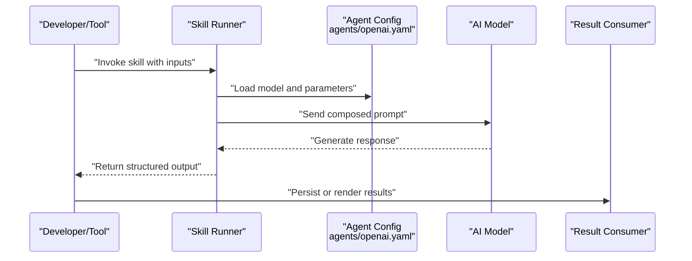
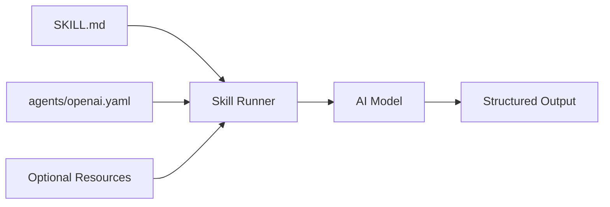

# Skills Reference

<cite>
**Referenced Files in This Document**
- [skills/README.md](file://skills/README.md)
- [skills/audit-code/SKILL.md](file://skills/audit-code/SKILL.md)
- [skills/code-reviewer/SKILL.md](file://skills/code-reviewer/SKILL.md)
- [skills/deepen-architecture/SKILL.md](file://skills/deepen-architecture/SKILL.md)
- [skills/develop-tdd/SKILL.md](file://skills/develop-tdd/SKILL.md)
- [skills/differential-review/SKILL.md](file://skills/differential-review/SKILL.md)
- [skills/enforce-first/SKILL.md](file://skills/enforce-first/SKILL.md)
- [skills/fp-check/SKILL.md](file://skills/fp-check/SKILL.md)
- [skills/pi-lens-ast-grep/SKILL.md](file://skills/pi-lens-ast-grep/SKILL.md)
- [skills/pi-lens-lsp-navigation/SKILL.md](file://skills/pi-lens-lsp-navigation/SKILL.md)
- [skills/pi-lens-write-ast-grep-rule/SKILL.md](file://skills/pi-lens-write-ast-grep-rule/SKILL.md)
- [skills/pi-lens-write-tree-sitter-rule/SKILL.md](file://skills/pi-lens-write-tree-sitter-rule/SKILL.md)
- [skills/request-review/SKILL.md](file://skills/request-review/SKILL.md)
- [skills/respond-review/SKILL.md](file://skills/respond-review/SKILL.md)
- [skills/simplify/SKILL.md](file://skills/simplify/SKILL.md)
- [skills/variant-analysis/SKILL.md](file://skills/variant-analysis/SKILL.md)
- [skills/verify-work/SKILL.md](file://skills/verify-work/SKILL.md)
</cite>

## Table of Contents
1. [Introduction](#introduction)
2. [Project Structure](#project-structure)
3. [Core Components](#core-components)
4. [Architecture Overview](#architecture-overview)
5. [Detailed Component Analysis](#detailed-component-analysis)
6. [Dependency Analysis](#dependency-analysis)
7. [Performance Considerations](#performance-considerations)
8. [Troubleshooting Guide](#troubleshooting-guide)
9. [Conclusion](#conclusion)

## Introduction
This document is the definitive reference for all available skills in the Pi Codex Kit. Each skill encapsulates a focused area of software development assistance, such as code review, architecture deepening, test-driven development, AST and LSP-based navigation, rule writing, variant analysis, and more. For each skill you will find:
- Purpose and scope
- Configuration options (model selection and agent settings)
- Inputs required and outputs produced
- Typical usage patterns and integration scenarios
- How the skill interacts with AI models
- Performance considerations and best practices

The goal is to help developers quickly understand what each skill does, how to configure it, and how to use it effectively within their workflows.

## Project Structure
The skills are organized under the skills directory. Each skill has its own folder containing:
- A SKILL.md file describing purpose, configuration, inputs, outputs, and usage
- An agents/openai.yaml file specifying model and agent parameters used by the skill
- Optional additional resources (scripts, references, methodology documents)

```mermaid
graph TB
subgraph "Skills"
A["audit-code"]
B["code-reviewer"]
C["deepen-architecture"]
D["develop-tdd"]
E["differential-review"]
F["enforce-first"]
G["fp-check"]
H["pi-lens-ast-grep"]
I["pi-lens-lsp-navigation"]
J["pi-lens-write-ast-grep-rule"]
K["pi-lens-write-tree-sitter-rule"]
L["request-review"]
M["respond-review"]
N["simplify"]
O["variant-analysis"]
P["verify-work"]
end
A --> Aa["agents/openai.yaml"]
B --> Ba["agents/openai.yaml"]
C --> Ca["agents/openai.yaml"]
D --> Da["agents/openai.yaml"]
E --> Ea["agents/openai.yaml"]
F --> Fa["agents/openai.yaml"]
G --> Ga["agents/openai.yaml"]
H --> Ha["agents/openai.yaml"]
I --> Ia["agents/openai.yaml"]
J --> Ja["agents/openai.yaml"]
K --> Ka["agents/openai.yaml"]
L --> La["agents/openai.yaml"]
M --> Ma["agents/openai.yaml"]
N --> Na["agents/openai.yaml"]
O --> Oa["agents/openai.yaml"]
P --> Pa["agents/openai.yaml"]
```

**Diagram sources**
- [skills/audit-code/SKILL.md](file://skills/audit-code/SKILL.md)
- [skills/audit-code/agents/openai.yaml](file://skills/audit-code/agents/openai.yaml)
- [skills/code-reviewer/SKILL.md](file://skills/code-reviewer/SKILL.md)
- [skills/code-reviewer/agents/openai.yaml](file://skills/code-reviewer/agents/openai.yaml)
- [skills/deepen-architecture/SKILL.md](file://skills/deepen-architecture/SKILL.md)
- [skills/deepen-architecture/agents/openai.yaml](file://skills/deepen-architecture/agents/openai.yaml)
- [skills/develop-tdd/SKILL.md](file://skills/develop-tdd/SKILL.md)
- [skills/develop-tdd/agents/openai.yaml](file://skills/develop-tdd/agents/openai.yaml)
- [skills/differential-review/SKILL.md](file://skills/differential-review/SKILL.md)
- [skills/differential-review/agents/openai.yaml](file://skills/differential-review/agents/openai.yaml)
- [skills/enforce-first/SKILL.md](file://skills/enforce-first/SKILL.md)
- [skills/enforce-first/agents/openai.yaml](file://skills/enforce-first/agents/openai.yaml)
- [skills/fp-check/SKILL.md](file://skills/fp-check/SKILL.md)
- [skills/fp-check/agents/openai.yaml](file://skills/fp-check/agents/openai.yaml)
- [skills/pi-lens-ast-grep/SKILL.md](file://skills/pi-lens-ast-grep/SKILL.md)
- [skills/pi-lens-ast-grep/agents/openai.yaml](file://skills/pi-lens-ast-grep/agents/openai.yaml)
- [skills/pi-lens-lsp-navigation/SKILL.md](file://skills/pi-lens-lsp-navigation/SKILL.md)
- [skills/pi-lens-lsp-navigation/agents/openai.yaml](file://skills/pi-lens-lsp-navigation/agents/openai.yaml)
- [skills/pi-lens-write-ast-grep-rule/SKILL.md](file://skills/pi-lens-write-ast-grep-rule/SKILL.md)
- [skills/pi-lens-write-ast-grep-rule/agents/openai.yaml](file://skills/pi-lens-write-ast-grep-rule/agents/openai.yaml)
- [skills/pi-lens-write-tree-sitter-rule/SKILL.md](file://skills/pi-lens-write-tree-sitter-rule/SKILL.md)
- [skills/pi-lens-write-tree-sitter-rule/agents/openai.yaml](file://skills/pi-lens-write-tree-sitter-rule/agents/openai.yaml)
- [skills/request-review/SKILL.md](file://skills/request-review/SKILL.md)
- [skills/request-review/agents/openai.yaml](file://skills/request-review/agents/openai.yaml)
- [skills/respond-review/SKILL.md](file://skills/respond-review/SKILL.md)
- [skills/respond-review/agents/openai.yaml](file://skills/respond-review/agents/openai.yaml)
- [skills/simplify/SKILL.md](file://skills/simplify/SKILL.md)
- [skills/simplify/agents/openai.yaml](file://skills/simplify/agents/openai.yaml)
- [skills/variant-analysis/SKILL.md](file://skills/variant-analysis/SKILL.md)
- [skills/variant-analysis/agents/openai.yaml](file://skills/variant-analysis/agents/openai.yaml)
- [skills/verify-work/SKILL.md](file://skills/verify-work/SKILL.md)
- [skills/verify-work/agents/openai.yaml](file://skills/verify-work/agents/openai.yaml)

**Section sources**
- [skills/README.md](file://skills/README.md)

## Core Components
Each skill is defined by two primary artifacts:
- SKILL.md: The human-readable specification that describes purpose, configuration, inputs, outputs, and usage patterns.
- agents/openai.yaml: The model and agent configuration used when invoking the skill via the OpenAI-compatible runtime.

Common configuration keys typically include:
- Model selection (e.g., model name or family)
- Temperature and other generation parameters
- System prompt or instruction overrides
- Context window constraints and token budgeting hints

Inputs and outputs vary per skill but generally follow these patterns:
- Inputs: source files, diffs, repository context, queries, rules, or user prompts
- Outputs: reports, suggestions, generated rules, refactoring plans, or structured findings

Integration points:
- CLI or editor integrations invoke a skill by name and pass the configured inputs
- The skill’s agent reads the openai.yaml to select the model and parameters
- The skill returns results in a format suitable for consumption by CI, editors, or downstream tools

Best practices:
- Keep inputs concise and relevant to reduce token usage and improve accuracy
- Use targeted queries or scoped diffs where possible
- Prefer deterministic configurations for repeatable results in CI

**Section sources**
- [skills/audit-code/SKILL.md](file://skills/audit-code/SKILL.md)
- [skills/audit-code/agents/openai.yaml](file://skills/audit-code/agents/openai.yaml)
- [skills/code-reviewer/SKILL.md](file://skills/code-reviewer/SKILL.md)
- [skills/code-reviewer/agents/openai.yaml](file://skills/code-reviewer/agents/openai.yaml)
- [skills/deepen-architecture/SKILL.md](file://skills/deepen-architecture/SKILL.md)
- [skills/deepen-architecture/agents/openai.yaml](file://skills/deepen-architecture/agents/openai.yaml)
- [skills/develop-tdd/SKILL.md](file://skills/develop-tdd/SKILL.md)
- [skills/develop-tdd/agents/openai.yaml](file://skills/develop-tdd/agents/openai.yaml)
- [skills/differential-review/SKILL.md](file://skills/differential-review/SKILL.md)
- [skills/differential-review/agents/openai.yaml](file://skills/differential-review/agents/openai.yaml)
- [skills/enforce-first/SKILL.md](file://skills/enforce-first/SKILL.md)
- [skills/enforce-first/agents/openai.yaml](file://skills/enforce-first/agents/openai.yaml)
- [skills/fp-check/SKILL.md](file://skills/fp-check/SKILL.md)
- [skills/fp-check/agents/openai.yaml](file://skills/fp-check/agents/openai.yaml)
- [skills/pi-lens-ast-grep/SKILL.md](file://skills/pi-lens-ast-grep/SKILL.md)
- [skills/pi-lens-ast-grep/agents/openai.yaml](file://skills/pi-lens-ast-grep/agents/openai.yaml)
- [skills/pi-lens-lsp-navigation/SKILL.md](file://skills/pi-lens-lsp-navigation/SKILL.md)
- [skills/pi-lens-lsp-navigation/agents/openai.yaml](file://skills/pi-lens-lsp-navigation/agents/openai.yaml)
- [skills/pi-lens-write-ast-grep-rule/SKILL.md](file://skills/pi-lens-write-ast-grep-rule/SKILL.md)
- [skills/pi-lens-write-ast-grep-rule/agents/openai.yaml](file://skills/pi-lens-write-ast-grep-rule/agents/openai.yaml)
- [skills/pi-lens-write-tree-sitter-rule/SKILL.md](file://skills/pi-lens-write-tree-sitter-rule/SKILL.md)
- [skills/pi-lens-write-tree-sitter-rule/agents/openai.yaml](file://skills/pi-lens-write-tree-sitter-rule/agents/openai.yaml)
- [skills/request-review/SKILL.md](file://skills/request-review/SKILL.md)
- [skills/request-review/agents/openai.yaml](file://skills/request-review/agents/openai.yaml)
- [skills/respond-review/SKILL.md](file://skills/respond-review/SKILL.md)
- [skills/respond-review/agents/openai.yaml](file://skills/respond-review/agents/openai.yaml)
- [skills/simplify/SKILL.md](file://skills/simplify/SKILL.md)
- [skills/simplify/agents/openai.yaml](file://skills/simplify/agents/openai.yaml)
- [skills/variant-analysis/SKILL.md](file://skills/variant-analysis/SKILL.md)
- [skills/variant-analysis/agents/openai.yaml](file://skills/variant-analysis/agents/openai.yaml)
- [skills/verify-work/SKILL.md](file://skills/verify-work/SKILL.md)
- [skills/verify-work/agents/openai.yaml](file://skills/verify-work/agents/openai.yaml)

## Architecture Overview
At a high level, each skill follows a consistent invocation pattern:
- User or tool invokes a specific skill with inputs
- The skill loads its agent configuration from agents/openai.yaml
- The skill composes a prompt based on SKILL.md instructions and provided inputs
- The model generates output according to the skill’s expected format
- The result is returned to the caller for display, storage, or further processing

[No sources needed since this diagram shows conceptual workflow, not actual code structure]

## Detailed Component Analysis

### Audit Code
- Purpose: Perform automated audits of codebases to identify issues, risks, and improvements.
- Configuration: Select an appropriate model and tune temperature for balanced creativity vs. determinism.
- Inputs: Target files or directories, optional focus areas, and audit criteria.
- Outputs: Structured audit report with findings, severity, and remediation guidance.
- Usage patterns: Run against PRs or nightly builds; integrate into CI gates.
- Integration: Combine with version control hooks to trigger on changes.
- Performance tips: Scope to changed files; limit context size; batch large repos.

**Section sources**
- [skills/audit-code/SKILL.md](file://skills/audit-code/SKILL.md)
- [skills/audit-code/agents/openai.yaml](file://skills/audit-code/agents/openai.yaml)

### Code Reviewer
- Purpose: Provide detailed code review feedback focusing on correctness, readability, and maintainability.
- Configuration: Choose a model optimized for reasoning; adjust temperature for consistency.
- Inputs: Diff or full file(s), reviewer guidelines, and target standards.
- Outputs: Review comments, suggestions, and prioritized action items.
- Usage patterns: Pre-commit checks, pull request reviews, or async feedback loops.
- Integration: Attach to CI pipelines and editor tooling.
- Performance tips: Focus on changed lines; avoid unnecessary context.

**Section sources**
- [skills/code-reviewer/SKILL.md](file://skills/code-reviewer/SKILL.md)
- [skills/code-reviewer/agents/openai.yaml](file://skills/code-reviewer/agents/openai.yaml)

### Deepen Architecture
- Purpose: Analyze and propose architectural improvements, refactorings, and design enhancements.
- Configuration: Use a model with strong reasoning capabilities; set moderate temperature for exploratory insights.
- Inputs: Architecture diagrams, module descriptions, dependency graphs, or codebase summaries.
- Outputs: Architectural recommendations, risk assessments, and migration strategies.
- Usage patterns: Periodic architecture reviews, pre-design workshops, or post-mortem analysis.
- Integration: Feed outputs into planning docs or issue trackers.
- Performance tips: Summarize large systems before analysis; iterate on focused subsystems.

**Section sources**
- [skills/deepen-architecture/SKILL.md](file://skills/deepen-architecture/SKILL.md)
- [skills/deepen-architecture/agents/openai.yaml](file://skills/deepen-architecture/agents/openai.yaml)

### Develop TDD
- Purpose: Assist in test-driven development by generating tests first and guiding implementation.
- Configuration: Select a model good at test generation; keep temperature low for reproducibility.
- Inputs: Function signatures, requirements, and existing test scaffolding.
- Outputs: Test cases, assertions, and implementation hints aligned with TDD cycles.
- Usage patterns: Feature scaffolding, regression creation, and coverage improvement.
- Integration: Hook into build steps to enforce test generation and validation.
- Performance tips: Limit scope to single units; reuse templates.

**Section sources**
- [skills/develop-tdd/SKILL.md](file://skills/develop-tdd/SKILL.md)
- [skills/develop-tdd/agents/openai.yaml](file://skills/develop-tdd/agents/openai.yaml)

### Differential Review
- Purpose: Conduct focused reviews on code differences, emphasizing impact and risk.
- Configuration: Tune model for precision; lower temperature for stable assessments.
- Inputs: Unified diff, change rationale, and affected modules.
- Outputs: Change-specific findings, potential regressions, and mitigation steps.
- Usage patterns: PR gating, security-focused scans, and compliance checks.
- Integration: Trigger on push events; publish reports to collaboration platforms.
- Performance tips: Restrict to changed paths; avoid scanning entire history.

**Section sources**
- [skills/differential-review/SKILL.md](file://skills/differential-review/SKILL.md)
- [skills/differential-review/agents/openai.yaml](file://skills/differential-review/agents/openai.yaml)

### Enforce First
- Purpose: Ensure adherence to coding standards and policies before merging.
- Configuration: Use deterministic settings; prefer strict thresholds.
- Inputs: Policy definitions, linting rules, and code snippets.
- Outputs: Enforcement decisions, violations, and corrective actions.
- Usage patterns: Pre-merge checks, policy-as-code enforcement, and developer feedback.
- Integration: Embed in CI and editor environments for immediate feedback.
- Performance tips: Cache policy evaluations; run only on changed files.

**Section sources**
- [skills/enforce-first/SKILL.md](file://skills/enforce-first/SKILL.md)
- [skills/enforce-first/agents/openai.yaml](file://skills/enforce-first/agents/openai.yaml)

### FP Check
- Purpose: Validate functional programming principles and patterns across codebases.
- Configuration: Choose a model adept at static analysis reasoning; keep temperature low.
- Inputs: Source files, style guides, and FP conventions.
- Outputs: Findings related to purity, immutability, composition, and side effects.
- Usage patterns: Library audits, refactoring campaigns, and education initiatives.
- Integration: Report to dashboards and track trends over time.
- Performance tips: Focus on core libraries; use incremental runs.

**Section sources**
- [skills/fp-check/SKILL.md](file://skills/fp-check/SKILL.md)
- [skills/fp-check/agents/openai.yaml](file://skills/fp-check/agents/openai.yaml)

### Pi Lens AST Grep
- Purpose: Search and analyze code using AST-aware grep-like queries powered by tree-sitter.
- Configuration: Select a model capable of understanding AST structures; moderate temperature for exploration.
- Inputs: AST grep queries, language targets, and file scopes.
- Outputs: Matched nodes, locations, and contextual explanations.
- Usage patterns: Refactoring prep, dependency mapping, and code archaeology.
- Integration: Pair with scripts to automate bulk operations.
- Performance tips: Narrow search scopes; cache parsed trees.

**Section sources**
- [skills/pi-lens-ast-grep/SKILL.md](file://skills/pi-lens-ast-grep/SKILL.md)
- [skills/pi-lens-ast-grep/agents/openai.yaml](file://skills/pi-lens-ast-grep/agents/openai.yaml)

### Pi Lens LSP Navigation
- Purpose: Navigate codebases using Language Server Protocol for precise symbol and definition lookups.
- Configuration: Use a model suited for code understanding; low temperature for accuracy.
- Inputs: Symbol names, file paths, and navigation requests.
- Outputs: Definitions, usages, call graphs, and cross-references.
- Usage patterns: IDE features, documentation generation, and impact analysis.
- Integration: Connect to editor plugins and automation scripts.
- Performance tips: Reuse LSP sessions; debounce rapid queries.

**Section sources**
- [skills/pi-lens-lsp-navigation/SKILL.md](file://skills/pi-lens-lsp-navigation/SKILL.md)
- [skills/pi-lens-lsp-navigation/agents/openai.yaml](file://skills/pi-lens-lsp-navigation/agents/openai.yaml)

### Pi Lens Write AST Grep Rule
- Purpose: Generate AST grep rules tailored to project needs and patterns.
- Configuration: Choose a model with strong code synthesis skills; moderate temperature for creativity.
- Inputs: Pattern descriptions, examples, and target languages.
- Outputs: Valid AST grep rules ready for execution.
- Usage patterns: Custom linters, policy enforcement, and automated refactors.
- Integration: Store rules in version control; run in CI.
- Performance tips: Start small; validate rules incrementally.

**Section sources**
- [skills/pi-lens-write-ast-grep-rule/SKILL.md](file://skills/pi-lens-write-ast-grep-rule/SKILL.md)
- [skills/pi-lens-write-ast-grep-rule/agents/openai.yaml](file://skills/pi-lens-write-ast-grep-rule/agents/openai.yaml)

### Pi Lens Write Tree Sitter Rule
- Purpose: Create tree-sitter rules for advanced parsing and transformation tasks.
- Configuration: Use a model proficient in grammar authoring; lower temperature for stability.
- Inputs: Grammar fragments, desired matches, and language specs.
- Outputs: Tree-sitter compatible rules and documentation.
- Usage patterns: Custom analyzers, syntax highlighting, and code transformations.
- Integration: Bundle with toolchains and distribution packages.
- Performance tips: Minimize rule complexity; test against representative samples.

**Section sources**
- [skills/pi-lens-write-tree-sitter-rule/SKILL.md](file://skills/pi-lens-write-tree-sitter-rule/SKILL.md)
- [skills/pi-lens-write-tree-sitter-rule/agents/openai.yaml](file://skills/pi-lens-write-tree-sitter-rule/agents/openai.yaml)

### Request Review
- Purpose: Initiate and manage code review requests with clear context and expectations.
- Configuration: Select a model for communication clarity; low temperature for consistency.
- Inputs: Change summary, reviewers, and review checklist.
- Outputs: Review invitations, context packs, and status updates.
- Usage patterns: Team workflows, asynchronous reviews, and mentorship.
- Integration: Sync with issue trackers and chat platforms.
- Performance tips: Keep summaries concise; attach minimal necessary diffs.

**Section sources**
- [skills/request-review/SKILL.md](file://skills/request-review/SKILL.md)
- [skills/request-review/agents/openai.yaml](file://skills/request-review/agents/openai.yaml)

### Respond Review
- Purpose: Draft thoughtful responses to review feedback and address concerns systematically.
- Configuration: Use a model skilled in negotiation and explanation; moderate temperature for nuance.
- Inputs: Review comments, original code, and proposed resolutions.
- Outputs: Response drafts, commit messages, and follow-up actions.
- Usage patterns: Post-review triage, clarification, and resolution tracking.
- Integration: Publish to PR threads and internal wikis.
- Performance tips: Group related comments; provide concrete diffs where helpful.

**Section sources**
- [skills/respond-review/SKILL.md](file://skills/respond-review/SKILL.md)
- [skills/respond-review/agents/openai.yaml](file://skills/respond-review/agents/openai.yaml)

### Simplify
- Purpose: Reduce complexity in code through refactoring suggestions and simplifications.
- Configuration: Choose a model with strong refactoring abilities; low temperature for safety.
- Inputs: Code snippets, complexity metrics, and simplification goals.
- Outputs: Refactored code, explanations, and alternative designs.
- Usage patterns: Debt reduction, performance tuning, and readability improvements.
- Integration: Apply via editor commands or CI jobs.
- Performance tips: Isolate hotspots; verify with tests after changes.

**Section sources**
- [skills/simplify/SKILL.md](file://skills/simplify/SKILL.md)
- [skills/simplify/agents/openai.yaml](file://skills/simplify/agents/openai.yaml)

### Variant Analysis
- Purpose: Perform variant analysis across codebases to detect anomalies, drift, and inconsistencies.
- Configuration: Use a model with analytical depth; tune temperature for balance between sensitivity and specificity.
- Inputs: Baseline variants, comparison criteria, and reporting templates.
- Outputs: Comparative reports, deviation highlights, and recommended actions.
- Usage patterns: Release comparisons, multi-branch audits, and compliance checks.
- Integration: Automate periodic runs and trend tracking.
- Performance tips: Limit variant sets; pre-filter noise.

**Section sources**
- [skills/variant-analysis/SKILL.md](file://skills/variant-analysis/SKILL.md)
- [skills/variant-analysis/agents/openai.yaml](file://skills/variant-analysis/agents/openai.yaml)

### Verify Work
- Purpose: Validate completed work against requirements, specifications, and quality gates.
- Configuration: Prefer deterministic settings; emphasize verification rigor.
- Inputs: Requirements, acceptance criteria, and deliverables.
- Outputs: Verification results, gaps, and remediation steps.
- Usage patterns: QA automation, release readiness checks, and audit trails.
- Integration: Tie into deployment pipelines and artifact stores.
- Performance tips: Chunk large deliverables; parallelize independent checks.

**Section sources**
- [skills/verify-work/SKILL.md](file://skills/verify-work/SKILL.md)
- [skills/verify-work/agents/openai.yaml](file://skills/verify-work/agents/openai.yaml)

## Dependency Analysis
Each skill depends on:
- Its SKILL.md specification for behavior and prompts
- Its agents/openai.yaml for model and parameter configuration
- Optional supporting resources (scripts, references, methodologies)

[No sources needed since this diagram shows conceptual workflow, not actual code structure]

## Performance Considerations
- Token efficiency: Keep inputs focused; avoid dumping entire repositories unless necessary.
- Determinism: Lower temperature for consistent outputs in CI; higher temperature for creative tasks like brainstorming.
- Caching: Reuse parsed ASTs, LSP sessions, and computed baselines to reduce latency.
- Parallelization: Run independent skills concurrently where safe; throttle rate limits.
- Incremental analysis: Prefer diffs and scoped contexts to minimize overhead.
- Monitoring: Track latency, cost, and error rates per skill; adjust configurations accordingly.

[No sources needed since this section provides general guidance]

## Troubleshooting Guide
Common issues and remedies:
- Model errors or timeouts: Retry with backoff; reduce input size; switch to a smaller model.
- Inconsistent outputs: Lower temperature; add explicit formatting instructions in SKILL.md.
- Excessive costs: Scope inputs tightly; enable caching; batch operations.
- Integration failures: Validate agent configuration; ensure environment variables and credentials are correct.
- Slow performance: Increase concurrency cautiously; optimize prompts; precompute heavy assets.

[No sources needed since this section provides general guidance]

## Conclusion
The Pi Codex Kit offers a comprehensive suite of skills covering code review, architecture analysis, TDD support, AST and LSP-based tooling, rule generation, variant analysis, and verification. By configuring each skill appropriately and following the best practices outlined here, teams can integrate powerful AI-assisted capabilities into their development workflows while maintaining performance, reliability, and clarity.

[No sources needed since this section summarizes without analyzing specific files]