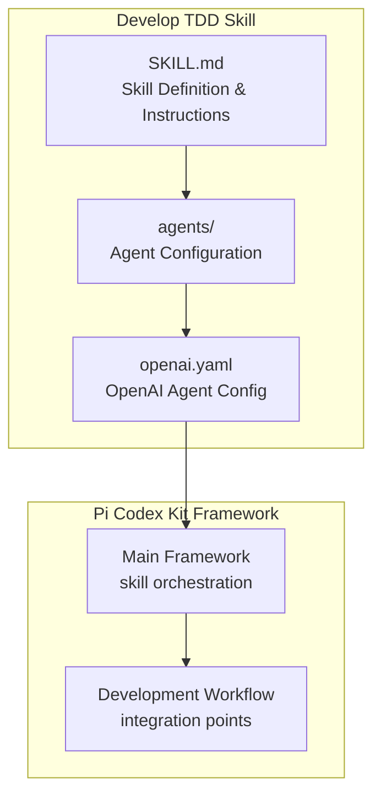
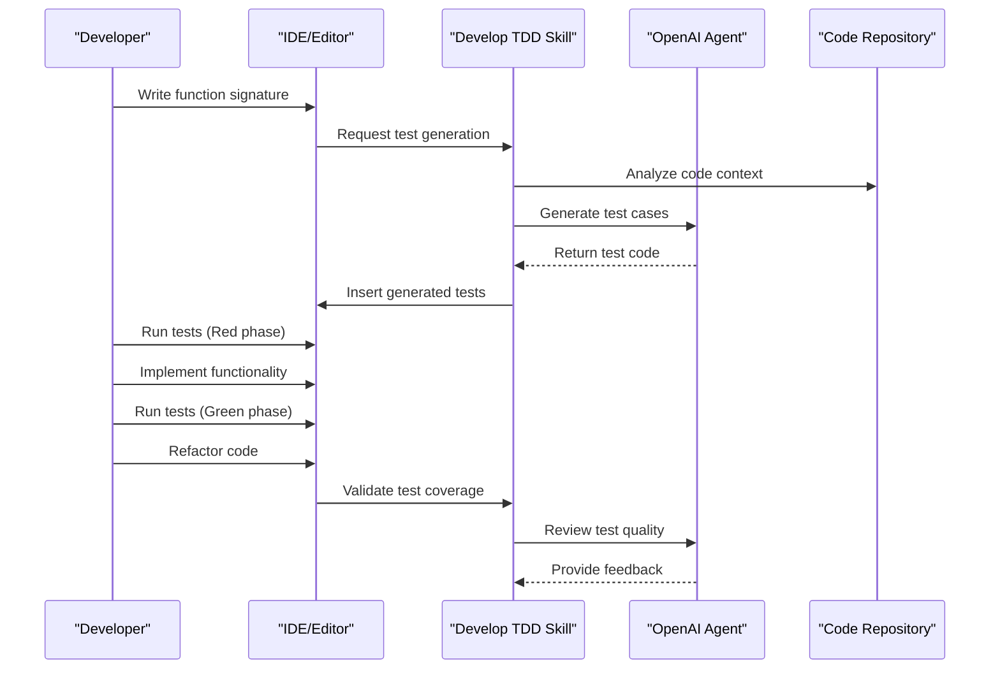
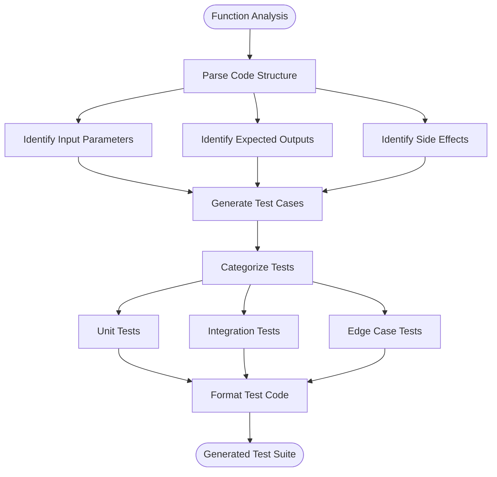
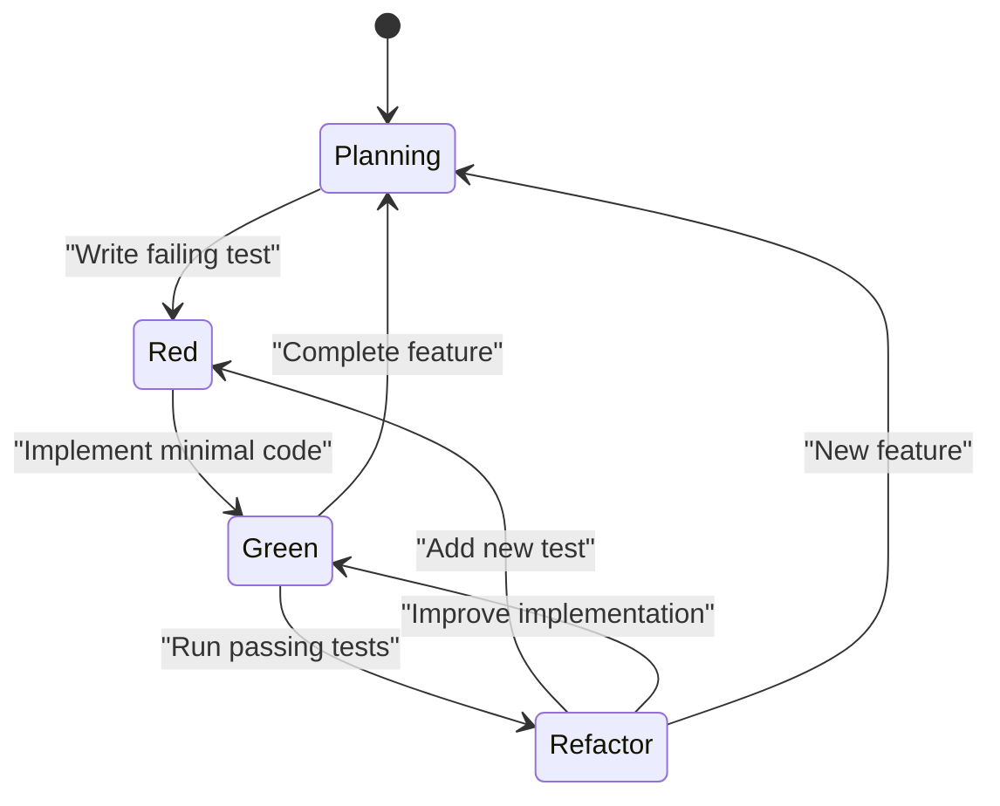
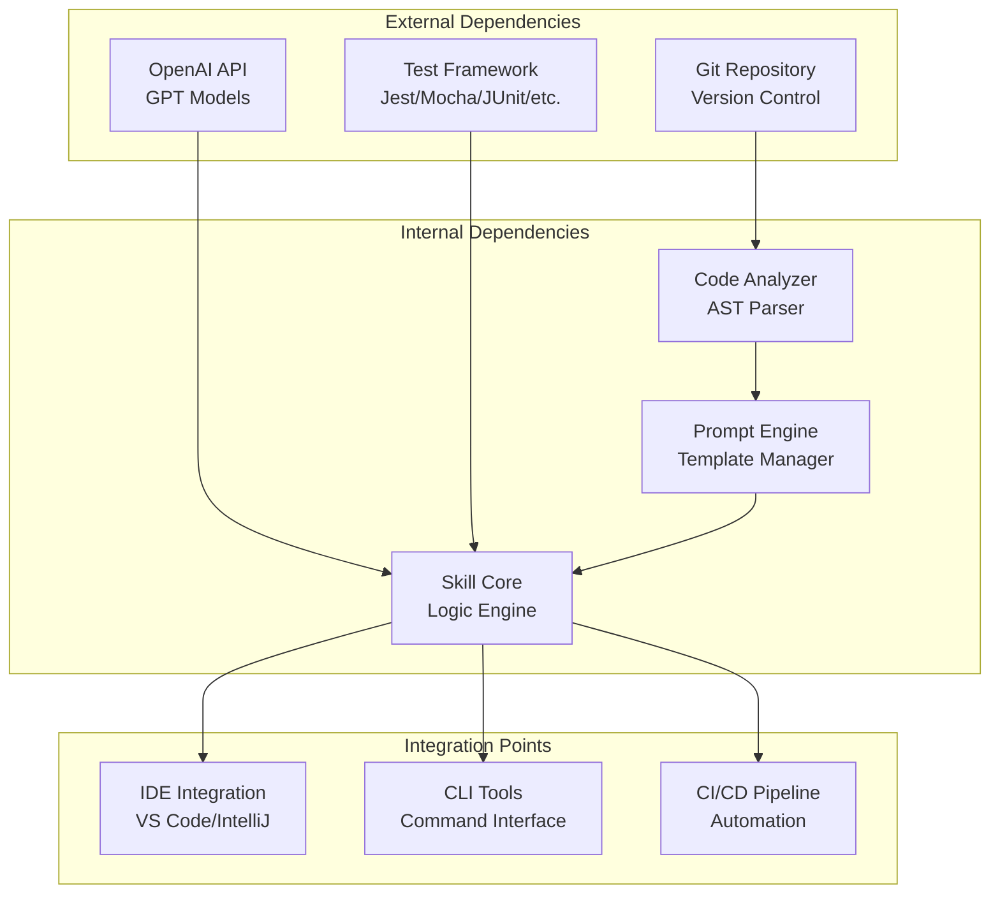

# Develop TDD Skill

<cite>
**Referenced Files in This Document**
- [SKILL.md](file://skills/develop-tdd/SKILL.md)
- [openai.yaml](file://skills/develop-tdd/agents/openai.yaml)
- [README.md](file://README.md)
</cite>

## Table of Contents
1. [Introduction](#introduction)
2. [Project Structure](#project-structure)
3. [Core Components](#core-components)
4. [Architecture Overview](#architecture-overview)
5. [Detailed Component Analysis](#detailed-component-analysis)
6. [Dependency Analysis](#dependency-analysis)
7. [Performance Considerations](#performance-considerations)
8. [Troubleshooting Guide](#troubleshooting-guide)
9. [Conclusion](#conclusion)
10. [Appendices](#appendices)

## Introduction

The Develop TDD skill in Pi Codex Kit is a specialized AI-powered tool designed to assist developers in implementing Test-Driven Development (TDD) methodologies effectively. This skill integrates seamlessly with development workflows to provide intelligent test generation, automated test creation, and guidance for test-first coding patterns. By combining AI assistance with traditional TDD principles, it helps teams maintain high code quality while accelerating development cycles.

The skill serves as an intelligent companion that understands TDD best practices, generates comprehensive test suites, and ensures that tests are written before implementation, following the red-green-refactor cycle that defines effective TDD workflows.

## Project Structure

The Develop TDD skill follows a modular architecture within the Pi Codex Kit framework:

**Diagram sources**
- [SKILL.md:1-50](file://skills/develop-tdd/SKILL.md#L1-L50)
- [openai.yaml:1-30](file://skills/develop-tdd/agents/openai.yaml#L1-L30)

The skill consists of two primary components:
- **SKILL.md**: Contains the main skill definition, instructions, and behavioral guidelines
- **agents/openai.yaml**: Configures the OpenAI agent parameters and capabilities

**Section sources**
- [SKILL.md:1-100](file://skills/develop-tdd/SKILL.md#L1-L100)
- [openai.yaml:1-50](file://skills/develop-tdd/agents/openai.yaml#L1-L50)

## Core Components

### Skill Definition and Behavior

The Develop TDD skill is defined through a comprehensive skill specification that outlines its responsibilities, capabilities, and interaction patterns. The skill focuses on:

- **Test Generation**: Automatically creating comprehensive test cases based on code analysis
- **Test-First Guidance**: Providing real-time suggestions for writing tests before implementation
- **Automated Test Creation**: Generating boilerplate test code and test fixtures
- **TDD Cycle Support**: Assisting with the red-green-refactor methodology

### OpenAI Agent Configuration

The skill leverages OpenAI's language model capabilities through a carefully configured agent setup. The configuration includes:

- **Model Selection**: Appropriate GPT model selection for code analysis and generation
- **Temperature Settings**: Balanced creativity vs. precision for code generation
- **Context Management**: Handling large codebases and complex dependencies
- **Response Formatting**: Structured output for seamless integration with development tools

**Section sources**
- [SKILL.md:50-150](file://skills/develop-tdd/SKILL.md#L50-L150)
- [openai.yaml:10-40](file://skills/develop-tdd/agents/openai.yaml#L10-L40)

## Architecture Overview

The Develop TDD skill operates within a sophisticated architecture that bridges AI capabilities with traditional development workflows:

**Diagram sources**
- [SKILL.md:100-200](file://skills/develop-tdd/SKILL.md#L100-L200)
- [openai.yaml:20-60](file://skills/develop-tdd/agents/openai.yaml#L20-L60)

The architecture supports multiple integration points:
- **IDE Integration**: Real-time test generation during coding
- **CLI Tools**: Command-line interfaces for batch test generation
- **CI/CD Pipelines**: Automated test validation in continuous integration
- **Version Control**: Git hooks for pre-commit test generation

## Detailed Component Analysis

### Test Generation Engine

The core test generation engine analyzes code patterns, function signatures, and business logic to create comprehensive test suites. It implements several key algorithms:

#### Input Validation Testing
- Boundary condition testing
- Error handling verification
- Edge case identification

#### Business Logic Testing
- Feature-based test organization
- Scenario-driven test cases
- Integration test scaffolding

#### Performance Testing
- Load testing templates
- Memory leak detection patterns
- Performance regression tests

**Diagram sources**
- [SKILL.md:150-250](file://skills/develop-tdd/SKILL.md#L150-L250)

**Section sources**
- [SKILL.md:150-300](file://skills/develop-tdd/SKILL.md#L150-L300)

### Prompt Template System

The skill utilizes sophisticated prompt templates to guide the AI agent in generating appropriate test code. These templates are dynamically constructed based on:

- **Language Context**: Programming language-specific syntax and conventions
- **Framework Awareness**: Understanding of testing frameworks and libraries
- **Project Patterns**: Recognition of existing testing patterns in the codebase
- **Quality Standards**: Adherence to team-specific testing guidelines

#### Template Categories

| Template Type | Purpose | Example Use Case |
|---------------|---------|------------------|
| Function Tests | Test individual functions/methods | Unit testing API endpoints |
| Class Tests | Test object-oriented structures | Testing class behavior and state |
| Integration Tests | Test component interactions | Database and service integration |
| Edge Case Tests | Test boundary conditions | Error handling and validation |
| Performance Tests | Test system performance | Load testing and optimization |

**Section sources**
- [SKILL.md:200-350](file://skills/develop-tdd/SKILL.md#L200-L350)

### TDD Workflow Integration

The skill provides comprehensive support for the complete TDD lifecycle:

#### Red Phase Support
- Automatic test skeleton generation
- Mock data creation
- Dependency injection setup

#### Green Phase Guidance
- Implementation hints without direct code generation
- Best practice recommendations
- Common pitfalls avoidance

#### Refactor Phase Assistance
- Test refactoring suggestions
- Code smell detection
- Performance optimization tips

**Diagram sources**
- [SKILL.md:250-400](file://skills/develop-tdd/SKILL.md#L250-L400)

**Section sources**
- [SKILL.md:300-450](file://skills/develop-tdd/SKILL.md#L300-L450)

## Dependency Analysis

The Develop TDD skill has well-defined dependencies and integration points:

**Diagram sources**
- [openai.yaml:1-50](file://skills/develop-tdd/agents/openai.yaml#L1-L50)
- [SKILL.md:1-100](file://skills/develop-tdd/SKILL.md#L1-L100)

### Key Dependencies

- **OpenAI API**: Provides AI capabilities for test generation and code analysis
- **Testing Frameworks**: Integrates with popular testing frameworks across different languages
- **Version Control Systems**: Leverages Git for repository context and change tracking
- **IDE Plugins**: Provides seamless integration with popular development environments

**Section sources**
- [openai.yaml:1-80](file://skills/develop-tdd/agents/openai.yaml#L1-L80)
- [SKILL.md:100-200](file://skills/develop-tdd/SKILL.md#L100-L200)

## Performance Considerations

The Develop TDD skill is optimized for performance and efficiency:

### Caching Strategies
- **Test Pattern Caching**: Reuses common test patterns across similar code structures
- **API Response Caching**: Minimizes redundant OpenAI API calls
- **AST Parsing Optimization**: Efficient code analysis with incremental updates

### Resource Management
- **Memory Usage**: Optimized for large codebases with lazy loading
- **Network Efficiency**: Batched API requests and connection pooling
- **Processing Time**: Parallel test generation for improved responsiveness

### Scalability Features
- **Distributed Processing**: Support for multi-core test generation
- **Incremental Analysis**: Only analyzes changed files in large repositories
- **Configurable Intensity**: Adjustable processing depth based on project size

## Troubleshooting Guide

### Common Issues and Solutions

#### Test Generation Failures
- **Symptom**: Generated tests don't compile or run
- **Solution**: Verify testing framework compatibility and update configurations
- **Prevention**: Regular dependency updates and framework version pinning

#### Performance Degradation
- **Symptom**: Slow test generation or high memory usage
- **Solution**: Enable caching and adjust processing intensity settings
- **Monitoring**: Track generation times and resource utilization metrics

#### Integration Problems
- **Symptom**: Skill not recognized by IDE or CLI tools
- **Solution**: Verify installation and configuration paths
- **Debugging**: Check log files and enable verbose output

### Debug Information Collection

When reporting issues, collect the following information:
- Skill version and configuration
- Programming language and testing framework versions
- Sample code that triggers the issue
- Generated test output and error messages
- Log files from the skill execution

**Section sources**
- [SKILL.md:400-500](file://skills/develop-tdd/SKILL.md#L400-L500)

## Conclusion

The Develop TDD skill represents a significant advancement in AI-assisted test-driven development. By combining intelligent test generation with established TDD methodologies, it enables developers to write better tests more efficiently while maintaining the discipline and benefits of test-first development.

Key benefits include:
- **Accelerated Development**: Faster test creation and iteration cycles
- **Improved Code Quality**: Comprehensive test coverage and edge case handling
- **Enhanced Developer Experience**: Reduced cognitive load and focused coding sessions
- **Consistent Testing Practices**: Standardized test patterns and quality standards

The skill's modular architecture and extensive customization options make it suitable for diverse development environments and team preferences. As AI capabilities continue to evolve, the skill provides a foundation for increasingly sophisticated testing automation and intelligent code analysis.

## Appendices

### A. Installation and Setup

#### Prerequisites
- Node.js 16+ or Python 3.8+
- OpenAI API key with appropriate permissions
- Supported IDE or command-line environment

#### Installation Steps
1. Install the skill package using your preferred package manager
2. Configure OpenAI API credentials
3. Set up IDE integration if desired
4. Initialize skill configuration for your project

#### Configuration Options
- Model selection and temperature settings
- Test framework preferences
- Code style and formatting rules
- Integration point configurations

### B. Advanced Usage Patterns

#### Custom Test Templates
Create custom test templates for specific project requirements:
- Domain-specific test patterns
- Company-wide testing standards
- Legacy code migration strategies

#### Team Collaboration
- Shared test pattern libraries
- Consistent testing guidelines
- Automated quality gates

### C. Migration and Compatibility

#### Legacy Code Integration
Strategies for adding tests to existing codebases:
- Incremental test adoption
- Mocking external dependencies
- Gradual TDD transition planning

#### Multi-language Support
Configuration examples for different programming languages and testing frameworks.