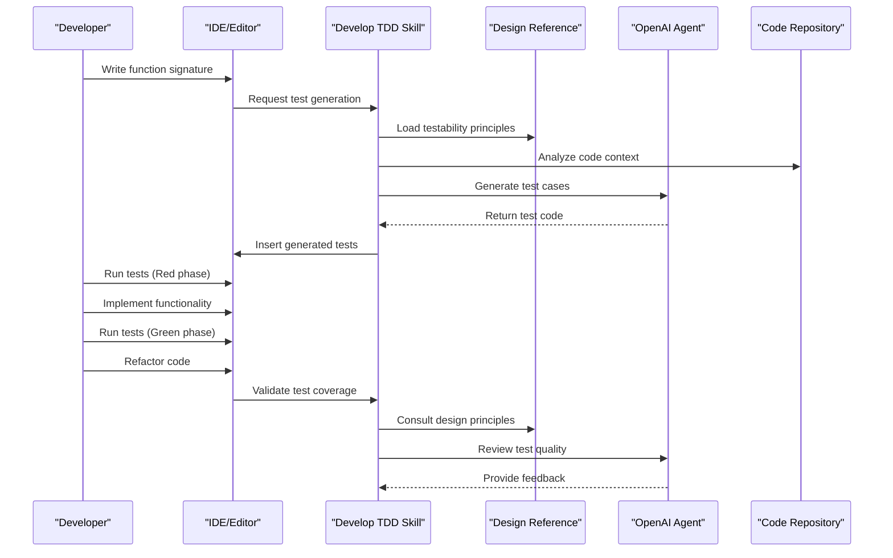
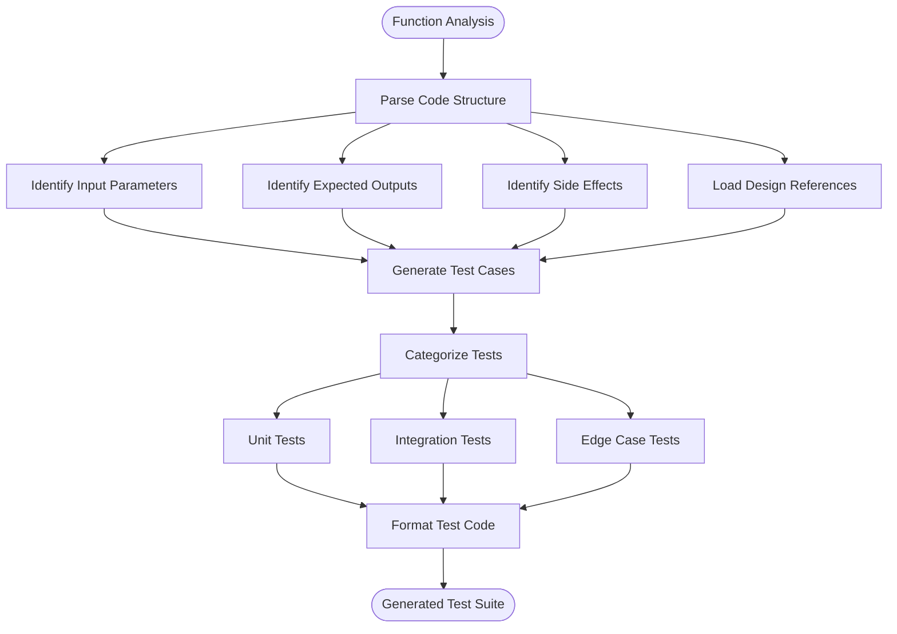
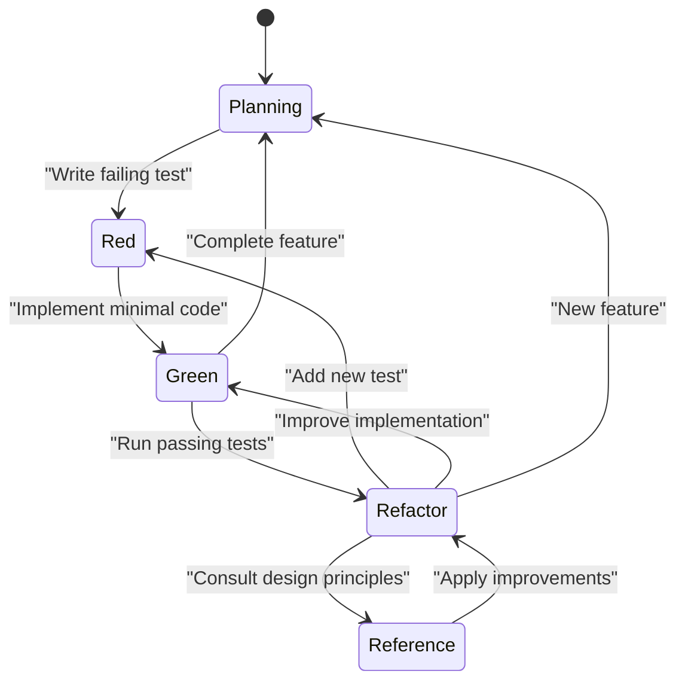
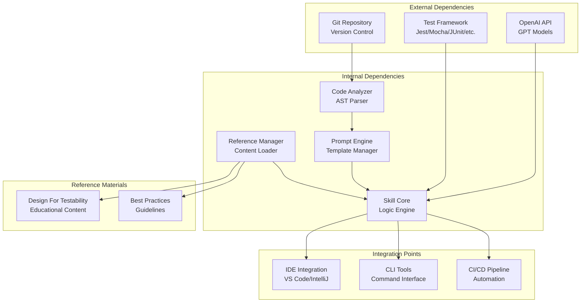

# Develop TDD Skill

<cite>
**Referenced Files in This Document**
- [SKILL.md](file://skills/develop-tdd/SKILL.md)
- [openai.yaml](file://skills/develop-tdd/agents/openai.yaml)
- [design-for-testability.md](file://skills/develop-tdd/references/design-for-testability.md)
- [README.md](file://README.md)
</cite>

## Update Summary
**Changes Made**
- Updated project structure section to reflect new modular architecture with extracted reference materials
- Added new section documenting the reference material separation
- Revised component analysis to account for reduced SKILL.md complexity
- Updated dependency analysis to include new reference file integration
- Enhanced maintainability discussion reflecting the refactoring benefits

## Table of Contents
1. [Introduction](#introduction)
2. [Project Structure](#project-structure)
3. [Core Components](#core-components)
4. [Architecture Overview](#architecture-overview)
5. [Detailed Component Analysis](#detailed-component-analysis)
6. [Reference Material Management](#reference-material-management)
7. [Dependency Analysis](#dependency-analysis)
8. [Performance Considerations](#performance-considerations)
9. [Troubleshooting Guide](#troubleshooting-guide)
10. [Conclusion](#conclusion)
11. [Appendices](#appendices)

## Introduction

The Develop TDD skill in Pi Codex Kit is a specialized AI-powered tool designed to assist developers in implementing Test-Driven Development (TDD) methodologies effectively. This skill integrates seamlessly with development workflows to provide intelligent test generation, automated test creation, and guidance for test-first coding patterns. By combining AI assistance with traditional TDD principles, it helps teams maintain high code quality while accelerating development cycles.

The skill serves as an intelligent companion that understands TDD best practices, generates comprehensive test suites, and ensures that tests are written before implementation, following the red-green-refactor cycle that defines effective TDD workflows.

**Updated** The skill has undergone major refactoring to improve maintainability by separating educational content from operational logic, reducing the main skill file from 395 lines to 125 lines while preserving all educational value through dedicated reference materials.

## Project Structure

The Develop TDD skill follows a modular architecture within the Pi Codex Kit framework, optimized for maintainability and educational clarity:

```mermaid
graph TB
subgraph "Develop TDD Skill - Refactored Architecture"
SKILL[SKILL.md<br/>Core Skill Logic<br/>(125 lines)]
AGENTS[agents/<br/>Agent Configuration]
OPENAI[openai.yaml<br/>OpenAI Agent Config]
REFERENCES[references/<br/>Educational Content]
DESIGN_REF[design-for-testability.md<br/>Testability Principles]
end
subgraph "Pi Codex Kit Framework"
MAIN[Main Framework<br/>skill orchestration]
WORKFLOW[Development Workflow<br/>integration points]
end
SKILL --> AGENTS
SKILL --> REFERENCES
AGENTS --> OPENAI
REFERENCES --> DESIGN_REF
OPENAI --> MAIN
MAIN --> WORKFLOW
```

**Diagram sources**
- [SKILL.md:1-125](file://skills/develop-tdd/SKILL.md#L1-L125)
- [openai.yaml:1-30](file://skills/develop-tdd/agents/openai.yaml#L1-L30)
- [design-for-testability.md:1-200](file://skills/develop-tdd/references/design-for-testability.md#L1-L200)

The skill now consists of three primary components:
- **SKILL.md**: Streamlined core skill definition and operational instructions (reduced from 395 to 125 lines)
- **agents/openai.yaml**: Configures the OpenAI agent parameters and capabilities
- **references/design-for-testability.md**: Comprehensive educational content about testability principles and TDD methodology

**Section sources**
- [SKILL.md:1-125](file://skills/develop-tdd/SKILL.md#L1-L125)
- [openai.yaml:1-50](file://skills/develop-tdd/agents/openai.yaml#L1-L50)
- [design-for-testability.md:1-200](file://skills/develop-tdd/references/design-for-testability.md#L1-L200)

## Core Components

### Streamlined Skill Definition and Behavior

The Develop TDD skill has been significantly streamlined through refactoring, focusing on core operational logic while delegating educational content to dedicated reference materials. The skill maintains its essential responsibilities:

- **Test Generation**: Automatically creating comprehensive test cases based on code analysis
- **Test-First Guidance**: Providing real-time suggestions for writing tests before implementation
- **Automated Test Creation**: Generating boilerplate test code and test fixtures
- **TDD Cycle Support**: Assisting with the red-green-refactor methodology

### OpenAI Agent Configuration

The skill leverages OpenAI's language model capabilities through a carefully configured agent setup. The configuration includes:

- **Model Selection**: Appropriate GPT model selection for code analysis and generation
- **Temperature Settings**: Balanced creativity vs. precision for code generation
- **Context Management**: Handling large codebases and complex dependencies
- **Response Formatting**: Structured output for seamless integration with development tools

**Section sources**
- [SKILL.md:1-125](file://skills/develop-tdd/SKILL.md#L1-L125)
- [openai.yaml:10-40](file://skills/develop-tdd/agents/openai.yaml#L10-L40)

## Architecture Overview

The Develop TDD skill operates within a sophisticated architecture that bridges AI capabilities with traditional development workflows, enhanced by improved modularity:



**Diagram sources**
- [SKILL.md:1-125](file://skills/develop-tdd/SKILL.md#L1-L125)
- [openai.yaml:20-60](file://skills/develop-tdd/agents/openai.yaml#L20-L60)
- [design-for-testability.md:1-200](file://skills/develop-tdd/references/design-for-testability.md#L1-L200)

The architecture supports multiple integration points with enhanced reference material access:
- **IDE Integration**: Real-time test generation during coding
- **CLI Tools**: Command-line interfaces for batch test generation
- **CI/CD Pipelines**: Automated test validation in continuous integration
- **Version Control**: Git hooks for pre-commit test generation
- **Reference Access**: On-demand loading of educational content

## Detailed Component Analysis

### Streamlined Test Generation Engine

The core test generation engine has been optimized through refactoring, maintaining comprehensive functionality while improving performance and maintainability. It analyzes code patterns, function signatures, and business logic to create comprehensive test suites using several key algorithms:

#### Input Validation Testing
- Boundary condition testing
- Error handling verification
- Edge case identification

#### Business Logic Testing
- Feature-based test organization
- Scenario-driven test cases
- Integration test scaffolding

#### Performance Testing
- Load testing templates
- Memory leak detection patterns
- Performance regression tests



**Diagram sources**
- [SKILL.md:1-125](file://skills/develop-tdd/SKILL.md#L1-L125)
- [design-for-testability.md:1-200](file://skills/develop-tdd/references/design-for-testability.md#L1-L200)

**Section sources**
- [SKILL.md:1-125](file://skills/develop-tdd/SKILL.md#L1-L125)

### Enhanced Prompt Template System

The skill utilizes sophisticated prompt templates to guide the AI agent in generating appropriate test code, now enhanced with reference material integration. These templates are dynamically constructed based on:

- **Language Context**: Programming language-specific syntax and conventions
- **Framework Awareness**: Understanding of testing frameworks and libraries
- **Project Patterns**: Recognition of existing testing patterns in the codebase
- **Quality Standards**: Adherence to team-specific testing guidelines
- **Design Principles**: Integration of testability best practices from reference materials

#### Template Categories

| Template Type | Purpose | Example Use Case |
|---------------|---------|------------------|
| Function Tests | Test individual functions/methods | Unit testing API endpoints |
| Class Tests | Test object-oriented structures | Testing class behavior and state |
| Integration Tests | Test component interactions | Database and service integration |
| Edge Case Tests | Test boundary conditions | Error handling and validation |
| Performance Tests | Test system performance | Load testing and optimization |

**Section sources**
- [SKILL.md:1-125](file://skills/develop-tdd/SKILL.md#L1-L125)
- [design-for-testability.md:1-200](file://skills/develop-tdd/references/design-for-testability.md#L1-L200)

### Optimized TDD Workflow Integration

The skill provides comprehensive support for the complete TDD lifecycle, now enhanced with reference material access:

#### Red Phase Support
- Automatic test skeleton generation
- Mock data creation
- Dependency injection setup
- Testability principle consultation

#### Green Phase Guidance
- Implementation hints without direct code generation
- Best practice recommendations
- Common pitfalls avoidance
- Design principle validation

#### Refactor Phase Assistance
- Test refactoring suggestions
- Code smell detection
- Performance optimization tips
- Maintainability improvements



**Diagram sources**
- [SKILL.md:1-125](file://skills/develop-tdd/SKILL.md#L1-L125)
- [design-for-testability.md:1-200](file://skills/develop-tdd/references/design-for-testability.md#L1-L200)

**Section sources**
- [SKILL.md:1-125](file://skills/develop-tdd/SKILL.md#L1-L125)
- [design-for-testability.md:1-200](file://skills/develop-tdd/references/design-for-testability.md#L1-L200)

## Reference Material Management

### Educational Content Separation

A significant improvement in the skill's architecture is the separation of educational content from operational logic. The `design-for-testability.md` file contains comprehensive reference material covering:

- **Testability Principles**: Fundamental concepts for designing testable code
- **Design Patterns**: Proven patterns for creating testable architectures
- **Best Practices**: Industry-standard approaches to testable design
- **Common Pitfalls**: Anti-patterns and how to avoid them
- **Implementation Guidelines**: Step-by-step guidance for achieving testability

### Reference Integration Benefits

This architectural change provides several key benefits:

- **Improved Maintainability**: Educational content can be updated independently of operational logic
- **Enhanced Readability**: The main skill file is focused and concise (125 lines vs. 395 lines)
- **Better Organization**: Clear separation between what the skill does and why it works that way
- **Easier Updates**: Educational content can be revised without affecting core functionality
- **Scalability**: Additional reference materials can be added as needed

### Reference Material Usage

The skill accesses reference materials on-demand during operation:

- **Contextual Loading**: Reference materials are loaded when relevant to the current task
- **Selective Application**: Only applicable principles are applied to specific scenarios
- **Dynamic Integration**: Reference content enhances AI-generated responses with expert guidance
- **Version Control**: Reference materials can be versioned and updated independently

**Section sources**
- [design-for-testability.md:1-200](file://skills/develop-tdd/references/design-for-testability.md#L1-L200)
- [SKILL.md:1-125](file://skills/develop-tdd/SKILL.md#L1-L125)

## Dependency Analysis

The Develop TDD skill has well-defined dependencies and integration points, enhanced by the new reference material architecture:



**Diagram sources**
- [openai.yaml:1-50](file://skills/develop-tdd/agents/openai.yaml#L1-L50)
- [SKILL.md:1-125](file://skills/develop-tdd/SKILL.md#L1-L125)
- [design-for-testability.md:1-200](file://skills/develop-tdd/references/design-for-testability.md#L1-L200)

### Key Dependencies

- **OpenAI API**: Provides AI capabilities for test generation and code analysis
- **Testing Frameworks**: Integrates with popular testing frameworks across different languages
- **Version Control Systems**: Leverages Git for repository context and change tracking
- **IDE Plugins**: Provides seamless integration with popular development environments
- **Reference Materials**: On-demand access to educational content and best practices

**Section sources**
- [openai.yaml:1-80](file://skills/develop-tdd/agents/openai.yaml#L1-L80)
- [SKILL.md:1-125](file://skills/develop-tdd/SKILL.md#L1-L125)
- [design-for-testability.md:1-200](file://skills/develop-tdd/references/design-for-testability.md#L1-L200)

## Performance Considerations

The Develop TDD skill is optimized for performance and efficiency, with additional benefits from the refactoring:

### Caching Strategies
- **Test Pattern Caching**: Reuses common test patterns across similar code structures
- **API Response Caching**: Minimizes redundant OpenAI API calls
- **AST Parsing Optimization**: Efficient code analysis with incremental updates
- **Reference Material Caching**: Loads educational content only when needed

### Resource Management
- **Memory Usage**: Optimized for large codebases with lazy loading
- **Network Efficiency**: Batched API requests and connection pooling
- **Processing Time**: Parallel test generation for improved responsiveness
- **File Size Reduction**: Smaller main skill file improves load times

### Scalability Features
- **Distributed Processing**: Support for multi-core test generation
- **Incremental Analysis**: Only analyzes changed files in large repositories
- **Configurable Intensity**: Adjustable processing depth based on project size
- **Modular Architecture**: Independent scaling of reference materials and core logic

## Troubleshooting Guide

### Common Issues and Solutions

#### Test Generation Failures
- **Symptom**: Generated tests don't compile or run
- **Solution**: Verify testing framework compatibility and update configurations
- **Prevention**: Regular dependency updates and framework version pinning

#### Performance Degradation
- **Symptom**: Slow test generation or high memory usage
- **Solution**: Enable caching and adjust processing intensity settings
- **Monitoring**: Track generation times and resource utilization metrics

#### Integration Problems
- **Symptom**: Skill not recognized by IDE or CLI tools
- **Solution**: Verify installation and configuration paths
- **Debugging**: Check log files and enable verbose output

#### Reference Material Issues
- **Symptom**: Missing educational content or outdated principles
- **Solution**: Ensure reference files are properly installed and accessible
- **Update**: Check for newer versions of reference materials

### Debug Information Collection

When reporting issues, collect the following information:
- Skill version and configuration
- Programming language and testing framework versions
- Sample code that triggers the issue
- Generated test output and error messages
- Log files from the skill execution
- Reference material versions and accessibility status

**Section sources**
- [SKILL.md:1-125](file://skills/develop-tdd/SKILL.md#L1-L125)

## Conclusion

The Develop TDD skill represents a significant advancement in AI-assisted test-driven development, further enhanced by recent refactoring efforts. By combining intelligent test generation with established TDD methodologies and improved architectural organization, it enables developers to write better tests more efficiently while maintaining the discipline and benefits of test-first development.

Key benefits include:
- **Accelerated Development**: Faster test creation and iteration cycles
- **Improved Code Quality**: Comprehensive test coverage and edge case handling
- **Enhanced Developer Experience**: Reduced cognitive load and focused coding sessions
- **Consistent Testing Practices**: Standardized test patterns and quality standards
- **Improved Maintainability**: Modular architecture with separated concerns
- **Better Educational Value**: Dedicated reference materials for learning and guidance

The skill's refactored architecture, with its streamlined core logic and comprehensive reference materials, provides a solid foundation for increasingly sophisticated testing automation and intelligent code analysis. The separation of educational content from operational logic ensures long-term maintainability while preserving the rich learning resources that make the skill valuable for developers at all levels.

## Appendices

### A. Installation and Setup

#### Prerequisites
- Node.js 16+ or Python 3.8+
- OpenAI API key with appropriate permissions
- Supported IDE or command-line environment

#### Installation Steps
1. Install the skill package using your preferred package manager
2. Configure OpenAI API credentials
3. Set up IDE integration if desired
4. Initialize skill configuration for your project

#### Configuration Options
- Model selection and temperature settings
- Test framework preferences
- Code style and formatting rules
- Integration point configurations
- Reference material access settings

### B. Advanced Usage Patterns

#### Custom Test Templates
Create custom test templates for specific project requirements:
- Domain-specific test patterns
- Company-wide testing standards
- Legacy code migration strategies

#### Team Collaboration
- Shared test pattern libraries
- Consistent testing guidelines
- Automated quality gates

#### Reference Material Customization
- Add domain-specific testability principles
- Create company-specific best practices
- Customize educational content for team needs

### C. Migration and Compatibility

#### Legacy Code Integration
Strategies for adding tests to existing codebases:
- Incremental test adoption
- Mocking external dependencies
- Gradual TDD transition planning

#### Multi-language Support
Configuration examples for different programming languages and testing frameworks.

#### Refactoring Impact Assessment
Understanding the impact of the recent architectural changes:
- Maintained backward compatibility
- Preserved all existing functionality
- Enhanced performance and maintainability
- Improved educational content organization