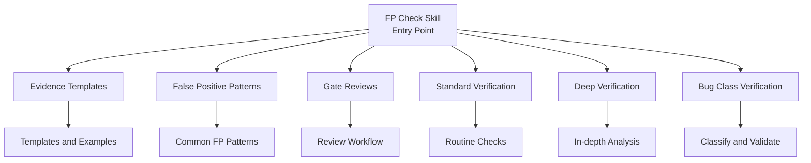
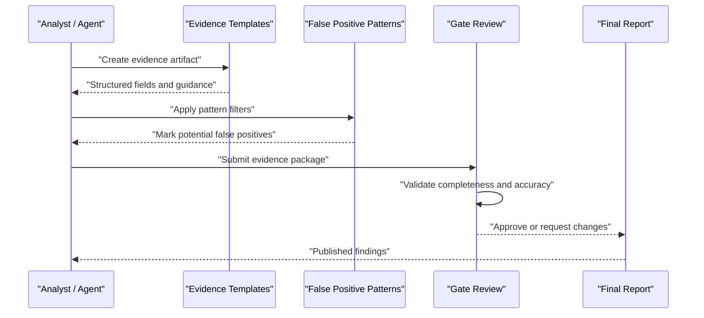
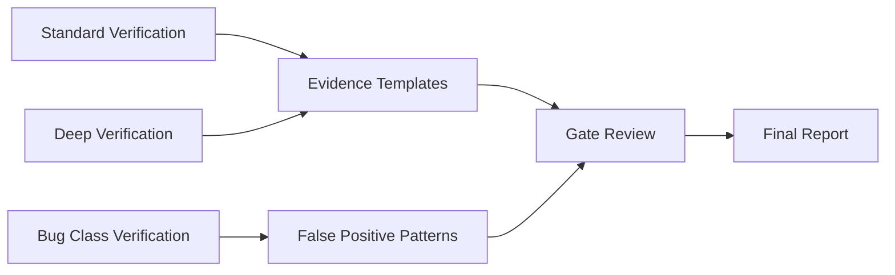

# Evidence and Reporting

<cite>
**Referenced Files in This Document**
- [SKILL.md](file://skills/fp-check/SKILL.md)
- [evidence-templates.md](file://skills/fp-check/references/evidence-templates.md)
- [false-positive-patterns.md](file://skills/fp-check/references/false-positive-patterns.md)
- [gate-reviews.md](file://skills/fp-check/references/gate-reviews.md)
- [bug-class-verification.md](file://skills/fp-check/references/bug-class-verification.md)
- [deep-verification.md](file://skills/fp-check/references/deep-verification.md)
- [standard-verification.md](file://skills/fp-check/references/standard-verification.md)
</cite>

## Table of Contents
1. [Introduction](#introduction)
2. [Project Structure](#project-structure)
3. [Core Components](#core-components)
4. [Architecture Overview](#architecture-overview)
5. [Detailed Component Analysis](#detailed-component-analysis)
6. [Dependency Analysis](#dependency-analysis)
7. [Performance Considerations](#performance-considerations)
8. [Troubleshooting Guide](#troubleshooting-guide)
9. [Conclusion](#conclusion)

## Introduction
This document explains how the FP Check skill collects evidence, handles false positives, and performs gate reviews to ensure high-quality functional programming analysis outcomes. It focuses on:
- The evidence template system for documenting verification results consistently
- Strategies for identifying and handling false positives in functional code analysis
- A structured gate review workflow for quality assurance
- Practical examples and best practices to maintain accuracy and reduce noise

## Project Structure
The FP Check skill is organized around a central skill definition and reference materials that define processes, templates, and patterns. Key areas include:
- Skill entry point describing scope and usage
- Reference documents detailing evidence templates, false positive patterns, and gate review procedures
- Verification guides for standard and deep checks, including bug class verification

**Diagram sources**
- [SKILL.md](file://skills/fp-check/SKILL.md)
- [evidence-templates.md](file://skills/fp-check/references/evidence-templates.md)
- [false-positive-patterns.md](file://skills/fp-check/references/false-positive-patterns.md)
- [gate-reviews.md](file://skills/fp-check/references/gate-reviews.md)
- [standard-verification.md](file://skills/fp-check/references/standard-verification.md)
- [deep-verification.md](file://skills/fp-check/references/deep-verification.md)
- [bug-class-verification.md](file://skills/fp-check/references/bug-class-verification.md)

**Section sources**
- [SKILL.md](file://skills/fp-check/SKILL.md)

## Core Components
- Evidence Template System: Standardized structures to capture verification context, findings, and conclusions with consistent fields and traceability.
- False Positive Handling: Pattern-based identification and triage strategies tailored to functional programming constructs.
- Gate Review Workflow: A multi-step process to validate evidence, confirm severity, and approve or reject findings before reporting.
- Verification Guides: Standard and deep verification procedures, plus bug class-specific validation steps.

**Section sources**
- [evidence-templates.md](file://skills/fp-check/references/evidence-templates.md)
- [false-positive-patterns.md](file://skills/fp-check/references/false-positive-patterns.md)
- [gate-reviews.md](file://skills/fp-check/references/gate-reviews.md)
- [standard-verification.md](file://skills/fp-check/references/standard-verification.md)
- [deep-verification.md](file://skills/fp-check/references/deep-verification.md)
- [bug-class-verification.md](file://skills/fp-check/references/bug-class-verification.md)

## Architecture Overview
The FP Check skill orchestrates evidence collection, false positive detection, and gate review through a cohesive pipeline. Analysts or automated agents follow the evidence templates to record findings, apply false positive pattern rules to filter noise, and then submit results for gate review where reviewers validate completeness and correctness.

**Diagram sources**
- [evidence-templates.md](file://skills/fp-check/references/evidence-templates.md)
- [false-positive-patterns.md](file://skills/fp-check/references/false-positive-patterns.md)
- [gate-reviews.md](file://skills/fp-check/references/gate-reviews.md)

## Detailed Component Analysis

### Evidence Template System
The evidence template system ensures every finding is documented with sufficient context, reproducibility, and traceability. Typical elements include:
- Context: Code location, language features, and relevant dependencies
- Finding Summary: Clear statement of the issue or observation
- Evidence: References to code snippets, logs, AST nodes, or test outputs
- Verification Steps: How the finding was validated (static analysis, runtime tests, manual inspection)
- Conclusion: Determination (confirmed, mitigated, false positive)
- Impact: Severity and risk assessment
- Remediation: Suggested fixes or workarounds
- Metadata: Author, timestamp, version, and related tickets

Best practices:
- Use consistent field names and formats across all artifacts
- Include exact file paths and line references
- Attach minimal but sufficient evidence to keep reports concise
- Link to related issues or pull requests for traceability

Practical example categories:
- Simple function purity check result
- Higher-order function misuse
- Type inference anomaly
- Concurrency-related side effect

**Section sources**
- [evidence-templates.md](file://skills/fp-check/references/evidence-templates.md)

### False Positive Handling in Functional Programming Analysis
Functional code introduces specific patterns that can trigger spurious alerts. Common false positive patterns include:
- Apparent side effects masked by referential transparency guarantees
- Higher-order functions misinterpreted as state mutation
- Lazy evaluation causing delayed computation misreads
- Algebraic data type transformations seen as mutations
- Monadic error handling mistaken for control flow anomalies
- Tail recursion flagged as infinite loops without proper context

Strategies:
- Maintain a curated list of known FP false positive patterns
- Apply rule refinements to exclude safe constructs
- Require additional evidence when confidence is low
- Encourage reviewers to annotate suspected false positives with rationale
- Iterate on heuristics based on feedback from gate reviews

Operational tips:
- Tag suspected false positives early in evidence artifacts
- Provide counterexamples or proofs of safety
- Keep pattern definitions up-to-date with new language features

**Section sources**
- [false-positive-patterns.md](file://skills/fp-check/references/false-positive-patterns.md)

### Gate Review Workflow
Gate review ensures that only verified, actionable findings are reported. The workflow typically includes:
- Intake: Collect evidence packages and metadata
- Completeness Check: Verify required fields and attachments
- Accuracy Validation: Cross-check evidence against code and tests
- Severity Assessment: Confirm impact and urgency
- Decision: Approve, request changes, or dismiss as false positive
- Publication: Generate final report and update tracking systems

Step-by-step procedure:
1. Receive submission with complete evidence
2. Validate structure and content against templates
3. Re-run key checks or tests if needed
4. Evaluate false positive likelihood using pattern references
5. Determine severity and remediation feasibility
6. Approve or return with change requests
7. Publish approved findings and archive decisions

Quality gates:
- No unverified claims
- Clear linkage between evidence and conclusion
- Consistent severity classification
- Actionable remediation guidance

**Section sources**
- [gate-reviews.md](file://skills/fp-check/references/gate-reviews.md)

### Verification Guides
- Standard Verification: Routine checks for common issues, quick validations, and baseline coverage.
- Deep Verification: In-depth analysis for complex cases, requiring more extensive evidence and reasoning.
- Bug Class Verification: Specific procedures for known classes of bugs, ensuring consistent classification and handling.

These guides complement the evidence templates and gate review workflow by providing detailed instructions for different levels of scrutiny.

**Section sources**
- [standard-verification.md](file://skills/fp-check/references/standard-verification.md)
- [deep-verification.md](file://skills/fp-check/references/deep-verification.md)
- [bug-class-verification.md](file://skills/fp-check/references/bug-class-verification.md)

## Dependency Analysis
The FP Check skill’s components depend on each other to form a coherent pipeline:
- Evidence templates drive the structure of submissions
- False positive patterns inform filtering and triage
- Gate reviews rely on both templates and patterns to make decisions
- Verification guides provide procedural depth for analysts and reviewers

**Diagram sources**
- [evidence-templates.md](file://skills/fp-check/references/evidence-templates.md)
- [false-positive-patterns.md](file://skills/fp-check/references/false-positive-patterns.md)
- [gate-reviews.md](file://skills/fp-check/references/gate-reviews.md)
- [standard-verification.md](file://skills/fp-check/references/standard-verification.md)
- [deep-verification.md](file://skills/fp-check/references/deep-verification.md)
- [bug-class-verification.md](file://skills/fp-check/references/bug-class-verification.md)

**Section sources**
- [evidence-templates.md](file://skills/fp-check/references/evidence-templates.md)
- [false-positive-patterns.md](file://skills/fp-check/references/false-positive-patterns.md)
- [gate-reviews.md](file://skills/fp-check/references/gate-reviews.md)

## Performance Considerations
- Minimize evidence size by attaching only necessary artifacts
- Pre-filter obvious false positives using pattern rules to reduce reviewer load
- Automate repetitive checks where possible to speed up intake
- Batch similar findings to streamline gate review sessions
- Maintain clear separation between routine and deep verification tasks

[No sources needed since this section provides general guidance]

## Troubleshooting Guide
Common issues and resolutions:
- Missing evidence fields: Return to analyst with explicit checklist
- Ambiguous conclusions: Request additional proof or counterexample
- Over-flagged false positives: Update pattern definitions and refine rules
- Inconsistent severity: Provide severity rubric and training examples
- Slow gate reviews: Implement triage queues and prioritization criteria

Operational recommendations:
- Log all change requests and approvals for auditability
- Track recurring false positive patterns and iterate on heuristics
- Maintain a knowledge base of resolved cases and lessons learned

**Section sources**
- [gate-reviews.md](file://skills/fp-check/references/gate-reviews.md)
- [false-positive-patterns.md](file://skills/fp-check/references/false-positive-patterns.md)

## Conclusion
The FP Check skill integrates evidence templates, false positive handling, and gate reviews into a robust quality assurance process. By standardizing documentation, applying targeted filtering strategies, and enforcing rigorous review workflows, teams can maintain high verification accuracy while reducing noise in reports. Continuous improvement of patterns and procedures ensures long-term reliability and effectiveness.

[No sources needed since this section summarizes without analyzing specific files]