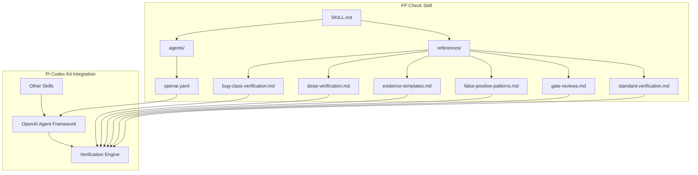
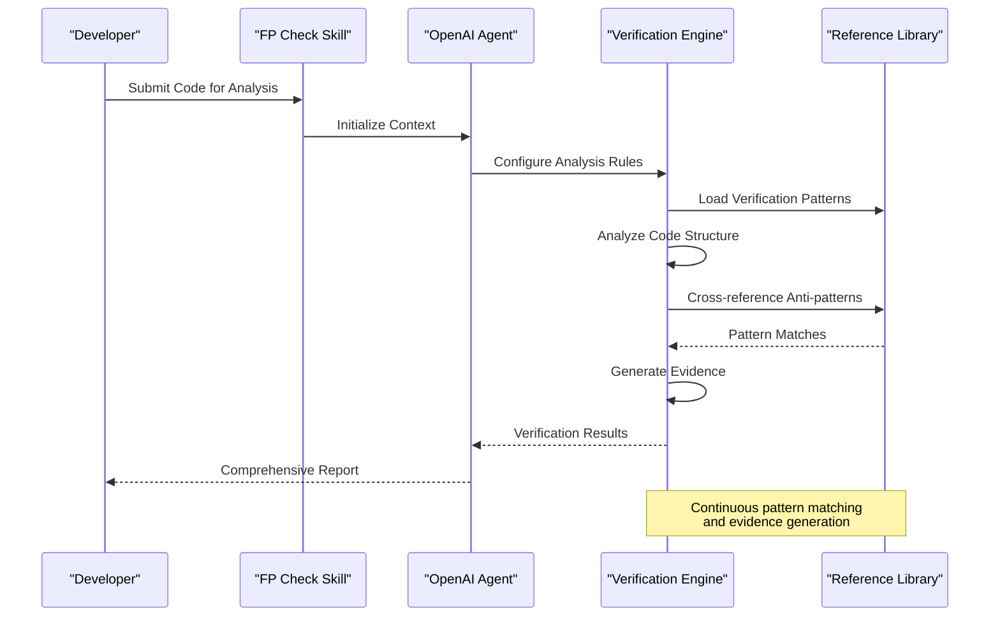
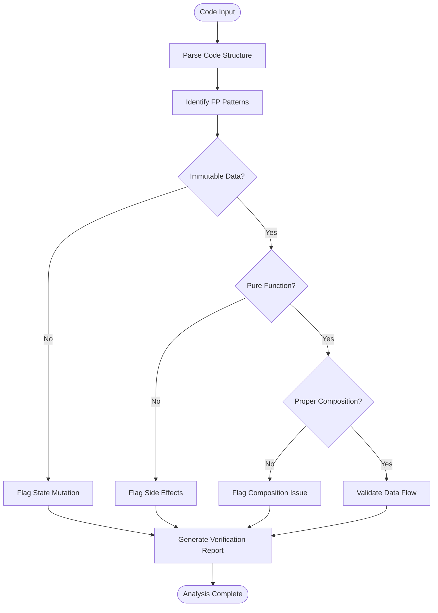
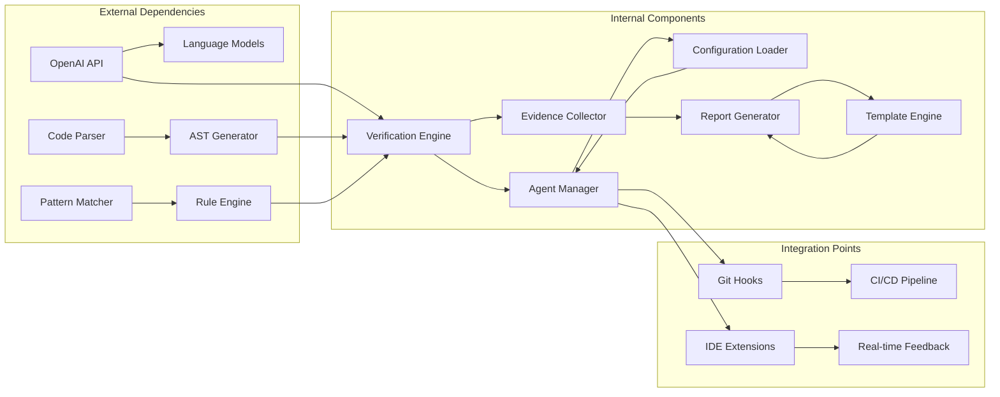

# FP Check Overview

<cite>
**Referenced Files in This Document**
- [SKILL.md](file://skills/fp-check/SKILL.md)
- [openai.yaml](file://skills/fp-check/agents/openai.yaml)
- [bug-class-verification.md](file://skills/fp-check/references/bug-class-verification.md)
- [deep-verification.md](file://skills/fp-check/references/deep-verification.md)
- [evidence-templates.md](file://skills/fp-check/references/evidence-templates.md)
- [false-positive-patterns.md](file://skills/fp-check/references/false-positive-patterns.md)
- [gate-reviews.md](file://skills/fp-check/references/gate-reviews.md)
- [standard-verification.md](file://skills/fp-check/references/standard-verification.md)
</cite>

## Table of Contents
1. [Introduction](#introduction)
2. [Project Structure](#project-structure)
3. [Core Components](#core-components)
4. [Architecture Overview](#architecture-overview)
5. [Detailed Component Analysis](#detailed-component-analysis)
6. [Dependency Analysis](#dependency-analysis)
7. [Performance Considerations](#performance-considerations)
8. [Troubleshooting Guide](#troubleshooting-guide)
9. [Conclusion](#conclusion)
10. [Appendices](#appendices)

## Introduction

The FP Check skill is a specialized component within the Pi Codex Kit designed to provide comprehensive functional programming verification capabilities. This skill focuses on identifying and preventing common anti-patterns in functional programming codebases while promoting best practices for immutable data handling, pure function composition, and proper error management.

Functional programming verification serves as a critical quality assurance mechanism that helps development teams maintain code consistency, prevent subtle bugs related to state mutation, and ensure adherence to functional programming principles across large-scale applications. The skill integrates seamlessly with the broader Pi Codex ecosystem, providing automated analysis and guidance for developers working with functional programming paradigms.

## Project Structure

The FP Check skill follows a modular architecture that separates concerns between core functionality, agent configuration, and reference materials. The implementation is organized into three primary directories:

**Diagram sources**
- [SKILL.md](file://skills/fp-check/SKILL.md)
- [openai.yaml](file://skills/fp-check/agents/openai.yaml)
- [bug-class-verification.md](file://skills/fp-check/references/bug-class-verification.md)
- [deep-verification.md](file://skills/fp-check/references/deep-verification.md)
- [evidence-templates.md](file://skills/fp-check/references/evidence-templates.md)
- [false-positive-patterns.md](file://skills/fp-check/references/false-positive-patterns.md)
- [gate-reviews.md](file://skills/fp-check/references/gate-reviews.md)
- [standard-verification.md](file://skills/fp-check/references/standard-verification.md)

The skill's architecture emphasizes modularity and extensibility, allowing for easy addition of new verification rules and integration with different functional programming languages and frameworks.

**Section sources**
- [SKILL.md](file://skills/fp-check/SKILL.md)

## Core Components

The FP Check skill consists of several interconnected components that work together to provide comprehensive functional programming verification:

### Primary Verification Engine
The core verification engine processes code through multiple analysis phases, each targeting specific aspects of functional programming patterns and anti-patterns.

### Agent Configuration System
The OpenAI agent configuration provides the foundation for intelligent code analysis, enabling contextual understanding of functional programming constructs and their relationships.

### Reference Documentation Library
A comprehensive collection of reference materials guides the verification process and provides detailed explanations of detected issues and recommended solutions.

### Evidence Collection Framework
The evidence templates system ensures consistent reporting of findings and facilitates automated remediation suggestions.

**Section sources**
- [SKILL.md](file://skills/fp-check/SKILL.md)
- [openai.yaml](file://skills/fp-check/agents/openai.yaml)

## Architecture Overview

The FP Check skill implements a multi-layered verification architecture that combines static analysis techniques with AI-powered code understanding:

**Diagram sources**
- [SKILL.md](file://skills/fp-check/SKILL.md)
- [openai.yaml](file://skills/fp-check/agents/openai.yaml)
- [standard-verification.md](file://skills/fp-check/references/standard-verification.md)

The architecture supports both shallow and deep verification modes, allowing developers to choose between quick checks and comprehensive analysis based on their needs and time constraints.

## Detailed Component Analysis

### Functional Programming Anti-Pattern Detection

The FP Check skill specializes in identifying common anti-patterns that undermine functional programming principles:

#### State Mutation Detection
The system analyzes code for unintended state mutations that violate immutability principles. This includes detecting direct variable reassignment, object property modification, and array element changes.

#### Side Effect Identification
Advanced algorithms identify functions with hidden side effects, including global state modifications, I/O operations without explicit declaration, and unhandled exceptions.

#### Composition Violations
The verification engine detects improper function composition patterns, including circular dependencies, missing error propagation, and incorrect data flow.

**Diagram sources**
- [bug-class-verification.md](file://skills/fp-check/references/bug-class-verification.md)
- [standard-verification.md](file://skills/fp-check/references/standard-verification.md)

### Deep Verification Capabilities

The deep verification mode provides comprehensive analysis beyond surface-level pattern matching:

#### Contextual Understanding
Leverages AI-powered code comprehension to understand the intent behind functional constructs and their usage patterns.

#### Cross-file Analysis
Examines relationships between files and modules to identify architectural violations and design inconsistencies.

#### Performance Impact Assessment
Analyzes potential performance implications of functional programming choices, including memory allocation patterns and computational complexity.

### Evidence Templates System

The evidence collection framework standardizes how verification findings are documented and presented:

#### Structured Reporting
Ensures consistent formatting of findings with clear severity levels, impact assessments, and remediation guidance.

#### Automated Remediation Suggestions
Provides actionable recommendations for fixing identified issues, including code examples and best practice references.

#### Historical Tracking
Maintains records of verification results over time to track improvement trends and recurring issues.

**Section sources**
- [deep-verification.md](file://skills/fp-check/references/deep-verification.md)
- [evidence-templates.md](file://skills/fp-check/references/evidence-templates.md)
- [false-positive-patterns.md](file://skills/fp-check/references/false-positive-patterns.md)

## Dependency Analysis

The FP Check skill maintains careful dependency management to ensure stability and performance:

**Diagram sources**
- [openai.yaml](file://skills/fp-check/agents/openai.yaml)
- [gate-reviews.md](file://skills/fp-check/references/gate-reviews.md)

The dependency structure emphasizes loose coupling between components while maintaining clear interfaces for extensibility and testing.

**Section sources**
- [openai.yaml](file://skills/fp-check/agents/openai.yaml)
- [gate-reviews.md](file://skills/fp-check/references/gate-reviews.md)

## Performance Considerations

The FP Check skill is designed with performance optimization in mind, particularly for large codebases and continuous integration environments:

### Incremental Analysis
Supports incremental verification by analyzing only changed files and their dependencies, significantly reducing processing time for large repositories.

### Parallel Processing
Utilizes parallel execution for independent verification tasks, maximizing resource utilization and minimizing analysis latency.

### Caching Strategies
Implements intelligent caching of analysis results and pattern matches to avoid redundant computations across multiple runs.

### Memory Management
Employs efficient memory usage patterns to handle large codebases without excessive resource consumption.

## Troubleshooting Guide

Common issues and their resolutions when using the FP Check skill:

### Configuration Problems
- **OpenAI API Key Issues**: Verify API key validity and permissions in the agent configuration
- **Model Selection Errors**: Ensure compatible model versions are specified in the configuration
- **Rate Limiting**: Implement appropriate retry logic and backoff strategies for API calls

### Analysis Accuracy
- **False Positives**: Review false positive patterns documentation and adjust rule sensitivity
- **Missing Detections**: Update verification rules and reference patterns for language-specific constructs
- **Context Loss**: Provide additional context through comments or configuration files

### Performance Issues
- **Slow Analysis**: Enable incremental analysis and configure selective file scanning
- **Memory Usage**: Adjust batch sizes and implement streaming analysis for large files
- **Timeout Errors**: Increase timeout limits and optimize complex verification rules

**Section sources**
- [false-positive-patterns.md](file://skills/fp-check/references/false-positive-patterns.md)
- [openai.yaml](file://skills/fp-check/agents/openai.yaml)

## Conclusion

The FP Check skill represents a sophisticated approach to functional programming verification that combines traditional static analysis techniques with modern AI-powered code understanding. Its modular architecture, comprehensive reference library, and flexible configuration options make it suitable for diverse development environments and team workflows.

By providing automated detection of functional programming anti-patterns and offering actionable remediation guidance, the skill helps development teams maintain high-quality functional code while accelerating the learning curve for developers transitioning to functional programming paradigms.

The skill's integration capabilities with CI/CD pipelines, IDE extensions, and other Pi Codex Kit components ensure seamless adoption into existing development workflows while providing immediate value through improved code quality and reduced debugging time.

## Appendices

### Practical Examples

#### Common Anti-Pattern Detection Scenarios

**State Mutation Example**: Detecting unintended variable reassignment in supposedly immutable contexts
**Side Effect Example**: Identifying hidden I/O operations in pure function declarations  
**Composition Example**: Finding broken function composition chains with missing error handling

#### Verification Workflow Patterns

**Pre-commit Hook**: Integrating FP Check into version control workflows for immediate feedback
**Pull Request Gate**: Automating functional programming compliance checks during code review
**Continuous Integration**: Running comprehensive verification as part of build pipelines

**Section sources**
- [bug-class-verification.md](file://skills/fp-check/references/bug-class-verification.md)
- [gate-reviews.md](file://skills/fp-check/references/gate-reviews.md)