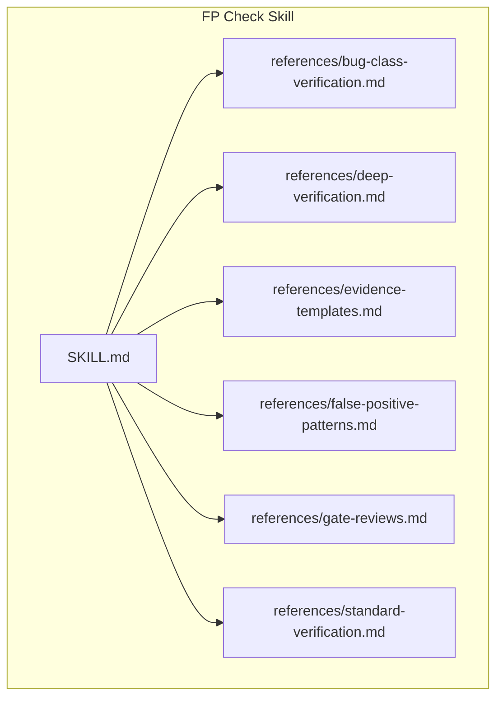
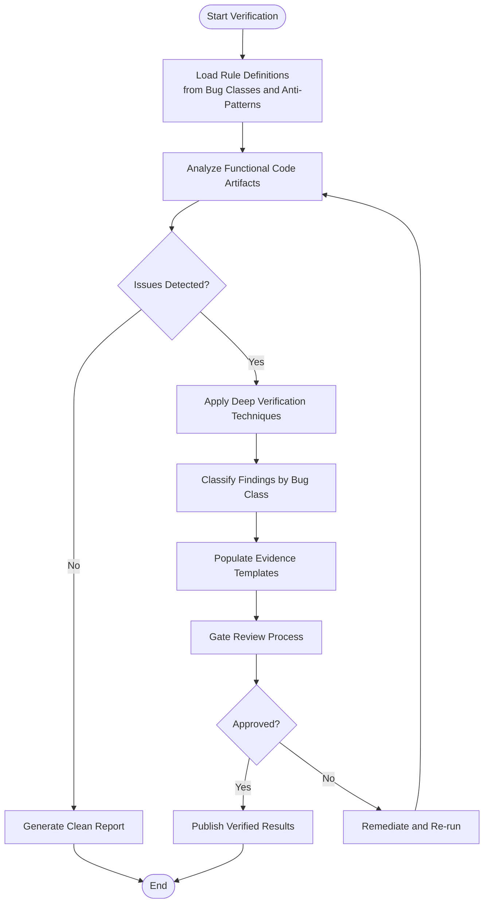
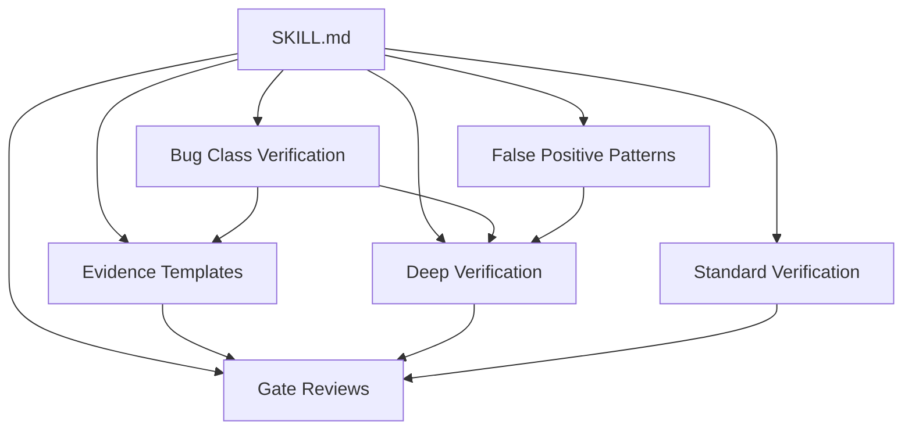
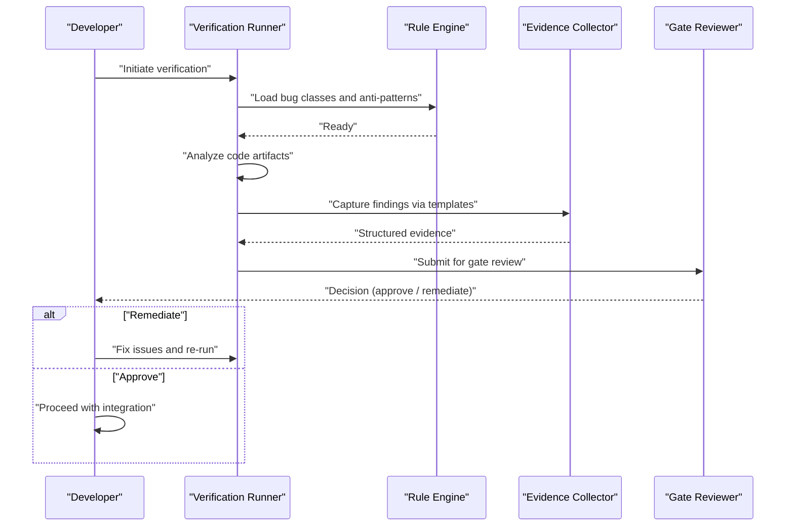

# FP Check Skill

<cite>
**Referenced Files in This Document**
- [SKILL.md](file://skills/fp-check/SKILL.md)
- [bug-class-verification.md](file://skills/fp-check/references/bug-class-verification.md)
- [deep-verification.md](file://skills/fp-check/references/deep-verification.md)
- [evidence-templates.md](file://skills/fp-check/references/evidence-templates.md)
- [false-positive-patterns.md](file://skills/fp-check/references/false-positive-patterns.md)
- [gate-reviews.md](file://skills/fp-check/references/gate-reviews.md)
- [standard-verification.md](file://skills/fp-check/references/standard-verification.md)
</cite>

## Table of Contents
1. [Introduction](#introduction)
2. [Project Structure](#project-structure)
3. [Core Components](#core-components)
4. [Architecture Overview](#architecture-overview)
5. [Detailed Component Analysis](#detailed-component-analysis)
6. [Dependency Analysis](#dependency-analysis)
7. [Performance Considerations](#performance-considerations)
8. [Troubleshooting Guide](#troubleshooting-guide)
9. [Conclusion](#conclusion)
10. [Appendices](#appendices)

## Introduction
This document provides comprehensive reference material for the FP Check skill, which enables functional programming verification capabilities across codebases. It consolidates guidance on bug class verification, deep verification techniques, evidence templates, false positive pattern recognition, gate review processes, and standard verification procedures. The goal is to help practitioners define robust verification rules, integrate them with functional languages, detect common anti-patterns, and execute repeatable verification workflows that improve reliability and maintainability.

## Project Structure
The FP Check skill is organized as a modular set of references under a dedicated directory. The primary entry point describes the skill’s purpose and scope, while the references folder contains detailed methodology and operational guidance.

**Diagram sources**
- [SKILL.md](file://skills/fp-check/SKILL.md)
- [bug-class-verification.md](file://skills/fp-check/references/bug-class-verification.md)
- [deep-verification.md](file://skills/fp-check/references/deep-verification.md)
- [evidence-templates.md](file://skills/fp-check/references/evidence-templates.md)
- [false-positive-patterns.md](file://skills/fp-check/references/false-positive-patterns.md)
- [gate-reviews.md](file://skills/fp-check/references/gate-reviews.md)
- [standard-verification.md](file://skills/fp-check/references/standard-verification.md)

**Section sources**
- [SKILL.md](file://skills/fp-check/SKILL.md)

## Core Components
The FP Check skill centers around six core components:

- Bug Class Verification: Defines how to identify, classify, and verify functional programming-related defects.
- Deep Verification: Provides advanced techniques for thorough analysis beyond surface-level checks.
- Evidence Templates: Standardized formats for capturing findings, context, and remediation steps.
- False Positive Pattern Recognition: Catalogs patterns that commonly lead to misclassification and how to avoid them.
- Gate Reviews: Describes quality gates and decision criteria for releasing or blocking changes.
- Standard Verification Procedures: Step-by-step workflows for consistent execution of verification tasks.

These components collectively form a cohesive methodology for verifying functional correctness and style adherence in functional programming contexts.

**Section sources**
- [bug-class-verification.md](file://skills/fp-check/references/bug-class-verification.md)
- [deep-verification.md](file://skills/fp-check/references/deep-verification.md)
- [evidence-templates.md](file://skills/fp-check/references/evidence-templates.md)
- [false-positive-patterns.md](file://skills/fp-check/references/false-positive-patterns.md)
- [gate-reviews.md](file://skills/fp-check/references/gate-reviews.md)
- [standard-verification.md](file://skills/fp-check/references/standard-verification.md)

## Architecture Overview
At a high level, the FP Check skill orchestrates verification through a pipeline:

- Input: Code artifacts from functional programming languages (e.g., Haskell, OCaml, Scala, Clojure).
- Rule Engine: Applies rule definitions derived from bug classes and anti-pattern catalogs.
- Evidence Capture: Produces structured findings using evidence templates.
- Review Gates: Enforces quality thresholds and approvals before release.
- Output: Verified results, actionable insights, and compliance reports.

[No sources needed since this diagram shows conceptual workflow, not actual code structure]

## Detailed Component Analysis

### Bug Class Verification
This component defines how to categorize and verify functional programming defects. It includes:

- Defining bug classes specific to functional paradigms (e.g., improper use of monads, unsafe state leakage, incorrect handling of partial functions).
- Establishing detection criteria and severity levels.
- Mapping each bug class to concrete rule definitions and test cases.
- Providing examples of typical violations and their impact.

Operational guidance covers:

- How to author new bug classes.
- How to validate rule coverage.
- How to triage and prioritize findings.

**Section sources**
- [bug-class-verification.md](file://skills/fp-check/references/bug-class-verification.md)

### Deep Verification
Deep verification extends basic checks with more rigorous analysis methods:

- Static analysis enhancements tailored to functional constructs.
- Symbolic reasoning where applicable.
- Cross-file and cross-module dependency checks.
- Integration with language-specific toolchains.

It also outlines when to escalate from standard checks to deep verification and how to interpret deeper findings.

**Section sources**
- [deep-verification.md](file://skills/fp-check/references/deep-verification.md)

### Evidence Templates
Standardized evidence templates ensure consistency and clarity in reporting:

- Required fields for each finding (context, location, classification, severity).
- Guidance on attaching relevant snippets and logs.
- Examples of well-formed evidence entries.
- Best practices for reproducibility and auditability.

Templates support downstream automation and human review alike.

**Section sources**
- [evidence-templates.md](file://skills/fp-check/references/evidence-templates.md)

### False Positive Pattern Recognition
This section catalogs patterns that often cause false positives:

- Common misclassifications in functional idioms.
- Contextual nuances that require additional disambiguation.
- Strategies to refine rules and reduce noise.
- Feedback loops to continuously improve accuracy.

Practitioners can use this catalog to tune rule sets and minimize unnecessary alerts.

**Section sources**
- [false-positive-patterns.md](file://skills/fp-check/references/false-positive-patterns.md)

### Gate Reviews
Gate reviews formalize quality checkpoints:

- Criteria for passing verification gates.
- Roles and responsibilities during review.
- Escalation paths for unresolved issues.
- Documentation requirements for approvals.

Gates ensure that only verified and compliant changes proceed.

**Section sources**
- [gate-reviews.md](file://skills/fp-check/references/gate-reviews.md)

### Standard Verification Procedures
Standard procedures provide repeatable workflows:

- Pre-flight checks and environment setup.
- Execution steps for running verifications.
- Interpretation of outputs and next actions.
- Post-run cleanup and reporting.

These procedures help teams achieve consistent outcomes across environments and contributors.

**Section sources**
- [standard-verification.md](file://skills/fp-check/references/standard-verification.md)

## Dependency Analysis
The FP Check skill’s references are interdependent:

- SKILL.md serves as the entry point and links to all reference materials.
- Bug class definitions inform rule creation and detection logic.
- Deep verification builds upon bug classes and anti-pattern knowledge.
- Evidence templates standardize output produced by verification runs.
- False positive patterns guide refinement of rules and templates.
- Gate reviews consume evidence and decisions to enforce quality.
- Standard procedures orchestrate the entire process end-to-end.

**Diagram sources**
- [SKILL.md](file://skills/fp-check/SKILL.md)
- [bug-class-verification.md](file://skills/fp-check/references/bug-class-verification.md)
- [deep-verification.md](file://skills/fp-check/references/deep-verification.md)
- [evidence-templates.md](file://skills/fp-check/references/evidence-templates.md)
- [false-positive-patterns.md](file://skills/fp-check/references/false-positive-patterns.md)
- [gate-reviews.md](file://skills/fp-check/references/gate-reviews.md)
- [standard-verification.md](file://skills/fp-check/references/standard-verification.md)

**Section sources**
- [SKILL.md](file://skills/fp-check/SKILL.md)
- [bug-class-verification.md](file://skills/fp-check/references/bug-class-verification.md)
- [deep-verification.md](file://skills/fp-check/references/deep-verification.md)
- [evidence-templates.md](file://skills/fp-check/references/evidence-templates.md)
- [false-positive-patterns.md](file://skills/fp-check/references/false-positive-patterns.md)
- [gate-reviews.md](file://skills/fp-check/references/gate-reviews.md)
- [standard-verification.md](file://skills/fp-check/references/standard-verification.md)

## Performance Considerations
- Prefer incremental verification to limit scope and speed up feedback cycles.
- Cache intermediate results where possible to avoid redundant work.
- Use targeted rule sets for specific modules or PRs rather than full scans.
- Balance depth vs. breadth; escalate to deep verification selectively.
- Monitor false positive rates and refine rules to reduce overhead.

[No sources needed since this section provides general guidance]

## Troubleshooting Guide
Common issues and resolutions:

- Misclassified findings: Consult false positive patterns to adjust rule conditions and add contextual guards.
- Incomplete evidence: Ensure evidence templates capture required fields and reproducible context.
- Gate failures: Review gate criteria and remediation steps; re-run verification after fixes.
- Slow runs: Narrow scope, enable caching, and split large jobs into smaller tasks.

For detailed procedures, refer to the standard verification and gate review references.

**Section sources**
- [false-positive-patterns.md](file://skills/fp-check/references/false-positive-patterns.md)
- [evidence-templates.md](file://skills/fp-check/references/evidence-templates.md)
- [gate-reviews.md](file://skills/fp-check/references/gate-reviews.md)
- [standard-verification.md](file://skills/fp-check/references/standard-verification.md)

## Conclusion
The FP Check skill offers a structured approach to verifying functional programming code through well-defined bug classes, deep verification techniques, standardized evidence, false positive mitigation, gate reviews, and repeatable procedures. By adopting these practices, teams can improve reliability, reduce risk, and maintain high standards across functional codebases.

[No sources needed since this section summarizes without analyzing specific files]

## Appendices

### Verification Workflow Sequence
A practical sequence for executing verification:

[No sources needed since this diagram shows conceptual workflow, not actual code structure]