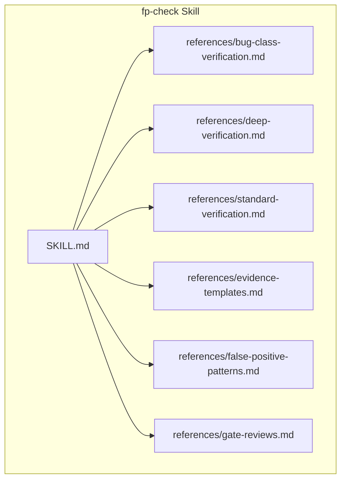
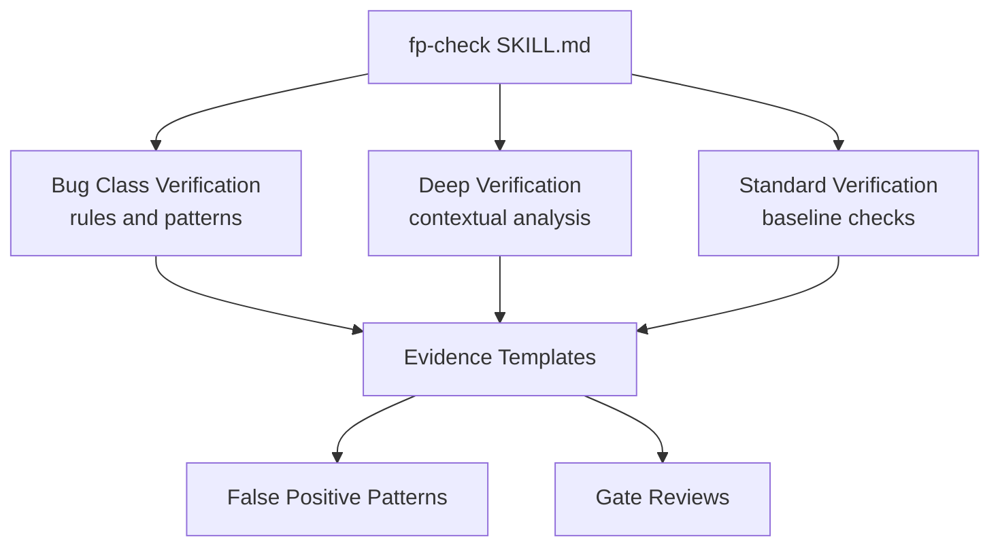
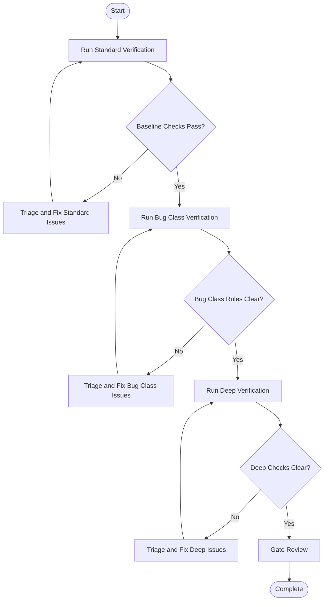
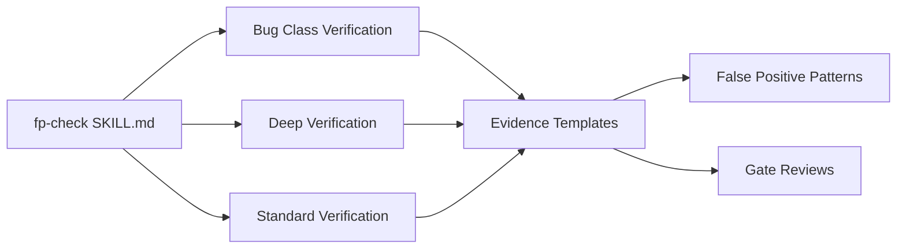

# Verification Methodologies

<cite>
**Referenced Files in This Document**
- [fp-check SKILL.md](file://skills/fp-check/SKILL.md)
- [bug-class-verification.md](file://skills/fp-check/references/bug-class-verification.md)
- [deep-verification.md](file://skills/fp-check/references/deep-verification.md)
- [standard-verification.md](file://skills/fp-check/references/standard-verification.md)
- [evidence-templates.md](file://skills/fp-check/references/evidence-templates.md)
- [false-positive-patterns.md](file://skills/fp-check/references/false-positive-patterns.md)
- [gate-reviews.md](file://skills/fp-check/references/gate-reviews.md)
</cite>

## Table of Contents
1. [Introduction](#introduction)
2. [Project Structure](#project-structure)
3. [Core Components](#core-components)
4. [Architecture Overview](#architecture-overview)
5. [Detailed Component Analysis](#detailed-component-analysis)
6. [Dependency Analysis](#dependency-analysis)
7. [Performance Considerations](#performance-considerations)
8. [Troubleshooting Guide](#troubleshooting-guide)
9. [Conclusion](#conclusion)

## Introduction
This document explains the verification methodologies used to analyze and validate functional programming code within the repository’s fp-check skill. It covers three complementary approaches:
- Bug class verification techniques that target known anti-patterns and error-prone constructs common in functional languages.
- Deep verification methods that perform thorough, context-aware analysis across modules and data flows.
- Standard verification procedures that provide consistent, repeatable checks for everyday quality gates.

The goal is to help practitioners select the right method for a given scenario, understand how these methods relate, and apply them effectively to detect functional programming anti-patterns with minimal false positives.

## Project Structure
The verification content is organized under the fp-check skill, which includes:
- A top-level skill definition describing scope and usage.
- Reference documents detailing each methodology (bug class, deep, standard).
- Supporting materials such as evidence templates, false positive patterns, and gate review guidance.

**Diagram sources**
- [fp-check SKILL.md](file://skills/fp-check/SKILL.md)
- [bug-class-verification.md](file://skills/fp-check/references/bug-class-verification.md)
- [deep-verification.md](file://skills/fp-check/references/deep-verification.md)
- [standard-verification.md](file://skills/fp-check/references/standard-verification.md)
- [evidence-templates.md](file://skills/fp-check/references/evidence-templates.md)
- [false-positive-patterns.md](file://skills/fp-check/references/false-positive-patterns.md)
- [gate-reviews.md](file://skills/fp-check/references/gate-reviews.md)

**Section sources**
- [fp-check SKILL.md](file://skills/fp-check/SKILL.md)

## Core Components
- Bug Class Verification: Focuses on detecting specific categories of defects by matching known anti-patterns and unsafe idioms in functional code. It emphasizes rule-based detection and targeted remediation advice.
- Deep Verification: Performs comprehensive, cross-file analysis to uncover subtle issues such as incorrect composition, misuse of higher-order functions, or violations of purity assumptions. It often uses richer context and may integrate additional tools or AST-based checks.
- Standard Verification: Provides baseline checks suitable for fast feedback loops, including style, basic correctness, and common pitfalls. These are designed to run frequently and early in development.

These components are coordinated through shared evidence and reporting artifacts and can be combined to balance speed and depth.

**Section sources**
- [bug-class-verification.md](file://skills/fp-check/references/bug-class-verification.md)
- [deep-verification.md](file://skills/fp-check/references/deep-verification.md)
- [standard-verification.md](file://skills/fp-check/references/standard-verification.md)

## Architecture Overview
The verification workflow integrates the three methodologies into a cohesive pipeline:
- Entry point defines the skill and available references.
- Each methodology contributes rules, patterns, and outputs.
- Evidence templates standardize reporting.
- False positive patterns guide triage and refinement.
- Gate reviews ensure consistency and governance.

**Diagram sources**
- [fp-check SKILL.md](file://skills/fp-check/SKILL.md)
- [bug-class-verification.md](file://skills/fp-check/references/bug-class-verification.md)
- [deep-verification.md](file://skills/fp-check/references/deep-verification.md)
- [standard-verification.md](file://skills/fp-check/references/standard-verification.md)
- [evidence-templates.md](file://skills/fp-check/references/evidence-templates.md)
- [false-positive-patterns.md](file://skills/fp-check/references/false-positive-patterns.md)
- [gate-reviews.md](file://skills/fp-check/references/gate-reviews.md)

## Detailed Component Analysis

### Bug Class Verification Techniques
Bug class verification targets well-known defect categories in functional programming. Typical areas include:
- Purity violations and unintended side effects.
- Incorrect use of higher-order functions (e.g., misapplied map/filter/reduce).
- Unsafe handling of optional values or error channels.
- Composition errors and incorrect function ordering.
- Misuse of recursion without proper base cases or tail-call considerations.

Detection patterns commonly involve:
- Rule-based AST or regex-like pattern matching against known anti-patterns.
- Signature and type-based heuristics to flag suspicious calls.
- Contextual guards to reduce noise (e.g., ignoring test-only files).

Remediation guidance should be actionable and language-specific where applicable.

When to use:
- Early in development to catch frequent mistakes quickly.
- As part of pre-commit hooks or CI for fast feedback.
- To enforce team conventions around pure functions and safe abstractions.

Relationship to other methods:
- Complements deep verification by providing quick wins and broad coverage.
- Feeds into standard verification as reusable rules.

**Section sources**
- [bug-class-verification.md](file://skills/fp-check/references/bug-class-verification.md)

### Deep Verification Methods
Deep verification performs thorough analysis beyond surface patterns:
- Cross-module reasoning about data flow and function composition.
- Type-driven checks to ensure correct usage of abstract types and interfaces.
- Property-based or contract-style validations where supported.
- Integration with external analyzers or toolchains for richer insights.

Analysis techniques may include:
- AST traversal with semantic information.
- Control-flow and data-flow analysis to detect unreachable branches or inconsistent states.
- Regression-safe rule evolution with automated tests.

When to use:
- Before merges or releases when higher assurance is required.
- For complex refactors or architectural changes.
- When investigating intermittent or hard-to-reproduce issues.

Relationship to other methods:
- Builds on bug class rules but adds deeper context.
- Results can inform updates to standard verification rules.

**Section sources**
- [deep-verification.md](file://skills/fp-check/references/deep-verification.md)

### Standard Verification Procedures
Standard verification provides consistent, repeatable checks:
- Baseline linting and style enforcement.
- Common anti-pattern detection aligned with team standards.
- Quick sanity checks for imports, exports, and module structure.

Operational characteristics:
- Designed for frequent execution with low overhead.
- Produces standardized reports consumable by CI systems.
- Encourages incremental improvements rather than big-bang fixes.

When to use:
- On every commit or pull request.
- As a first line of defense before deeper analysis.
- To maintain baseline quality across large codebases.

Relationship to other methods:
- Serves as the foundation upon which bug class and deep verifications layer.
- Shares evidence formats with deeper analyses for unified reporting.

**Section sources**
- [standard-verification.md](file://skills/fp-check/references/standard-verification.md)

### Evidence and Reporting
Evidence templates standardize how findings are recorded and communicated:
- Consistent fields for severity, location, description, and suggested fix.
- Links to relevant rules or references.
- Structured output suitable for dashboards and audits.

False positive patterns document known cases where rules over-report:
- Examples of legitimate code that triggers warnings.
- Guidance on suppressing or refining rules safely.
- Strategies to improve precision without sacrificing recall.

Gate reviews define governance and approval criteria:
- Criteria for passing verification gates.
- Roles and responsibilities for sign-off.
- Escalation paths for persistent issues.

**Section sources**
- [evidence-templates.md](file://skills/fp-check/references/evidence-templates.md)
- [false-positive-patterns.md](file://skills/fp-check/references/false-positive-patterns.md)
- [gate-reviews.md](file://skills/fp-check/references/gate-reviews.md)

### Conceptual Workflow
The following conceptual diagram shows how the three methodologies interact during a typical verification cycle.

[No sources needed since this diagram shows conceptual workflow, not actual code structure]

## Dependency Analysis
The fp-check skill orchestrates multiple reference documents to deliver a layered verification strategy. The relationships emphasize reuse of evidence and governance via gate reviews.

**Diagram sources**
- [fp-check SKILL.md](file://skills/fp-check/SKILL.md)
- [bug-class-verification.md](file://skills/fp-check/references/bug-class-verification.md)
- [deep-verification.md](file://skills/fp-check/references/deep-verification.md)
- [standard-verification.md](file://skills/fp-check/references/standard-verification.md)
- [evidence-templates.md](file://skills/fp-check/references/evidence-templates.md)
- [false-positive-patterns.md](file://skills/fp-check/references/false-positive-patterns.md)
- [gate-reviews.md](file://skills/fp-check/references/gate-reviews.md)

**Section sources**
- [fp-check SKILL.md](file://skills/fp-check/SKILL.md)

## Performance Considerations
- Prefer standard verification for fast feedback; reserve deep verification for high-value scenarios.
- Incrementally expand bug class rules based on real-world findings to avoid overwhelming developers.
- Use evidence templates to keep reports concise and actionable, reducing triage time.
- Periodically review false positive patterns to refine rule precision and maintain developer trust.

[No sources needed since this section provides general guidance]

## Troubleshooting Guide
Common issues and strategies:
- High false positive rate: Consult false positive patterns to adjust rule scope or add exceptions.
- Inconsistent reports: Ensure evidence templates are followed uniformly across all methodologies.
- Gate bottlenecks: Clarify gate review criteria and assign clear ownership for approvals.
- Slow runs: Separate fast standard checks from slower deep verification; gate only critical failures early.

**Section sources**
- [false-positive-patterns.md](file://skills/fp-check/references/false-positive-patterns.md)
- [evidence-templates.md](file://skills/fp-check/references/evidence-templates.md)
- [gate-reviews.md](file://skills/fp-check/references/gate-reviews.md)

## Conclusion
By combining bug class verification, deep verification, and standard verification, teams can achieve both breadth and depth in analyzing functional code. Standard checks provide rapid feedback, bug class rules target frequent pitfalls, and deep verification uncovers subtle, systemic issues. Shared evidence and governance through gate reviews ensure consistency and continuous improvement.

[No sources needed since this section summarizes without analyzing specific files]