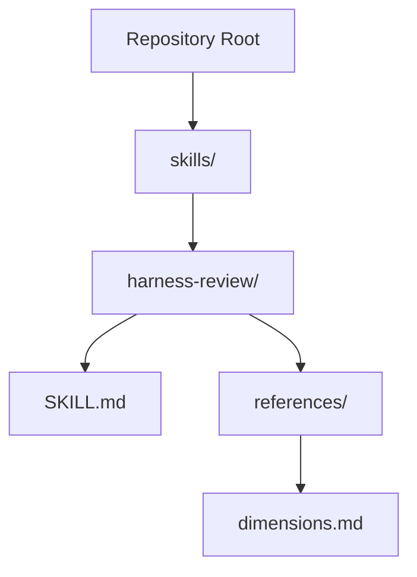
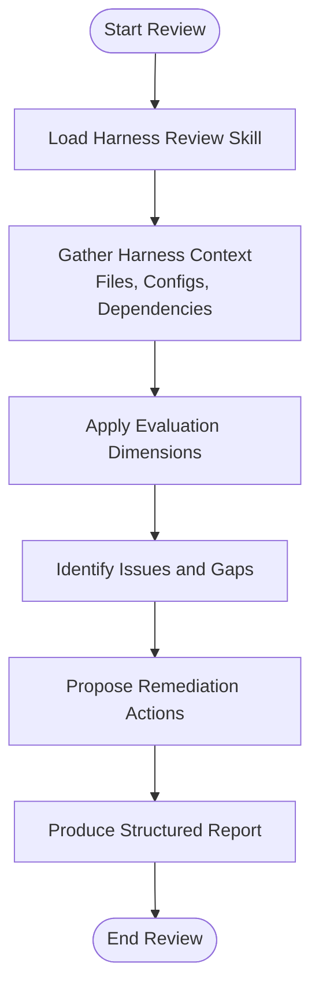
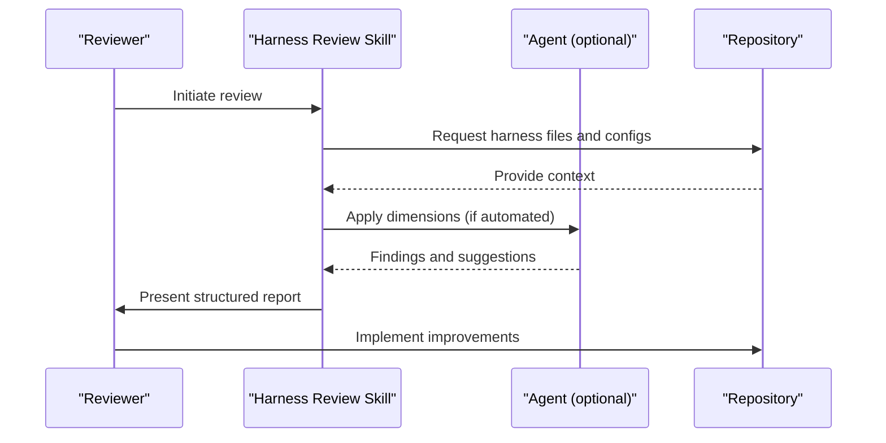
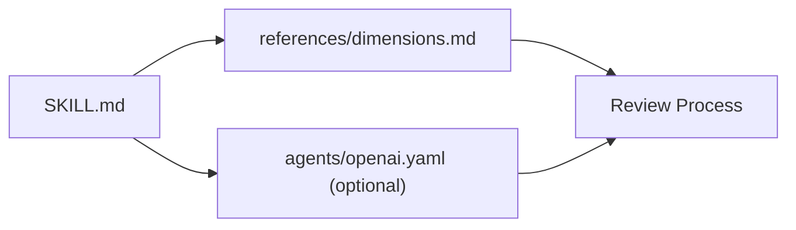

# Harness Review Skill

<cite>
**Referenced Files in This Document**
- [README.md](file://README.md)
- [skills/harness-review/SKILL.md](file://skills/harness-review/SKILL.md)
- [skills/harness-review/references/dimensions.md](file://skills/harness-review/references/dimensions.md)
</cite>

## Table of Contents
1. [Introduction](#introduction)
2. [Project Structure](#project-structure)
3. [Core Components](#core-components)
4. [Architecture Overview](#architecture-overview)
5. [Detailed Component Analysis](#detailed-component-analysis)
6. [Dependency Analysis](#dependency-analysis)
7. [Performance Considerations](#performance-considerations)
8. [Troubleshooting Guide](#troubleshooting-guide)
9. [Conclusion](#conclusion)

## Introduction
This document describes the Harness Review skill, a reusable review capability designed to evaluate and improve test harnesses within software projects. The skill focuses on structured evaluation across multiple dimensions such as reliability, coverage, maintainability, and clarity. It provides guidance for reviewers and automated agents to consistently assess harness quality and propose actionable improvements.

The skill is part of a broader collection of skills that standardize code review practices, architecture deepening, TDD development, differential reviews, security gating, and variant analysis.

## Project Structure
The repository organizes skills under a dedicated directory. Each skill typically includes:
- A SKILL.md file describing purpose, usage, and workflow
- Optional references or guides for deeper methodology
- Optional agent configuration files for integration with AI-driven workflows

For the Harness Review skill, the relevant structure is:
- skills/harness-review/SKILL.md: Primary skill definition and instructions
- skills/harness-review/references/dimensions.md: Reference material detailing evaluation dimensions

**Diagram sources**
- [README.md](file://README.md)
- [skills/harness-review/SKILL.md](file://skills/harness-review/SKILL.md)
- [skills/harness-review/references/dimensions.md](file://skills/harness-review/references/dimensions.md)

**Section sources**
- [README.md](file://README.md)
- [skills/harness-review/SKILL.md](file://skills/harness-review/SKILL.md)
- [skills/harness-review/references/dimensions.md](file://skills/harness-review/references/dimensions.md)

## Core Components
- Harness Review Skill Definition: Provides the overall scope, objectives, and recommended workflow for evaluating test harnesses.
- Evaluation Dimensions: A reference guide enumerating key aspects to consider when reviewing harnesses (e.g., determinism, isolation, observability, maintenance).
- Integration Points: Optional agent configuration files can be used to integrate the skill into automated review pipelines.

Key responsibilities:
- Define consistent criteria for assessing harness quality
- Provide structured prompts and checklists for reviewers
- Offer guidance for remediation and continuous improvement

**Section sources**
- [skills/harness-review/SKILL.md](file://skills/harness-review/SKILL.md)
- [skills/harness-review/references/dimensions.md](file://skills/harness-review/references/dimensions.md)

## Architecture Overview
At a high level, the Harness Review skill operates as a knowledge-based component integrated into review workflows. It can be invoked by human reviewers or automated agents to produce structured assessments and recommendations.

[No sources needed since this diagram shows conceptual workflow, not actual code structure]

## Detailed Component Analysis

### Harness Review Skill (SKILL.md)
Purpose:
- Defines the scope and goals of harness reviews
- Outlines recommended steps for gathering context, applying evaluation criteria, and producing reports
- Provides guidance for integrating with review tools and agents

Workflow highlights:
- Context acquisition: Collect relevant harness files, configurations, and dependencies
- Dimension application: Evaluate against established criteria
- Issue identification: Detect anti-patterns, flakiness risks, and maintenance burdens
- Remediation proposals: Suggest concrete improvements and best practices
- Reporting: Generate clear, actionable outputs for developers and reviewers

Integration notes:
- Can be used by human reviewers as a checklist
- Can be consumed by agents via provided configuration to automate parts of the process

**Section sources**
- [skills/harness-review/SKILL.md](file://skills/harness-review/SKILL.md)

### Evaluation Dimensions (references/dimensions.md)
Purpose:
- Enumerates the core dimensions used to assess harness quality
- Describes what each dimension means and why it matters
- Offers examples of good and problematic patterns

Typical dimensions include:
- Determinism and stability: Avoiding flaky behavior and ensuring predictable outcomes
- Isolation and independence: Preventing cross-test interference and shared state issues
- Observability and diagnostics: Providing clear logs, assertions, and failure signals
- Maintainability and readability: Keeping harness code simple, modular, and easy to evolve
- Coverage and relevance: Ensuring tests exercise meaningful scenarios and edge cases
- Performance and efficiency: Minimizing runtime overhead and resource consumption

Usage:
- Use these dimensions as a rubric during reviews
- Map identified issues back to specific dimensions for clarity and prioritization

**Section sources**
- [skills/harness-review/references/dimensions.md](file://skills/harness-review/references/dimensions.md)

### Conceptual Workflow for Harness Reviews
A practical sequence for executing a harness review using the skill:

[No sources needed since this diagram shows conceptual workflow, not actual code structure]

## Dependency Analysis
The Harness Review skill primarily depends on:
- The skill definition file (SKILL.md)
- The evaluation dimensions reference (references/dimensions.md)
- Optional agent configuration files if integrated into automated workflows

There are no direct code-level imports; instead, the skill functions as a knowledge artifact consumed by reviewers and automation.

**Diagram sources**
- [skills/harness-review/SKILL.md](file://skills/harness-review/SKILL.md)
- [skills/harness-review/references/dimensions.md](file://skills/harness-review/references/dimensions.md)

**Section sources**
- [skills/harness-review/SKILL.md](file://skills/harness-review/SKILL.md)
- [skills/harness-review/references/dimensions.md](file://skills/harness-review/references/dimensions.md)

## Performance Considerations
- Keep context gathering focused: Limit the scope to relevant harness files and configurations to reduce noise.
- Prioritize high-impact dimensions: Emphasize determinism, isolation, and observability first, then address maintainability and performance.
- Automate repetitive checks: Use agent integrations where possible to pre-screen common issues before human review.
- Incremental improvements: Encourage small, targeted fixes rather than large overhauls to minimize disruption.

[No sources needed since this section provides general guidance]

## Troubleshooting Guide
Common issues and resolutions:
- Ambiguous scope: Clarify which harnesses are in scope before starting the review.
- Missing context: Ensure all necessary files and configurations are available to the reviewer or agent.
- Overly broad findings: Tie each issue to a specific dimension and provide actionable remediation steps.
- Inconsistent reporting: Standardize output format using the skill’s guidance to ensure consistency across reviews.

**Section sources**
- [skills/harness-review/SKILL.md](file://skills/harness-review/SKILL.md)
- [skills/harness-review/references/dimensions.md](file://skills/harness-review/references/dimensions.md)

## Conclusion
The Harness Review skill offers a structured approach to evaluating test harnesses across critical dimensions. By combining clear definitions, practical workflows, and detailed evaluation criteria, it helps teams improve harness reliability, maintainability, and effectiveness. Integrating the skill into both manual and automated review processes ensures consistent quality and continuous improvement.