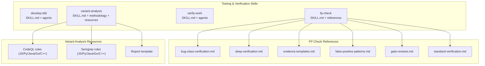
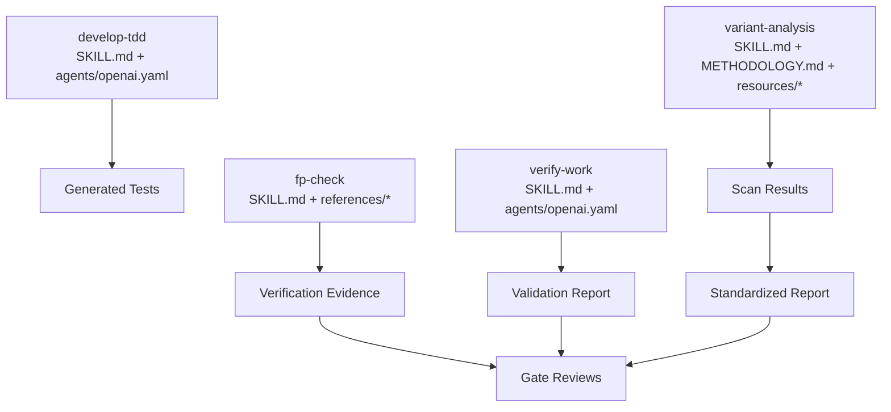
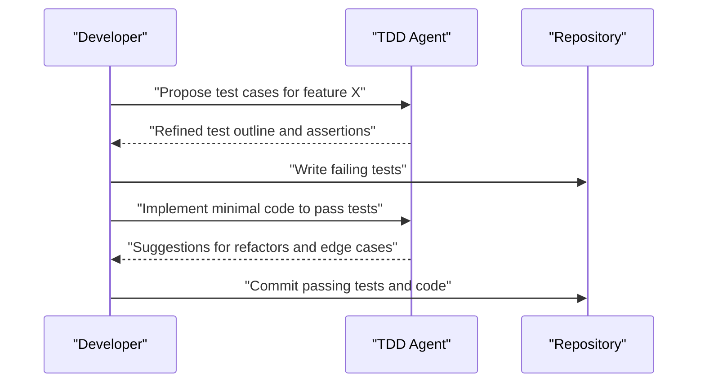
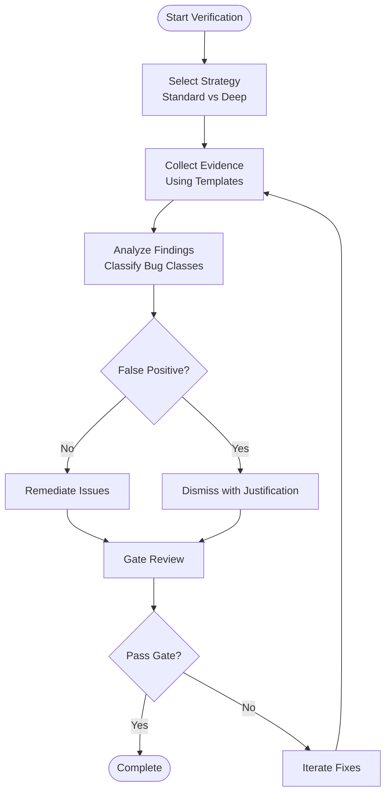
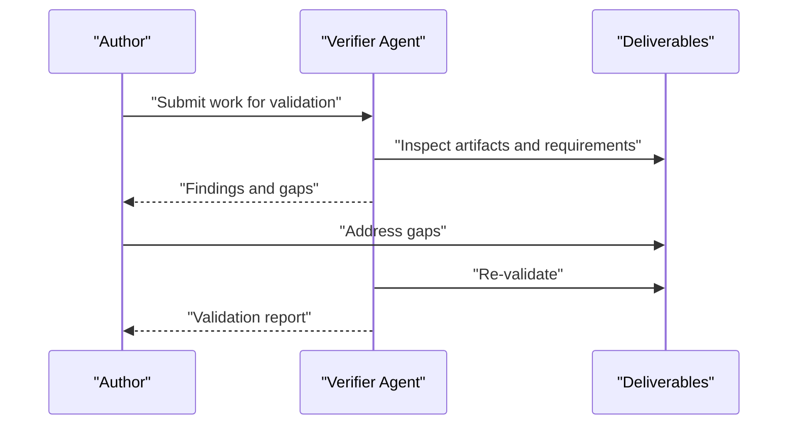
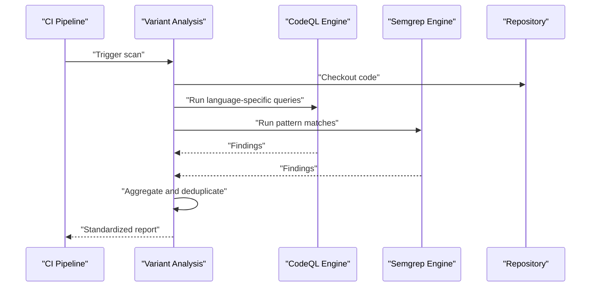
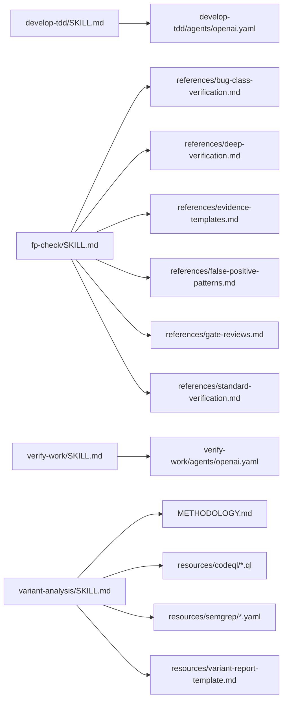

# Testing & Verification Skills

<cite>
**Referenced Files in This Document**
- [skills/develop-tdd/SKILL.md](file://skills/develop-tdd/SKILL.md)
- [skills/develop-tdd/agents/openai.yaml](file://skills/develop-tdd/agents/openai.yaml)
- [skills/fp-check/SKILL.md](file://skills/fp-check/SKILL.md)
- [skills/fp-check/agents/openai.yaml](file://skills/fp-check/agents/openai.yaml)
- [skills/fp-check/references/bug-class-verification.md](file://skills/fp-check/references/bug-class-verification.md)
- [skills/fp-check/references/deep-verification.md](file://skills/fp-check/references/deep-verification.md)
- [skills/fp-check/references/evidence-templates.md](file://skills/fp-check/references/evidence-templates.md)
- [skills/fp-check/references/false-positive-patterns.md](file://skills/fp-check/references/false-positive-patterns.md)
- [skills/fp-check/references/gate-reviews.md](file://skills/fp-check/references/gate-reviews.md)
- [skills/fp-check/references/standard-verification.md](file://skills/fp-check/references/standard-verification.md)
- [skills/verify-work/SKILL.md](file://skills/verify-work/SKILL.md)
- [skills/verify-work/agents/openai.yaml](file://skills/verify-work/agents/openai.yaml)
- [skills/variant-analysis/SKILL.md](file://skills/variant-analysis/SKILL.md)
- [skills/variant-analysis/METHODOLOGY.md](file://skills/variant-analysis/METHODOLOGY.md)
- [skills/variant-analysis/agents/openai.yaml](file://skills/variant-analysis/agents/openai.yaml)
- [skills/variant-analysis/resources/codeql/javascript.ql](file://skills/variant-analysis/resources/codeql/javascript.ql)
- [skills/variant-analysis/resources/codeql/python.ql](file://skills/variant-analysis/resources/codeql/python.ql)
- [skills/variant-analysis/resources/codeql/java.ql](file://skills/variant-analysis/resources/codeql/java.ql)
- [skills/variant-analysis/resources/codeql/go.ql](file://skills/variant-analysis/resources/codeql/go.ql)
- [skills/variant-analysis/resources/codeql/cpp.ql](file://skills/variant-analysis/resources/codeql/cpp.ql)
- [skills/variant-analysis/resources/semgrep/javascript.yaml](file://skills/variant-analysis/resources/semgrep/javascript.yaml)
- [skills/variant-analysis/resources/semgrep/python.yaml](file://skills/variant-analysis/resources/semgrep/python.yaml)
- [skills/variant-analysis/resources/semgrep/java.yaml](file://skills/variant-analysis/resources/semgrep/java.yaml)
- [skills/variant-analysis/resources/semgrep/go.yaml](file://skills/variant-analysis/resources/semgrep/go.yaml)
- [skills/variant-analysis/resources/semgrep/cpp.yaml](file://skills/variant-analysis/resources/semgrep/cpp.yaml)
- [skills/variant-analysis/resources/variant-report-template.md](file://skills/variant-analysis/resources/variant-report-template.md)
</cite>

## Table of Contents
1. [Introduction](#introduction)
2. [Project Structure](#project-structure)
3. [Core Components](#core-components)
4. [Architecture Overview](#architecture-overview)
5. [Detailed Component Analysis](#detailed-component-analysis)
6. [Dependency Analysis](#dependency-analysis)
7. [Performance Considerations](#performance-considerations)
8. [Troubleshooting Guide](#troubleshooting-guide)
9. [Conclusion](#conclusion)
10. [Appendices](#appendices)

## Introduction
This document provides comprehensive documentation for testing and verification skills in the Pi Codex Kit, focusing on:
- develop-tdd: Test-driven development assistance to author tests first and iterate with AI guidance.
- fp-check: Functional programming verification with extensive reference materials for evidence-based validation.
- verify-work: Work validation to ensure deliverables meet requirements and quality gates.
- variant-analysis: Security vulnerability scanning using CodeQL and Semgrep, including rule configuration, outputs, and CI/CD integration.

The goal is to help teams adopt consistent, repeatable practices for building reliable software through automated checks, structured reviews, and security scanning.

## Project Structure
The testing and verification capabilities are organized as skills under the skills directory. Each skill includes a SKILL.md describing usage and an agents/openai.yaml defining agent behavior. Supporting resources (references, rules, templates) live alongside each skill.

**Diagram sources**
- [skills/develop-tdd/SKILL.md](file://skills/develop-tdd/SKILL.md)
- [skills/fp-check/SKILL.md](file://skills/fp-check/SKILL.md)
- [skills/verify-work/SKILL.md](file://skills/verify-work/SKILL.md)
- [skills/variant-analysis/SKILL.md](file://skills/variant-analysis/SKILL.md)
- [skills/fp-check/references/bug-class-verification.md](file://skills/fp-check/references/bug-class-verification.md)
- [skills/fp-check/references/deep-verification.md](file://skills/fp-check/references/deep-verification.md)
- [skills/fp-check/references/evidence-templates.md](file://skills/fp-check/references/evidence-templates.md)
- [skills/fp-check/references/false-positive-patterns.md](file://skills/fp-check/references/false-positive-patterns.md)
- [skills/fp-check/references/gate-reviews.md](file://skills/fp-check/references/gate-reviews.md)
- [skills/fp-check/references/standard-verification.md](file://skills/fp-check/references/standard-verification.md)
- [skills/variant-analysis/resources/codeql/javascript.ql](file://skills/variant-analysis/resources/codeql/javascript.ql)
- [skills/variant-analysis/resources/codeql/python.ql](file://skills/variant-analysis/resources/codeql/python.ql)
- [skills/variant-analysis/resources/codeql/java.ql](file://skills/variant-analysis/resources/codeql/java.ql)
- [skills/variant-analysis/resources/codeql/go.ql](file://skills/variant-analysis/resources/codeql/go.ql)
- [skills/variant-analysis/resources/codeql/cpp.ql](file://skills/variant-analysis/resources/codeql/cpp.ql)
- [skills/variant-analysis/resources/semgrep/javascript.yaml](file://skills/variant-analysis/resources/semgrep/javascript.yaml)
- [skills/variant-analysis/resources/semgrep/python.yaml](file://skills/variant-analysis/resources/semgrep/python.yaml)
- [skills/variant-analysis/resources/semgrep/java.yaml](file://skills/variant-analysis/resources/semgrep/java.yaml)
- [skills/variant-analysis/resources/semgrep/go.yaml](file://skills/variant-analysis/resources/semgrep/go.yaml)
- [skills/variant-analysis/resources/semgrep/cpp.yaml](file://skills/variant-analysis/resources/semgrep/cpp.yaml)
- [skills/variant-analysis/resources/variant-report-template.md](file://skills/variant-analysis/resources/variant-report-template.md)

**Section sources**
- [skills/develop-tdd/SKILL.md](file://skills/develop-tdd/SKILL.md)
- [skills/fp-check/SKILL.md](file://skills/fp-check/SKILL.md)
- [skills/verify-work/SKILL.md](file://skills/verify-work/SKILL.md)
- [skills/variant-analysis/SKILL.md](file://skills/variant-analysis/SKILL.md)

## Core Components
- develop-tdd: Guides test-first workflows, helping you write failing tests, implement minimal code to pass them, and refactor safely. It includes agent configuration to tailor interactions.
- fp-check: Provides a structured approach to verifying functional programs with deep analysis, standard checks, evidence templates, false positive handling, and gate review criteria.
- verify-work: Validates completed work against acceptance criteria, ensuring consistency, completeness, and readiness for delivery.
- variant-analysis: Orchestrates security scanning with CodeQL and Semgrep across multiple languages, producing standardized reports and actionable remediation steps.

**Section sources**
- [skills/develop-tdd/SKILL.md](file://skills/develop-tdd/SKILL.md)
- [skills/fp-check/SKILL.md](file://skills/fp-check/SKILL.md)
- [skills/verify-work/SKILL.md](file://skills/verify-work/SKILL.md)
- [skills/variant-analysis/SKILL.md](file://skills/variant-analysis/SKILL.md)

## Architecture Overview
The skills operate as modular components that can be invoked independently or combined into pipelines. The diagram below shows how each skill interacts with its supporting assets and typical downstream artifacts.

**Diagram sources**
- [skills/develop-tdd/SKILL.md](file://skills/develop-tdd/SKILL.md)
- [skills/develop-tdd/agents/openai.yaml](file://skills/develop-tdd/agents/openai.yaml)
- [skills/fp-check/SKILL.md](file://skills/fp-check/SKILL.md)
- [skills/fp-check/references/bug-class-verification.md](file://skills/fp-check/references/bug-class-verification.md)
- [skills/fp-check/references/deep-verification.md](file://skills/fp-check/references/deep-verification.md)
- [skills/fp-check/references/evidence-templates.md](file://skills/fp-check/references/evidence-templates.md)
- [skills/fp-check/references/false-positive-patterns.md](file://skills/fp-check/references/false-positive-patterns.md)
- [skills/fp-check/references/gate-reviews.md](file://skills/fp-check/references/gate-reviews.md)
- [skills/fp-check/references/standard-verification.md](file://skills/fp-check/references/standard-verification.md)
- [skills/verify-work/SKILL.md](file://skills/verify-work/SKILL.md)
- [skills/verify-work/agents/openai.yaml](file://skills/verify-work/agents/openai.yaml)
- [skills/variant-analysis/SKILL.md](file://skills/variant-analysis/SKILL.md)
- [skills/variant-analysis/METHODOLOGY.md](file://skills/variant-analysis/METHODOLOGY.md)
- [skills/variant-analysis/resources/variant-report-template.md](file://skills/variant-analysis/resources/variant-report-template.md)

## Detailed Component Analysis

### develop-tdd Skill
Purpose:
- Assist in writing tests before implementation (test-first).
- Provide iterative feedback loops between tests and code.
- Encourage small, focused changes and safe refactoring.

Key elements:
- SKILL.md defines workflow, prompts, and expected outcomes.
- agents/openai.yaml configures agent behavior for TDD sessions.

Typical usage flow:
- Define failing test cases aligned with requirements.
- Implement minimal code to pass tests.
- Refactor while keeping tests green.
- Use agent guidance to improve test coverage and clarity.

**Diagram sources**
- [skills/develop-tdd/SKILL.md](file://skills/develop-tdd/SKILL.md)
- [skills/develop-tdd/agents/openai.yaml](file://skills/develop-tdd/agents/openai.yaml)

**Section sources**
- [skills/develop-tdd/SKILL.md](file://skills/develop-tdd/SKILL.md)
- [skills/develop-tdd/agents/openai.yaml](file://skills/develop-tdd/agents/openai.yaml)

### fp-check Skill
Purpose:
- Provide rigorous verification for functional programs.
- Offer deep verification strategies, standard checks, evidence templates, and guidance for handling false positives.
- Establish gate review criteria to enforce quality.

Reference materials:
- bug-class-verification.md: Patterns for verifying known bug classes.
- deep-verification.md: Advanced techniques for thorough validation.
- evidence-templates.md: Structured formats for collecting proof of correctness.
- false-positive-patterns.md: Identifying and mitigating false positives.
- gate-reviews.md: Criteria and processes for gating changes.
- standard-verification.md: Baseline checks applicable across projects.

**Diagram sources**
- [skills/fp-check/SKILL.md](file://skills/fp-check/SKILL.md)
- [skills/fp-check/references/bug-class-verification.md](file://skills/fp-check/references/bug-class-verification.md)
- [skills/fp-check/references/deep-verification.md](file://skills/fp-check/references/deep-verification.md)
- [skills/fp-check/references/evidence-templates.md](file://skills/fp-check/references/evidence-templates.md)
- [skills/fp-check/references/false-positive-patterns.md](file://skills/fp-check/references/false-positive-patterns.md)
- [skills/fp-check/references/gate-reviews.md](file://skills/fp-check/references/gate-reviews.md)
- [skills/fp-check/references/standard-verification.md](file://skills/fp-check/references/standard-verification.md)

**Section sources**
- [skills/fp-check/SKILL.md](file://skills/fp-check/SKILL.md)
- [skills/fp-check/references/bug-class-verification.md](file://skills/fp-check/references/bug-class-verification.md)
- [skills/fp-check/references/deep-verification.md](file://skills/fp-check/references/deep-verification.md)
- [skills/fp-check/references/evidence-templates.md](file://skills/fp-check/references/evidence-templates.md)
- [skills/fp-check/references/false-positive-patterns.md](file://skills/fp-check/references/false-positive-patterns.md)
- [skills/fp-check/references/gate-reviews.md](file://skills/fp-check/references/gate-reviews.md)
- [skills/fp-check/references/standard-verification.md](file://skills/fp-check/references/standard-verification.md)

### verify-work Skill
Purpose:
- Validate completed work against acceptance criteria.
- Ensure consistency, completeness, and readiness for delivery.
- Produce a concise validation report summarizing findings and next steps.

Key elements:
- SKILL.md outlines validation steps and reporting format.
- agents/openai.yaml configures agent behavior for review and synthesis.

**Diagram sources**
- [skills/verify-work/SKILL.md](file://skills/verify-work/SKILL.md)
- [skills/verify-work/agents/openai.yaml](file://skills/verify-work/agents/openai.yaml)

**Section sources**
- [skills/verify-work/SKILL.md](file://skills/verify-work/SKILL.md)
- [skills/verify-work/agents/openai.yaml](file://skills/verify-work/agents/openai.yaml)

### variant-analysis Skill
Purpose:
- Perform security vulnerability scanning using CodeQL and Semgrep.
- Support multiple languages via dedicated rule sets.
- Generate standardized reports and integrate with CI/CD.

Resources:
- CodeQL rules: javascript.ql, python.ql, java.ql, go.ql, cpp.ql
- Semgrep rules: javascript.yaml, python.yaml, java.yaml, go.yaml, cpp.yaml
- Methodology: METHODOLOGY.md
- Report template: variant-report-template.md

**Diagram sources**
- [skills/variant-analysis/SKILL.md](file://skills/variant-analysis/SKILL.md)
- [skills/variant-analysis/METHODOLOGY.md](file://skills/variant-analysis/METHODOLOGY.md)
- [skills/variant-analysis/resources/codeql/javascript.ql](file://skills/variant-analysis/resources/codeql/javascript.ql)
- [skills/variant-analysis/resources/codeql/python.ql](file://skills/variant-analysis/resources/codeql/python.ql)
- [skills/variant-analysis/resources/codeql/java.ql](file://skills/variant-analysis/resources/codeql/java.ql)
- [skills/variant-analysis/resources/codeql/go.ql](file://skills/variant-analysis/resources/codeql/go.ql)
- [skills/variant-analysis/resources/codeql/cpp.ql](file://skills/variant-analysis/resources/codeql/cpp.ql)
- [skills/variant-analysis/resources/semgrep/javascript.yaml](file://skills/variant-analysis/resources/semgrep/javascript.yaml)
- [skills/variant-analysis/resources/semgrep/python.yaml](file://skills/variant-analysis/resources/semgrep/python.yaml)
- [skills/variant-analysis/resources/semgrep/java.yaml](file://skills/variant-analysis/resources/semgrep/java.yaml)
- [skills/variant-analysis/resources/semgrep/go.yaml](file://skills/variant-analysis/resources/semgrep/go.yaml)
- [skills/variant-analysis/resources/semgrep/cpp.yaml](file://skills/variant-analysis/resources/semgrep/cpp.yaml)
- [skills/variant-analysis/resources/variant-report-template.md](file://skills/variant-analysis/resources/variant-report-template.md)

**Section sources**
- [skills/variant-analysis/SKILL.md](file://skills/variant-analysis/SKILL.md)
- [skills/variant-analysis/METHODOLOGY.md](file://skills/variant-analysis/METHODOLOGY.md)
- [skills/variant-analysis/resources/codeql/javascript.ql](file://skills/variant-analysis/resources/codeql/javascript.ql)
- [skills/variant-analysis/resources/codeql/python.ql](file://skills/variant-analysis/resources/codeql/python.ql)
- [skills/variant-analysis/resources/codeql/java.ql](file://skills/variant-analysis/resources/codeql/java.ql)
- [skills/variant-analysis/resources/codeql/go.ql](file://skills/variant-analysis/resources/codeql/go.ql)
- [skills/variant-analysis/resources/codeql/cpp.ql](file://skills/variant-analysis/resources/codeql/cpp.ql)
- [skills/variant-analysis/resources/semgrep/javascript.yaml](file://skills/variant-analysis/resources/semgrep/javascript.yaml)
- [skills/variant-analysis/resources/semgrep/python.yaml](file://skills/variant-analysis/resources/semgrep/python.yaml)
- [skills/variant-analysis/resources/semgrep/java.yaml](file://skills/variant-analysis/resources/semgrep/java.yaml)
- [skills/variant-analysis/resources/semgrep/go.yaml](file://skills/variant-analysis/resources/semgrep/go.yaml)
- [skills/variant-analysis/resources/semgrep/cpp.yaml](file://skills/variant-analysis/resources/semgrep/cpp.yaml)
- [skills/variant-analysis/resources/variant-report-template.md](file://skills/variant-analysis/resources/variant-report-template.md)

## Dependency Analysis
Each skill depends on its SKILL.md and optional agents configuration. fp-check additionally depends on a set of reference documents. variant-analysis depends on methodological guidance and language-specific rule sets.

**Diagram sources**
- [skills/develop-tdd/SKILL.md](file://skills/develop-tdd/SKILL.md)
- [skills/develop-tdd/agents/openai.yaml](file://skills/develop-tdd/agents/openai.yaml)
- [skills/fp-check/SKILL.md](file://skills/fp-check/SKILL.md)
- [skills/fp-check/references/bug-class-verification.md](file://skills/fp-check/references/bug-class-verification.md)
- [skills/fp-check/references/deep-verification.md](file://skills/fp-check/references/deep-verification.md)
- [skills/fp-check/references/evidence-templates.md](file://skills/fp-check/references/evidence-templates.md)
- [skills/fp-check/references/false-positive-patterns.md](file://skills/fp-check/references/false-positive-patterns.md)
- [skills/fp-check/references/gate-reviews.md](file://skills/fp-check/references/gate-reviews.md)
- [skills/fp-check/references/standard-verification.md](file://skills/fp-check/references/standard-verification.md)
- [skills/verify-work/SKILL.md](file://skills/verify-work/SKILL.md)
- [skills/verify-work/agents/openai.yaml](file://skills/verify-work/agents/openai.yaml)
- [skills/variant-analysis/SKILL.md](file://skills/variant-analysis/SKILL.md)
- [skills/variant-analysis/METHODOLOGY.md](file://skills/variant-analysis/METHODOLOGY.md)
- [skills/variant-analysis/resources/codeql/javascript.ql](file://skills/variant-analysis/resources/codeql/javascript.ql)
- [skills/variant-analysis/resources/codeql/python.ql](file://skills/variant-analysis/resources/codeql/python.ql)
- [skills/variant-analysis/resources/codeql/java.ql](file://skills/variant-analysis/resources/codeql/java.ql)
- [skills/variant-analysis/resources/codeql/go.ql](file://skills/variant-analysis/resources/codeql/go.ql)
- [skills/variant-analysis/resources/codeql/cpp.ql](file://skills/variant-analysis/resources/codeql/cpp.ql)
- [skills/variant-analysis/resources/semgrep/javascript.yaml](file://skills/variant-analysis/resources/semgrep/javascript.yaml)
- [skills/variant-analysis/resources/semgrep/python.yaml](file://skills/variant-analysis/resources/semgrep/python.yaml)
- [skills/variant-analysis/resources/semgrep/java.yaml](file://skills/variant-analysis/resources/semgrep/java.yaml)
- [skills/variant-analysis/resources/semgrep/go.yaml](file://skills/variant-analysis/resources/semgrep/go.yaml)
- [skills/variant-analysis/resources/semgrep/cpp.yaml](file://skills/variant-analysis/resources/semgrep/cpp.yaml)
- [skills/variant-analysis/resources/variant-report-template.md](file://skills/variant-analysis/resources/variant-report-template.md)

**Section sources**
- [skills/develop-tdd/SKILL.md](file://skills/develop-tdd/SKILL.md)
- [skills/fp-check/SKILL.md](file://skills/fp-check/SKILL.md)
- [skills/verify-work/SKILL.md](file://skills/verify-work/SKILL.md)
- [skills/variant-analysis/SKILL.md](file://skills/variant-analysis/SKILL.md)

## Performance Considerations
- Prefer incremental scans: run only changed files or modules when possible to reduce execution time.
- Cache intermediate results where supported by tools to avoid redundant work.
- Limit scope of deep verification to high-risk areas to balance thoroughness and speed.
- Parallelize independent tasks (e.g., running CodeQL and Semgrep concurrently) if your environment allows it.
- Tune rule sets to exclude low-value noise and focus on impactful patterns.

[No sources needed since this section provides general guidance]

## Troubleshooting Guide
Common issues and resolutions:
- Missing dependencies: Ensure required tools (e.g., CodeQL CLI, Semgrep) are installed and available in PATH.
- Rule misconfiguration: Validate rule syntax and paths; confirm language support aligns with repository content.
- False positives: Use fp-check’s false-positive-patterns guidance to dismiss benign findings with justification.
- Incomplete evidence: Follow evidence-templates to structure findings consistently and make them actionable.
- Gate failures: Refer to gate-reviews criteria to understand why a change did not pass and what must be addressed.

**Section sources**
- [skills/fp-check/references/false-positive-patterns.md](file://skills/fp-check/references/false-positive-patterns.md)
- [skills/fp-check/references/evidence-templates.md](file://skills/fp-check/references/evidence-templates.md)
- [skills/fp-check/references/gate-reviews.md](file://skills/fp-check/references/gate-reviews.md)

## Conclusion
These skills provide a cohesive framework for building robust software:
- develop-tdd accelerates test-first development with guided iteration.
- fp-check ensures rigorous, evidence-backed verification with clear gates.
- verify-work validates deliverables against requirements.
- variant-analysis integrates security scanning with standardized reporting.

Adopting these practices improves reliability, reduces risk, and streamlines collaboration across teams.

[No sources needed since this section summarizes without analyzing specific files]

## Appendices

### Setup Procedures
- Install prerequisites:
  - CodeQL CLI and database setup for target languages.
  - Semgrep CLI and any required language parsers.
- Configure repositories:
  - Place rule sets under variant-analysis/resources as appropriate.
  - Update agents configurations if custom behaviors are needed.
- Prepare environments:
  - Ensure tool versions are pinned for reproducibility.
  - Set up secrets and tokens for CI/CD integrations.

[No sources needed since this section provides general guidance]

### Rule Configuration
- CodeQL:
  - Add or update language-specific queries under resources/codeql.
  - Select appropriate libraries and query suites per language.
- Semgrep:
  - Maintain rule files under resources/semgrep for each language.
  - Use tags and metadata to control filtering and prioritization.

**Section sources**
- [skills/variant-analysis/resources/codeql/javascript.ql](file://skills/variant-analysis/resources/codeql/javascript.ql)
- [skills/variant-analysis/resources/codeql/python.ql](file://skills/variant-analysis/resources/codeql/python.ql)
- [skills/variant-analysis/resources/codeql/java.ql](file://skills/variant-analysis/resources/codeql/java.ql)
- [skills/variant-analysis/resources/codeql/go.ql](file://skills/variant-analysis/resources/codeql/go.ql)
- [skills/variant-analysis/resources/codeql/cpp.ql](file://skills/variant-analysis/resources/codeql/cpp.ql)
- [skills/variant-analysis/resources/semgrep/javascript.yaml](file://skills/variant-analysis/resources/semgrep/javascript.yaml)
- [skills/variant-analysis/resources/semgrep/python.yaml](file://skills/variant-analysis/resources/semgrep/python.yaml)
- [skills/variant-analysis/resources/semgrep/java.yaml](file://skills/variant-analysis/resources/semgrep/java.yaml)
- [skills/variant-analysis/resources/semgrep/go.yaml](file://skills/variant-analysis/resources/semgrep/go.yaml)
- [skills/variant-analysis/resources/semgrep/cpp.yaml](file://skills/variant-analysis/resources/semgrep/cpp.yaml)

### Analysis Outputs
- Standardized report:
  - Use the provided template to aggregate findings from both scanners.
  - Include severity, affected files, remediation steps, and references.
- FP check evidence:
  - Populate evidence templates with concrete proofs and justifications.
  - Classify findings according to bug-class-verification guidance.

**Section sources**
- [skills/variant-analysis/resources/variant-report-template.md](file://skills/variant-analysis/resources/variant-report-template.md)
- [skills/fp-check/references/evidence-templates.md](file://skills/fp-check/references/evidence-templates.md)
- [skills/fp-check/references/bug-class-verification.md](file://skills/fp-check/references/bug-class-verification.md)

### CI/CD Integration
- Trigger variant-analysis on pull requests and merges.
- Fail builds based on severity thresholds defined in gate-reviews.
- Publish reports as artifacts for traceability.
- Automate fp-check runs for critical modules and use evidence artifacts as part of approvals.

**Section sources**
- [skills/variant-analysis/METHODOLOGY.md](file://skills/variant-analysis/METHODOLOGY.md)
- [skills/fp-check/references/gate-reviews.md](file://skills/fp-check/references/gate-reviews.md)