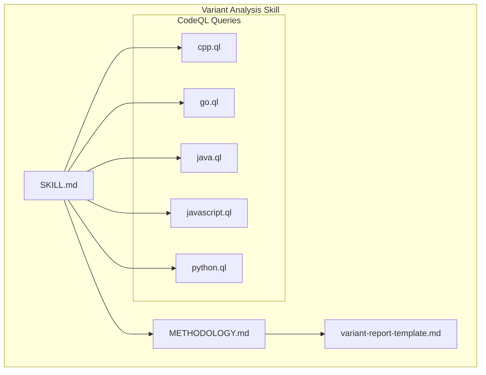
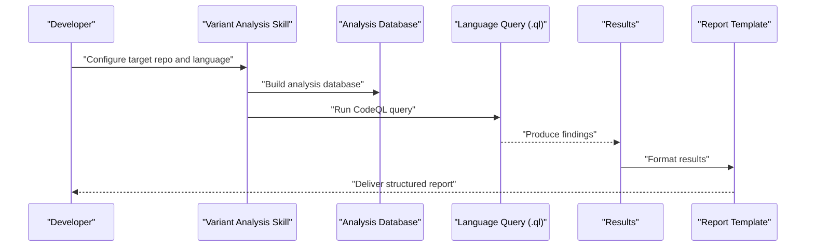
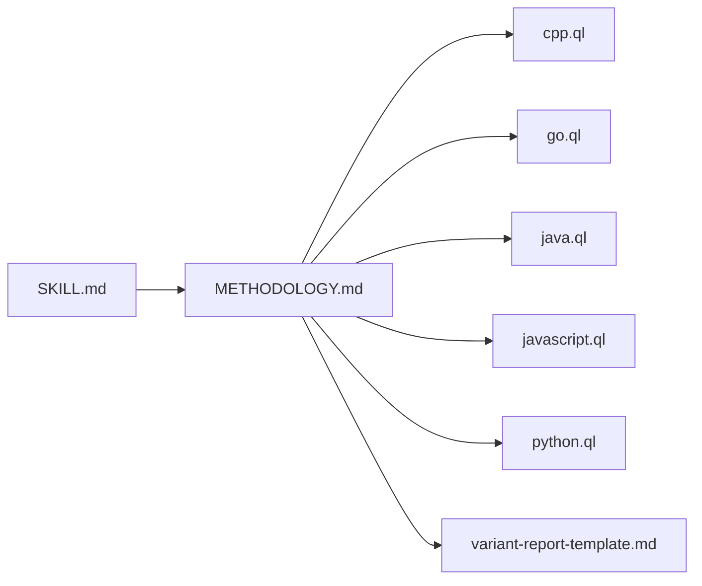

# CodeQL Integration

<cite>
**Referenced Files in This Document**
- [SKILL.md](file://skills/variant-analysis/SKILL.md)
- [METHODOLOGY.md](file://skills/variant-analysis/METHODOLOGY.md)
- [cpp.ql](file://skills/variant-analysis/resources/codeql/cpp.ql)
- [go.ql](file://skills/variant-analysis/resources/codeql/go.ql)
- [java.ql](file://skills/variant-analysis/resources/codeql/java.ql)
- [javascript.ql](file://skills/variant-analysis/resources/codeql/javascript.ql)
- [python.ql](file://skills/variant-analysis/resources/codeql/python.ql)
- [variant-report-template.md](file://skills/variant-analysis/resources/variant-report-template.md)
</cite>

## Table of Contents
1. [Introduction](#introduction)
2. [Project Structure](#project-structure)
3. [Core Components](#core-components)
4. [Architecture Overview](#architecture-overview)
5. [Detailed Component Analysis](#detailed-component-analysis)
6. [Dependency Analysis](#dependency-analysis)
7. [Performance Considerations](#performance-considerations)
8. [Troubleshooting Guide](#troubleshooting-guide)
9. [Conclusion](#conclusion)
10. [Appendices](#appendices)

## Introduction
This document explains how CodeQL is integrated into the variant analysis skill to detect vulnerabilities across multiple languages. It covers:
- The purpose and scope of CodeQL usage within the skill
- How language-specific queries are organized and executed
- Guidance for creating custom CodeQL queries
- Configuring analysis databases
- Interpreting results and reporting
- Performance considerations and troubleshooting tips

The goal is to help both new and experienced users understand, extend, and operate CodeQL-based variant analysis effectively.

## Project Structure
The variant analysis skill includes a dedicated resources directory with CodeQL query files per supported language and a report template used to present findings consistently.

**Diagram sources**
- [SKILL.md](file://skills/variant-analysis/SKILL.md)
- [METHODOLOGY.md](file://skills/variant-analysis/METHODOLOGY.md)
- [cpp.ql](file://skills/variant-analysis/resources/codeql/cpp.ql)
- [go.ql](file://skills/variant-analysis/resources/codeql/go.ql)
- [java.ql](file://skills/variant-analysis/resources/codeql/java.ql)
- [javascript.ql](file://skills/variant-analysis/resources/codeql/javascript.ql)
- [python.ql](file://skills/variant-analysis/resources/codeql/python.ql)
- [variant-report-template.md](file://skills/variant-analysis/resources/variant-report-template.md)

**Section sources**
- [SKILL.md](file://skills/variant-analysis/SKILL.md)
- [METHODOLOGY.md](file://skills/variant-analysis/METHODOLOGY.md)

## Core Components
- Language-specific CodeQL queries: One .ql file per language (C++, Go, Java, JavaScript, Python). Each query defines patterns that match potentially vulnerable code constructs.
- Variant analysis methodology: Describes how to run analyses, select targets, and interpret outputs.
- Report template: Standardizes how results are presented and shared.

Key responsibilities:
- Define detection logic per language using CodeQL’s type system and dataflow APIs where applicable.
- Provide consistent result metadata to enable aggregation and reporting.
- Ensure queries are maintainable and extensible for future vulnerability classes.

**Section sources**
- [cpp.ql](file://skills/variant-analysis/resources/codeql/cpp.ql)
- [go.ql](file://skills/variant-analysis/resources/codeql/go.ql)
- [java.ql](file://skills/variant-analysis/resources/codeql/java.ql)
- [javascript.ql](file://skills/variant-analysis/resources/codeql/javascript.ql)
- [python.ql](file://skills/variant-analysis/resources/codeql/python.ql)
- [METHODOLOGY.md](file://skills/variant-analysis/METHODOLOGY.md)
- [variant-report-template.md](file://skills/variant-analysis/resources/variant-report-template.md)

## Architecture Overview
At a high level, the integration follows a standard CodeQL workflow: build an analysis database for each target repository/language, run the language-specific query, and export results for interpretation and reporting.

[No sources needed since this diagram shows conceptual workflow, not actual code structure]

## Detailed Component Analysis

### C++ Query (cpp.ql)
Purpose: Detect C++-specific vulnerability patterns such as unsafe memory operations, resource leaks, or insecure API usage.

Detection approach:
- Use CodeQL’s C++ library predicates to identify risky function calls and control flows.
- Apply taint-style tracking when necessary to follow user input to dangerous sinks.
- Filter false positives by adding constraints on call sites and context.

Common patterns:
- Unsafe string handling
- Raw pointer misuse
- Missing bounds checks
- Insecure cryptographic usage

Extensibility:
- Add new predicates for newly discovered patterns.
- Introduce helper modules to reduce duplication across queries.

**Section sources**
- [cpp.ql](file://skills/variant-analysis/resources/codeql/cpp.ql)

### Go Query (go.ql)
Purpose: Identify Go-specific issues like improper error handling, goroutine misuse, or insecure configuration.

Detection approach:
- Leverage Go AST and type information to find problematic call graphs.
- Track data flow from sources (e.g., environment variables, HTTP inputs) to sinks (e.g., command execution, file writes).
- Use built-in Go library models to avoid noise.

Common patterns:
- Ignored errors
- Race conditions
- Hardcoded secrets
- Insecure TLS settings

Extensibility:
- Create reusable predicate libraries for common flows.
- Parameterize queries to support different frameworks.

**Section sources**
- [go.ql](file://skills/variant-analysis/resources/codeql/go.ql)

### Java Query (java.ql)
Purpose: Find Java vulnerabilities including injection flaws, deserialization risks, and misconfigurations.

Detection approach:
- Utilize Java’s rich type system and framework models.
- Implement dataflow from sources (user input, config) to sinks (SQL exec, eval-like calls).
- Incorporate annotations and reflection-aware checks where relevant.

Common patterns:
- SQL injection
- Command injection
- Insecure deserialization
- Weak cryptography

Extensibility:
- Extend framework-specific models (e.g., Spring, Jakarta EE).
- Add taint-tracking rules for complex pipelines.

**Section sources**
- [java.ql](file://skills/variant-analysis/resources/codeql/java.ql)

### JavaScript Query (javascript.ql)
Purpose: Detect JavaScript vulnerabilities such as XSS, prototype pollution, and unsafe dynamic evaluation.

Detection approach:
- Combine AST matching with dataflow to trace tainted values through DOM APIs and template engines.
- Account for dynamic property access and object mutation.
- Filter noisy third-party patterns via path constraints.

Common patterns:
- Cross-site scripting
- Prototype pollution
- Eval-like usage
- Insecure cookie handling

Extensibility:
- Add framework-specific handlers (React, Vue, Express).
- Integrate with browser/runtime models for precise sink identification.

**Section sources**
- [javascript.ql](file://skills/variant-analysis/resources/codeql/javascript.ql)

### Python Query (python.ql)
Purpose: Surface Python security issues like command injection, unsafe deserialization, and weak crypto.

Detection approach:
- Use Python AST and type inference to locate risky calls.
- Track data flow from untrusted sources to dangerous sinks.
- Exclude safe wrappers and well-known safe libraries.

Common patterns:
- os.system/shell=True usage
- pickle.loads without validation
- Insecure random number generation
- Hardcoded credentials

Extensibility:
- Build helper predicates for common web frameworks.
- Support async code paths and modern Python features.

**Section sources**
- [python.ql](file://skills/variant-analysis/resources/codeql/python.ql)

### Creating Custom CodeQL Queries
Guidelines:
- Start with a clear threat model and define source/sink pairs.
- Prefer existing library predicates over raw AST matches for stability.
- Use dataflow tracking to reduce false positives and improve precision.
- Keep queries modular; extract reusable helpers into separate modules.
- Validate against real-world codebases to tune thresholds and filters.

Steps:
1. Identify the vulnerability class and language-specific APIs involved.
2. Draft initial matches using AST or library predicates.
3. Add dataflow constraints to connect sources to sinks.
4. Refine with additional filters (e.g., ignore tests, vendor directories).
5. Test with sample repositories and iterate.

**Section sources**
- [METHODOLOGY.md](file://skills/variant-analysis/METHODOLOGY.md)

### Configuring Analysis Databases
General steps:
- Select the target repository and language.
- Configure build commands if automatic extraction fails.
- Run the database creation step before executing queries.
- Verify that all required dependencies are available during extraction.

Best practices:
- Cache databases for repeated runs.
- Limit scope to relevant directories to speed up builds.
- Use incremental builds where supported.

**Section sources**
- [METHODOLOGY.md](file://skills/variant-analysis/METHODOLOGY.md)

### Interpreting Results
What to look for:
- Location details (file, line, column)
- Description and severity
- Dataflow traces (if available)
- Related code snippets for context

How to use them:
- Prioritize findings based on exploitability and impact.
- Correlate with recent changes and known risk areas.
- Use the report template to standardize communication.

**Section sources**
- [variant-report-template.md](file://skills/variant-analysis/resources/variant-report-template.md)

## Dependency Analysis
The variant analysis skill composes language-specific queries and a reporting mechanism. The following diagram illustrates the relationships between the skill documentation, methodology, queries, and report template.

**Diagram sources**
- [SKILL.md](file://skills/variant-analysis/SKILL.md)
- [METHODOLOGY.md](file://skills/variant-analysis/METHODOLOGY.md)
- [cpp.ql](file://skills/variant-analysis/resources/codeql/cpp.ql)
- [go.ql](file://skills/variant-analysis/resources/codeql/go.ql)
- [java.ql](file://skills/variant-analysis/resources/codeql/java.ql)
- [javascript.ql](file://skills/variant-analysis/resources/codeql/javascript.ql)
- [python.ql](file://skills/variant-analysis/resources/codeql/python.ql)
- [variant-report-template.md](file://skills/variant-analysis/resources/variant-report-template.md)

**Section sources**
- [SKILL.md](file://skills/variant-analysis/SKILL.md)
- [METHODOLOGY.md](file://skills/variant-analysis/METHODOLOGY.md)

## Performance Considerations
- Scope your analysis to relevant directories to reduce extraction time.
- Prefer library predicates over deep AST traversals to minimize overhead.
- Use targeted dataflow paths instead of broad taint tracking when possible.
- Cache analysis databases and reuse them across runs.
- Split large repositories into focused subsets for faster iteration.
- Avoid overly generic patterns that match many locations; add precise filters.

[No sources needed since this section provides general guidance]

## Troubleshooting Guide
Common issues and remedies:
- Extraction failures: Ensure build tools and dependencies are installed; provide explicit build commands if needed.
- Excessive false positives: Tighten filters, refine dataflow constraints, and exclude non-production code.
- Slow queries: Replace broad matches with specific library predicates; limit search scope.
- Missing symbols: Verify that the correct language version and framework models are configured.
- Reporting inconsistencies: Follow the report template fields and ensure consistent metadata in query results.

Operational tips:
- Validate queries against small, representative samples first.
- Log intermediate steps to pinpoint bottlenecks.
- Maintain a changelog for query updates and their effects on results.

**Section sources**
- [METHODOLOGY.md](file://skills/variant-analysis/METHODOLOGY.md)
- [variant-report-template.md](file://skills/variant-analysis/resources/variant-report-template.md)

## Conclusion
The variant analysis skill integrates CodeQL through per-language queries that target common vulnerability classes. By following the methodology, leveraging the report template, and adhering to performance and troubleshooting best practices, teams can reliably detect and communicate security issues across C++, Go, Java, JavaScript, and Python codebases. Extending coverage involves adding new queries and refining existing ones with precise dataflow and filtering strategies.

[No sources needed since this section summarizes without analyzing specific files]

## Appendices

### Example Vulnerability Patterns by Language
- C++: Unsafe memory operations, missing bounds checks, insecure crypto usage
- Go: Ignored errors, race conditions, hardcoded secrets, insecure TLS
- Java: Injection flaws, insecure deserialization, weak crypto
- JavaScript: XSS, prototype pollution, eval-like usage, insecure cookies
- Python: Command injection, unsafe deserialization, weak randomness, hardcoded credentials

[No sources needed since this section provides general guidance]