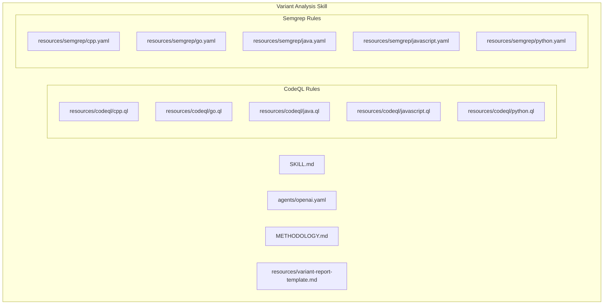
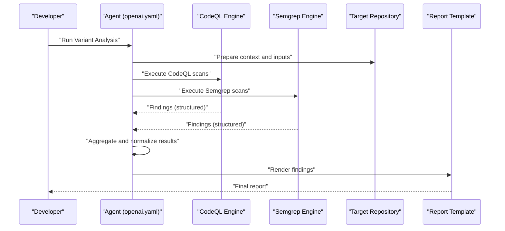
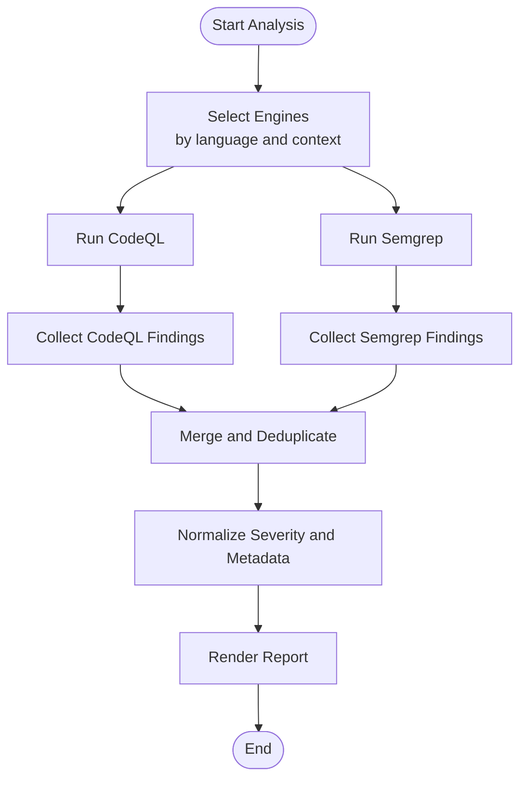
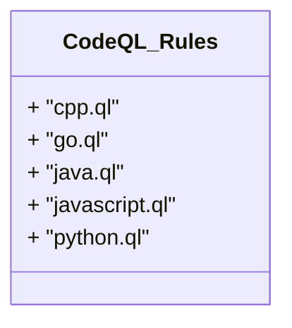
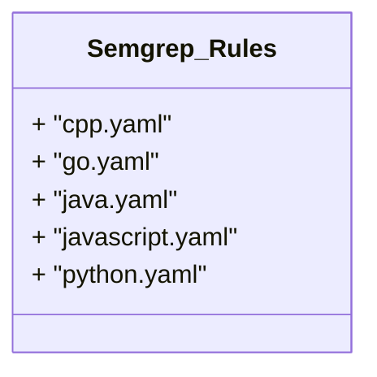
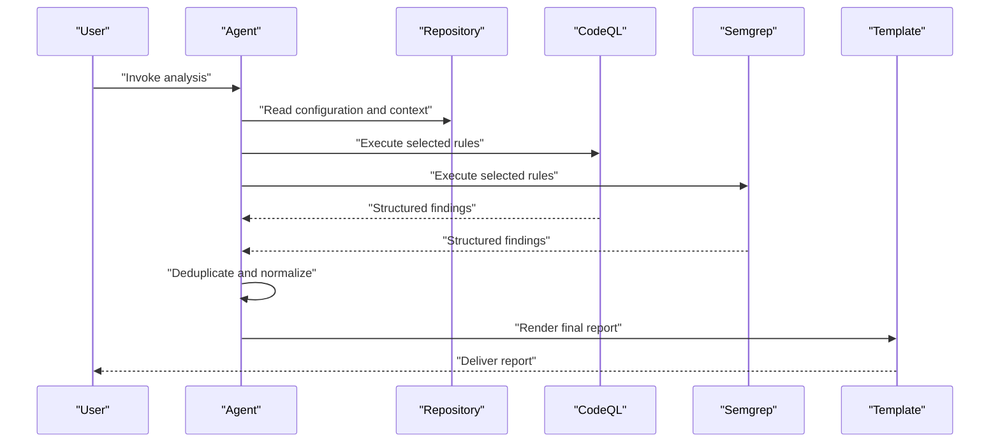
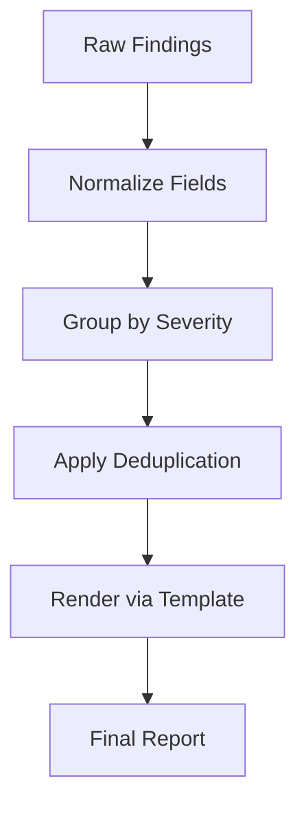
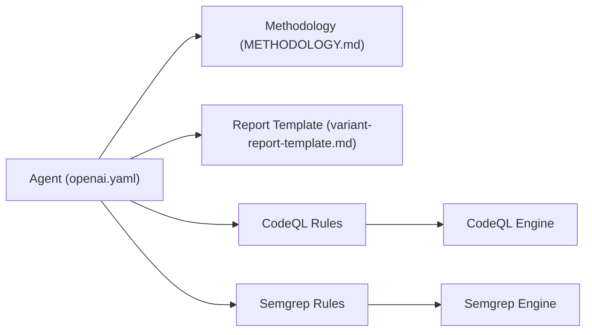

# Overview and Methodology

<cite>
**Referenced Files in This Document**
- [SKILL.md](file://skills/variant-analysis/SKILL.md)
- [METHODOLOGY.md](file://skills/variant-analysis/METHODOLOGY.md)
- [openai.yaml](file://skills/variant-analysis/agents/openai.yaml)
- [codeql/cpp.ql](file://skills/variant-analysis/resources/codeql/cpp.ql)
- [codeql/go.ql](file://skills/variant-analysis/resources/codeql/go.ql)
- [codeql/java.ql](file://skills/variant-analysis/resources/codeql/java.ql)
- [codeql/javascript.ql](file://skills/variant-analysis/resources/codeql/javascript.ql)
- [codeql/python.ql](file://skills/variant-analysis/resources/codeql/python.ql)
- [semgrep/cpp.yaml](file://skills/variant-analysis/resources/semgrep/cpp.yaml)
- [semgrep/go.yaml](file://skills/variant-analysis/resources/semgrep/go.yaml)
- [semgrep/java.yaml](file://skills/variant-analysis/resources/semgrep/java.yaml)
- [semgrep/javascript.yaml](file://skills/variant-analysis/resources/semgrep/javascript.yaml)
- [semgrep/python.yaml](file://skills/variant-analysis/resources/semgrep/python.yaml)
- [variant-report-template.md](file://skills/variant-analysis/resources/variant-report-template.md)
</cite>

## Table of Contents
1. [Introduction](#introduction)
2. [Project Structure](#project-structure)
3. [Core Components](#core-components)
4. [Architecture Overview](#architecture-overview)
5. [Detailed Component Analysis](#detailed-component-analysis)
6. [Dependency Analysis](#dependency-analysis)
7. [Performance Considerations](#performance-considerations)
8. [Troubleshooting Guide](#troubleshooting-guide)
9. [Conclusion](#conclusion)
10. [Appendices](#appendices)

## Introduction
This document explains the Variant Analysis skill, its purpose, methodology, and how it integrates into development workflows to detect security vulnerabilities across multiple programming languages. The skill employs a dual-engine approach using CodeQL and Semgrep to provide broad coverage and complementary detection strategies. It also describes configuration options, integration patterns, expected outputs, and usage guidance for both beginners and experienced developers.

## Project Structure
The Variant Analysis skill is organized under skills/variant-analysis with clear separation between:
- Skill definition and agent configuration
- Methodology documentation
- Language-specific rule sets for CodeQL and Semgrep
- A standardized report template

**Diagram sources**
- [SKILL.md](file://skills/variant-analysis/SKILL.md)
- [openai.yaml](file://skills/variant-analysis/agents/openai.yaml)
- [METHODOLOGY.md](file://skills/variant-analysis/METHODOLOGY.md)
- [codeql/cpp.ql](file://skills/variant-analysis/resources/codeql/cpp.ql)
- [codeql/go.ql](file://skills/variant-analysis/resources/codeql/go.ql)
- [codeql/java.ql](file://skills/variant-analysis/resources/codeql/java.ql)
- [codeql/javascript.ql](file://skills/variant-analysis/resources/codeql/javascript.ql)
- [codeql/python.ql](file://skills/variant-analysis/resources/codeql/python.ql)
- [semgrep/cpp.yaml](file://skills/variant-analysis/resources/semgrep/cpp.yaml)
- [semgrep/go.yaml](file://skills/variant-analysis/resources/semgrep/go.yaml)
- [semgrep/java.yaml](file://skills/variant-analysis/resources/semgrep/java.yaml)
- [semgrep/javascript.yaml](file://skills/variant-analysis/resources/semgrep/javascript.yaml)
- [semgrep/python.yaml](file://skills/variant-analysis/resources/semgrep/python.yaml)
- [variant-report-template.md](file://skills/variant-analysis/resources/variant-report-template.md)

**Section sources**
- [SKILL.md](file://skills/variant-analysis/SKILL.md)
- [METHODOLOGY.md](file://skills/variant-analysis/METHODOLOGY.md)
- [openai.yaml](file://skills/variant-analysis/agents/openai.yaml)

## Core Components
- Skill Definition (SKILL.md): Describes the purpose, scope, and high-level workflow of the Variant Analysis skill.
- Agent Configuration (agents/openai.yaml): Defines how the AI agent interacts with the skill’s resources and orchestrates analysis steps.
- Methodology (METHODOLOGY.md): Details the dual-engine strategy, selection criteria, and operational procedures for running CodeQL and Semgrep.
- Rule Sets:
  - CodeQL rules per language (cpp.ql, go.ql, java.ql, javascript.ql, python.ql)
  - Semgrep rules per language (cpp.yaml, go.yaml, java.yaml, javascript.yaml, python.yaml)
- Report Template (variant-report-template.md): Standardizes output structure and presentation of findings.

Key responsibilities:
- Orchestration: The agent coordinates scanning, result aggregation, and reporting.
- Detection: Complementary engines (CodeQL and Semgrep) scan codebases for security issues.
- Reporting: Findings are normalized into a consistent format for downstream consumption.

**Section sources**
- [SKILL.md](file://skills/variant-analysis/SKILL.md)
- [METHODOLOGY.md](file://skills/variant-analysis/METHODOLOGY.md)
- [openai.yaml](file://skills/variant-analysis/agents/openai.yaml)
- [variant-report-template.md](file://skills/variant-analysis/resources/variant-report-template.md)

## Architecture Overview
The Variant Analysis skill follows a modular architecture:
- Input: Target repository or code snapshot.
- Engines: CodeQL and Semgrep run in parallel or sequentially based on configuration.
- Aggregation: Results from both engines are merged, deduplicated, and enriched.
- Output: A structured report following the provided template.

**Diagram sources**
- [openai.yaml](file://skills/variant-analysis/agents/openai.yaml)
- [METHODOLOGY.md](file://skills/variant-analysis/METHODOLOGY.md)
- [variant-report-template.md](file://skills/variant-analysis/resources/variant-report-template.md)

## Detailed Component Analysis

### Dual-Engine Strategy: CodeQL and Semgrep
- Purpose: Leverage static analysis strengths of both engines to improve coverage and reduce false negatives.
- Selection Criteria: Choose engine(s) based on target language, project characteristics, and performance constraints.
- Execution Model: Run both engines when feasible; otherwise, select the most appropriate engine for the scenario.
- Result Fusion: Merge findings, remove duplicates, and standardize severity and metadata.

**Diagram sources**
- [METHODOLOGY.md](file://skills/variant-analysis/METHODOLOGY.md)

**Section sources**
- [METHODOLOGY.md](file://skills/variant-analysis/METHODOLOGY.md)

### CodeQL Rules
- Scope: Language-specific queries targeting common vulnerability classes.
- Organization: One file per supported language.
- Typical Targets: Injection flaws, unsafe API usage, insecure defaults, and data flow issues.

**Diagram sources**
- [codeql/cpp.ql](file://skills/variant-analysis/resources/codeql/cpp.ql)
- [codeql/go.ql](file://skills/variant-analysis/resources/codeql/go.ql)
- [codeql/java.ql](file://skills/variant-analysis/resources/codeql/java.ql)
- [codeql/javascript.ql](file://skills/variant-analysis/resources/codeql/javascript.ql)
- [codeql/python.ql](file://skills/variant-analysis/resources/codeql/python.ql)

**Section sources**
- [codeql/cpp.ql](file://skills/variant-analysis/resources/codeql/cpp.ql)
- [codeql/go.ql](file://skills/variant-analysis/resources/codeql/go.ql)
- [codeql/java.ql](file://skills/variant-analysis/resources/codeql/java.ql)
- [codeql/javascript.ql](file://skills/variant-analysis/resources/codeql/javascript.ql)
- [codeql/python.ql](file://skills/variant-analysis/resources/codeql/python.ql)

### Semgrep Rules
- Scope: Pattern-based rules for fast detection of known vulnerability patterns.
- Organization: One YAML file per supported language.
- Typical Targets: Hardcoded secrets, unsafe deserialization, missing input validation, and insecure configurations.

**Diagram sources**
- [semgrep/cpp.yaml](file://skills/variant-analysis/resources/semgrep/cpp.yaml)
- [semgrep/go.yaml](file://skills/variant-analysis/resources/semgrep/go.yaml)
- [semgrep/java.yaml](file://skills/variant-analysis/resources/semgrep/java.yaml)
- [semgrep/javascript.yaml](file://skills/variant-analysis/resources/semgrep/javascript.yaml)
- [semgrep/python.yaml](file://skills/variant-analysis/resources/semgrep/python.yaml)

**Section sources**
- [semgrep/cpp.yaml](file://skills/variant-analysis/resources/semgrep/cpp.yaml)
- [semgrep/go.yaml](file://skills/variant-analysis/resources/semgrep/go.yaml)
- [semgrep/java.yaml](file://skills/variant-analysis/resources/semgrep/java.yaml)
- [semgrep/javascript.yaml](file://skills/variant-analysis/resources/semgrep/javascript.yaml)
- [semgrep/python.yaml](file://skills/variant-analysis/resources/semgrep/python.yaml)

### Agent Orchestration
- Role: Coordinates preparation, execution, aggregation, and reporting.
- Inputs: Repository path, language filters, and optional parameters.
- Outputs: Structured findings and rendered report.

**Diagram sources**
- [openai.yaml](file://skills/variant-analysis/agents/openai.yaml)
- [variant-report-template.md](file://skills/variant-analysis/resources/variant-report-template.md)

**Section sources**
- [openai.yaml](file://skills/variant-analysis/agents/openai.yaml)

### Reporting and Outputs
- Template: Provides a consistent structure for presenting findings, including severity, description, affected files, and remediation guidance.
- Expected Outputs:
  - Consolidated list of vulnerabilities
  - Contextual details and references
  - Prioritized recommendations

**Diagram sources**
- [variant-report-template.md](file://skills/variant-analysis/resources/variant-report-template.md)

**Section sources**
- [variant-report-template.md](file://skills/variant-analysis/resources/variant-report-template.md)

## Dependency Analysis
- Internal Dependencies:
  - Agent depends on methodology and templates for orchestration and formatting.
  - Both engines depend on their respective rule sets.
- External Integrations:
  - CodeQL and Semgrep toolchains must be available in the environment.
  - CI/CD systems can consume the generated reports.

**Diagram sources**
- [openai.yaml](file://skills/variant-analysis/agents/openai.yaml)
- [METHODOLOGY.md](file://skills/variant-analysis/METHODOLOGY.md)
- [variant-report-template.md](file://skills/variant-analysis/resources/variant-report-template.md)
- [codeql/cpp.ql](file://skills/variant-analysis/resources/codeql/cpp.ql)
- [codeql/go.ql](file://skills/variant-analysis/resources/codeql/go.ql)
- [codeql/java.ql](file://skills/variant-analysis/resources/codeql/java.ql)
- [codeql/javascript.ql](file://skills/variant-analysis/resources/codeql/javascript.ql)
- [codeql/python.ql](file://skills/variant-analysis/resources/codeql/python.ql)
- [semgrep/cpp.yaml](file://skills/variant-analysis/resources/semgrep/cpp.yaml)
- [semgrep/go.yaml](file://skills/variant-analysis/resources/semgrep/go.yaml)
- [semgrep/java.yaml](file://skills/variant-analysis/resources/semgrep/java.yaml)
- [semgrep/javascript.yaml](file://skills/variant-analysis/resources/semgrep/javascript.yaml)
- [semgrep/python.yaml](file://skills/variant-analysis/resources/semgrep/python.yaml)

**Section sources**
- [openai.yaml](file://skills/variant-analysis/agents/openai.yaml)
- [METHODOLOGY.md](file://skills/variant-analysis/METHODOLOGY.md)
- [variant-report-template.md](file://skills/variant-analysis/resources/variant-report-template.md)

## Performance Considerations
- Parallelization: Running CodeQL and Semgrep concurrently can reduce total scan time.
- Rule Scope: Limiting rule sets to relevant languages reduces overhead.
- Incremental Scans: Focus on changed files where possible to speed up feedback loops.
- Resource Limits: Configure timeouts and memory limits for large repositories.

[No sources needed since this section provides general guidance]

## Troubleshooting Guide
Common issues and resolutions:
- Missing Toolchains: Ensure CodeQL and Semgrep are installed and accessible in PATH.
- Rule Errors: Validate rule syntax and compatibility with target language versions.
- Large Repositories: Use incremental scanning and restrict rule scope to critical directories.
- Report Formatting: Confirm that the template is present and correctly referenced by the agent.

**Section sources**
- [METHODOLOGY.md](file://skills/variant-analysis/METHODOLOGY.md)
- [openai.yaml](file://skills/variant-analysis/agents/openai.yaml)
- [variant-report-template.md](file://skills/variant-analysis/resources/variant-report-template.md)

## Conclusion
The Variant Analysis skill provides a robust, dual-engine approach to security vulnerability scanning across multiple languages. By combining CodeQL and Semgrep, it achieves broader coverage while maintaining a consistent reporting format. Its modular design supports flexible configuration and easy integration into existing development and CI/CD pipelines.

[No sources needed since this section summarizes without analyzing specific files]

## Appendices

### Prerequisites and Setup
- Install CodeQL and Semgrep toolchains.
- Ensure access to the target repository and required permissions.
- Verify that the agent configuration points to the correct rule sets and template.

**Section sources**
- [openai.yaml](file://skills/variant-analysis/agents/openai.yaml)
- [METHODOLOGY.md](file://skills/variant-analysis/METHODOLOGY.md)

### Basic Usage Patterns
- Beginner: Run full-scope analysis against a single-language repository using default rules.
- Experienced: Customize rule sets, enable parallel execution, and integrate with CI/CD for automated gating.

**Section sources**
- [SKILL.md](file://skills/variant-analysis/SKILL.md)
- [METHODOLOGY.md](file://skills/variant-analysis/METHODOLOGY.md)

### Integration Patterns
- Local Development: Execute analyses before committing changes.
- CI/CD Pipeline: Add steps to run both engines and publish reports.
- Artifact Consumption: Parse structured findings for dashboards and alerts.

**Section sources**
- [openai.yaml](file://skills/variant-analysis/agents/openai.yaml)
- [variant-report-template.md](file://skills/variant-analysis/resources/variant-report-template.md)