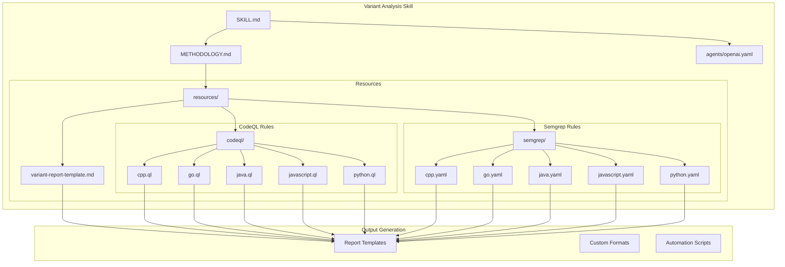
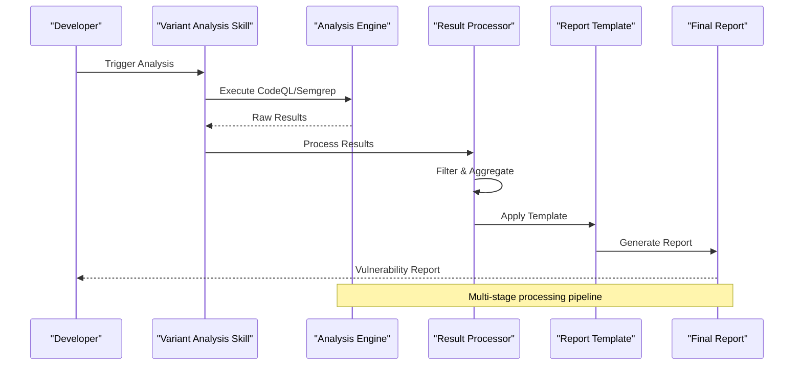
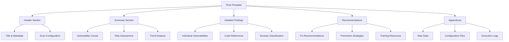
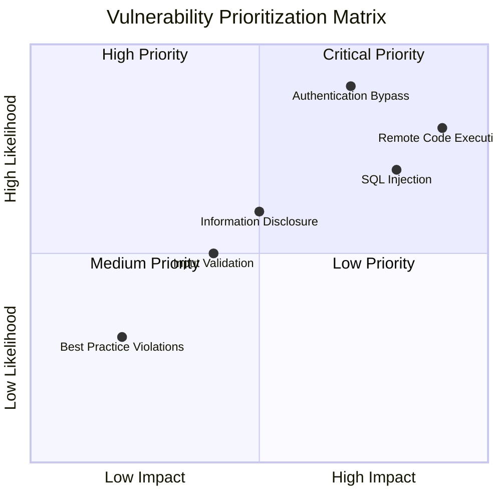
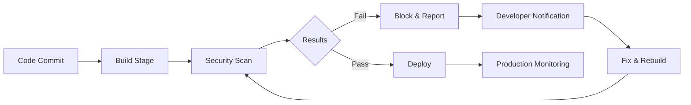
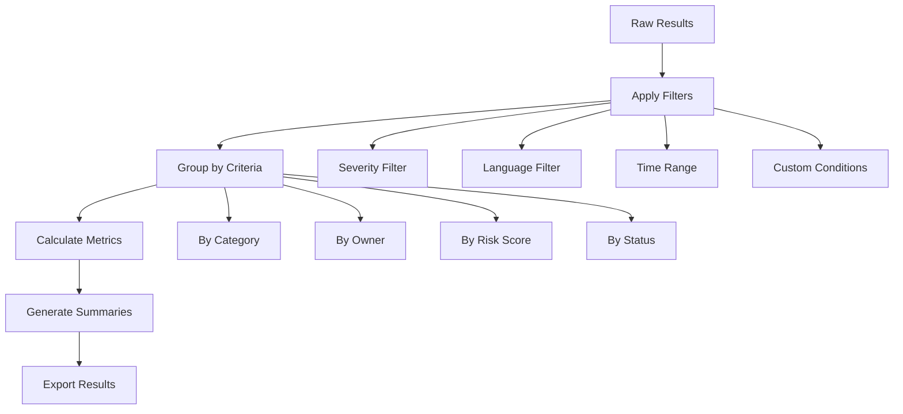
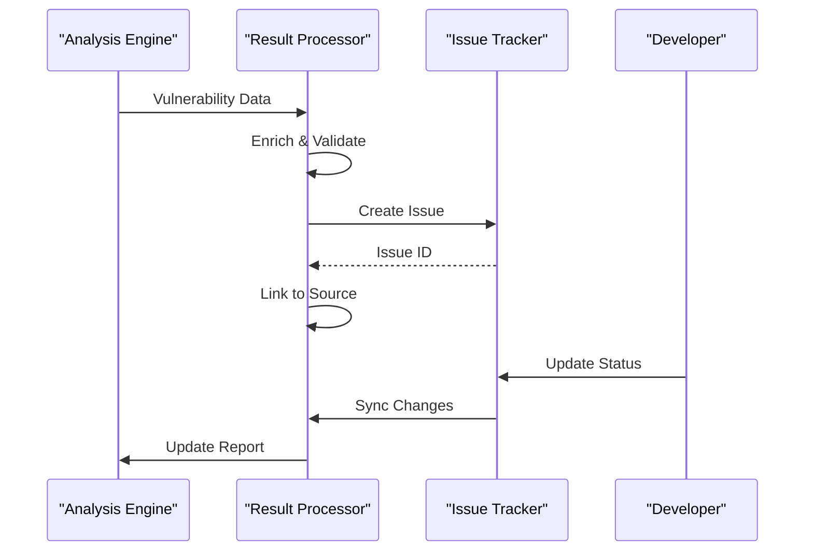

# Reporting and Output Generation

<cite>
**Referenced Files in This Document**
- [SKILL.md](file://skills/variant-analysis/SKILL.md)
- [METHODOLOGY.md](file://skills/variant-analysis/METHODOLOGY.md)
- [variant-report-template.md](file://skills/variant-analysis/resources/variant-report-template.md)
- [cpp.ql](file://skills/variant-analysis/resources/codeql/cpp.ql)
- [go.ql](file://skills/variant-analysis/resources/codeql/go.ql)
- [java.ql](file://skills/variant-analysis/resources/codeql/java.ql)
- [javascript.ql](file://skills/variant-analysis/resources/codeql/javascript.ql)
- [python.ql](file://skills/variant-analysis/resources/codeql/python.ql)
- [cpp.yaml](file://skills/variant-analysis/resources/semgrep/cpp.yaml)
- [go.yaml](file://skills/variant-analysis/resources/semgrep/go.yaml)
- [java.yaml](file://skills/variant-analysis/resources/semgrep/java.yaml)
- [javascript.yaml](file://skills/variant-analysis/resources/semgrep/javascript.yaml)
- [python.yaml](file://skills/variant-analysis/resources/semgrep/python.yaml)
</cite>

## Table of Contents
1. [Introduction](#introduction)
2. [Project Structure](#project-structure)
3. [Core Components](#core-components)
4. [Architecture Overview](#architecture-overview)
5. [Detailed Component Analysis](#detailed-component-analysis)
6. [Report Template Structure](#report-template-structure)
7. [Output Formats and Customization](#output-formats-and-customization)
8. [Analysis Results Interpretation](#analysis-results-interpretation)
9. [Vulnerability Prioritization](#vulnerability-prioritization)
10. [Integration with Development Workflows](#integration-with-development-workflows)
11. [Automation Scripts and Processing](#automation-scripts-and-processing)
12. [Report Filtering and Aggregation](#report-filtering-and-aggregation)
13. [Issue Tracking Integration](#issue-tracking-integration)
14. [Performance Considerations](#performance-considerations)
15. [Troubleshooting Guide](#troubleshooting-guide)
16. [Conclusion](#conclusion)

## Introduction

The variant analysis skill provides comprehensive reporting and output generation capabilities for security vulnerability detection across multiple programming languages. This documentation explains how to interpret analysis results, customize report templates, prioritize vulnerabilities, and integrate reports into development workflows. The system supports both CodeQL and Semgrep-based analysis engines, generating structured reports that can be filtered, aggregated, and integrated with various issue tracking systems.

## Project Structure

The variant analysis skill is organized within a modular architecture that separates concerns between analysis engines, report templates, and output formatting:

**Diagram sources**
- [SKILL.md](file://skills/variant-analysis/SKILL.md)
- [METHODOLOGY.md](file://skills/variant-analysis/METHODOLOGY.md)
- [variant-report-template.md](file://skills/variant-analysis/resources/variant-report-template.md)

**Section sources**
- [SKILL.md](file://skills/variant-analysis/SKILL.md)
- [METHODOLOGY.md](file://skills/variant-analysis/METHODOLOGY.md)

## Core Components

The reporting system consists of several key components that work together to generate comprehensive vulnerability reports:

### Analysis Engines
- **CodeQL Engine**: Static analysis using CodeQL query language for deep code understanding
- **Semgrep Engine**: Pattern-based scanning for common vulnerability patterns
- **Multi-language Support**: Built-in rules for C++, Go, Java, JavaScript, and Python

### Report Generation Pipeline
- **Template System**: Markdown-based report templates with customizable sections
- **Data Processing**: Structured data transformation from analysis results
- **Output Formatting**: Multiple output formats including JSON, HTML, and PDF

### Customization Framework
- **Template Variables**: Dynamic content insertion based on analysis context
- **Filtering Options**: Configurable result filtering by severity, language, or pattern
- **Aggregation Logic**: Summary statistics and trend analysis

**Section sources**
- [SKILL.md](file://skills/variant-analysis/SKILL.md)
- [METHODOLOGY.md](file://skills/variant-analysis/METHODOLOGY.md)

## Architecture Overview

The variant analysis reporting system follows a pipeline architecture that processes raw analysis results through multiple transformation stages:

**Diagram sources**
- [SKILL.md](file://skills/variant-analysis/SKILL.md)
- [variant-report-template.md](file://skills/variant-analysis/resources/variant-report-template.md)

## Detailed Component Analysis

### Report Template System

The report template system provides a flexible framework for generating consistent, professional-looking vulnerability reports. The template structure includes:

#### Template Sections
- **Executive Summary**: High-level overview of findings and risk assessment
- **Technical Details**: In-depth analysis of each vulnerability with code references
- **Remediation Guidance**: Step-by-step fix recommendations
- **Compliance Mapping**: Alignment with security standards and frameworks
- **Appendices**: Supporting data, logs, and configuration details

#### Template Variables
The system supports dynamic variable substitution for:
- Scan metadata (timestamp, target repository, analysis duration)
- Vulnerability counts by severity and category
- Language-specific statistics and trends
- Risk scoring calculations

**Section sources**
- [variant-report-template.md](file://skills/variant-analysis/resources/variant-report-template.md)

### Analysis Result Processing

The result processing component transforms raw analysis outputs into structured data suitable for report generation:

#### Data Transformation Pipeline
1. **Raw Input Parsing**: Parse CodeQL and Semgrep output formats
2. **Normalization**: Standardize data structures across different engines
3. **Enrichment**: Add contextual information and severity classifications
4. **Validation**: Ensure data integrity and completeness

#### Error Handling
- Graceful degradation when analysis engines fail
- Partial result processing with error reporting
- Comprehensive logging for troubleshooting

**Section sources**
- [METHODOLOGY.md](file://skills/variant-analysis/METHODOLOGY.md)

## Report Template Structure

The variant report template follows a standardized structure designed for clarity and actionability:

### Template Hierarchy

**Diagram sources**
- [variant-report-template.md](file://skills/variant-analysis/resources/variant-report-template.md)

### Template Customization Points

| Section | Purpose | Customization Level |
|---------|---------|-------------------|
| Header | Branding and identification | Low |
| Executive Summary | Key findings overview | Medium |
| Technical Details | Vulnerability descriptions | High |
| Remediation Steps | Fix instructions | High |
| Compliance Mapping | Standards alignment | Medium |
| Appendices | Supporting documentation | Low |

**Section sources**
- [variant-report-template.md](file://skills/variant-analysis/resources/variant-report-template.md)

## Output Formats and Customization

The system supports multiple output formats to accommodate different workflow requirements:

### Supported Output Formats

| Format | Use Case | Features |
|--------|----------|----------|
| Markdown | Documentation & Sharing | Human-readable, version control friendly |
| JSON | API Integration | Machine-readable, programmatic access |
| HTML | Web Display | Browser-friendly, interactive elements |
| PDF | Formal Reports | Print-ready, professional presentation |
| CSV | Data Analysis | Spreadsheet compatible, bulk processing |

### Format-Specific Customizations

#### Markdown Reports
- Syntax highlighting for code snippets
- Table formatting for structured data
- Link embedding for external resources
- Image inclusion for visual aids

#### JSON Reports
- Hierarchical data structure
- Metadata preservation
- Schema validation support
- Version compatibility

#### HTML Reports
- Responsive design
- Interactive filtering
- Search functionality
- Export options

**Section sources**
- [SKILL.md](file://skills/variant-analysis/SKILL.md)

## Analysis Results Interpretation

Understanding and interpreting variant analysis results requires familiarity with the classification system and severity metrics:

### Severity Classification

| Severity | Description | Response Time | Examples |
|----------|-------------|---------------|----------|
| Critical | Immediate exploitation possible | < 1 hour | Remote code execution, SQL injection |
| High | Significant security impact | < 24 hours | Authentication bypass, privilege escalation |
| Medium | Moderate security risk | < 1 week | Information disclosure, input validation |
| Low | Minor security concern | < 1 month | Best practice violations, minor flaws |

### Risk Scoring Methodology

The system calculates risk scores based on multiple factors:
- **Exploitability**: How easily can the vulnerability be exploited?
- **Impact**: What is the potential damage if exploited?
- **Likelihood**: What is the probability of exploitation?
- **Context**: Environmental factors and mitigating controls

### Trend Analysis

Reports include historical comparison data showing:
- Vulnerability count changes over time
- New vs. recurring issues
- Remediation effectiveness metrics
- Team performance indicators

**Section sources**
- [METHODOLOGY.md](file://skills/variant-analysis/METHODOLOGY.md)

## Vulnerability Prioritization

Effective vulnerability management requires systematic prioritization based on business impact and technical risk:

### Prioritization Matrix

### Business Context Integration

Prioritization considers:
- **Asset Criticality**: Importance of affected components
- **Data Sensitivity**: Type and sensitivity of exposed data
- **Regulatory Requirements**: Compliance obligations
- **Customer Impact**: Potential effect on end users

### Automated Prioritization Rules

The system applies configurable rules for automatic prioritization:
- CVSS score thresholds
- CWE category mappings
- Business unit dependencies
- Deployment environment factors

**Section sources**
- [METHODOLOGY.md](file://skills/variant-analysis/METHODOLOGY.md)

## Integration with Development Workflows

The variant analysis reporting system integrates seamlessly with modern development workflows:

### CI/CD Pipeline Integration

### IDE Integration

- **Real-time Feedback**: Inline vulnerability detection during coding
- **Quick Fixes**: Automated remediation suggestions
- **Contextual Help**: Documentation links and examples
- **Progress Tracking**: Personal vulnerability resolution metrics

### Collaboration Tools

- **Slack/Teams Integration**: Real-time notifications
- **Jira Integration**: Automated ticket creation
- **GitHub/GitLab**: PR comments and status checks
- **Confluence**: Automated documentation updates

**Section sources**
- [SKILL.md](file://skills/variant-analysis/SKILL.md)

## Automation Scripts and Processing

The system provides extensible automation capabilities for processing analysis results:

### Script Categories

| Category | Purpose | Examples |
|----------|---------|----------|
| Pre-processing | Data preparation | Format conversion, filtering |
| Post-processing | Result enrichment | Metrics calculation, tagging |
| Notification | Alerting systems | Email, chat, webhook |
| Integration | External systems | Ticket creation, dashboard updates |

### Common Automation Patterns

#### Batch Processing
- Process multiple repositories simultaneously
- Schedule regular analysis runs
- Handle large codebases efficiently

#### Conditional Logic
- Branch-specific analysis rules
- Environment-aware configurations
- Dependency on build artifacts

#### Error Recovery
- Retry mechanisms for failed operations
- Graceful degradation strategies
- Comprehensive logging and monitoring

**Section sources**
- [SKILL.md](file://skills/variant-analysis/SKILL.md)

## Report Filtering and Aggregation

Advanced filtering and aggregation capabilities enable targeted analysis and reporting:

### Filtering Dimensions

| Dimension | Options | Use Cases |
|-----------|---------|-----------|
| Severity | Critical, High, Medium, Low | Focus on critical issues |
| Language | C++, Go, Java, JS, Python | Language-specific analysis |
| Category | Injection, Auth, Crypto, etc. | Security domain focus |
| Status | New, Recurring, Fixed | Progress tracking |
| File Path | Directory, module, function | Targeted remediation |

### Aggregation Methods

#### Temporal Aggregation
- Daily/weekly/monthly trends
- Sprint velocity tracking
- Release cycle comparisons

#### Structural Aggregation
- By team or ownership
- By service or microservice
- By technology stack

#### Statistical Aggregation
- Mean time to remediation
- False positive rates
- Coverage metrics

### Advanced Query Capabilities

**Section sources**
- [METHODOLOGY.md](file://skills/variant-analysis/METHODOLOGY.md)

## Issue Tracking Integration

Seamless integration with popular issue tracking systems enables automated vulnerability management:

### Supported Systems

| System | Integration Type | Features |
|--------|------------------|----------|
| Jira | REST API | Auto-ticket creation, status sync |
| GitHub Issues | GraphQL API | Label assignment, milestone linking |
| Azure DevOps | REST API | Work item creation, sprint planning |
| ServiceNow | SOAP/REST | ITIL compliance, change management |
| Custom Systems | Webhook | Flexible integration patterns |

### Integration Workflow

### Customization Options

- **Field Mapping**: Custom field definitions and transformations
- **Workflow Automation**: Status transitions and approvals
- **Notification Rules**: Role-based alerting
- **Audit Trail**: Complete change history

**Section sources**
- [SKILL.md](file://skills/variant-analysis/SKILL.md)

## Performance Considerations

Optimizing report generation and analysis performance is crucial for large codebases:

### Optimization Strategies

#### Parallel Processing
- Concurrent analysis engine execution
- Distributed report generation
- Memory-efficient data streaming

#### Caching Mechanisms
- Rule result caching
- Template compilation caching
- Dependency resolution caching

#### Resource Management
- Adaptive concurrency limits
- Memory usage monitoring
- Garbage collection optimization

### Scalability Guidelines

| Codebase Size | Recommended Configuration | Expected Runtime |
|---------------|---------------------------|------------------|
| < 10k LOC | Single-threaded, minimal caching | < 5 minutes |
| 10k-100k LOC | Multi-threaded, moderate caching | 5-30 minutes |
| 100k-1M LOC | Distributed processing, full caching | 30-120 minutes |
| > 1M LOC | Clustered deployment, advanced caching | 2+ hours |

**Section sources**
- [METHODOLOGY.md](file://skills/variant-analysis/METHODOLOGY.md)

## Troubleshooting Guide

Common issues and their resolutions for the reporting system:

### Report Generation Issues

| Symptom | Cause | Solution |
|---------|-------|----------|
| Empty reports | Analysis engine failure | Check engine logs, verify permissions |
| Slow generation | Large codebase, insufficient resources | Increase memory, enable caching |
| Missing data | Template variable errors | Validate template syntax, check data availability |
| Formatting errors | Unsupported characters | Sanitize input, use proper encoding |

### Integration Problems

| Symptom | Cause | Solution |
|---------|-------|----------|
| Failed API calls | Authentication issues | Verify credentials, check network connectivity |
| Data synchronization errors | Schema mismatches | Update field mappings, validate data types |
| Timeout errors | Network latency | Implement retry logic, adjust timeouts |
| Duplicate tickets | Race conditions | Add deduplication logic, implement locking |

### Performance Bottlenecks

| Issue | Detection Method | Resolution |
|-------|------------------|------------|
| Memory leaks | Memory profiling | Identify and fix resource leaks |
| CPU saturation | CPU profiling | Optimize algorithms, reduce complexity |
| Disk I/O bottlenecks | I/O monitoring | Implement async processing, optimize storage |
| Network latency | Network monitoring | Implement caching, use CDN where applicable |

**Section sources**
- [METHODOLOGY.md](file://skills/variant-analysis/METHODOLOGY.md)

## Conclusion

The variant analysis skill provides a comprehensive reporting and output generation system that transforms raw security analysis results into actionable insights. Through its flexible template system, multiple output formats, and extensive customization options, it supports diverse organizational needs and workflows.

Key benefits include:
- **Consistent Reporting**: Standardized format across all analyses
- **Actionable Insights**: Clear prioritization and remediation guidance
- **Workflow Integration**: Seamless connection with existing development tools
- **Scalable Architecture**: Performance optimization for large codebases
- **Extensible Design**: Easy customization for specific organizational requirements

The system's emphasis on practical usability ensures that security findings translate directly into development actions, fostering a culture of proactive security management while maintaining developer productivity.