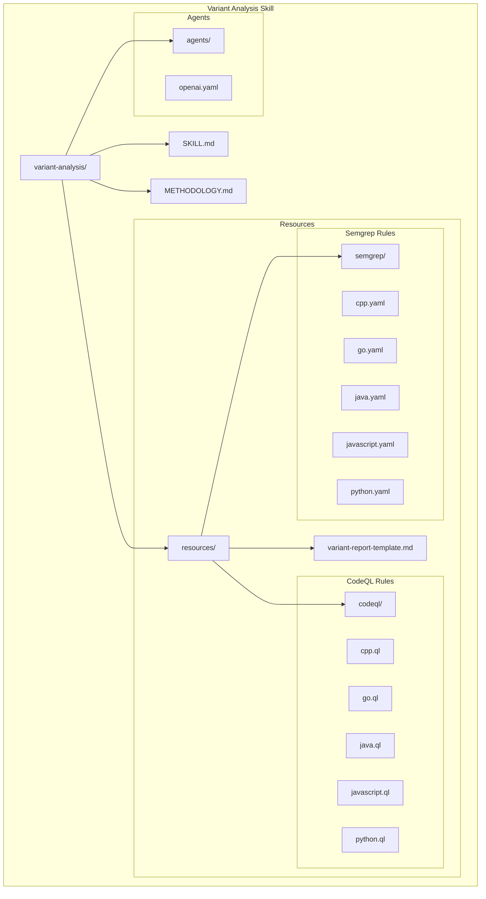
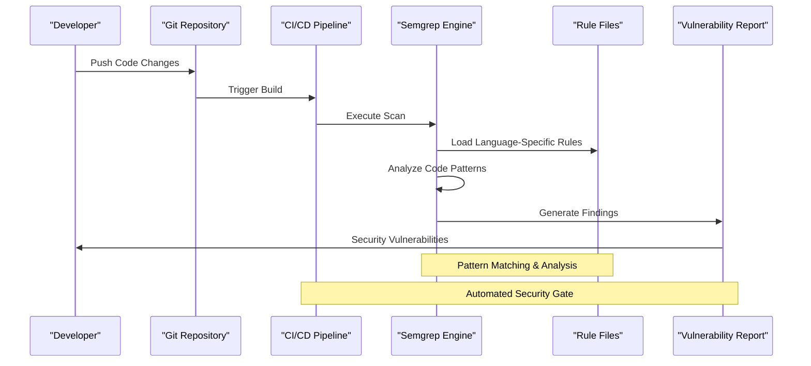
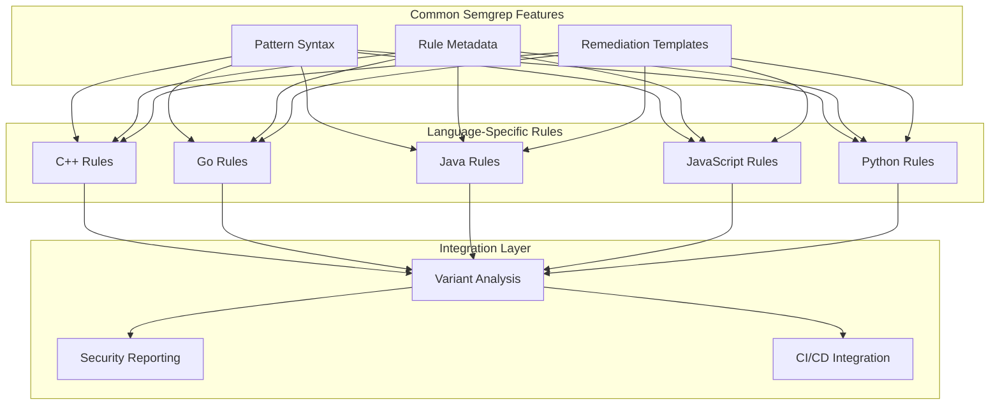

# Semgrep Rule Configuration

<cite>
**Referenced Files in This Document**
- [cpp.yaml](file://skills/variant-analysis/resources/semgrep/cpp.yaml)
- [go.yaml](file://skills/variant-analysis/resources/semgrep/go.yaml)
- [java.yaml](file://skills/variant-analysis/resources/semgrep/java.yaml)
- [javascript.yaml](file://skills/variant-analysis/resources/semgrep/javascript.yaml)
- [python.yaml](file://skills/variant-analysis/resources/semgrep/python.yaml)
- [SKILL.md](file://skills/variant-analysis/SKILL.md)
- [METHODOLOGY.md](file://skills/variant-analysis/METHODOLOGY.md)
</cite>

## Table of Contents
1. [Introduction](#introduction)
2. [Project Structure](#project-structure)
3. [Core Components](#core-components)
4. [Architecture Overview](#architecture-overview)
5. [Detailed Component Analysis](#detailed-component-analysis)
6. [Dependency Analysis](#dependency-analysis)
7. [Performance Considerations](#performance-considerations)
8. [Troubleshooting Guide](#troubleshooting-guide)
9. [Conclusion](#conclusion)
10. [Appendices](#appendices)

## Introduction

This document provides comprehensive guidance for configuring and using Semgrep rules within the variant analysis skill. It covers pattern matching syntax, severity levels, fix suggestions, custom rule development, testing methodologies, performance optimization, security pattern detection, rule composition techniques, and CI/CD integration strategies.

The variant analysis skill leverages Semgrep to detect security vulnerabilities across multiple programming languages including C++, Go, Java, JavaScript, and Python. Each language has dedicated rule files that define specific security patterns and remediation suggestions.

## Project Structure

The Semgrep rule configuration is organized within the variant analysis skill under a structured directory layout:



**Diagram sources**
- [SKILL.md](file://skills/variant-analysis/SKILL.md)
- [METHODOLOGY.md](file://skills/variant-analysis/METHODOLOGY.md)

**Section sources**
- [SKILL.md](file://skills/variant-analysis/SKILL.md)
- [METHODOLOGY.md](file://skills/variant-analysis/METHODOLOGY.md)

## Core Components

### Semgrep Rule Architecture

Each language-specific Semgrep rule file follows a standardized YAML structure that defines security patterns, metadata, and remediation guidance. The core components include:

#### Rule Metadata
- **id**: Unique identifier for the rule
- **message**: Human-readable description of the vulnerability
- **severity**: Risk level (ERROR, WARNING, INFO)
- **languages**: Target programming language(s)
- **tags**: Categorization tags for filtering and reporting

#### Pattern Matching Engine
- **patterns**: Code pattern definitions using Semgrep's pattern syntax
- **pattern-either**: Alternative pattern matching
- **pattern-inside**: Contextual pattern constraints
- **pattern-not**: Negative pattern matching

#### Fix Suggestions
- **fix**: Automated remediation code snippets
- **fix-regex**: Regular expression-based fixes
- **metadata**: Additional context and references

### Supported Languages

The variant analysis skill supports Semgrep rules for five primary programming languages:

| Language | File Path | Primary Use Cases |
|----------|-----------|-------------------|
| C++ | `cpp.yaml` | Memory safety, buffer overflows, pointer arithmetic |
| Go | `go.yaml` | Concurrency issues, error handling, crypto usage |
| Java | `java.yaml` | SQL injection, XSS, deserialization vulnerabilities |
| JavaScript | `javascript.yaml` | XSS, prototype pollution, insecure dependencies |
| Python | `python.yaml` | Command injection, unsafe eval, path traversal |

**Section sources**
- [cpp.yaml](file://skills/variant-analysis/resources/semgrep/cpp.yaml)
- [go.yaml](file://skills/variant-analysis/resources/semgrep/go.yaml)
- [java.yaml](file://skills/variant-analysis/resources/semgrep/java.yaml)
- [javascript.yaml](file://skills/variant-analysis/resources/semgrep/javascript.yaml)
- [python.yaml](file://skills/variant-analysis/resources/semgrep/python.yaml)

## Architecture Overview

The Semgrep rule system integrates with the variant analysis workflow through a multi-layered architecture:



**Diagram sources**
- [SKILL.md](file://skills/variant-analysis/SKILL.md)
- [METHODOLOGY.md](file://skills/variant-analysis/METHODOLOGY.md)

## Detailed Component Analysis

### C++ Security Rules

C++ rules focus on memory safety vulnerabilities and low-level security issues:

#### Key Security Patterns
- Buffer overflow prevention
- Pointer validation and bounds checking
- Memory leak detection
- Unsafe function usage identification

#### Pattern Matching Examples
- String manipulation functions without bounds checking
- Raw pointer operations without proper validation
- Deprecated or unsafe API calls

#### Severity Classification
- **ERROR**: Critical memory safety violations
- **WARNING**: Potential security risks requiring review
- **INFO**: Best practice recommendations

### Go Security Rules

Go-specific rules address concurrency-related security issues and common pitfalls:

#### Concurrency Security
- Race condition detection in shared state access
- Goroutine leak prevention patterns
- Channel misuse identification

#### Error Handling Security
- Unhandled error propagation
- Insecure error message exposure
- Missing input validation

#### Cryptographic Usage
- Weak cryptographic algorithm detection
- Improper key management patterns
- Insecure random number generation

### Java Security Rules

Java rules target enterprise application security concerns:

#### Injection Vulnerabilities
- SQL injection prevention patterns
- Cross-site scripting (XSS) mitigation
- Command injection detection

#### Deserialization Security
- Unsafe object deserialization
- Insecure serialization formats
- Class loading vulnerabilities

#### Authentication & Authorization
- Weak authentication mechanisms
- Insecure session management
- Privilege escalation patterns

### JavaScript Security Rules

JavaScript rules focus on web application security:

#### Client-Side Security
- DOM-based XSS prevention
- Prototype pollution detection
- Insecure third-party library usage

#### Server-Side Security
- Node.js specific vulnerabilities
- Express.js middleware security
- Database query sanitization

#### Dependency Management
- Known vulnerable package detection
- Outdated dependency warnings
- Supply chain attack vectors

### Python Security Rules

Python rules address common scripting and web framework vulnerabilities:

#### Input Validation
- Command injection prevention
- Path traversal detection
- SQL injection mitigation

#### Web Framework Security
- Django/Flask specific vulnerabilities
- Template injection detection
- CSRF protection patterns

#### Data Processing Security
- Pickle deserialization risks
- XML parsing vulnerabilities
- File upload security

**Section sources**
- [cpp.yaml](file://skills/variant-analysis/resources/semgrep/cpp.yaml)
- [go.yaml](file://skills/variant-analysis/resources/semgrep/go.yaml)
- [java.yaml](file://skills/variant-analysis/resources/semgrep/java.yaml)
- [javascript.yaml](file://skills/variant-analysis/resources/semgrep/javascript.yaml)
- [python.yaml](file://skills/variant-analysis/resources/semgrep/python.yaml)

## Dependency Analysis

The Semgrep rule system maintains clear separation between language-specific implementations while sharing common patterns and best practices:



**Diagram sources**
- [cpp.yaml](file://skills/variant-analysis/resources/semgrep/cpp.yaml)
- [go.yaml](file://skills/variant-analysis/resources/semgrep/go.yaml)
- [java.yaml](file://skills/variant-analysis/resources/semgrep/java.yaml)
- [javascript.yaml](file://skills/variant-analysis/resources/semgrep/javascript.yaml)
- [python.yaml](file://skills/variant-analysis/resources/semgrep/python.yaml)

**Section sources**
- [cpp.yaml](file://skills/variant-analysis/resources/semgrep/cpp.yaml)
- [go.yaml](file://skills/variant-analysis/resources/semgrep/go.yaml)
- [java.yaml](file://skills/variant-analysis/resources/semgrep/java.yaml)
- [javascript.yaml](file://skills/variant-analysis/resources/semgrep/javascript.yaml)
- [python.yaml](file://skills/variant-analysis/resources/semgrep/python.yaml)

## Performance Considerations

### Rule Optimization Strategies

#### Pattern Efficiency
- Use specific patterns rather than broad matches
- Leverage language-specific AST patterns when available
- Minimize nested pattern complexity
- Utilize pattern guards for early filtering

#### Scanning Performance
- Configure parallel scanning for large codebases
- Implement incremental scanning for CI/CD pipelines
- Use targeted file globs to limit scan scope
- Cache rule compilation results

#### Memory Management
- Optimize pattern matching algorithms
- Implement efficient result aggregation
- Manage large codebase scanning resources
- Balance rule granularity with performance impact

### Best Practices for High-Performance Rules

1. **Pattern Specificity**: Write precise patterns that match minimal necessary code
2. **Early Filtering**: Use language and file type filters before complex pattern matching
3. **Result Limiting**: Implement reasonable limits on matched results per rule
4. **Parallel Execution**: Enable concurrent rule evaluation where possible
5. **Incremental Scanning**: Support delta scanning for CI/CD environments

## Troubleshooting Guide

### Common Issues and Solutions

#### Rule Not Matching
- Verify pattern syntax against Semgrep documentation
- Check language compatibility and version support
- Validate file encoding and line ending formats
- Test patterns with sample code snippets

#### Performance Problems
- Profile rule execution time using Semgrep's built-in profiling
- Identify overly broad patterns causing excessive matches
- Review rule composition for redundant checks
- Consider splitting complex rules into simpler components

#### False Positives
- Add negative patterns to exclude legitimate use cases
- Refine pattern specificity to reduce noise
- Implement contextual analysis where possible
- Use severity levels appropriately

#### Integration Issues
- Verify Semgrep version compatibility
- Check environment variable configuration
- Validate file permissions and access rights
- Review CI/CD pipeline configuration

### Debugging Techniques

#### Pattern Testing
- Use Semgrep's interactive mode for pattern development
- Test rules against known vulnerable and safe code samples
- Utilize the Semgrep playground for rapid prototyping
- Implement unit tests for critical security rules

#### Performance Profiling
- Enable detailed logging for rule execution analysis
- Monitor memory usage during large codebase scans
- Track rule execution times and identify bottlenecks
- Analyze scan coverage and effectiveness metrics

**Section sources**
- [SKILL.md](file://skills/variant-analysis/SKILL.md)
- [METHODOLOGY.md](file://skills/variant-analysis/METHODOLOGY.md)

## Conclusion

The Semgrep rule configuration in the variant analysis skill provides a comprehensive security scanning framework across multiple programming languages. By following the established patterns, leveraging language-specific optimizations, and implementing robust testing methodologies, teams can effectively detect and remediate security vulnerabilities throughout their development lifecycle.

The modular architecture allows for easy extension with new language support and custom rule development, while maintaining consistent quality standards and performance characteristics. Integration with CI/CD pipelines ensures continuous security monitoring and automated vulnerability detection.

## Appendices

### Custom Rule Development Guide

#### Rule Structure Template
```yaml
id: unique-rule-identifier
message: "Descriptive message about the security issue"
severity: ERROR|WARNING|INFO
languages: [language]
tags: [security, category]
patterns:
  - pattern: your-pattern-here
    # Additional pattern configuration
fix: |
  # Suggested fix code
metadata:
  references:
    - https://reference-url
```

#### Testing Methodology
1. Create test cases covering both vulnerable and safe code patterns
2. Validate rule accuracy against known vulnerability databases
3. Measure false positive and false negative rates
4. Perform performance benchmarking on representative codebases
5. Document expected behavior and edge cases

#### CI/CD Integration Examples
- GitHub Actions workflow configuration
- Jenkins pipeline integration
- GitLab CI/CD setup
- Azure DevOps pipeline configuration

[No sources needed since this section provides general guidance]