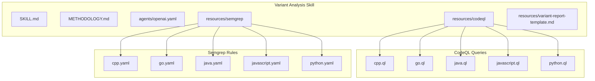
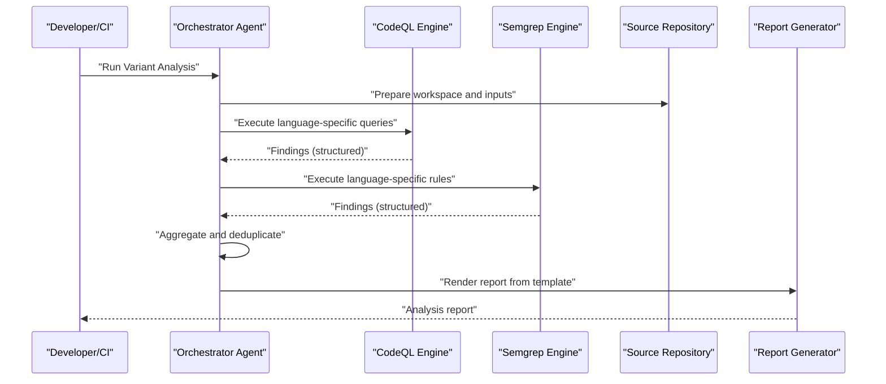
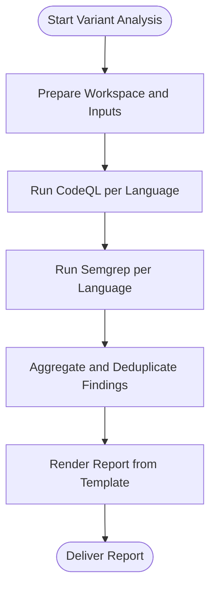
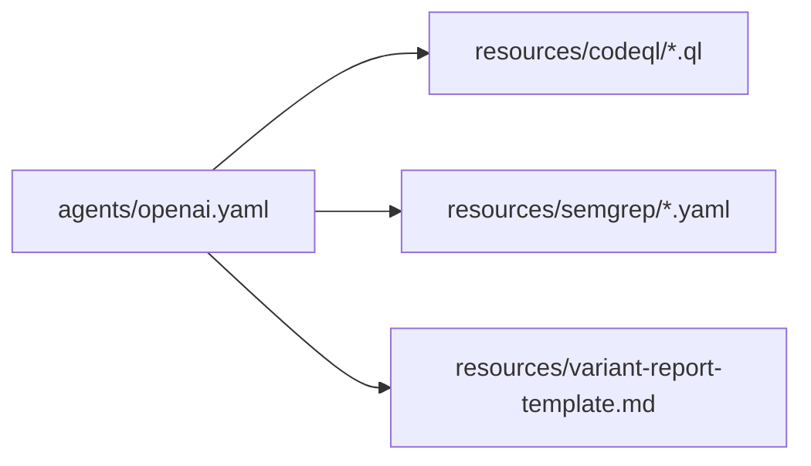

# Variant Analysis Skill

<cite>
**Referenced Files in This Document**
- [SKILL.md](file://skills/variant-analysis/SKILL.md)
- [METHODOLOGY.md](file://skills/variant-analysis/METHODOLOGY.md)
- [agents/openai.yaml](file://skills/variant-analysis/agents/openai.yaml)
- [resources/codeql/cpp.ql](file://skills/variant-analysis/resources/codeql/cpp.ql)
- [resources/codeql/go.ql](file://skills/variant-analysis/resources/codeql/go.ql)
- [resources/codeql/java.ql](file://skills/variant-analysis/resources/codeql/java.ql)
- [resources/codeql/javascript.ql](file://skills/variant-analysis/resources/codeql/javascript.ql)
- [resources/codeql/python.ql](file://skills/variant-analysis/resources/codeql/python.ql)
- [resources/semgrep/cpp.yaml](file://skills/variant-analysis/resources/semgrep/cpp.yaml)
- [resources/semgrep/go.yaml](file://skills/variant-analysis/resources/semgrep/go.yaml)
- [resources/semgrep/java.yaml](file://skills/variant-analysis/resources/semgrep/java.yaml)
- [resources/semgrep/javascript.yaml](file://skills/variant-analysis/resources/semgrep/javascript.yaml)
- [resources/semgrep/python.yaml](file://skills/variant-analysis/resources/semgrep/python.yaml)
- [resources/variant-report-template.md](file://skills/variant-analysis/resources/variant-report-template.md)
</cite>

## Table of Contents
1. [Introduction](#introduction)
2. [Project Structure](#project-structure)
3. [Core Components](#core-components)
4. [Architecture Overview](#architecture-overview)
5. [Detailed Component Analysis](#detailed-component-analysis)
6. [Dependency Analysis](#dependency-analysis)
7. [Performance Considerations](#performance-considerations)
8. [Troubleshooting Guide](#troubleshooting-guide)
9. [Conclusion](#conclusion)
10. [Appendices](#appendices)

## Introduction
This document describes the Variant Analysis skill, which performs security vulnerability scanning across multiple programming languages using CodeQL and Semgrep. It explains the methodology, supported languages (C++, Go, Java, JavaScript, Python), rule configurations, analysis workflows, report generation, and how to integrate these capabilities into CI/CD pipelines. It also provides guidance for interpreting results and creating custom rules.

## Project Structure
The Variant Analysis skill is organized under skills/variant-analysis with:
- SKILL.md: High-level skill description and usage overview
- METHODOLOGY.md: Detailed methodology for variant analysis
- agents/openai.yaml: Agent configuration for orchestration
- resources/codeql: Language-specific CodeQL query files
- resources/semgrep: Language-specific Semgrep rule sets
- resources/variant-report-template.md: Markdown template used to generate analysis reports

**Diagram sources**
- [SKILL.md](file://skills/variant-analysis/SKILL.md)
- [METHODOLOGY.md](file://skills/variant-analysis/METHODOLOGY.md)
- [agents/openai.yaml](file://skills/variant-analysis/agents/openai.yaml)
- [resources/codeql/cpp.ql](file://skills/variant-analysis/resources/codeql/cpp.ql)
- [resources/codeql/go.ql](file://skills/variant-analysis/resources/codeql/go.ql)
- [resources/codeql/java.ql](file://skills/variant-analysis/resources/codeql/java.ql)
- [resources/codeql/javascript.ql](file://skills/variant-analysis/resources/codeql/javascript.ql)
- [resources/codeql/python.ql](file://skills/variant-analysis/resources/codeql/python.ql)
- [resources/semgrep/cpp.yaml](file://skills/variant-analysis/resources/semgrep/cpp.yaml)
- [resources/semgrep/go.yaml](file://skills/variant-analysis/resources/semgrep/go.yaml)
- [resources/semgrep/java.yaml](file://skills/variant-analysis/resources/semgrep/java.yaml)
- [resources/semgrep/javascript.yaml](file://skills/variant-analysis/resources/semgrep/javascript.yaml)
- [resources/semgrep/python.yaml](file://skills/variant-analysis/resources/semgrep/python.yaml)
- [resources/variant-report-template.md](file://skills/variant-analysis/resources/variant-report-template.md)

**Section sources**
- [SKILL.md](file://skills/variant-analysis/SKILL.md)
- [METHODOLOGY.md](file://skills/variant-analysis/METHODOLOGY.md)
- [agents/openai.yaml](file://skills/variant-analysis/agents/openai.yaml)

## Core Components
- Methodology guide: Describes the approach to identifying variants of vulnerabilities across codebases and prioritizing findings.
- Orchestration agent: Configured via an agent YAML file to coordinate tooling and workflow steps.
- CodeQL queries: Language-specific queries that detect patterns indicative of security issues.
- Semgrep rules: Language-specific rule sets that complement CodeQL by targeting additional patterns and fast-path checks.
- Report template: Standardized Markdown structure for producing consistent analysis reports.

Key responsibilities:
- Define the analysis scope and language targets
- Execute CodeQL and Semgrep scans
- Aggregate and deduplicate findings
- Generate a structured report for triage and remediation

**Section sources**
- [METHODOLOGY.md](file://skills/variant-analysis/METHODOLOGY.md)
- [agents/openai.yaml](file://skills/variant-analysis/agents/openai.yaml)
- [resources/variant-report-template.md](file://skills/variant-analysis/resources/variant-report-template.md)

## Architecture Overview
The Variant Analysis skill orchestrates two complementary scanners—CodeQL and Semgrep—per language, then consolidates results into a unified report. The agent coordinates execution, while language-specific rule sets drive detection.

**Diagram sources**
- [agents/openai.yaml](file://skills/variant-analysis/agents/openai.yaml)
- [resources/codeql/cpp.ql](file://skills/variant-analysis/resources/codeql/cpp.ql)
- [resources/codeql/go.ql](file://skills/variant-analysis/resources/codeql/go.ql)
- [resources/codeql/java.ql](file://skills/variant-analysis/resources/codeql/java.ql)
- [resources/codeql/javascript.ql](file://skills/variant-analysis/resources/codeql/javascript.ql)
- [resources/codeql/python.ql](file://skills/variant-analysis/resources/codeql/python.ql)
- [resources/semgrep/cpp.yaml](file://skills/variant-analysis/resources/semgrep/cpp.yaml)
- [resources/semgrep/go.yaml](file://skills/variant-analysis/resources/semgrep/go.yaml)
- [resources/semgrep/java.yaml](file://skills/variant-analysis/resources/semgrep/java.yaml)
- [resources/semgrep/javascript.yaml](file://skills/variant-analysis/resources/semgrep/javascript.yaml)
- [resources/semgrep/python.yaml](file://skills/variant-analysis/resources/semgrep/python.yaml)
- [resources/variant-report-template.md](file://skills/variant-analysis/resources/variant-report-template.md)

## Detailed Component Analysis

### Methodology
The methodology defines how to identify variants of known vulnerabilities, prioritize risk, and ensure coverage across languages. It guides:
- Scope selection and target languages
- Combining static analysis results with contextual information
- Deduplication and correlation strategies
- Reporting and triage workflows

**Section sources**
- [METHODOLOGY.md](file://skills/variant-analysis/METHODOLOGY.md)

### Orchestration Agent
The agent configuration centralizes control flow for running the analysis pipeline, including:
- Selecting active languages
- Invoking CodeQL and Semgrep engines
- Managing artifacts and outputs
- Rendering the final report

**Section sources**
- [agents/openai.yaml](file://skills/variant-analysis/agents/openai.yaml)

### CodeQL Query Files
Language-specific CodeQL queries implement deep program analysis to detect security-relevant patterns. Each file corresponds to a supported language:
- C++: cpp.ql
- Go: go.ql
- Java: java.ql
- JavaScript: javascript.ql
- Python: python.ql

These queries are executed against compiled or analyzed codebases to produce structured findings.

**Section sources**
- [resources/codeql/cpp.ql](file://skills/variant-analysis/resources/codeql/cpp.ql)
- [resources/codeql/go.ql](file://skills/variant-analysis/resources/codeql/go.ql)
- [resources/codeql/java.ql](file://skills/variant-analysis/resources/codeql/java.ql)
- [resources/codeql/javascript.ql](file://skills/variant-analysis/resources/codeql/javascript.ql)
- [resources/codeql/python.ql](file://skills/variant-analysis/resources/codeql/python.ql)

### Semgrep Rule Sets
Complementary Semgrep rules provide fast pattern-based detection across languages:
- C++: cpp.yaml
- Go: go.yaml
- Java: java.yaml
- JavaScript: javascript.yaml
- Python: python.yaml

These rules target common insecure patterns and can be tuned for performance and precision.

**Section sources**
- [resources/semgrep/cpp.yaml](file://skills/variant-analysis/resources/semgrep/cpp.yaml)
- [resources/semgrep/go.yaml](file://skills/variant-analysis/resources/semgrep/go.yaml)
- [resources/semgrep/java.yaml](file://skills/variant-analysis/resources/semgrep/java.yaml)
- [resources/semgrep/javascript.yaml](file://skills/variant-analysis/resources/semgrep/javascript.yaml)
- [resources/semgrep/python.yaml](file://skills/variant-analysis/resources/semgrep/python.yaml)

### Report Generation
The report template standardizes output format for consistency and readability. It includes sections for:
- Executive summary
- Findings by language
- Risk classification and severity
- Remediation guidance
- Artifacts and references

**Section sources**
- [resources/variant-report-template.md](file://skills/variant-analysis/resources/variant-report-template.md)

### Workflow Sequence
The end-to-end workflow integrates agent orchestration, scanner execution, aggregation, and reporting.

**Diagram sources**
- [agents/openai.yaml](file://skills/variant-analysis/agents/openai.yaml)
- [resources/variant-report-template.md](file://skills/variant-analysis/resources/variant-report-template.md)

## Dependency Analysis
The skill’s dependencies are primarily internal to the repository:
- Orchestrator depends on agent configuration
- Scanners depend on language-specific rule/query files
- Report generator depends on the report template

**Diagram sources**
- [agents/openai.yaml](file://skills/variant-analysis/agents/openai.yaml)
- [resources/codeql/cpp.ql](file://skills/variant-analysis/resources/codeql/cpp.ql)
- [resources/codeql/go.ql](file://skills/variant-analysis/resources/codeql/go.ql)
- [resources/codeql/java.ql](file://skills/variant-analysis/resources/codeql/java.ql)
- [resources/codeql/javascript.ql](file://skills/variant-analysis/resources/codeql/javascript.ql)
- [resources/codeql/python.ql](file://skills/variant-analysis/resources/codeql/python.ql)
- [resources/semgrep/cpp.yaml](file://skills/variant-analysis/resources/semgrep/cpp.yaml)
- [resources/semgrep/go.yaml](file://skills/variant-analysis/resources/semgrep/go.yaml)
- [resources/semgrep/java.yaml](file://skills/variant-analysis/resources/semgrep/java.yaml)
- [resources/semgrep/javascript.yaml](file://skills/variant-analysis/resources/semgrep/javascript.yaml)
- [resources/semgrep/python.yaml](file://skills/variant-analysis/resources/semgrep/python.yaml)
- [resources/variant-report-template.md](file://skills/variant-analysis/resources/variant-report-template.md)

**Section sources**
- [agents/openai.yaml](file://skills/variant-analysis/agents/openai.yaml)

## Performance Considerations
- Prefer Semgrep for fast, broad-spectrum checks; use CodeQL for deeper, context-sensitive analysis.
- Limit scan scope to relevant directories or modules to reduce runtime.
- Tune Semgrep rules to minimize false positives and improve throughput.
- Parallelize per-language scans where possible.
- Cache intermediate artifacts (e.g., CodeQL databases) when re-running analyses.

[No sources needed since this section provides general guidance]

## Troubleshooting Guide
Common issues and resolutions:
- Missing language support: Ensure the appropriate CodeQL database setup and Semgrep language packs are installed for each target language.
- Excessive false positives: Adjust Semgrep rule sensitivity and refine CodeQL predicates to better match project patterns.
- Slow scans: Narrow input scope, disable non-essential rules, and leverage incremental builds where available.
- Inconsistent reports: Validate that the report template is present and correctly referenced by the orchestrator.

**Section sources**
- [agents/openai.yaml](file://skills/variant-analysis/agents/openai.yaml)
- [resources/variant-report-template.md](file://skills/variant-analysis/resources/variant-report-template.md)

## Conclusion
The Variant Analysis skill combines CodeQL and Semgrep to deliver comprehensive, multi-language security scanning. With a clear methodology, standardized reporting, and modular rule sets, it supports both rapid feedback in development and rigorous analysis in CI/CD environments. Extending coverage involves adding new language-specific queries and rules, and integrating the orchestrator into your pipeline for automated execution.

[No sources needed since this section summarizes without analyzing specific files]

## Appendices

### Supported Languages and Rule Locations
- C++
  - CodeQL: [resources/codeql/cpp.ql](file://skills/variant-analysis/resources/codeql/cpp.ql)
  - Semgrep: [resources/semgrep/cpp.yaml](file://skills/variant-analysis/resources/semgrep/cpp.yaml)
- Go
  - CodeQL: [resources/codeql/go.ql](file://skills/variant-analysis/resources/codeql/go.ql)
  - Semgrep: [resources/semgrep/go.yaml](file://skills/variant-analysis/resources/semgrep/go.yaml)
- Java
  - CodeQL: [resources/codeql/java.ql](file://skills/variant-analysis/resources/codeql/java.ql)
  - Semgrep: [resources/semgrep/java.yaml](file://skills/variant-analysis/resources/semgrep/java.yaml)
- JavaScript
  - CodeQL: [resources/codeql/javascript.ql](file://skills/variant-analysis/resources/codeql/javascript.ql)
  - Semgrep: [resources/semgrep/javascript.yaml](file://skills/variant-analysis/resources/semgrep/javascript.yaml)
- Python
  - CodeQL: [resources/codeql/python.ql](file://skills/variant-analysis/resources/codeql/python.ql)
  - Semgrep: [resources/semgrep/python.yaml](file://skills/variant-analysis/resources/semgrep/python.yaml)

### Custom Rule Creation Guidance
- For Semgrep:
  - Identify insecure patterns and express them as concise rules in the corresponding language YAML file.
  - Use targeted metavariables and path filters to reduce noise.
- For CodeQL:
  - Extend existing queries or add new ones in the language-specific .ql file.
  - Focus on data flow and taint analysis where applicable to capture complex variants.

**Section sources**
- [resources/semgrep/cpp.yaml](file://skills/variant-analysis/resources/semgrep/cpp.yaml)
- [resources/semgrep/go.yaml](file://skills/variant-analysis/resources/semgrep/go.yaml)
- [resources/semgrep/java.yaml](file://skills/variant-analysis/resources/semgrep/java.yaml)
- [resources/semgrep/javascript.yaml](file://skills/variant-analysis/resources/semgrep/javascript.yaml)
- [resources/semgrep/python.yaml](file://skills/variant-analysis/resources/semgrep/python.yaml)
- [resources/codeql/cpp.ql](file://skills/variant-analysis/resources/codeql/cpp.ql)
- [resources/codeql/go.ql](file://skills/variant-analysis/resources/codeql/go.ql)
- [resources/codeql/java.ql](file://skills/variant-analysis/resources/codeql/java.ql)
- [resources/codeql/javascript.ql](file://skills/variant-analysis/resources/codeql/javascript.ql)
- [resources/codeql/python.ql](file://skills/variant-analysis/resources/codeql/python.ql)

### Interpreting Analysis Results
- Review the generated report to understand:
  - Severity and confidence levels
  - Affected files and lines
  - Suggested mitigations and references
- Correlate CodeQL and Semgrep findings to reduce duplicates and confirm high-confidence issues.
- Prioritize remediation based on exploitability and business impact.

**Section sources**
- [resources/variant-report-template.md](file://skills/variant-analysis/resources/variant-report-template.md)

### CI/CD Integration Examples
- Add a step to run the orchestrator with selected languages.
- Capture artifacts (findings, logs, report).
- Gate merges on critical findings thresholds.
- Publish reports as build artifacts or attach to pull requests.

**Section sources**
- [agents/openai.yaml](file://skills/variant-analysis/agents/openai.yaml)