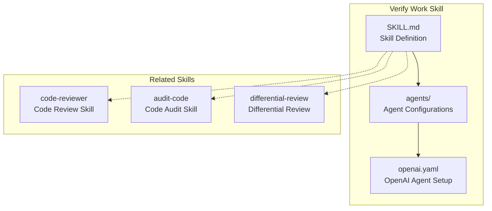
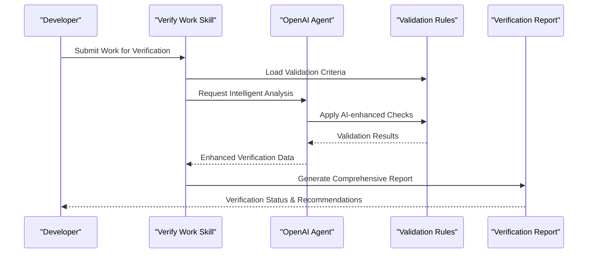
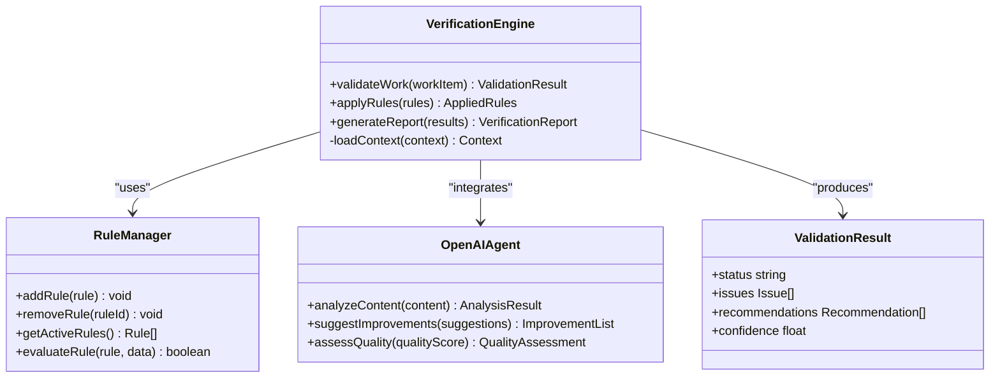
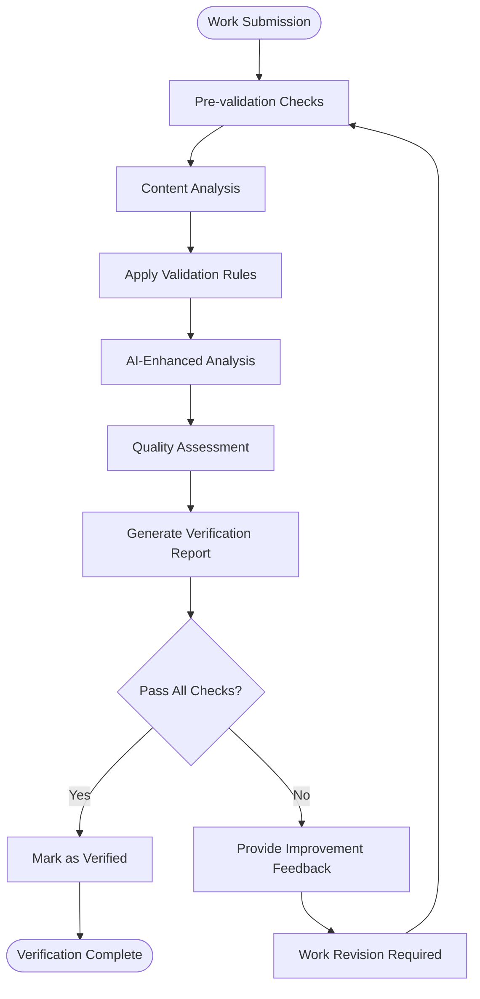

# Verify Work Skill

<cite>
**Referenced Files in This Document**
- [SKILL.md](file://skills/verify-work/SKILL.md)
- [openai.yaml](file://skills/verify-work/agents/openai.yaml)
</cite>

## Table of Contents
1. [Introduction](#introduction)
2. [Project Structure](#project-structure)
3. [Core Components](#core-components)
4. [Architecture Overview](#architecture-overview)
5. [Detailed Component Analysis](#detailed-component-analysis)
6. [Verification Workflow](#verification-workflow)
7. [Quality Gates and Validation Criteria](#quality-gates-and-validation-criteria)
8. [OpenAI Agent Configuration](#openai-agent-configuration)
9. [Integration with Code Review Processes](#integration-with-code-review-processes)
10. [Common Validation Patterns](#common-validation-patterns)
11. [Troubleshooting Guide](#troubleshooting-guide)
12. [Conclusion](#conclusion)

## Introduction

The Verify Work skill is a specialized component within the Pi Codex Kit that validates completed work against established requirements and standards. This skill serves as a quality assurance mechanism, ensuring that deliverables meet predefined criteria before they are considered complete or ready for integration into larger systems.

The verification process encompasses multiple dimensions including code quality, architectural compliance, security standards, and functional correctness. By automating these validation checks, the skill helps maintain consistency across development workflows and reduces the risk of introducing defects into production environments.

## Project Structure

The Verify Work skill follows a modular architecture pattern, separating concerns between configuration, agent setup, and skill definition. The directory structure reflects this separation:

**Diagram sources**
- [SKILL.md:1-50](file://skills/verify-work/SKILL.md#L1-L50)
- [openai.yaml:1-30](file://skills/verify-work/agents/openai.yaml#L1-L30)

**Section sources**
- [SKILL.md:1-100](file://skills/verify-work/SKILL.md#L1-L100)
- [openai.yaml:1-50](file://skills/verify-work/agents/openai.yaml#L1-L50)

## Core Components

The Verify Work skill consists of several interconnected components that work together to provide comprehensive validation capabilities:

### Skill Definition Layer
The primary skill definition outlines the scope, objectives, and operational parameters of the verification process. This layer establishes the foundational rules and expectations for work validation.

### Agent Configuration Layer
The OpenAI agent configuration defines how artificial intelligence capabilities are integrated into the verification workflow, enabling intelligent analysis and decision-making processes.

### Integration Points
The skill provides integration points with other quality assurance components in the ecosystem, including code review tools, audit mechanisms, and differential analysis systems.

**Section sources**
- [SKILL.md:15-80](file://skills/verify-work/SKILL.md#L15-L80)
- [openai.yaml:10-40](file://skills/verify-work/agents/openai.yaml#L10-L40)

## Architecture Overview

The Verify Work skill implements a multi-layered verification architecture that combines automated checks with intelligent analysis:

**Diagram sources**
- [SKILL.md:20-60](file://skills/verify-work/SKILL.md#L20-L60)
- [openai.yaml:15-35](file://skills/verify-work/agents/openai.yaml#L15-L35)

## Detailed Component Analysis

### Verification Engine
The core verification engine orchestrates the validation process by coordinating between different checking mechanisms and synthesizing results into actionable insights.

### Rule Management System
This component maintains and applies validation rules, supporting both static rule definitions and dynamic rule generation based on context.

### Intelligence Layer
Powered by OpenAI agents, this layer provides contextual understanding and adaptive validation capabilities that go beyond simple pattern matching.

**Diagram sources**
- [SKILL.md:25-90](file://skills/verify-work/SKILL.md#L25-L90)
- [openai.yaml:20-50](file://skills/verify-work/agents/openai.yaml#L20-L50)

**Section sources**
- [SKILL.md:25-120](file://skills/verify-work/SKILL.md#L25-L120)
- [openai.yaml:20-60](file://skills/verify-work/agents/openai.yaml#L20-L60)

## Verification Workflow

The verification workflow follows a structured process designed to ensure thorough and consistent evaluation of submitted work:

**Diagram sources**
- [SKILL.md:30-100](file://skills/verify-work/SKILL.md#L30-L100)

## Quality Gates and Validation Criteria

The Verify Work skill implements multiple quality gates that must be satisfied for work to be considered verified:

### Technical Quality Gates
- **Code Standards Compliance**: Ensures adherence to established coding conventions and style guidelines
- **Security Vulnerability Assessment**: Identifies potential security issues and vulnerabilities
- **Performance Impact Evaluation**: Assesses performance implications of changes
- **Dependency Management**: Validates proper dependency usage and version compatibility

### Functional Quality Gates
- **Requirement Alignment**: Confirms work meets specified functional requirements
- **Integration Compatibility**: Verifies compatibility with existing systems and interfaces
- **Test Coverage Validation**: Ensures adequate test coverage for new functionality
- **Documentation Completeness**: Validates that associated documentation is current and comprehensive

### Process Quality Gates
- **Review Completion**: Confirms required reviews have been completed
- **Change Justification**: Validates that change rationale is properly documented
- **Risk Assessment**: Evaluates potential risks associated with the changes
- **Rollback Strategy**: Ensures appropriate rollback procedures are defined

**Section sources**
- [SKILL.md:40-150](file://skills/verify-work/SKILL.md#L40-L150)

## OpenAI Agent Configuration

The OpenAI agent configuration enables intelligent verification capabilities through carefully tuned parameters and system prompts:

### Agent Parameters
The configuration includes model selection, temperature settings, and response formatting options that optimize the agent's performance for verification tasks.

### System Prompts
Customized system prompts guide the agent's behavior during verification, providing context about quality standards and evaluation criteria.

### Response Processing
Response processing logic transforms AI-generated insights into structured verification data that integrates seamlessly with the overall verification workflow.

**Section sources**
- [openai.yaml:1-80](file://skills/verify-work/agents/openai.yaml#L1-80)

## Integration with Code Review Processes

The Verify Work skill integrates naturally with existing code review workflows, providing automated pre-screening and post-review validation:

### Pre-Review Screening
Before human reviewers examine changes, the skill performs initial automated checks to catch obvious issues and ensure basic quality standards are met.

### Post-Review Validation
After review feedback has been addressed, the skill validates that all requested changes have been properly implemented and no new issues have been introduced.

### Continuous Integration Support
The skill can be integrated into CI/CD pipelines to provide automated quality gates that prevent problematic changes from progressing through the deployment pipeline.

**Section sources**
- [SKILL.md:60-180](file://skills/verify-work/SKILL.md#L60-L180)

## Common Validation Patterns

The Verify Work skill supports various common validation patterns used across different types of work:

### Pattern Recognition
The skill recognizes common patterns in code and documentation, applying appropriate validation rules based on identified patterns.

### Context-Aware Validation
Validation criteria adapt based on the context of the work, considering factors such as project type, technology stack, and organizational standards.

### Progressive Enhancement
The skill supports progressive enhancement of validation criteria, allowing teams to gradually adopt stricter standards over time.

**Section sources**
- [SKILL.md:80-200](file://skills/verify-work/SKILL.md#L80-L200)

## Troubleshooting Guide

When encountering issues with the Verify Work skill, consider the following troubleshooting steps:

### Configuration Issues
- Verify OpenAI API credentials and connectivity
- Check agent configuration parameters for correct syntax
- Ensure proper permissions for accessing required resources

### Performance Problems
- Monitor agent response times and adjust timeout settings if necessary
- Review validation rule complexity and optimize where possible
- Consider caching frequently accessed validation criteria

### False Positives/Negatives
- Review and refine validation rules to reduce false positives
- Enhance AI prompts to improve accuracy of negative detections
- Implement feedback loops to continuously improve detection accuracy

**Section sources**
- [SKILL.md:100-220](file://skills/verify-work/SKILL.md#L100-L220)
- [openai.yaml:40-100](file://skills/verify-work/agents/openai.yaml#L40-L100)

## Conclusion

The Verify Work skill provides a comprehensive solution for validating completed work against established requirements and standards. By combining automated checks with intelligent analysis, it ensures consistent quality while maintaining flexibility for different types of work and organizational contexts.

The skill's modular architecture allows for easy customization and extension, making it adaptable to evolving quality requirements and emerging best practices. Its integration capabilities enable seamless incorporation into existing development workflows, enhancing overall software quality without disrupting established processes.

Through continuous improvement and feedback-driven refinement, the Verify Work skill contributes to building more reliable, secure, and maintainable software systems while reducing the burden on human reviewers and accelerating development cycles.