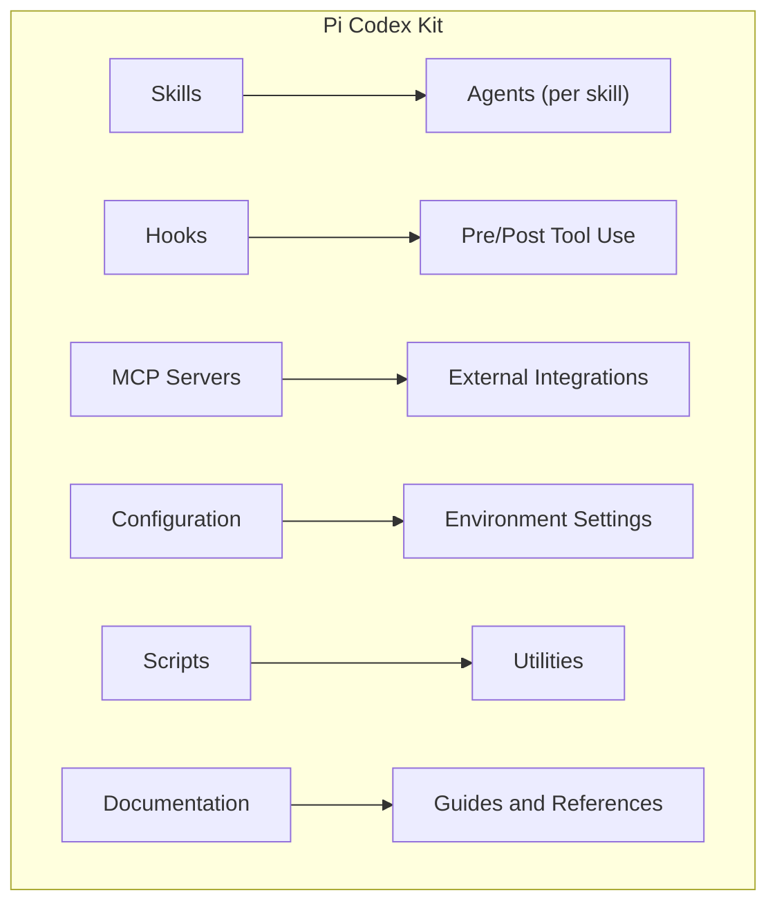
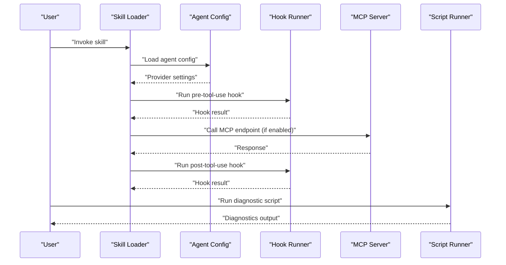
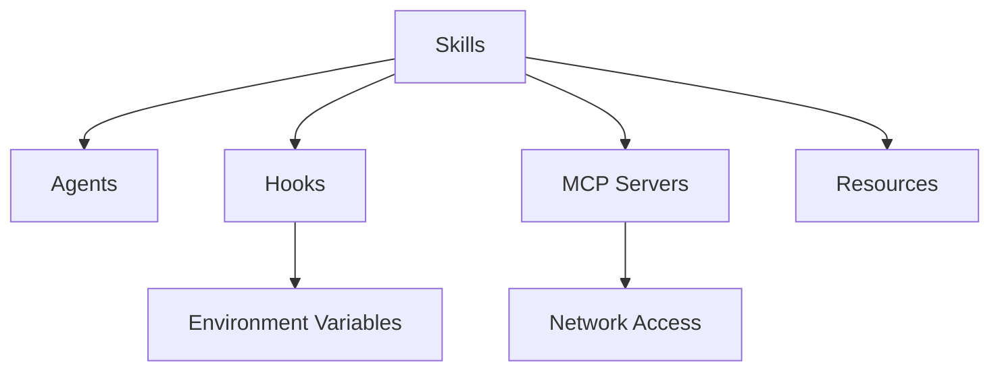

# Troubleshooting & FAQ

<cite>
**Referenced Files in This Document**
- [README.md](file://README.md)
- [skills/README.md](file://skills/README.md)
- [hooks/README.md](file://hooks/README.md)
- [mcp-servers/README.md](file://mcp-servers/README.md)
- [codex-config/README.md](file://codex-config/README.md)
- [pi-lens/README.md](file://pi-lens/README.md)
- [scripts/README.md](file://scripts/README.md)
- [agents-md/README.md](file://agents-md/README.md)
</cite>

## Table of Contents
1. [Introduction](#introduction)
2. [Project Structure](#project-structure)
3. [Core Components](#core-components)
4. [Architecture Overview](#architecture-overview)
5. [Detailed Component Analysis](#detailed-component-analysis)
6. [Dependency Analysis](#dependency-analysis)
7. [Performance Considerations](#performance-considerations)
8. [Troubleshooting Guide](#troubleshooting-guide)
9. [FAQ](#faq)
10. [Conclusion](#conclusion)
11. [Appendices](#appendices)

## Introduction
This document provides comprehensive troubleshooting guidance and frequently asked questions for the Pi Codex Kit. It focuses on installation, configuration, runtime errors, debugging techniques, logging configuration, performance profiling, platform-specific issues, and escalation procedures. The content is organized to help both new and experienced users diagnose and resolve common problems efficiently.

## Project Structure
The repository is a modular toolkit centered around skills, hooks, MCP servers, configuration, and supporting documentation. Key areas include:
- Skills: Reusable agent workflows with associated agents and resources
- Hooks: Pre/post tool-use and reminder scripts
- MCP Servers: External server integrations
- Configuration: Centralized settings and environment setup
- Scripts: Utility and automation helpers
- Documentation: READMEs and guides for each component

[No sources needed since this diagram shows conceptual structure]

## Core Components
- Skills: Encapsulate domain-specific workflows and agent configurations. Each skill typically includes an SKILL.md and an agents directory with provider-specific definitions.
- Hooks: Provide lifecycle integration points such as pre-tool-use reminders or post-processing logic.
- MCP Servers: Enable external model context protocol integrations.
- Configuration: Centralizes environment variables, paths, and feature flags.
- Scripts: Offer reusable utilities for automation and diagnostics.
- Documentation: Provides usage instructions, methodology, and references.

**Section sources**
- [skills/README.md](file://skills/README.md)
- [hooks/README.md](file://hooks/README.md)
- [mcp-servers/README.md](file://mcp-servers/README.md)
- [codex-config/README.md](file://codex-config/README.md)
- [scripts/README.md](file://scripts/README.md)
- [agents-md/README.md](file://agents-md/README.md)

## Architecture Overview
At runtime, the system loads skills and their agents, applies hooks around tool use, integrates with MCP servers when configured, and reads configuration from centralized settings. Scripts can be invoked for diagnostics or automation.

[No sources needed since this diagram shows conceptual workflow]

## Detailed Component Analysis

### Skills
- Purpose: Define reusable workflows with associated agent configurations and optional resources.
- Common issues:
  - Missing or misconfigured agent files under agents/
  - Incorrect provider credentials or endpoints
  - Incompatible skill versions with the runtime
- Resolution steps:
  - Verify that each skill has a valid SKILL.md and an agents/openai.yaml (or equivalent).
  - Confirm provider keys and endpoints are set in configuration.
  - Check version compatibility between skills and the runtime.

**Section sources**
- [skills/README.md](file://skills/README.md)

### Hooks
- Purpose: Execute custom logic before or after tool use, including reminders and validations.
- Common issues:
  - Hook scripts not found or not executable
  - Syntax errors in hook modules
  - Environment variables missing within hook context
- Resolution steps:
  - Ensure hooks are present and referenced correctly.
  - Validate syntax and dependencies of hook modules.
  - Export required environment variables in the hook execution context.

**Section sources**
- [hooks/README.md](file://hooks/README.md)

### MCP Servers
- Purpose: Integrate external services via the Model Context Protocol.
- Common issues:
  - Server unreachable or misconfigured endpoints
  - Authentication failures
  - Version mismatches between client and server
- Resolution steps:
  - Verify network connectivity and firewall rules.
  - Confirm authentication tokens and scopes.
  - Align client/server versions per compatibility matrix.

**Section sources**
- [mcp-servers/README.md](file://mcp-servers/README.md)

### Configuration
- Purpose: Centralize environment variables, paths, and feature flags.
- Common issues:
  - Missing environment variables
  - Incorrect file paths or permissions
  - Conflicting settings across environments
- Resolution steps:
  - Review all required variables and defaults.
  - Validate file paths and read/write permissions.
  - Isolate environment-specific overrides.

**Section sources**
- [codex-config/README.md](file://codex-config/README.md)

### Scripts
- Purpose: Provide utility commands for diagnostics, automation, and maintenance.
- Common issues:
  - Scripts not in PATH or not executable
  - Missing dependencies
  - Incorrect invocation parameters
- Resolution steps:
  - Add scripts directory to PATH or invoke with full path.
  - Install required dependencies.
  - Consult script help flags for correct usage.

**Section sources**
- [scripts/README.md](file://scripts/README.md)

### Agents Documentation
- Purpose: Describe agent behavior, capabilities, and constraints.
- Common issues:
  - Misunderstanding agent scope or limitations
  - Incorrect prompt templates or parameters
- Resolution steps:
  - Read agent documentation thoroughly.
  - Adjust prompts and parameters according to guidelines.

**Section sources**
- [agents-md/README.md](file://agents-md/README.md)

## Dependency Analysis
- Internal dependencies:
  - Skills depend on agent configurations and may reference hooks and scripts.
  - Hooks may rely on environment variables and shared utilities.
  - MCP clients depend on server availability and authentication.
- External dependencies:
  - Provider SDKs for agent backends
  - Network access for MCP servers
  - System tools invoked by scripts

[No sources needed since this diagram shows conceptual relationships]

## Performance Considerations
- Reduce unnecessary tool calls by refining skill prompts and agent parameters.
- Cache repeated results where appropriate using scripts or external caches.
- Profile long-running operations by enabling detailed logs and measuring durations.
- Limit concurrent MCP requests to avoid rate limits and timeouts.

[No sources needed since this section provides general guidance]

## Troubleshooting Guide

### Installation Issues
- Symptom: Repository fails to initialize or load components.
- Steps:
  - Verify prerequisites and supported platforms.
  - Confirm file permissions and ownership.
  - Re-run initialization with verbose output.

**Section sources**
- [README.md](file://README.md)

### Configuration Problems
- Symptom: Runtime errors due to missing or invalid settings.
- Steps:
  - List required environment variables and validate values.
  - Check configuration precedence and overrides.
  - Test connectivity to external services.

**Section sources**
- [codex-config/README.md](file://codex-config/README.md)

### Runtime Errors
- Symptom: Failures during skill execution or tool use.
- Steps:
  - Inspect logs for stack traces and error codes.
  - Validate agent configuration files.
  - Reproduce with minimal inputs to isolate the issue.

**Section sources**
- [hooks/README.md](file://hooks/README.md)
- [mcp-servers/README.md](file://mcp-servers/README.md)

### Debugging Techniques
- Enable verbose logging and capture request/response payloads.
- Use scripts to dump environment state and dependency versions.
- Step through hooks to verify pre/post conditions.

**Section sources**
- [scripts/README.md](file://scripts/README.md)

### Logging Configuration
- Configure log levels and destinations.
- Rotate logs and retain sufficient history for analysis.
- Correlate logs across components using consistent identifiers.

**Section sources**
- [codex-config/README.md](file://codex-config/README.md)

### Performance Profiling
- Measure latency for MCP calls and tool invocations.
- Identify hotspots in hooks and scripts.
- Tune concurrency and retry policies.

**Section sources**
- [scripts/README.md](file://scripts/README.md)

### Platform-Specific Issues
- Windows:
  - Ensure scripts are executable and line endings are compatible.
  - Validate PATH and environment variable expansion.
- macOS/Linux:
  - Check shebang lines and execute permissions.
  - Resolve library path issues for native dependencies.

**Section sources**
- [scripts/README.md](file://scripts/README.md)

### Diagnostic Commands
- Run health checks for MCP servers and providers.
- Dump configuration and environment snapshot.
- Trigger skill dry-run mode to validate inputs.

**Section sources**
- [scripts/README.md](file://scripts/README.md)

### Log Analysis Guidance
- Search for error codes and exception types.
- Trace request IDs across components.
- Aggregate logs by skill and agent for pattern recognition.

**Section sources**
- [hooks/README.md](file://hooks/README.md)

### Escalation Procedures
- Collect environment snapshots, logs, and reproduction steps.
- Include skill and agent versions, provider details, and MCP server status.
- Open an issue with structured information and attach artifacts.

**Section sources**
- [README.md](file://README.md)

## FAQ

### How do I enable or disable a specific skill?
- Locate the skill’s configuration entry and toggle its activation flag.
- Restart the runtime if required.

**Section sources**
- [skills/README.md](file://skills/README.md)

### Why does my agent return unexpected outputs?
- Review agent prompts and parameters.
- Validate provider credentials and model selection.
- Check for conflicting global settings.

**Section sources**
- [agents-md/README.md](file://agents-md/README.md)

### How can I integrate a new MCP server?
- Add server configuration and credentials.
- Test connectivity and authentication.
- Update skill mappings to use the new server.

**Section sources**
- [mcp-servers/README.md](file://mcp-servers/README.md)

### What should I do if a hook fails silently?
- Enable verbose logging for hooks.
- Validate script syntax and dependencies.
- Run the hook independently to inspect errors.

**Section sources**
- [hooks/README.md](file://hooks/README.md)

### How do I troubleshoot permission errors?
- Verify file and directory permissions.
- Ensure the runtime user has necessary access.
- Adjust security policies if enforced by the platform.

**Section sources**
- [scripts/README.md](file://scripts/README.md)

### How can I profile slow operations?
- Instrument critical sections with timing markers.
- Capture metrics for MCP calls and tool executions.
- Analyze profiles to identify bottlenecks.

**Section sources**
- [scripts/README.md](file://scripts/README.md)

### Where can I find community resources and support channels?
- Refer to the main README for links to documentation, forums, and issue trackers.
- Engage with community discussions and share reproducible cases.

**Section sources**
- [README.md](file://README.md)

## Conclusion
Use this guide to systematically diagnose and resolve issues across installation, configuration, runtime, and integration layers. Leverage diagnostics, logging, and profiling to improve reliability and performance. When needed, escalate with complete context and artifacts to expedite resolution.

## Appendices

### Quick Reference: Common Checks
- Verify environment variables and configuration precedence.
- Confirm provider credentials and MCP server reachability.
- Validate skill and agent configurations.
- Inspect logs for actionable errors and trace IDs.

[No sources needed since this section provides general guidance]